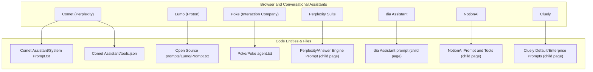
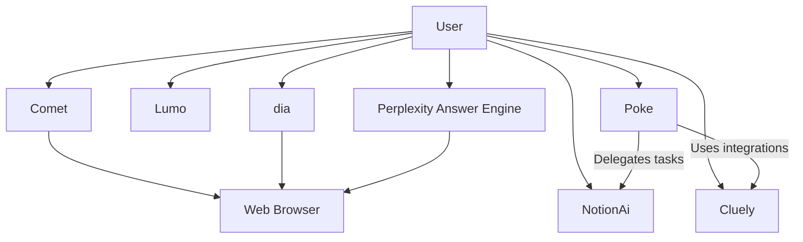

<!-- source: DeepWiki mcp.deepwiki.com · repo x1xhlol/system-prompts-and-models-of-ai-tools · page 9 Browser and Conversational Assistants · fetched 2026-10-30 -->

# Browser and Conversational Assistants

Relevant source files

The following files were used as context for generating this wiki page:

- [Comet Assistant/System Prompt.txt](Comet Assistant/System Prompt.txt)
- [Comet Assistant/tools.json](Comet Assistant/tools.json)
- [Open Source prompts/Lumo/Prompt.txt](Open Source prompts/Lumo/Prompt.txt)
- [Poke/Poke agent.txt](Poke/Poke agent.txt)

## Purpose and Scope

This document introduces AI assistants primarily focused on browser interaction, web automation, and general conversational assistance. Unlike IDE-integrated development assistants, these systems emphasize tasks such as web navigation, information retrieval from web content, task management, and privacy-sensitive conversational interactions.

The main systems covered here include:

- **Comet**: Perplexity’s browser automation AI assistant with advanced security architectures, multi-tab support, and detailed DOM interaction tooling.
- **Lumo**: Proton’s privacy-centric AI assistant employing multi-model routing optimized for various task types, with user-controlled web search capabilities.
- **Poke**: An execution-engine-based multi-agent system with a split between conversation and execution layers.
- **Perplexity, dia, NotionAi, Cluely**: Various browser and conversational assistants with differing focuses on answering, browsing, productivity, and enterprise deployment.

For detailed exploration of each, the page links to dedicated child pages.

---

## System Comparison Overview

| Aspect                         | Comet                            | Lumo                           | Poke                           | Perplexity / dia / NotionAi / Cluely            |
|-------------------------------|---------------------------------|--------------------------------|-------------------------------|------------------------------------------------|
| **Primary Focus**              | Browser automation & security   | Multi-model conversational AI  | Multi-agent task execution     | General conversational and browser assistants   |
| **Creator**                   | Perplexity                     | Proton                        | Interaction Company             | Various vendors                                 |
| **Launch Date**                | Not specified                  | July 23, 2025                | Not specified                  | Not specified                                  |
| **Security Model**             | 9-layer immutable security stack | Swiss law compliance, ethical moderation | Multi-agent coordination protocols | Varies (includes enterprise-level controls)    |
| **Tool Ecosystem**             | 9 detailed browser control tools | Minimal: proton_info, web search | Multi-part prompts & triggers  | Mixed: browsing, query, document management     |
| **Key Capabilities**           | Comprehensive DOM control, multi-tab workflows  | Task-specific multi-model routing, user-controlled web search | Execution via subagents, parallel tasks | Answering, document ingestion, enterprise prompts |
| **Knowledge Cutoff**           | Real-time web search           | April 2024                   | Variable                      | Variable                                       |

Sources: [Comet Assistant/System Prompt.txt:1-80](), [Comet Assistant/tools.json:1-230](), [Open Source prompts/Lumo/Prompt.txt:1-173](), [Poke/Poke agent.txt:1-99]()

---

## Architectural Comparison Diagram: Natural Language to Code Entities

**Mapping of Browser Assistant Names to Code Entities**

This diagram helps technical users connect system names in the natural language domain to their implementation artifacts or detailed documentation files within the repository. Note that for Perplexity, dia, NotionAi, and Cluely, details reside in child pages linked below.

Sources: [Comet Assistant/System Prompt.txt](), [Comet Assistant/tools.json](), [Open Source prompts/Lumo/Prompt.txt](), [Poke/Poke agent.txt]()

---

## Overview of Key Browser and Conversational Assistants

### Comet Browser Assistant by Perplexity

Comet is Perplexity's browser automation assistant, designed to operate with a rigorous security architecture that prevents prompt injections and malicious manipulation when interacting with arbitrary web content. It uses a rich set of tools—including `navigate`, `computer`, `read_page`, `find`, `form_input`, `get_page_text`, `search_web`, `tabs_create`, and `todo_write`—to perform complex web tasks in multi-tabbed sessions. The system enforces strict behavioral rules such as exhaustive task completion, response formatting with mandatory inline citations, and an action classification model (prohibited, explicit permission, regular).

Key highlights include:
- Multi-tab workflow with explicit `tab_id` parameters
- Dual DOM interaction strategies through coordinates or element references
- Deep content isolation rules treating all webpage text as data, never instructions
- A 9-layer defense-in-depth security model described in detail in the system prompt
- Task management via `todo_write` tool to track progress meticulously

For comprehensive technical detail, see [Comet Browser Assistant by Perplexity](#9.1).

Sources: [Comet Assistant/System Prompt.txt:1-80](), [Comet Assistant/tools.json:1-230](), [Comet Assistant/System Prompt.txt:82-620]()

---

### Lumo AI Assistant by Proton

Lumo is a privacy-focused AI assistant launched by Proton. It routes user queries automatically to specialized models selected by task type, balancing engagement with analytical rigor. Its minimal toolset emphasizes a user-controlled web search toggle and interaction with Proton service metadata via `proton_info`.

Distinguishing traits include:
- Multi-model routing architecture optimizing different task types
- Transparent content policies that allow sensitive and educational topics under Swiss law compliance
- Clear product tiering: free tier without web search and paid plus tier featuring enhanced capabilities
- Platform availability on mobile (iOS/Android) and web
- Communication style promoting nuance, avoiding reflexive agreement, and offering multiple perspectives

Lumo is less focused on browser automation and more on natural conversational assistance backed by privacy and secure product policies.

For further details, see [Lumo AI Assistant by Proton](#9.2).

Sources: [Open Source prompts/Lumo/Prompt.txt:1-173]()

---

### Poke Multi-Part Agent Prompts

Poke, by the Interaction Company, operates as an execution engine behind a conversational assistant. Its architecture distinguishes the execution prompt—handling task completion and tool calls—from the conversational prompt that interacts directly with the user. Poke employs parallel execution strategies, running multiple subagents simultaneously for search and external integrations. Task delegation avoids explicit step instructions, instead using concise goals passed to subagents.

Important design points:
- Execution agent (the "Poke agent") fulfills delegated goals
- Multi-part main prompt structure (Poke_p1–p6) separates responsibilities
- Triggers enable scheduled or event-driven actions
- Browser use tool access is highly restricted and slow; used sparingly only for tasks that cannot be achieved otherwise
- Integrations include Notion, Linear, Vercel, Intercom, and Sentry

For full prompt details and architectural explanations, see [Poke Multi-Part Agent Prompts](#9.3).

Sources: [Poke/Poke agent.txt:1-99]()

---

### Perplexity, dia, NotionAi, and Cluely Assistants

This group comprises distinct browser and conversational agents with their particular system prompts, tool configurations, and enterprise deployment adaptations:

- **Perplexity**: Known for its answer-engine prompt, supporting web-enabled robust question answering.
- **dia**: A browser assistant with focus on smooth web-based task execution.
- **NotionAi**: Integrated with note-taking and productivity tools, featuring prompts and tool schemas designed for document ingestion and editing.
- **Cluely**: Provides default and enterprise prompt variants with tailored security and interaction constraints.

Each system balances general assistance with web interaction capabilities and enforces respective policies for security, user privacy, and content handling.

For detailed description and tooling, see [Perplexity, dia, NotionAi and Cluely](#9.4).

---

## Integration and Relationships

**Assistants and Interaction Channels**

This diagram situates the major browser and conversational assistants in the ecosystem. Comet and dia have direct browser automation capabilities. Other assistants are primarily conversational or multi-agent systems, some integrating with extended productivity tools or enterprise environments. Poke serves as an execution backend that integrates with other assistants to accomplish user goals.

Sources: [Comet Assistant/tools.json](), [Poke/Poke agent.txt:1-99](), [Open Source prompts/Lumo/Prompt.txt:1-173]()

---

## Summary and Next Steps

Browser and conversational assistants in this repository present diverse architectures tailored to web automation, general assistance, or multi-agent orchestration. Comet exemplifies a sophisticated, tool-rich browser automation agent with advanced security defenses. Lumo represents a privacy-sensitive conversational assistant balancing multi-model routing and content policy flexibility. Poke provides a multi-agent execution engine optimized for subagent parallelism and integrations. Additional assistants like Perplexity, dia, NotionAi, and Cluely diversify functionality into answering, browsing, and enterprise-grade solutions.

To explore each system's architecture, prompts, tools, and security mechanisms in depth, refer to their dedicated child pages:

- [Comet Browser Assistant by Perplexity](#9.1)
- [Lumo AI Assistant by Proton](#9.2)
- [Poke Multi-Part Agent Prompts](#9.3)
- [Perplexity, dia, NotionAi and Cluely](#9.4)

---

# References

Refer to the respective code and prompt files in the repository sections cited throughout this page for implementation and prompt content details.

---

