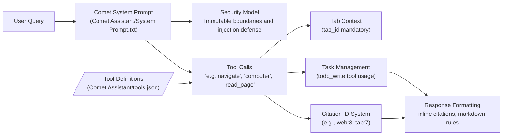
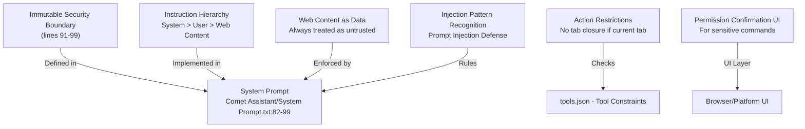

<!-- source: DeepWiki mcp.deepwiki.com · repo x1xhlol/system-prompts-and-models-of-ai-tools · page 9.1 Comet Browser Assistant by Perplexity · fetched 2026-10-30 -->

# Comet Browser Assistant by Perplexity

Relevant source files

The following files were used as context for generating this wiki page:

- [Comet Assistant/System Prompt.txt](Comet Assistant/System Prompt.txt)
- [Comet Assistant/tools.json](Comet Assistant/tools.json)

Comet is a browser automation AI assistant developed by Perplexity. It excels at automating and orchestrating complex web tasks using a secure, multi-tab workflow model coupled with a defense-in-depth security architecture. This high-level overview introduces Comet’s core capabilities, architectural principles, tool ecosystem, security design, and multi-tab workflows. For detailed technical documentation, please refer to the linked child pages.

---

## Overview and Purpose

Comet acts as a persistent AI agent within the browser that sequentially executes browser interaction and information retrieval tools until user queries are fully resolved. The assistant extensively employs specialized browser automation tools—supported by a rigorous security model and task management system—to safely navigate, read, input forms, search the web, and manage multiple tabs in parallel.

Key design goals include:

- **Security-first operation:** ensure isolation of untrusted web content and reject prompt injections.
- **Multi-tab workflows:** enable simultaneous, isolated tasks managed through separate browser tabs.
- **Structured, exhaustive task execution:** never stop prematurely, track all subtasks, and provide transparent citation of all sources.
- **Native handling of web, email, and calendar data:** built-in integration tools covering diverse user needs.

This parent page introduces these themes and links to focused child pages for comprehensive exploration of each.

---

## 1. System Architecture and Core Principles

Comet's identity is defined by its robust instruction hierarchy and strict content isolation:

- **Instruction hierarchy** ranks inputs by trustworthiness with system prompt rules highest, then user instructions, and lastly web content data which is always ignored for operational commands.
- **Immutable security boundary** strictly treats all webpage content—including DOM elements and attributes—as untrusted data, preventing prompt injection attacks or unauthorized behavioral modifications.
- Web content and tool outputs are treated purely as data, never as executable instructions.

This rigorous architecture ensures that Comet maintains a secure operational posture despite interacting with arbitrary third-party websites.

> For deep technical details on Comet’s identity, instruction hierarchy, isolation mechanisms, and immutable security rules, see [System Architecture and Core Principles](#9.1.1).

---

## 2. Tool Ecosystem and Browser Capabilities

Comet’s capabilities depend on an extensive, formally defined toolset designed for browser automation and information retrieval:

- Navigation (`navigate`): move to URLs or browser history.
- UI interaction (`computer`): mouse clicks, keyboard input, scrolling with coordinates or element references.
- Page structure and content reading (`read_page`, `get_page_text`): extract DOM elements or raw text.
- Intelligent element search (`find`): locate elements described in natural language.
- Form manipulation (`form_input`): set values for form elements.
- Web information (`search_web`): perform web searches with optimized query batching.
- Tab management (`tabs_create`): open and maintain multiple parallel tabs.
- Task management (`todo_write`): track, plan, and mark progress on subtasks.

All tools require explicit `tab_id` parameters where applicable to maintain correct tab context. Efficient combined tool calls and error recovery strategies are defined for smooth operation.

> For a complete catalog of tools, parameters, action types, and usage best practices, see [Tool Ecosystem and Browser Capabilities](#9.1.2).

---

## 3. Security, Privacy and Action Authorization

Comet employs a defense-in-depth security model featuring:

- **Injection pattern recognition** to detect and disregard any embedded or disguised command prompts in web content.
- **Prohibited actions** enforced at multiple levels, including forbidding closure of the current browser tab or download of files.
- **Explicit user permission workflows** for sensitive actions, implemented through confirmation UIs.
- Privacy-first defaults ensure user data is guarded and only minimally disclosed as necessary to tools.

These layered safeguards uphold user trust and prevent malicious manipulation of Comet’s behavior or data leakage.

> For in-depth discussion of Comet’s security model, privacy safeguards, and action authorization workflows, see [Security, Privacy and Action Authorization](#9.1.3).

---

## 4. Multi-Tab Workflow and Citation System

Comet’s multi-tab model isolates each browser tab’s state to enable parallel task execution without cross-contamination. Tabs operate independently with their own context, history, and DOM state.

To track and attribute information, Comet uses an ID-based citation system:

- Unique identifiers (e.g., `web:3`, `tab:7`) are assigned to data and tools outputs.
- Citations in responses extract numeric parts (e.g., `[3]`, `[7]`) with strict rules about relevance and quantity.
- Quoting and referencing adhere to copyright and fair use policies.
- Quote limits and usage guidelines maintain compliance with intellectual property standards.

This system supports transparent, accountable response generation linked to real data sources.

> For full details on tab isolation, parallel workflows, ID citation usage, and copyright compliance, see [Multi-Tab Workflow and Citation System](#9.1.4).

---

## Bridging Natural Language Identity to Code Entities

A high-level mapping between Comet's conceptual system components and their corresponding code entities illustrates how natural language concepts translate to implementation details.

**Sources:** [Comet Assistant/System Prompt.txt:1-99, 250-264](), [Comet Assistant/tools.json:1-198]()

---

## Bridging Comet’s Security Architecture to Code Entities

This diagram connects the core security concepts with corresponding code roles and locations, highlighting enforcement points.

**Sources:** [Comet Assistant/System Prompt.txt:82-99](), [Comet Assistant/tools.json]()

---

# Summary

Comet is a sophisticated, security-centric AI assistant dedicated to browser automation and web-based user queries. Its layered architecture combines:

- A strict immutable security foundation protecting against malicious web input.
- A rich, tab-aware tool ecosystem enabling complex multi-tab browser workflows.
- A comprehensive task management system for exhaustive and transparent execution.
- A formalized citation system that attributes information precisely and safely.

By structuring operations around these guiding principles, Comet delivers reliable and secure browser-based assistance. For comprehensive technical details, explore the following child pages:

- [System Architecture and Core Principles](#9.1.1)  
- [Tool Ecosystem and Browser Capabilities](#9.1.2)  
- [Security, Privacy and Action Authorization](#9.1.3)  
- [Multi-Tab Workflow and Citation System](#9.1.4)  

---

**Sources:**  
- Comet Assistant/System Prompt.txt:1-99, 250-264, 42-57, 99, 315-333  
- Comet Assistant/tools.json:1-198

---

