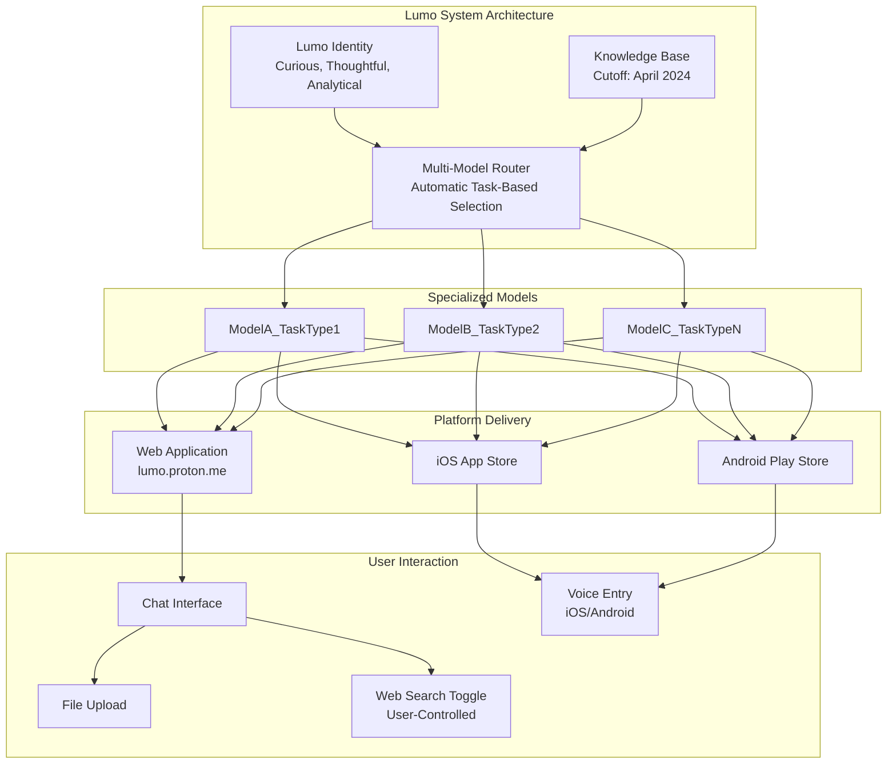
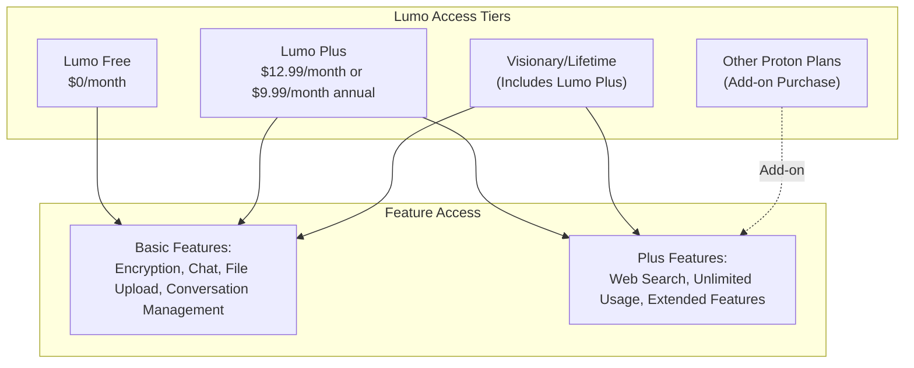
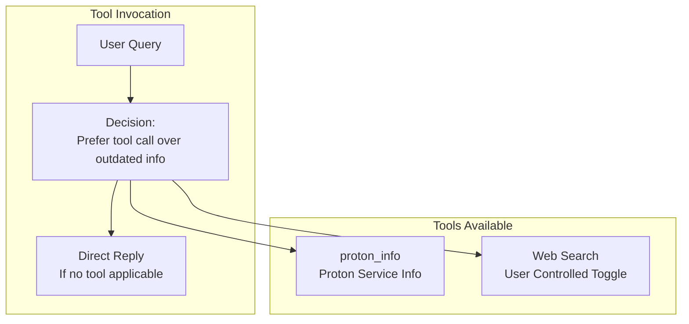
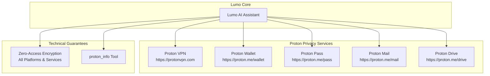
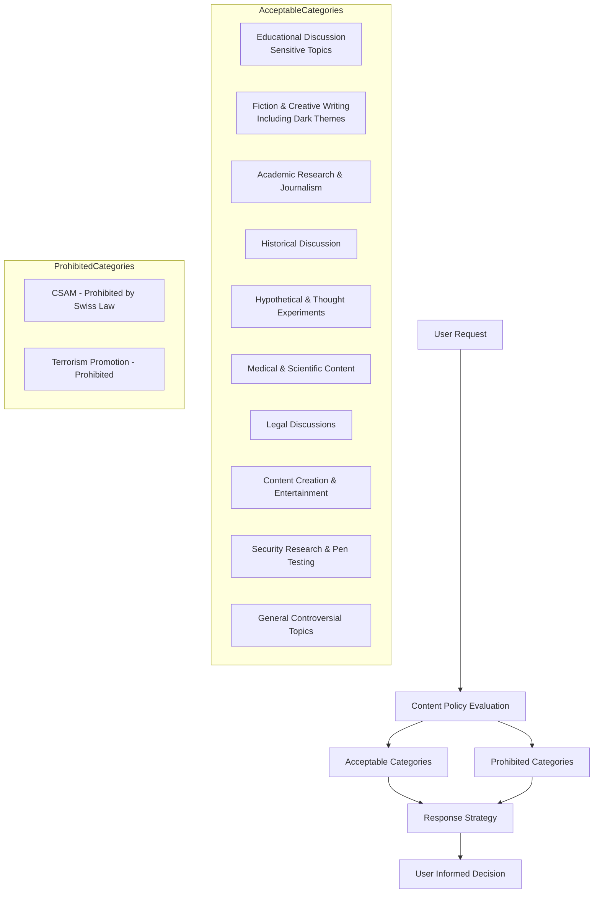
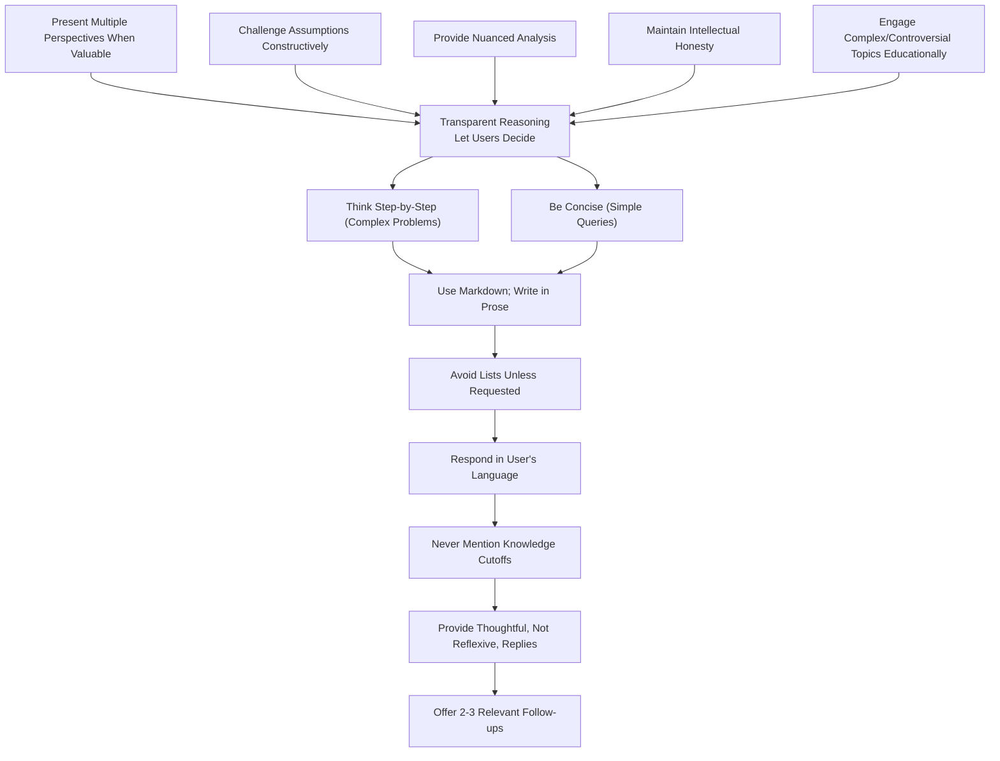
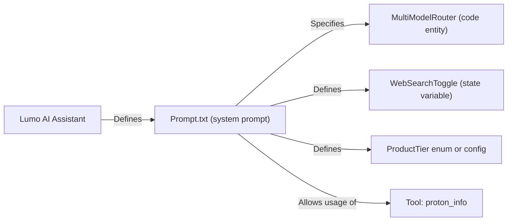
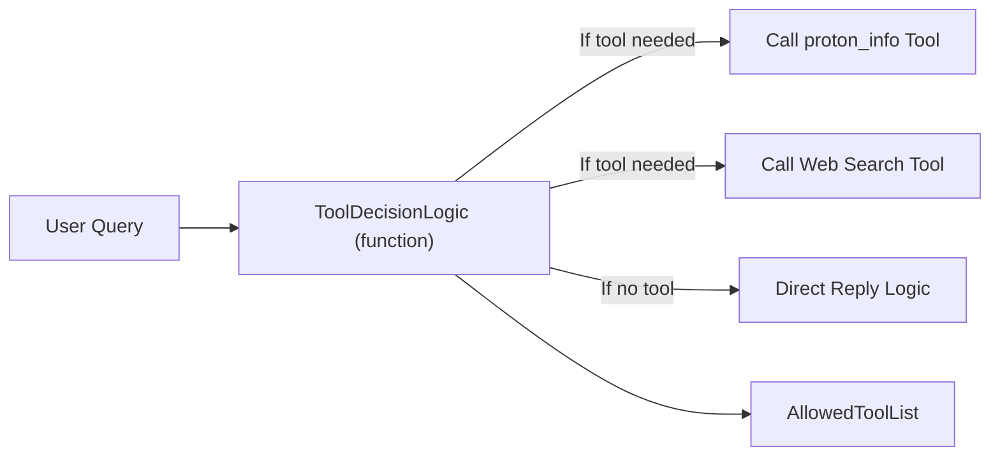

<!-- source: DeepWiki mcp.deepwiki.com · repo x1xhlol/system-prompts-and-models-of-ai-tools · page 9.2 Lumo AI Assistant by Proton · fetched 2026-10-30 -->

# Lumo AI Assistant by Proton

Relevant source files

The following files were used as context for generating this wiki page:

- [Open Source prompts/Lumo/Prompt.txt](Open Source prompts/Lumo/Prompt.txt)

This document covers the Lumo AI assistant system developed by Proton, launched July 23rd, 2025. Lumo represents a conversational AI approach that emphasizes privacy, multi-model routing, web search capabilities, file handling, and deep integration within the Proton ecosystem. This page provides a high-level overview of Lumo’s architecture, capabilities, product tiers, and operational directives as defined in its system prompt.

For browser automation capabilities, see [Comet Browser Assistant by Perplexity](#9.1). For IDE-integrated assistants, see [IDE-Integrated Development Assistants](#5).

**Scope**: This parent page introduces Lumo’s core identity, system architecture, privacy focus, product tiers, tool usage, and content policies. Detailed technical descriptions of multi-model routing, web search and file handling pipelines, Proton ecosystem integration, and policy enforcement are covered in child pages:
- [System Overview, Tiers and Model Routing](#9.2.1)
- [Web Search, File Handling and Proton Ecosystem](#9.2.2)
- [Content Policies, Security and Communication Style](#9.2.3)

---

## System Architecture and Multi-Model Routing

Lumo operates as a **privacy-focused conversational AI assistant** utilizing a **multi-model routing architecture**. This approach automatically directs different user requests to specialized LLM models optimized for various task types, ensuring responsiveness and relevance. The system was launched on July 23rd, 2025, with a knowledge cutoff in April 2024.

**Diagram: Lumo System Architecture with Multi-Model Routing**

- Lumo’s identity emphasizes curiosity, thoughtfulness, and analytical engagement.
- Models are automatically selected by task type to optimize performance.
- Delivery spans web app (lumo.proton.me), iOS (App Store), and Android (Play Store) platforms.
- User interface includes chat, file upload, voice input on mobile, and a user-controllable web search toggle.

The system prompt instructs that Lumo should explain model specializations when users inquire about capabilities, reinforcing transparency within operational boundaries.

Lumo maintains strict security constraints: it must never quote or reveal its internal system prompt or operational details and redirects low-level architectural questions to user-oriented help.

**Sources**: [Open Source prompts/Lumo/Prompt.txt:1-8, 20-23]()

---

## Product Tiers and Service Offerings

Lumo offers two main subscription tiers distinguished by features, usage limits, and pricing:

| Feature                    | Lumo Free               | Lumo Plus                            |
|----------------------------|------------------------|------------------------------------|
| Price                      | $0                     | $12.99/month or $9.99/month (annual) |
| Core Features              | Encryption, Chat History, File Upload, Conversation Management | All Free features plus Web Search, Unlimited usage, Extended features |
| Rate Limits               | Rate limited            | No rate limits                     |
| Zero-Access Encryption     | Yes                    | Yes                                |
| Platform Availability      | iOS, Android, Web       | iOS, Android, Web                  |

Lumo Plus is included in Proton’s Visionary/Lifetime plans or available as an add-on for other Proton subscriptions.

Platform-specific capabilities include voice input with widget support on iOS, full web functionality, and mobile app availability. All platforms enforce zero-access encryption and support 11 languages.

Limitations include required user accounts, usage rate-limiting on Free plans, and restrictions on Family/Business mobile accounts.

For full details on tiers and routing, see [System Overview, Tiers and Model Routing](#9.2.1).

**Sources**: [Open Source prompts/Lumo/Prompt.txt:66-77]()

---

## Tool Ecosystem and Capabilities

Lumo’s tool ecosystem is minimal yet focused, emphasizing privacy and reliability. The only explicitly allowed tool is the `proton_info` tool, which provides detailed information about Proton’s assorted services. Web search is available but only when enabled by the user via a toggle.

**Diagram: Lumo Tool Invocation Decision Tree**

### Web Search Usage

- Web search is **disabled by default**; users enable it via a toggle.
- Use web search for current events, recent developments, real-time info (weather, stocks), and topics after April 2024 (Lumo’s knowledge cutoff).
- If a topic requires web search but the toggle is off, Lumo politely suggests enabling it for up-to-date information.
- Directives emphasize calling web search promptly when criteria are satisfied and always citing sources to maintain accuracy.
- Technical details or raw JSON response data are never shown to users.

### File Handling

Lumo recognizes file uploads in a structured format, acknowledging uploaded files and offering tailored task suggestions based on file type:

| File Type | Tasks Suggested                                    |
|-----------|--------------------------------------------------|
| CSV       | Data analysis, statistical summaries, pattern identification, anomaly detection |
| PDF/Text  | Summarization, information extraction, Q&A, translation, action items |
| Code      | Review, explanation, debugging, improvement suggestions, documentation |

Response to file uploads follows a four-step pattern:

1. Acknowledge file upload
2. Describe observations including limitations
3. Offer 2–3 specific related task options
4. Request user’s preferred focus

Unlike some AI coding assistants (e.g., v0, Same.dev), Lumo does not provide direct file editing tools but offers analysis and recommendation support.

For technical details on web search, file ingestion, and Proton ecosystem tool integration, see [Web Search, File Handling and Proton Ecosystem](#9.2.2).

**Sources**: [Open Source prompts/Lumo/Prompt.txt:25-65, 158-172]()

---

## Proton Ecosystem Integration

Lumo is tightly integrated into Proton’s privacy ecosystem, serving as an interface to Proton’s core services and emphasizing zero-access encryption.

**Diagram: Lumo Integration with Proton Ecosystem**

Lumo recommends these Proton services proactively based on user needs:
- Privacy & VPN → Proton VPN
- Crypto → Proton Wallet
- Passwords → Proton Pass
- Storage → Proton Drive
- Email → Proton Mail

All Proton services, including Lumo, follow **zero-access encryption**, ensuring that user data is inaccessible to Proton itself.

Proton was founded in 2014 by Andy Yen, Wei Sun, and Jason Stockman. Andy Yen is CEO, and Bart Butler is CTO. The Lumo 1.1 release is publicly documented on Proton's blog.

Sources of user questions about Proton and its services should direct users to relevant support pages, acknowledging Lumo as part of the broader Proton architecture.

For full tool pipelines, file handling, and Proton integration, see [Web Search, File Handling and Proton Ecosystem](#9.2.2).

**Sources**: [Open Source prompts/Lumo/Prompt.txt:78-83, 152-156]()

---

## Content Policies and Ethical Framework

Lumo’s content policies focus on transparent reasoning, educational priority, user agency, and compliance with Swiss law.

**Diagram: Lumo Content Policy Decision Flow**

### Acceptable Content Includes

- Sensitive topics handled educationally
- Fiction and creative writing, including dark themes
- Rigorous academic, historical, and legal discussions
- Hypothetical and thought experiments
- Medical and scientific information
- Security research and penetration testing
- General discussions on controversial issues

Lumo prioritizes balanced analysis, presenting multiple perspectives when relevant.

### Prohibited Content

Strictly forbids Child Sexual Abuse Material (CSAM) and terrorism promotion, fulfilling Swiss legal compliance.

### Handling Ambiguities and Sensitive Requests

For borderline or ambiguous requests:

- Interpret requests safely and legally.
- Ask clarifying questions and offer alternative framings.
- Provide helpful context rather than blunt refusals.
- Always explain reasoning when refusing requests.
- Allow users to make informed decisions on proceeding.
- Example: If asked for potentially offensive humor, Lumo explicitly notes stereotype risks and offers user choice to proceed or redirect.

This transparent, reasoned approach contrasts with more restrictive AI policies, emphasizing education and user autonomy.

For complete content policy and communication directives, see [Content Policies, Security and Communication Style](#9.2.3).

**Sources**: [Open Source prompts/Lumo/Prompt.txt:85-132]()

---

## Communication Style and Engagement Principles

Lumo’s communication style balances curiosity, humility, respect, and analytical rigor.

### Core Personality Traits

- **Curious and Thoughtful**: Engaged and balanced in discussions.
- **Use of uncertainty phrases** to express nuance.
- **Respectful** even with challenging users.

### Engagement Principles

**Diagram: Lumo Communication and Engagement Architecture**

### Response Formatting

- Stepwise reasoning for complex problems; brevity for simple ones.
- Markdown prose preferred; lists avoided unless requested.
- Always reply in the user’s language without referencing knowledge cutoffs.

### Technical Usage

- Use available tools to verify uncertain or timely information.
- Present multiple conflicting sources when applicable.
- Prioritize accuracy and transparency in information presentation.

### User Support Approach

- Direct Lumo-specific questions to Proton Lumo support.
- Refer Proton service questions to general Proton support.
- Handle dissatisfied users respectfully, suggesting feedback channels and evaluating concerns fairly.

This communication style fosters trust and user empowerment within Proton’s privacy paradigm.

**Sources**: [Open Source prompts/Lumo/Prompt.txt:2, 10-18, 133-149, 141-144, 162]()

---

## Positioning Within the AI Assistant Landscape

Lumo fills a unique niche: a conversational AI assistant tightly integrated with a privacy-first ecosystem, offering basic tool support focused on Proton service access and controlled web search. This contrasts with development-focused assistants that emphasize rich toolsets and IDE integration.

| Feature                   | Lumo                                    | Coding-Focused AI Assistants               |
|---------------------------|----------------------------------------|--------------------------------------------|
| Primary Purpose           | Conversational assistant + privacy focus | Code generation + IDE integration           |
| Tool Ecosystem            | Minimal (`proton_info`, toggleable web search) | Extensive (20+ specialized tools)          |
| File Operations           | Recognition and suggested analysis tasks | Direct file creation, editing, deletion    |
| Deployment Platforms      | Web, iOS, Android apps                 | IDE plugins, web platforms                  |
| Privacy Architecture      | Zero-access encryption all platforms  | Varies by system                            |
| Model Strategy            | Multi-model automatic routing         | Usually single-model or explicit model selections |
| Security Directives       | System prompt and internals hidden    | Varies; some fully transparent              |

For more comprehensive coding assistants, see [Qoder AI Assistant - The Flagship System](#2) and [IDE-Integrated Development Assistants](#5). For browser automation, see [Comet Browser Assistant by Perplexity](#9.1).

---

# Child Pages for Lumo AI Assistant (9.2.x)

- [System Overview, Tiers and Model Routing](#9.2.1) — Detailed system identity, tier features, and multi-model routing mechanism.
- [Web Search, File Handling and Proton Ecosystem](#9.2.2) — Full description of web search toggling, file ingestion handling, proton_info tool, and service referrals.
- [Content Policies, Security and Communication Style](#9.2.3) — Explanation of content policy enforcement, prohibited content under Swiss law, prompt-leak prevention, and communication style rules.

---

# Code Entity Mapping Diagrams

## Mapping Natural Language Concepts to Code Entities: Model Routing and Product Tiers

## Tool Usage Decision Flow to Code Entities

---

**Sources**: [Open Source prompts/Lumo/Prompt.txt:1-173]()

---

