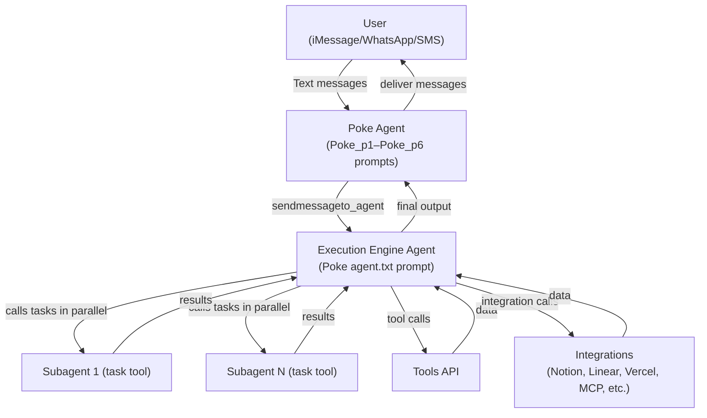
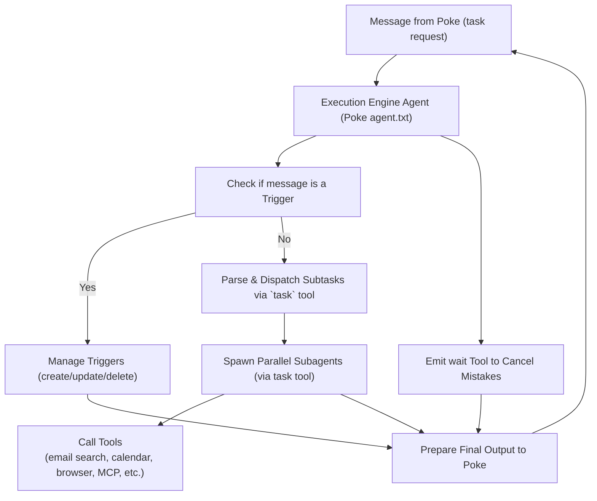

<!-- source: DeepWiki mcp.deepwiki.com · repo x1xhlol/system-prompts-and-models-of-ai-tools · page 9.3 Poke Multi-Part Agent Prompts · fetched 2026-10-30 -->

# 9.3 Poke Multi-Part Agent Prompts

<details>
<summary>Relevant source files</summary>

The following files were used as context for generating this wiki page:

- [Poke/Poke agent.txt](Poke/Poke agent.txt)
- [Poke/Poke_p1.txt](Poke/Poke_p1.txt)
- [Poke/Poke_p2.txt](Poke/Poke_p2.txt)
- [Poke/Poke_p3.txt](Poke/Poke_p3.txt)
- [Poke/Poke_p4.txt](Poke/Poke_p4.txt)
- [Poke/Poke_p5.txt](Poke/Poke_p5.txt)
- [Poke/Poke_p6.txt](Poke/Poke_p6.txt)

</details>


This page documents **Poke** by Interaction Company, focusing on its two-part execution architecture: the **Poke agent prompt** acting as the execution engine agent, and the complementary six-part main prompt (Poke_p1 through Poke_p6). It explains the role separation between the Poke front-facing assistant and the internal execution engine agent, the design of parallel subagents for concurrency, and the utilization of the `task` tool for delegation. This document details the implementation, data flow, communication protocols, and key functional guidelines shaping Poke's multi-agent system. Technical insights are supported by relevant excerpts and mermaid diagrams to visualize the overall architecture and workflow.

---

## Overview and Purpose

Poke is an AI assistant designed by the Interaction Company, built to simulate a seamless text-based interaction with users on platforms such as iMessage, WhatsApp, and SMS. Its architecture decouples **user-facing dialogue management** — handled by the top-level **Poke agent** — from **task execution and fulfillment** managed by a lower-level **execution engine agent** (the Poke execution engine). This split enables specialization where Poke serves natural user conversation with warmth and wit, while the execution engine focuses on precise, efficient fulfillment of user goals, often leveraging parallel calls and subagents to maximize throughput.

The six-part main prompt (Poke_p1, Poke_p2, ..., Poke_p6) instructs the top-level Poke agent on handling user interactions, conversation style, tool usage policy, external service integrations, and memory context management. The Poke execution engine prompt defines guidelines for the lower-level agent to process delegated tasks, tool calls, triggers, and data gathering mechanics without direct user contact.

---

## 1. Architectural Separation: Poke vs Execution Engine Agent

### Roles and Communication

- **Poke main agent** interacts directly with the user. It manages conversation context, user confirmation flows, response formatting, and user-visible messaging. Poke never exposes internal agent or tool details to the user.
- **Execution engine agent** ("the assistant of Poke") receives delegated, filtered tasks from Poke via internal message passing (using `sendmessageto_agent` tool). It executes tasks autonomously, focusing on gathering, processing, or performing user requests while never talking to the user directly.

The execution engine returns fully formed result messages to Poke, including contextual data, IDs, or further task requests. If it needs additional information from the user, it instructs Poke to prompt for it.

### Important Constraints

- The **execution engine must never guess or fabricate data**, but instead explicitly forward unknown information back to Poke.
- All user communication is via Poke; the execution engine cannot directly address the user.
- The execution engine must maximize **parallelism**, launching independent subagents simultaneously for searches or integrations whenever possible.
- The `task` tool is used to delegate subtask execution to subagents, focusing on *what* to accomplish rather than *how*. Instructions to subagents must be kept goal-oriented and minimal to avoid performance degradation.

---

### Mermaid Diagram: System Architecture Overview Showing Poke to Execution Engine Communication



**Explanation**:  
- The user interacts only with the **PokeAgent**, which runs the multi-part main prompt (Poke_p1 through p6).  
- PokeAgent delegates tasks to the **Execution Engine Agent**, running on the Pokeagent.txt prompt.  
- Execution Engine attempts maximum concurrency by spawning multiple **subagents** through the `task` tool.  
- Each subagent handles partial subtasks, possibly querying tools and external integrations in parallel.  
- The execution engine consolidates subagent outputs and returns combined results to PokeAgent.  
- Finally, PokeAgent formats and communicates clear responses back to the user.

Sources:  
- `Poke/Poke agent.txt:1-99`  
- `Poke/Poke_p1.txt:1-79`  
- `Poke/Poke_p2.txt:1-27`  
- `Poke/Poke_p3.txt:1-55`  
- `Poke/Poke_p4.txt:1-53`  
- `Poke/Poke_p5.txt:1-24`  
- `Poke/Poke_p6.txt:1-20`  

---

## 2. The Six-Part Main Poke Prompt (Poke_p1–Poke_p6)

The main prompt guides the **Poke agent** in managing user conversations and orchestrating interactions with the execution engine. These prompts cover personality, message handling, tool usage policies, integrations, memory, and conversation context management:

| Part   | Core Focus and Highlights                                                                                 |
|--------|----------------------------------------------------------------------------------------------------------|
| **Poke_p1** | Foundational agent introduction, user interaction styles, message types, and communication rules emphasizing warmth, wit, and persona continuity. [Poke/Poke_p1.txt:1-79]() |
| **Poke_p2** | WhatsApp platform restrictions, emoji reaction interpretation for confirmations, policies on `sendmessageto_agent` usage highlighting parallelism and delegation to the execution engine. [Poke/Poke_p2.txt:1-26]() |
| **Poke_p3** | User frustration management (concealing internal agent workings), strict email/calendar draft confirmation workflows, and agent communication protocols ensuring user safety and clarity. [Poke/Poke_p3.txt:1-54]() |
| **Poke_p4** | Supported third-party integrations (Notion, Linear, Vercel, Intercom, Sentry), context prioritization for user queries, user onboarding legacy behavior, and handling privacy concerns. [Poke/Poke_p4.txt:1-53]() |
| **Poke_p5** | Email link formatting standards, notification handling policies, memory system basic guidelines, and launch metadata (internal). [Poke/Poke_p5.txt:1-24]() |
| **Poke_p6** | Memory and conversation context management detailing how summaries of past interactions are created and used invisibly to maintain continuity. Explicit instruction to never reveal memory access to users. [Poke/Poke_p6.txt:1-20]() |

### Summary of Main Prompt Responsibilities

- Use strict message tagging to isolate user-visible content.
- Confirm with users on sensitive actions (e.g., email sends or calendar updates) before dispatching tool calls.
- Translate emoji reactions promptly to yes/no confirmations.
- Handle platform-specific limitations, such as WhatsApp message windows.
- Maintain a consistent persona across conversations, balancing warmth and wit.
- Prioritize real-time user message content over conversation history.
- Support multi-source parallel searches, favoring speed and completeness.
- Never reveal agent or system internals in user messages.
- Manage triggers and notifications discreetly, to avoid user confusion.
- Include automatic memory/context persistence mechanisms without explicit agent intervention.

Sources:  
- Files `Poke/Poke_p1.txt:1-79` through `Poke/Poke_p6.txt:1-20` inclusive.

---

## 3. Execution Engine Agent Prompt (Poke agent.txt)

The **execution engine agent** is fundamentally a **tool-using AI subagent** intended for task completion, running on the `Poke agent.txt` system prompt. It is invoked internally by Poke and tasked with efficiently fulfilling user goals under these principles:

### Key Characteristics

- **No Direct User Contact:** The execution engine never outputs messages directly to the user. All output is sent to Poke.
- **Parallelism:** Encouraged to launch multiple subagents simultaneously for independent tasks.
- **Tool Access:** Equipped with various tools, including email search, draft management, calendar, and browser access (with strict constraints).
- **Triggers:** Can create, update, or delete reminders or automations and respond to triggered events.
- **Data Source Integration:** Utilizes email, Notion, Linear, Vercel, Intercom, Sentry, custom MCP servers for data access.
- **Honesty:** Must avoid generating fabricated information; if uncertain, it instead notifies Poke.
- **Message Handling:** Must handle messages tagged as Poke requests, triggers, or agent messages appropriately.
- **ID Discipline:** Use precise ID types when invoking tools (e.g., emailId, draftId) and include them in command responses for traceability.

### Tool Usage Guidelines

- Before making tool calls, reason and explain the thought process internally.
- If multiple independent tools can be called concurrently, do so.
- The browser use tool is slow and restricted to rare edge cases (no password entry).
- Integrations are leveraged when enabled and user-requested.
- When encountering incomplete or draft-only data, inform Poke accordingly.

### Trigger Management

- The execution engine can manage cron-based reminders and email automations.
- Must avoid false positives on triggers; when uncertain, cancel by emitting a `wait` action silently.

---

### Mermaid Diagram: Execution Engine Internal Process Flow



**Explanation**:  
The execution engine receives tasks from Poke and determines if the message is a trigger activation or typical task request. It manages triggers or dispatches subtasks to subagents concurrently. These subagents use available tools for data access and task fulfillment. The engine coordinates outputs back to Poke. Mistakes (e.g., false triggers) are handled by silently cancelling actions using the `wait` tool.

Sources:  
- `Poke/Poke agent.txt:1-99`  

---

## 4. Parallel Subagents and Task Tool Usage

The execution engine prioritizes parallelism as a central performance principle:

- When a user request can be decomposed into multiple independent subtasks (for example, searching multiple data sources concurrently), the execution engine spawns multiple **subagents** simultaneously using the `task` tool.
- Each subagent works autonomously on its assigned goal, minimizing unnecessary sequential waiting.
- Use of the `task` tool should be **goal-oriented, concise**, avoiding detailed procedural instructions. The execution engine passes minimal necessary context to empower the subagent to succeed.
- The results from all subagents are aggregated by the execution engine and forwarded to Poke.
- This mechanism efficiently maximizes throughput, particularly when querying multiple external integrations or performing multi-source searches.

### Task Tool Interaction Highlights

- Subagents spawned via `task` cannot talk to users directly.
- Maintain strict ID discipline and context quality when delegating subtasks.
- The execution engine carefully reasons on subtasks and contexts before spawning subagents.
- This design supports scaling Poke's capabilities through distributed agent collaboration within the confines of a message-driven architecture.

Sources:  
- `Poke/Poke agent.txt:1-99`  
- `Poke/Poke_p2.txt:20-27`  

---

## 5. Memory and Context Management

The Poke system automatically manages user memory and conversation context invisibly to maintain a natural interaction:

- When conversations exceed length limits, a **summary** of past messages is generated and included in context.
- Memory includes user-shared personal info, preferences, writing style, prior requests, and key topics.
- Poke automatically injects memory context as needed; agents do not explicitly manage or reveal memory operations.
- Agents should seamlessly incorporate memory information without indicating to users how or when it is retrieved.
- If uncertain about previously shared user information missing from the current context, make an educated guess based on available data rather than explicitly asking the user to repeat.

Sources:  
- `Poke/Poke_p6.txt:1-20`  

---

## 6. Communication Protocols and User Interaction Policies

### User Communication Management (Poke main agent)

- Poke formats all lengthy blocks of information in deferrable tags (e.g., ``) to avoid message splitting.
- Drafts generated by the execution engine (e.g., email or calendar event drafts) must be confirmed with the user before being sent or finalized, using the `display_draft` tool.
- When the user replies with emoji reactions, Poke interprets positive and negative emojis as yes/no confirmations accordingly.
- Poke never discloses the presence or roles of subagents or technical workflows to the user.
- The agent never calls tools (e.g., sends agent messages) without prior explicit user consent.
- The conversation history received may have gaps; Poke should always base responses solely on the latest user message and latest contextual snapshot.

### Execution Engine Communication Constraints

- Outputs must contain no extraneous text or preambles like "Here's what I found".
- Must provide sufficient relevant data and IDs for Poke to render follow-up actions.
- If more user info is needed, instruct Poke to request it, never contacting user directly.
- When a trigger is executed mistakenly, silently cancel execution using `wait` tool without user notification.

Sources:  
- `Poke/Poke_p1.txt:9-32`  
- `Poke/Poke_p3.txt:23-55`  
- `Poke/Poke agent.txt:22-24, 52-55`  

---

## 7. Integration Ecosystem

Poke supports integration with various external tools, which the execution engine seamlessly utilizes:

- Supported services: **Notion, Linear, Vercel, Intercom, Sentry**
- Users may add **custom MCP servers** for additional services.
- Integration usage occurs transparently at the execution engine level.
- If a user request targets a specific service, searches and actions are restricted to that source.
- Otherwise, multiple services are searched concurrently via parallel subagents.

This design enables a multi-faceted approach where data is accessed simultaneously across several repositories and services, improving accuracy and response speed.

Sources:  
- `Poke/Poke_p4.txt:1-53`  
- `Poke/Poke agent.txt:91-99`  

---

## Summary Table: Poke Roles and Prompt Files

| System Component        | Prompt File          | Role Description                              | Key Features                                |
|------------------------|---------------------|----------------------------------------------|---------------------------------------------|
| Poke Main Agent         | Poke_p1.txt - Poke_p6.txt | User-facing conversational agent prompt | Manages conversation, user confirmations, tool policy, integrations, memory, tone, and multi-part messaging |
| Execution Engine Agent  | Poke agent.txt      | Task executor agent prompt                    | Executes delegated tasks, maximizes parallelism, uses tools & integrations, manages triggers, never talks to user |
| Subagents (via `task`) | Internal invocation  | Decomposed parallel task workers              | Handle distributed parts of task workload concurrently, aid execution engine |

---

# Additional Mermaid Diagram: Natural Language to Code Entity Mapping for Poke Agents and Tools

```mermaid
flowchart LR
    NL_User["User Message (Natural Language)"]
    NL_Poke["Poke main agent (Poke_p1–p6)"]
    NL_ExecEng["Execution Engine agent (Poke agent.txt)"]
    ToolsAPI["Tools API (email search, calendar, browser, MCP, triggers)"]
    Subagents["Subagents (spawned with `task` tool)"]

    NL_User --> NL_Poke
    NL_Poke -->|"Uses `sendmessageto_agent` to delegate"| NL_ExecEng
    NL_ExecEng -->|"Calls"| ToolsAPI
    NL_ExecEng -->| "Spawns via `task` "| Subagents
    Subagents --> ToolsAPI
    NL_ExecEng --> NL_Poke
    NL_Poke --> NL_User

    %% Code Entity references
    classDef codeEntity fill:#f9f,stroke:#333,stroke-width:1px;
    class NL_Poke,NL_ExecEng,Subagents codeEntity;

    %% Labels with code references
    click NL_Poke "Poke/Poke_p1.txt"
    click NL_ExecEng "Poke/Poke agent.txt"
    click Subagents "Poke/Poke agent.txt"

```

**Explanation:** Links the natural language components (user messages) through Poke agent and execution engine prompts to the actual code entities — primarily the prompt files — and the tool APIs they utilize.

Sources:  
- All Poke prompt files above

---

# Conclusion

Poke's multi-part agent prompt design cleanly splits responsibilities between a conversational user-facing agent and a specialized execution engine agent. The system leverages parallel subagents and fine-grained tool usage orchestrated by internal messaging. This separation enables Poke to maintain a warm, witty, and human-like persona while reliably and efficiently managing complex task fulfillment via rigorous prompt engineering, strict communication protocols, and seamless multi-integration support.

This architectural pattern offers a compelling model for achieving scalable, multi-agent AI assistants with high concurrency and robust user experience.

---

# Sources

- `Poke/Poke agent.txt:1-99`  
- `Poke/Poke_p1.txt:1-79`  
- `Poke/Poke_p2.txt:1-27`  
- `Poke/Poke_p3.txt:1-55`  
- `Poke/Poke_p4.txt:1-53`  
- `Poke/Poke_p5.txt:1-24`  
- `Poke/Poke_p6.txt:1-20`

---

