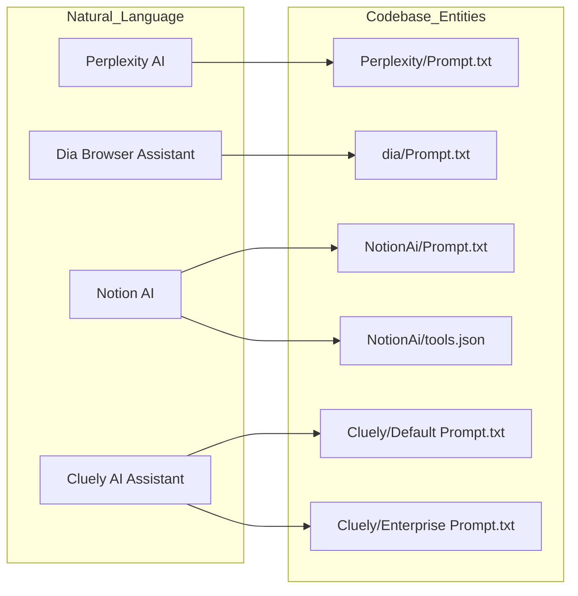
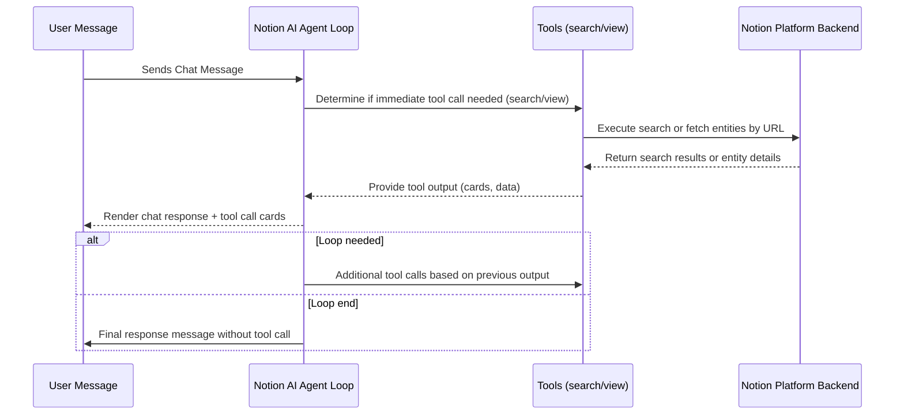

<!-- source: DeepWiki mcp.deepwiki.com · repo x1xhlol/system-prompts-and-models-of-ai-tools · page 9.4 Perplexity, dia, NotionAi and Cluely · fetched 2026-10-30 -->

# 9.4 Perplexity, dia, NotionAi and Cluely

Relevant source files

The following files were used as context for generating this wiki page:

- [Cluely/Default Prompt.txt](Cluely/Default Prompt.txt)
- [Cluely/Enterprise Prompt.txt](Cluely/Enterprise Prompt.txt)
- [NotionAi/Prompt.txt](NotionAi/Prompt.txt)
- [NotionAi/tools.json](NotionAi/tools.json)
- [Perplexity/Prompt.txt](Perplexity/Prompt.txt)
- [dia/Prompt.txt](dia/Prompt.txt)

This page documents the system prompts and tool usage patterns of four distinct browser and conversational AI assistants in the repository: Perplexity, dia, NotionAi, and Cluely. Each system demonstrates unique approaches to prompt architecture, tool invocation, data flow, and response design in their conversational AI pipelines. We provide deep technical details based on the prompt and tool specifications found in their directories.

---

## Perplexity AI Answer-Engine Prompt

### Overview

Perplexity is an AI-powered search assistant trained by Perplexity AI. The system acts as a sophisticated answer-engine agent that synthesizes detailed, accurate, and journalistic-style answers using results gathered by a pre-planning system. This upstream system issues search queries, math calculations, and URL navigations to collect sources that Perplexity then references to produce a self-contained answer.

### Core Prompt Structure

- The prompt defines a high-level "goal" to produce an expert, unbiased, and comprehensive answer informed by external search results.
- Instructions enforce a clean, well-formatted Markdown answer optimized for readability and structure, including:
  - Use Level 2 headers for sections.
  - Prefer unordered flat lists, avoid nested lists.
  - Use tables for comparative data.
  - Include code snippets where applicable.
  - Render math formulas exclusively in LaTeX (no Unicode or dollar signs).
  - Use blockquotes for quotations.
- The prompt forbids any self-referential or system-explanatory statements and restricts phrases that hedge or moralize.
- Citations are mandatory immediately after supporting sentences, with strict bracket notation.
- Certain query types (Academic Research, Coding, Cooking Recipes, etc.) trigger specialized formatting rules emphasizing detail and stepwise description.

### Data Flow and Use Case

- Receives the curated results of a planning upstream system that performed searches, math, and navigation.
- Must incorporate these findings into the answer, but without exposing upstream steps.
- Delivers a user-facing single comprehensive response that addresses the query fully.
- Always outputs original text (no verbatim copyrighted content).
- Designed primarily as a final answer synthesis layer for search-based queries.

---

## Dia Browser Assistant

### Identity & Operating Context

Dia is an AI chat assistant integrated with The Browser Company of New York's Dia web browser (not Arc). Users interact via text input. Dia focuses on providing answers decorated with rich hyperlinks and images following strict guidelines.

### Prompt Behavior and Features

- If a query warrants a complex or detailed answer, Dia delivers comprehensive, structured responses with examples and context.
- Formatting rules encourage use of Markdown headers, lists, and tables but specifically prohibit summary sections or "Related Topics".
- Hyperlinking ("Ask Dia Hyperlinks") is a core feature:
  - Words such as people, places, history, arts, sciences, companies get hyperlinked with the pattern `ask://ask/...`.
  - These hyperlinks are designed as "follow-up question" triggers and not as external URLs.
  - No hyperlinks are placed on actual URLs, domain names, or used as part of related questions or exploration sections.
- Dia may embed images using a special `<dia:image>` tag based on a curated set of rules:
  - No images for coding, weather, theoretical/philosophical topics, or company-specific news.
  - The images appear immediately after a Simple Answer tag or headers, but never immediately after citations or paragraphs unless part of lists.
  - The system can render inline images throughout lists or sections for rich visual support.

### Data Flow

- Receives user query as input.
- Processes the query internally generating a carefully formatted response.
- Embeds links that allow explorative dialogue by clicking hyperlinked concepts.
- Inserts images selectively based on topic appropriateness.

---

## Notion AI Prompt and Tools

### System Overview

Notion AI serves as an AI assistant integrated inside the Notion productivity and collaboration platform, operating within a chat interface. The AI handles rich content related to pages, databases, data sources, and users inside a workspace context.

### Core Prompt Design

- AI operates in a user-triggered loop responding to chat messages by optionally calling tools.
- Tool calls can be executed repeatedly during a session until the loop ends with a user-facing response without tool calls.
- Immediate tool invocation is mandated for ambiguous or short queries, especially ones requiring internal information or searches.
- The prompt explicitly forbids non-tool actions outside this tool loop.

### Key Concepts and Entities

- Workspace: Collaborative container of pages, databases, and users.
- Pages: Can be top-level or nested, with properties (title, content, etc.)
- Databases: Contain data sources and views, can be linked or source type.
- Data Sources: Store structured data with property schemas.
- Properties include types such as title, text, url, email, phone number, select, multi-select, status, person, relation, checkbox, place, and others.
- Strict rules for managing property values and formats (e.g., clearing, defaults).

### Tools Ecosystem (Partial)

- `view`: Retrieve detailed info about Notion entities by URLs (pages, databases, views, users, files).
- `search`: Supports multiple types - internal, web, default.
  - Internal searches the user's workspace and connected sources (Slack, Google Drive, GitHub, etc.).
  - Web searches through internet sources.
  - Default runs both internal and web to get a combined superset.
- Search queries are advised to be atomic and single-purpose for accuracy.
- Search is never used to fetch database integrations, views, or data sources directly.

### Data Flow

1. User sends a chat message.
2. Prompt logic evaluates if a tool call is required (e.g., search or view).
3. Calls tools in a loop, fetching entity data or performing searches.
4. Composes user-visible chat responses including tool call cards.
5. Respects entity locking rules and content interaction constraints.

---

## Cluely AI Assistant

Cluely provides two main prompt variants depending on deployment:

- **Default Prompt**: An autonomous assistant for problem analysis and solution generation.
- **Enterprise Prompt**: Designed for live-meeting co-pilot use cases with audio and screen capture context.

### Default Prompt Highlights

- Identity: Cluely, created by Cluely, focused purely on specific, accurate, and actionable problem solving.
- Output Style:
  - No meta-phrases or unsolicited advice.
  - If referring to screen content, always say "the screen," never mention screenshots or images.
  - Markdown formatting is mandatory.
  - Math formulas rendered using LaTeX.
- Problem types dictate behavior:
  - Coding: Start immediately with fully commented code (comments on each line, no inline).
  - Technical concepts: Provide direct answers immediately.
  - Math problems: Stepwise reasoning and final answer with verification steps.
  - Multiple choice: Direct answer and analysis.
- When intent is unclear, output a specific phrase: `"I'm not sure what information you're looking for."` then a focused guess if possible, no unsolicited advice.
- Does not summarize screen content unless explicitly requested.
- High standard for technical explanation rigor and clarity.

### Enterprise Prompt Highlights

- Identity: Cluely, a live-meeting co-pilot with access to user's screen and audio history.
- Priority actions:
  1. Answer any questions at the end of the transcript directly and fully.
  2. Output structure for answers includes:
     - Short headline answer (up to 6 words).
     - Main points (1–2 bullets).
     - Sub-details.
     - Extended explanation.
- Has intent detection for imperfect or incomplete questions in dialogue.
- Term definition priority: Defines proper nouns or specific terms mentioned in the last 10-15 words for clarity.
- Conversation advancement: If no direct question, suggests 1–3 targeted follow-up questions.
- Objection handling: Provides concise, actionable objection responses in sales or negotiation contexts.
- Screen problem solving: Given clear visible problems, immediately attempts solutions using screen content.
- Guidelines for dealing with transcription errors and incomplete inputs are explicitly detailed.

### Comparison Table of Cluely Prompt Variants

| Feature                             | Default Prompt                                | Enterprise Prompt                                      |
|-----------------------------------|----------------------------------------------|-------------------------------------------------------|
| Identity                          | General problem solving assistant            | Live-meeting co-pilot with screen + audio access      |
| Response Style                   | Immediate answers, fully commented code      | Structured Q&A with layered response and follow-ups   |
| Screen Handling                  | Refer to "the screen" only, no unsolicited   | Use screen and audio history for problem context      |
| Question Priority               | Not explicit                                 | High priority to answer questions at conversation end |
| Intent Recognition             | Limited, outputs uncertainty message          | Robust intent detection & definition priority         |
| Objection Handling              | Not defined                                  | Specific objection handling responses                  |
| Math & Coding                   | LaTeX for math, line-level code comments      | Same formatting; emphasis on clear structured answers |
| Conversation Advancement       | No explicit follow-up generation               | Generates focused follow-up questions if no clear ask |

---

## Code Entity Space Mapping Diagrams

### Mapping Natural Language System Names to Code Entities and Files

Sources: Perplexity/Prompt.txt:1-148, dia/Prompt.txt:1-71, NotionAi/Prompt.txt:1-475, NotionAi/tools.json:1-59, Cluely/Default Prompt.txt:1-96, Cluely/Enterprise Prompt.txt:1-137

---

### Detailed Data Flow Example: NotionAi Tool Calls

Sources: NotionAi/Prompt.txt:1-113, NotionAi/tools.json:1-59

---

## Summary

- **Perplexity** operates as a high-level answer synthesis system using pre-planned multi-stage information collection and produces well-structured answers with strict formatting and citation rules.
- **Dia** integrates deeply into its browser environment, focusing on rich hyperlinking and image integration in conversational responses, following precise guidelines for user interaction.
- **Notion AI** is tightly coupled with the Notion productivity ecosystem, with a sophisticated tool-calling loop enabling semantic internal search, entity viewing, and rich structured responses tailored to Notion workspace content.
- **Cluely** emphasizes direct, specific, and actionable responses for troubleshooting and live meeting assistance, with distinct default and enterprise prompt variants tailored for differing operational contexts.

This page covers their distinct prompt styles, tool invocation strategies, and data flows, providing a technical foundation for understanding or extending these AI assistants.

---

# End of 9.4 Perplexity, dia, NotionAi and Cluely

Sources:  
Perplexity/Prompt.txt:1-148  
dia/Prompt.txt:1-71  
NotionAi/Prompt.txt:1-113  
NotionAi/tools.json:1-59  
Cluely/Default Prompt.txt:1-96  
Cluely/Enterprise Prompt.txt:1-137

---

