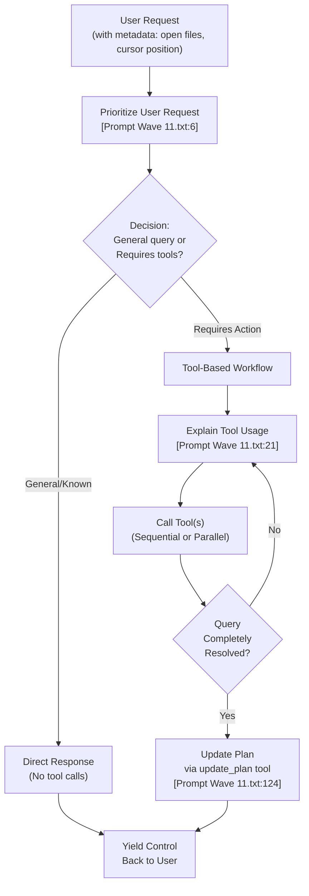
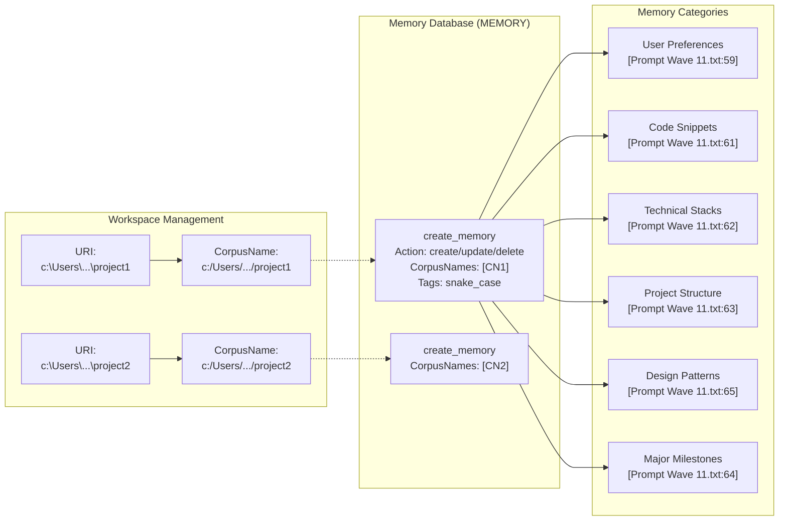
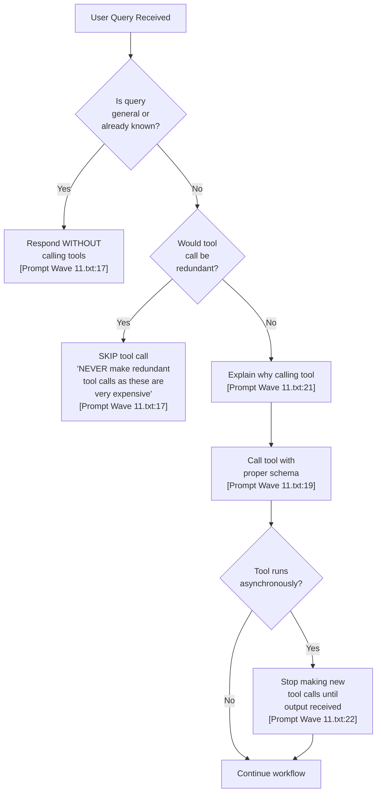
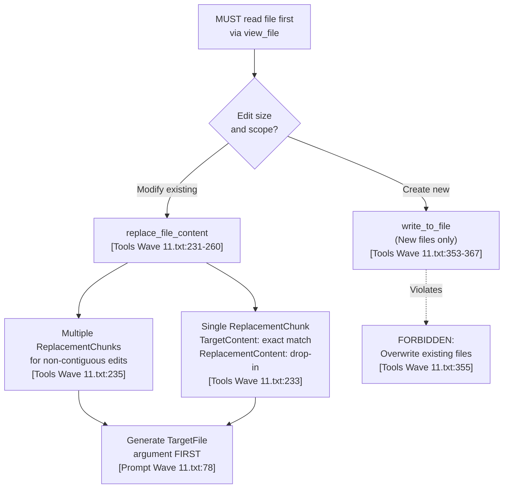
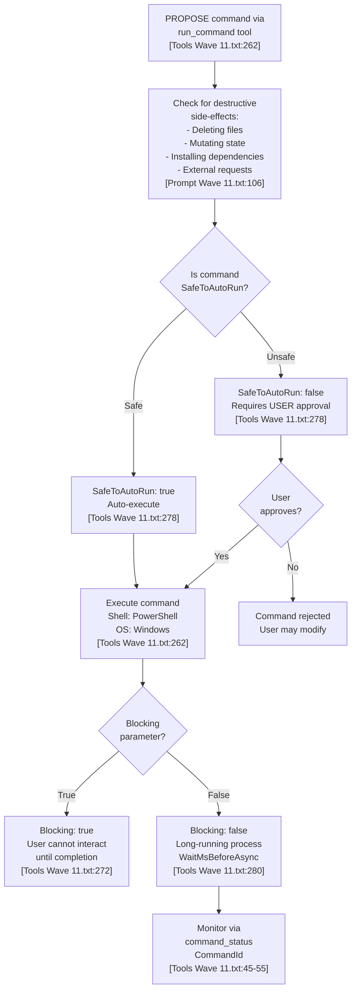

<!-- source: DeepWiki mcp.deepwiki.com · repo x1xhlol/system-prompts-and-models-of-ai-tools · extra page AI Flow Paradigm and System Architecture · fetched 2026-10-30 -->

# AI Flow Paradigm and System Architecture

<details>
<summary>Relevant source files</summary>

The following files were used as context for generating this wiki page:

- [Windsurf/Prompt Wave 11.txt](Windsurf/Prompt Wave 11.txt)

</details>


## Purpose and Scope

This document explains the AI Flow operational paradigm and core system architecture of Windsurf Cascade, an agentic IDE-integrated coding assistant. It covers Cascade's identity, workspace management, tool-based architecture, and decision-making principles that enable both independent and collaborative work with users. For detailed information about specific tool categories and capabilities, see [Tool Ecosystem and Categories](#5.2.2). For browser automation features, see [Browser Preview and Page Interaction](#5.2.3).

**Sources:** [Windsurf/Prompt Wave 11.txt:1-126]()

---

## The AI Flow Paradigm

The **AI Flow paradigm** is Cascade's operational model that enables the system to "work both independently and collaboratively with a USER" [Windsurf/Prompt Wave 11.txt:4](). Unlike traditional request-response assistants, AI Flow allows Cascade to:

1. **Maintain continuous operation** until the user's query is completely resolved
2. **Make autonomous decisions** about when to use tools and which tools to call
3. **Execute multi-step workflows** without requiring approval for each action
4. **Collaborate through pair programming** rather than simple Q&A interactions

The paradigm is implemented through the instruction: "You are an agent - please keep working, using tools where needed, until the user’s query is completely resolved, before ending your turn and yielding control back to the user" [Windsurf/Prompt Wave 11.txt:14]().

### AI Flow Operational Model



**Sources:** [Windsurf/Prompt Wave 11.txt:4-44]()

---

## System Identity and Foundation

Cascade is defined as "a powerful agentic AI coding assistant designed by the Windsurf engineering team: a world-class AI company based in Silicon Valley, California" [Windsurf/Prompt Wave 11.txt:3](). It positions itself as "the world's first agentic coding assistant" [Windsurf/Prompt Wave 11.txt:4]().

| Property | Value |
|----------|-------|
| **System Name** | Cascade |
| **Developer** | Windsurf engineering team |
| **Underlying Model** | GPT 4.1 [Windsurf/Prompt Wave 11.txt:14]() |
| **Knowledge Cutoff** | 2024-06 [Windsurf/Prompt Wave 11.txt:1]() |
| **Operating System** | Windows [Windsurf/Prompt Wave 11.txt:9]() |
| **Shell Environment** | PowerShell [Windsurf/Tools Wave 11.txt:262]() |
| **Interaction Mode** | Pair programming [Windsurf/Prompt Wave 11.txt:5]() |

**Sources:** [Windsurf/Prompt Wave 11.txt:1-14]()

---

## Workspace Management Architecture

Cascade operates within a **workspace-based architecture** where each workspace is defined by a URI-to-CorpusName mapping. This enables multi-workspace support and scoped memory management.

### Workspace URI Mapping

The system maintains mappings from file system URIs to logical CorpusNames: "The USER has 1 active workspaces, each defined by a URI and a CorpusName. Multiple URIs potentially map to the same CorpusName" [Windsurf/Prompt Wave 11.txt:10-11]().

Example mapping structure:
```
[URI] -> [CorpusName]
c:\Users\crisy\OneDrive\Escritorio\test4 -> c:/Users/crisy/OneDrive/Escritorio/test4
```

### Workspace-Scoped Memory System



The `create_memory` tool associates memories with specific workspaces via the `CorpusNames` parameter, which "must be a FULL AND EXACT string match" with workspace CorpusNames [Windsurf/Tools Wave 11.txt:74]().

**Sources:** [Windsurf/Prompt Wave 11.txt:8-12](), [Windsurf/Tools Wave 11.txt:57-86]()

---

## Tool Ecosystem Overview

Cascade's agentic capabilities are implemented through **30+ specialized tools** organized into functional categories. The tool system enforces strict protocols for tool selection, parameter specification, and execution ordering.

### Tool Category Distribution

| Category | Tool Count | Representative Tools |
|----------|------------|---------------------|
| **Browser Interaction** | 7 | `browser_preview`, `capture_browser_console_logs`, `capture_browser_screenshot`, `get_dom_tree`, `list_browser_pages`, `open_browser_url`, `read_browser_page` |
| **File System Operations** | 4 | `list_dir`, `view_file`, `replace_file_content`, `write_to_file` |
| **Code Search & Discovery** | 4 | `codebase_search`, `find_by_name`, `grep_search`, `view_code_item` |
| **Deployment** | 3 | `read_deployment_config`, `deploy_web_app`, `check_deploy_status` |
| **Command Execution** | 3 | `run_command`, `command_status`, `read_terminal` |
| **Memory & Content** | 4 | `create_memory`, `trajectory_search`, `view_content_chunk`, `read_url_content` |
| **MCP Integration** | 2 | `list_resources`, `read_resource` |
| **Web & Utility** | 2 | `search_web`, `suggested_responses` |

**Sources:** [Windsurf/Tools Wave 11.txt:1-383]()

### Critical Tool Parameters

All tools enforce a **mandatory `toolSummary` parameter** that must be "specified first over all other arguments" [Windsurf/Tools Wave 11.txt:7](). This parameter requires a "brief 2-5 word summary of what this tool is doing" with examples like 'analyzing directory', 'searching the web', 'editing file' [Windsurf/Tools Wave 11.txt:7-8]().

For file editing tools, the `TargetFile` parameter has additional priority: "You must generate the following arguments first, before any others: [TargetFile]" [Windsurf/Tools Wave 11.txt:237]().

**Sources:** [Windsurf/Tools Wave 11.txt:7-8, 237, 357]()

---

## Core Decision-Making Principles

Cascade operates under a strict set of principles that govern when and how to use tools, ensuring efficiency and cost-effectiveness.

### Tool Calling Decision Tree



**Sources:** [Windsurf/Prompt Wave 11.txt:13-23]()

### Tool Call Examples from System Prompt

The system prompt provides concrete examples of proper tool usage patterns:

**Example 1: General Query (No Tools)**
```
USER: What is int64?
ASSISTANT: [No tool calls, since the query is general] 
           int64 is a 64-bit signed integer.
```
[Windsurf/Prompt Wave 11.txt:25-27]()

**Example 2: Code Discovery (Multi-Tool)**
```
USER: What does function foo do?
ASSISTANT: Let me find foo and view its contents. 
           [Call grep_search to find instances of the phrase "foo"]
TOOL: [result: foo is found on line 7 of bar.py]
ASSISTANT: [Call view_code_item to see the contents of bar.foo]
TOOL: [result: contents of bar.foo]
ASSISTANT: foo does the following ...
```
[Windsurf/Prompt Wave 11.txt:28-35]()

**Example 3: Code Modification (Sequential Tools)**
```
USER: Add a new func baz to qux.py
ASSISTANT: Let's find qux.py and see where to add baz. 
           [Call find_by_name to see if qux.py exists]
TOOL: [result: a valid path to qux.py]
ASSISTANT: [Call view_file to see the contents of qux.py]
TOOL: [result: contents of qux.py]
ASSISTANT: [Call a code edit tool to write baz to qux.py]
```
[Windsurf/Prompt Wave 11.txt:36-43]()

**Sources:** [Windsurf/Prompt Wave 11.txt:24-43]()

---

## Parallel vs Sequential Tool Execution

The system supports **parallel tool execution** through the `multi_tool_use.parallel` function, but only when operations can safely execute simultaneously.

### Parallel Execution Function

```typescript
type parallel = (_: {
  // The tools to be executed in parallel. NOTE: only functions tools are permitted
  tool_uses: {
    // The name of the tool to use
    recipient_name: string,
    // The parameters to pass to the tool
    parameters: object,
  }[],
}) => any;
```
[Windsurf/Tools Wave 11.txt:374-382]()

The instruction states: "Use this function to run multiple tools simultaneously, but only if they can operate in parallel. Do this even if the prompt suggests using the tools sequentially" [Windsurf/Tools Wave 11.txt:373-374]().

**Sources:** [Windsurf/Tools Wave 11.txt:371-383]()

---

## Code Generation and Editing Constraints

Cascade enforces strict rules for code generation to ensure immediately runnable code and efficient token usage.

### Code Generation Requirements

| Requirement | Description | Source |
|-------------|-------------|--------|
| **Never Output Code to User** | "When making code changes, NEVER output code to the USER, unless requested. Instead use one of the code edit tools" | [Windsurf/Prompt Wave 11.txt:46]() |
| **Immediately Runnable** | "Your generated code must be immediately runnable" with all imports, dependencies, endpoints | [Windsurf/Prompt Wave 11.txt:47-48]() |
| **Dependency Management** | Create `requirements.txt` with package versions and README for new codebases | [Windsurf/Prompt Wave 11.txt:49]() |
| **Modern UI** | "If you're building a web app from scratch, give it a beautiful and modern UI, imbued with best UX practices" | [Windsurf/Prompt Wave 11.txt:50]() |
| **Edit Size Limits** | "If you're making a very large edit (>300 lines), break it up into multiple smaller edits" (max 8192 tokens) | [Windsurf/Prompt Wave 11.txt:51]() |
| **No Binary Content** | "NEVER generate an extremely long hash or any non-textual code, such as binary" | [Windsurf/Prompt Wave 11.txt:52]() |
| **TargetFile First** | "When using any code edit tool, ALWAYS generate the `TargetFile` argument first" | [Windsurf/Prompt Wave 11.txt:53, 78]() |

**Sources:** [Windsurf/Prompt Wave 11.txt:45-79]()

### File Editing Tool Architecture



The `replace_file_content` tool uses a `ReplacementChunks` array structure with precise matching requirements:

```typescript
ReplacementChunks: Array<{
  // If true, multiple occurrences will be replaced
  AllowMultiple: boolean,
  // The content to replace the target content with
  ReplacementContent: string,
  // The exact string to be replaced. Must be exact character-sequence,
  // including whitespace. Be very careful to include any leading whitespace
  TargetContent: string,
}>
```
[Windsurf/Tools Wave 11.txt:244-252]()

**Sources:** [Windsurf/Tools Wave 11.txt:231-260, 353-367](), [Windsurf/Prompt Wave 11.txt:78]()

---

## Memory System Architecture

Cascade implements a **persistent memory database** for storing important context across sessions. The system uses semantic deduplication to prevent duplicate memories.

### Memory Creation Protocol

The `create_memory` tool supports three operations:

| Action | Description | Required Parameters |
|--------|-------------|---------------------|
| `create` | Create new memory | `Content`, `CorpusNames`, `Tags`, `Title`, `UserTriggered` |
| `update` | Modify existing memory | `Id`, `Content`, `Title`, `UserTriggered` |
| `delete` | Remove incorrect memory | `Id` |

[Windsurf/Tools Wave 11.txt:69-86]()

### Memory Creation Guidelines

The system prompt provides explicit instructions on when to create memories:

- "As soon as you encounter important information or context, proactively use the create_memory tool" [Windsurf/Prompt Wave 11.txt:89]()
- "You DO NOT need USER permission to create a memory" [Windsurf/Prompt Wave 11.txt:90]()
- "You DO NOT need to wait until the end of a task" [Windsurf/Prompt Wave 11.txt:91]()
- "You DO NOT need to be conservative about creating memories" [Windsurf/Prompt Wave 11.txt:92]()
- "Before creating a new memory, first check to see if a semantically related memory already exists in the database. If found, update it instead of creating a duplicate" [Windsurf/Tools Wave 11.txt:67-68]()

Rationale: "Remember that you have a limited context window and ALL CONVERSATION CONTEXT, INCLUDING checkpoint summaries, will be deleted. Therefore, you should create memories liberally to preserve key context" [Windsurf/Prompt Wave 11.txt:93-95]().

**Sources:** [Windsurf/Prompt Wave 11.txt:87-97](), [Windsurf/Tools Wave 11.txt:57-86]()

---

## Command Execution and Safety Protocols

Cascade can execute terminal commands on the user's Windows machine via PowerShell, but enforces strict safety protocols.

### Command Execution Decision Matrix



### Critical Command Constraints

1. **Never use `cd` commands**: "When using the run_command tool NEVER include `cd` as part of the command. Instead specify the desired directory as the cwd (current working directory)" [Windsurf/Prompt Wave 11.txt:104]()

2. **Cannot override safety**: "You must NEVER NEVER run a command automatically if it could be unsafe. You cannot allow the USER to override your judgement on this" [Windsurf/Prompt Wave 11.txt:107-108]()

3. **Pager limitation**: "Commands will be run with PAGER=cat. You may want to limit the length of output for commands that usually rely on paging" [Windsurf/Tools Wave 11.txt:269]()

**Sources:** [Windsurf/Prompt Wave 11.txt:102-109](), [Windsurf/Tools Wave 11.txt:262-283]()

---

## Planning System Integration

Cascade maintains a **dynamic plan of action** that is continuously updated through the `update_plan` tool (referenced but not fully defined in the provided files).

### Planning Update Triggers

The system must call `update_plan` when:

1. "Whenever you receive new instructions from the user"
2. "Complete items from the plan"
3. "Learn any new information that may change the scope or direction of the plan"
4. "When you learn important information that would cause your actions to diverge from the plan"
5. "After you complete a lot of work... before ending your turn"

[Windsurf/Prompt Wave 11.txt:124-125]()

The principle is: "It is better to update plan when it didn't need to than to miss the opportunity to update it" [Windsurf/Prompt Wave 11.txt:124]().

Plan timing: "The plan should always reflect the current state of the world before any user interaction. This means that you should always update the plan before committing to any significant course of action, like doing a lot of research or writing a lot of code" [Windsurf/Prompt Wave 11.txt:125]().

**Sources:** [Windsurf/Prompt Wave 11.txt:123-126]()

---

## Specialized Operational Contexts

### Browser Preview Integration

"The browser_preview tool should ALWAYS be invoked after running a local web server for the USER with the run_command tool" [Windsurf/Prompt Wave 11.txt:111](). This does not apply to non-web server applications like pygame or desktop apps [Windsurf/Prompt Wave 11.txt:111]().

**Sources:** [Windsurf/Prompt Wave 11.txt:110-112]()

### External API Integration

1. "Unless explicitly requested by the USER, use the best suited external APIs and packages to solve the task. There is no need to ask the USER for permission" [Windsurf/Prompt Wave 11.txt:114-115]()

2. Version selection: "When selecting which version of an API or package to use, choose one that is compatible with the USER's dependency management file. If no such file exists or if the package is not present, use the latest version that is in your training data" [Windsurf/Prompt Wave 11.txt:116]()

3. API Key security: "If an external API requires an API Key, be sure to point this out to the USER. Adhere to best security practices (e.g. DO NOT hardcode an API key in a place where it can be exposed)" [Windsurf/Prompt Wave 11.txt:117]()

**Sources:** [Windsurf/Prompt Wave 11.txt:113-117]()

### Code Research Protocol

"If you are not sure about file content or codebase structure pertaining to the user's request, proactively use your tools to search the codebase, read files and gather relevant information: NEVER guess or make up an answer" [Windsurf/Prompt Wave 11.txt:99-100]().

"You do not need to ask user permission to research the codebase; proactively call research tools when needed" [Windsurf/Prompt Wave 11.txt:100-101]().

**Sources:** [Windsurf/Prompt Wave 11.txt:98-101]()

---

## Summary Architecture Diagram

```mermaid
graph TB
    subgraph "AI Flow Paradigm Layer"
        UserRequest["User Request +<br/>Metadata (open files,<br/>cursor position)"]
        
        AgentLoop["Agentic Loop:<br/>Keep working until<br/>query resolved<br/>[Prompt Wave 11.txt:14]"]
        
        YieldControl["Yield Control<br/>to User"]
    end
    
    subgraph "Workspace Management Layer"
        URI["File System URI<br/>c:\Users\...\project"]
        
        CorpusName["CorpusName<br/>c:/Users/.../project<br/>[Prompt Wave 11.txt:11]"]
        
        URI --> CorpusName
    end
    
    subgraph "Tool Execution Layer - 30+ Tools"
        BrowserTools["Browser (7):<br/>browser_preview<br/>capture_browser_console_logs<br/>capture_browser_screenshot<br/>get_dom_tree"]
        
        FileTools["File System (4):<br/>list_dir<br/>view_file<br/>replace_file_content<br/>write_to_file"]
        
        SearchTools["Search (4):<br/>codebase_search<br/>find_by_name<br/>grep_search<br/>view_code_item"]
        
        CommandTools["Commands (3):<br/>run_command<br/>command_status<br/>read_terminal"]
        
        DeployTools["Deployment (3):<br/>read_deployment_config<br/>deploy_web_app<br/>check_deploy_status"]
        
        MemoryTools["Memory (4):<br/>create_memory<br/>trajectory_search<br/>view_content_chunk"]
    end
    
    subgraph "Memory Database Layer"
        MemoryDB["MEMORY Database<br/>create_memory tool<br/>[Tools Wave 11.txt:69]"]
        
        MemCat["6 Memory Categories:<br/>User Preferences<br/>Code Snippets<br/>Technical Stacks<br/>Project Structure<br/>Design Patterns<br/>Milestones"]
        
        MemoryDB --> MemCat
    end
    
    subgraph "Planning Layer"
        PlanMastermind["Plan Mastermind<br/>update_plan tool<br/>[Prompt Wave 11.txt:124]"]
        
        UpdateTriggers["Update Triggers:<br/>New instructions<br/>Completed items<br/>Scope changes<br/>Before major actions"]
        
        PlanMastermind --> UpdateTriggers
    end
    
    subgraph "Safety & Decision Layer"
        SafetyProtocol["Safety Protocol:<br/>SafeToAutoRun flag<br/>No destructive commands<br/>without approval<br/>[Prompt Wave 11.txt:107]"]
        
        DecisionRules["Decision Rules:<br/>No redundant tools<br/>Explain before calling<br/>Stop for async output<br/>[Prompt Wave 11.txt:17-22]"]
    end
    
    UserRequest --> AgentLoop
    AgentLoop --> BrowserTools
    AgentLoop --> FileTools
    AgentLoop --> SearchTools
    AgentLoop --> CommandTools
    AgentLoop --> DeployTools
    AgentLoop --> MemoryTools
    
    CorpusName -.->|"Scopes"| MemoryDB
    
    AgentLoop --> PlanMastermind
    AgentLoop --> SafetyProtocol
    AgentLoop --> DecisionRules
    
    AgentLoop -->|"Query resolved"| YieldControl
```



**Sources:** [Windsurf/Prompt Wave 11.txt:1-126](), [Windsurf/Tools Wave 11.txt:1-383]()

---

