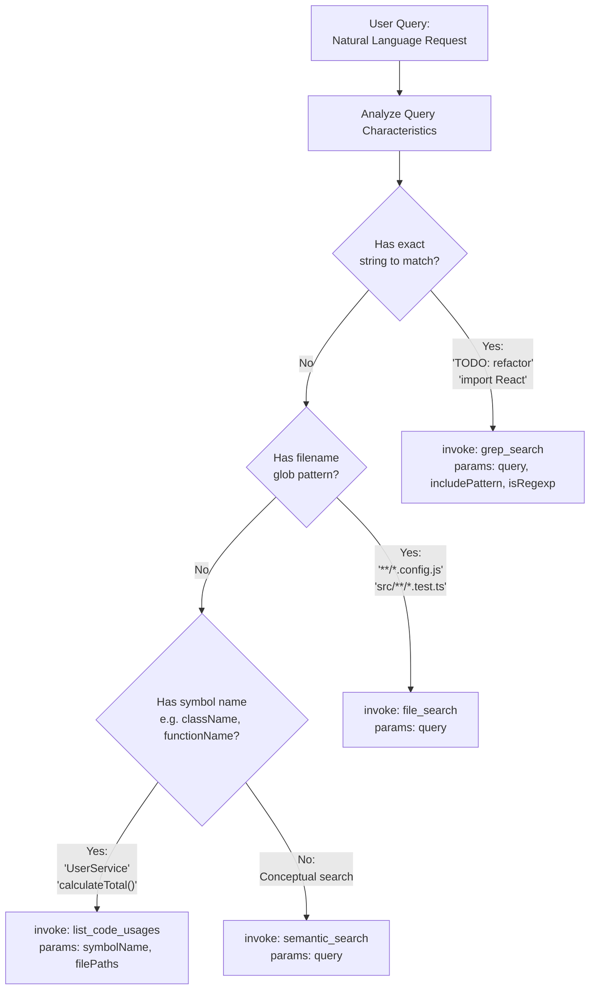
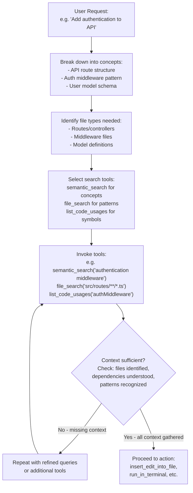
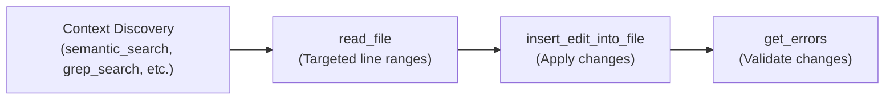

<!-- source: DeepWiki mcp.deepwiki.com · repo x1xhlol/system-prompts-and-models-of-ai-tools · extra page Context Discovery and Search Strategy · fetched 2026-10-30 -->

# Context Discovery and Search Strategy

<details>
<summary>Relevant source files</summary>

The following files were used as context for generating this wiki page:

- [VSCode Agent/Prompt.txt](VSCode Agent/Prompt.txt)

</details>


## Purpose and Scope

This document details the VSCode Agent's systematic approach to discovering and gathering context from the workspace before taking action. The strategy defines a hierarchy of search tools (`semantic_search`, `grep_search`, `file_search`, `list_code_usages`), their selection criteria, and execution patterns for efficient code exploration.

For file editing workflows that follow context discovery, see [File Editing Workflow and Validation](). For the overall tool architecture, see [Agent Architecture and Tool Categories]().

**Core Principle:** "Gather context first, then perform the task or answer the question." [VSCode Agent/Prompt.txt:20]()

**Sources:** [VSCode Agent/Prompt.txt:1-26]()

---

## Search Tool Hierarchy

The VSCode Agent employs a **preference-based tool selection strategy** where `semantic_search` is the primary discovery mechanism unless specific conditions warrant alternative tools.

**Instruction Directive:** "Prefer using the semantic_search tool to search for context unless you know the exact string or filename pattern you're searching for." [VSCode Agent/Prompt.txt:19]()

### Tool Selection Decision Flow



**Sources:** [VSCode Agent/Prompt.txt:19](), [VSCode Agent/Prompt.txt:71-90]()

### Function Name to Natural Language Mapping

| Natural Language Query | Tool Function Name | Key Parameters | Return Type |
|------------------------|-------------------|----------------|-------------|
| "Find authentication logic" | `semantic_search` | `query`: string | Code snippets or full workspace |
| "Find all calls to `processPayment`" | `list_code_usages` | `symbolName`: string, `filePaths`: string[] | Usage locations |
| "Find all `.config.js` files" | `file_search` | `query`: glob pattern | File paths (max 20) |
| "Find exact text 'TODO: refactor'" | `grep_search` | `query`: string, `isRegexp`: boolean | Text matches (max 20) |
| "Read `src/utils/helper.ts` lines 50-100" | `read_file` | `filePath`, `startLineNumberBaseZero`, `endLineNumberBaseZero` | File content (line range) |

**Sources:** [VSCode Agent/Prompt.txt:71-90]()

---

## Tool Specifications

### semantic_search

The **preferred default tool** for context discovery when searching conceptually or when exact patterns are unknown.

**Function Signature:**
```json
{
  "name": "semantic_search",
  "description": "Run a natural language search for relevant code or documentation comments from the user's current workspace. Returns relevant code snippets from the user's current workspace if it is large, or the full contents of the workspace if it is small.",
  "parameters": {
    "type": "object",
    "properties": {
      "query": {
        "type": "string",
        "description": "The query to search the codebase for. Should contain all relevant context. Should ideally be text that might appear in the codebase, such as function names, variable names, or comments."
      }
    },
    "required": ["query"]
  }
}
```

| Property | Value |
|----------|-------|
| Function Name | `semantic_search` |
| Primary Use | Natural language search for relevant code/documentation |
| Query Format | Text that might appear in codebase (function names, variable names, comments) |
| Query Examples | `"authentication middleware"`, `"database connection setup"`, `"error handling utilities"` |
| Return Behavior | Full workspace contents if workspace is small; relevant snippets if large |
| Parallel Execution | **Prohibited** - must be called sequentially |
| Result Completeness | Returns all text file contents when workspace is small [VSCode Agent/Prompt.txt:36]() |

**Completeness Signal:** "If semantic_search returns the full contents of the text files in the workspace, you have all the workspace context." [VSCode Agent/Prompt.txt:36]()

**Sources:** [VSCode Agent/Prompt.txt:71-83](), [VSCode Agent/Prompt.txt:19](), [VSCode Agent/Prompt.txt:35-36]()

---

### list_code_usages

Specialized tool for **symbol-level exploration** to find all references, definitions, and implementations of code entities.

**Function Signature:**
```json
{
  "name": "list_code_usages",
  "description": "Request to list all usages (references, definitions, implementations etc) of a function, class, method, variable etc. Use this tool when \n1. Looking for a sample implementation of an interface or class\n2. Checking how a function is used throughout the codebase.\n3. Including and updating all usages when changing a function, method, or constructor",
  "parameters": {
    "type": "object",
    "properties": {
      "filePaths": {
        "type": "array",
        "items": {
          "type": "string"
        },
        "description": "Optional. If provided, the tool will only search for usages in the given files. This can speed up the invocation and improve the quality of the results. Provide a list of likely definition locations for the symbol."
      },
      "symbolName": {
        "type": "string",
        "description": "The name of the symbol to search for (e.g. function name, class name, method name, variable name, etc.)."
      }
    },
    "required": ["symbolName"]
  }
}
```

| Property | Value |
|----------|-------|
| Function Name | `list_code_usages` |
| Primary Use Cases | (1) Finding sample implementations of interfaces/classes<br/>(2) Checking function usage throughout codebase<br/>(3) Updating all usages when changing signatures |
| Required Parameters | `symbolName`: string |
| Optional Parameters | `filePaths`: string[] - speeds up invocation and improves quality |
| Symbol Types | Functions, classes, methods, variables, constructors |
| Symbol Examples | `"UserService"`, `"calculateTotal"`, `"API_ENDPOINT"`, `"useState"` |

**Use Case Mapping:**

| Task Description | `symbolName` Parameter Example | `filePaths` Hint Example |
|------------------|-------------------------------|--------------------------|
| "Find all places `fetchData` is called" | `"fetchData"` | `["src/api/client.ts"]` |
| "Find implementations of `IUserRepository`" | `"IUserRepository"` | `["src/interfaces/user.ts"]` |
| "Update all calls to `formatDate` after signature change" | `"formatDate"` | `["src/utils/date.ts"]` |

**Sources:** [VSCode Agent/Prompt.txt:85-102]()

---

### file_search

**Glob pattern matching** for finding files by name or path structure.

**Function Signature:**
```json
{
  "name": "file_search",
  "description": "Search for files in the user's current workspace by glob pattern. Returns a list of file paths. Only returns up to 20 files.",
  "parameters": {
    "type": "object",
    "properties": {
      "query": {
        "type": "string",
        "description": "The glob pattern to search for (e.g. `src/**/*.ts`, `**/*.js`, `*.json`)."
      }
    },
    "required": ["query"]
  }
}
```

| Property | Value |
|----------|-------|
| Function Name | `file_search` |
| Search Method | Glob pattern from workspace root |
| Result Limit | 20 files maximum |
| Returns | File paths only (not contents) |
| Use Case | Known exact filename pattern |

**Glob Pattern Examples:**

| Natural Language Request | `query` Parameter | Matches |
|--------------------------|------------------|---------|
| "Find all JavaScript/TypeScript files" | `"**/*.{js,ts}"` | `src/index.ts`, `utils/helper.js`, etc. |
| "Find all files under src folder" | `"src/**"` | `src/app.ts`, `src/components/Button.tsx`, etc. |
| "Find all test files" | `"**/*.test.{js,ts}"` | `auth.test.ts`, `api/user.test.js`, etc. |
| "Find all config files in any directory" | `"**/*.config.js"` | `webpack.config.js`, `jest.config.js`, etc. |
| "Find all JS files under foo directories" | `"**/foo/**/*.js"` | `src/foo/bar.js`, `lib/foo/baz.js`, etc. |

**Sources:** [VSCode Agent/Prompt.txt:118-130]()

---

### grep_search

**Text-based search** for exact string matches across the workspace.

**Function Signature:**
```json
{
  "name": "grep_search",
  "description": "Search for a given query in the user's current workspace. Returns a list of matches. Only returns up to 20 matches.",
  "parameters": {
    "type": "object",
    "properties": {
      "query": {
        "type": "string",
        "description": "The query to search for (e.g. `TODO:`, `console.log`). Can be a regular expression if `isRegexp` is true."
      },
      "includePattern": {
        "type": "string",
        "description": "Optional. A glob pattern to filter the files to search in (e.g. `src/**/*.ts`, `**/*.js`, `*.json`)."
      },
      "isRegexp": {
        "type": "boolean",
        "description": "Optional. Whether the query should be treated as a regular expression. Defaults to `false`."
      }
    },
    "required": ["query"]
  }
}
```

| Property | Value |
|----------|-------|
| Function Name | `grep_search` |
| Search Method | Plain text or regex pattern |
| Result Limit | 20 results maximum |
| Required Parameters | `query`: string |
| Optional Parameters | `includePattern`: glob pattern<br/>`isRegexp`: boolean (default false) |
| Use Case | Known exact string to search for |

**Search Pattern Examples:**

| Search Goal | `query` | `includePattern` | `isRegexp` |
|-------------|---------|------------------|------------|
| Find all TODO comments | `"TODO:"` | (none) | `false` |
| Find all React imports | `"import React"` | `"src/**/*.tsx"` | `false` |
| Find all API endpoints | `"/api/[^"]*"` | `"**/*.ts"` | `true` |
| Find all error throws | `"throw new Error"` | (none) | `false` |
| Find all database queries | `"SELECT.*FROM"` | `"**/*.sql"` | `true` |

**Sources:** [VSCode Agent/Prompt.txt:132-152]()

---

### read_file

**Direct file content retrieval** with line-range specification.

**Function Signature:**
```json
{
  "name": "read_file",
  "description": "Read the contents of a file. If the file is too large, it will return an outline of the file and you can call this tool again with a specific line range to read parts of the file.",
  "parameters": {
    "type": "object",
    "properties": {
      "filePath": {
        "type": "string",
        "description": "The absolute path to the file to read."
      },
      "startLineNumberBaseZero": {
        "type": "number",
        "description": "Optional. The 0-based line number to start reading from (inclusive). If not provided, starts from the beginning of the file."
      },
      "endLineNumberBaseZero": {
        "type": "number",
        "description": "Optional. The 0-based line number to end reading at (inclusive). If not provided, reads to the end of the file."
      }
    },
    "required": ["filePath"]
  }
}
```

| Property | Value |
|----------|-------|
| Function Name | `read_file` |
| Required Parameters | `filePath`: string |
| Optional Parameters | `startLineNumberBaseZero`: number<br/>`endLineNumberBaseZero`: number |
| Behavior | Returns requested line range; provides outline if file is larger |
| Re-invocation | Can be called again to retrieve more content |
| Skip Condition | "You don't need to read a file if it's already provided in context" [VSCode Agent/Prompt.txt:25]() |

**Line Indexing:** All line numbers are **0-based** (first line is 0, not 1).

**Example Invocations:**

| Goal | `filePath` | `startLineNumberBaseZero` | `endLineNumberBaseZero` |
|------|-----------|---------------------------|-------------------------|
| Read first 50 lines of file | `"/workspace/src/app.ts"` | `0` | `49` |
| Read lines 100-150 | `"/workspace/utils/helper.js"` | `99` | `149` |
| Read entire small file | `"/workspace/config.json"` | `0` | `9999` |

**Sources:** [VSCode Agent/Prompt.txt:154-174](), [VSCode Agent/Prompt.txt:25]()

---

## Context Discovery Workflow

The agent follows a **gather-first, act-second** approach with progressive context accumulation.

### High-Level Workflow



**Core Behavioral Directives:**

1. **Conceptual Breakdown**: "If the user wants you to implement a feature and they have not specified the files to edit, first break down the user's request into smaller concepts and think about the kinds of files you need to grasp each concept." [VSCode Agent/Prompt.txt:17]()

2. **No Assumptions**: "Don't make assumptions about the situation- gather context first, then perform the task or answer the question." [VSCode Agent/Prompt.txt:20]()

3. **Persistent Collection**: "You can call tools repeatedly to take actions or gather as much context as needed until you have completed the task fully. Don't give up unless you are sure the request cannot be fulfilled with the tools you have. It's YOUR RESPONSIBILITY to make sure that you have done all you can to collect necessary context." [VSCode Agent/Prompt.txt:18]()

4. **Creative Exploration**: "Think creatively and explore the workspace in order to make a complete fix." [VSCode Agent/Prompt.txt:21]()

5. **Tool Versatility**: "If you aren't sure which tool is relevant, you can call multiple tools." [VSCode Agent/Prompt.txt:18]()

**Sources:** [VSCode Agent/Prompt.txt:17-21]()

### Concrete Example: Context Discovery for "Add login endpoint"

```mermaid
graph LR
    UserQuery["User: 'Add login endpoint'"]
    
    Step1["semantic_search:<br/>query='authentication routes'"]
    Result1["Results: auth.routes.ts,<br/>user.controller.ts found"]
    
    Step2["list_code_usages:<br/>symbolName='UserController'"]
    Result2["Results: Used in 3 route files,<br/>has method authenticate()"]
    
    Step3["read_file:<br/>filePath='src/routes/auth.routes.ts'<br/>startLine=0, endLine=50"]
    Result3["Results: See existing<br/>POST /register pattern"]
    
    Step4["file_search:<br/>query='**/*.middleware.ts'"]
    Result4["Results: auth.middleware.ts,<br/>validation.middleware.ts"]
    
    Sufficient["Context sufficient:<br/>- Route structure known<br/>- Controller pattern seen<br/>- Middleware available"]
    
    Action["insert_edit_into_file:<br/>Add POST /login route<br/>to auth.routes.ts"]
    
    UserQuery --> Step1
    Step1 --> Result1
    Result1 --> Step2
    Step2 --> Result2
    Result2 --> Step3
    Step3 --> Result3
    Result3 --> Step4
    Step4 --> Result4
    Result4 --> Sufficient
    Sufficient --> Action
```



**Sources:** [VSCode Agent/Prompt.txt:17-21](), [VSCode Agent/Prompt.txt:71-90]()

---

## Parallel Execution Strategy

The agent optimizes context gathering through **selective parallel tool invocation** with specific constraints.

### Parallelization Rules

| Tool Function Name | Parallel Execution Allowed | Rationale |
|--------------------|---------------------------|-----------|
| `semantic_search` | **No** - Must be sequential | Semantic analysis is computationally expensive; sequential execution prevents overwhelming the system |
| `read_file` | **Yes** - Can parallelize multiple reads | File reads are independent operations; parallel execution is 3-5x faster |
| `file_search` | **Yes** - Can call in parallel with others | Glob pattern matching is independent; safe to parallelize |
| `grep_search` | **Yes** - Can call in parallel with others | Text searches are independent; safe to parallelize |
| `list_code_usages` | **Yes** - Can call in parallel with others | Symbol lookups are independent; safe to parallelize |

**Core Directive:** "If you think running multiple tools can answer the user's question, prefer calling them in parallel whenever possible, but do not call semantic_search in parallel." [VSCode Agent/Prompt.txt:35]()

### Example Parallel Invocation

When user asks: "Find all places where `UserService` is used and read the main implementation file"

**Parallel execution (valid):**
```json
[
  {
    "name": "list_code_usages",
    "parameters": {"symbolName": "UserService"}
  },
  {
    "name": "read_file",
    "parameters": {
      "filePath": "/workspace/src/services/user.service.ts",
      "startLineNumberBaseZero": 0,
      "endLineNumberBaseZero": 100
    }
  }
]
```

**Sequential execution (invalid - would be slower):**
```json
// Call 1
{"name": "list_code_usages", "parameters": {"symbolName": "UserService"}}

// Wait for result, then call 2
{"name": "read_file", "parameters": {...}}
```

**Sources:** [VSCode Agent/Prompt.txt:35]()

---

## Completeness Detection

The agent recognizes when full workspace context has been obtained through `semantic_search` return behavior.

**Completeness Signal:**
> "If semantic_search returns the full contents of the text files in the workspace, you have all the workspace context." [VSCode Agent/Prompt.txt:36-36]()

This allows the agent to determine whether additional context gathering is necessary or whether sufficient information has been collected to proceed with the task.

**Sources:** [VSCode Agent/Prompt.txt:36-36]()

---

## Context Optimization

### Avoiding Redundant Reads

The agent maintains awareness of already-available context to prevent unnecessary tool calls.

**Skip Condition:**
> "You don't need to read a file if it's already provided in context." [VSCode Agent/Prompt.txt:25-25]()

This optimization reduces token consumption and improves response time when file contents are already present in the conversation context.

**Sources:** [VSCode Agent/Prompt.txt:25-25]()

### Progressive Line-Range Reading

The `read_file` tool supports **incremental content retrieval** through line-range specification:

1. Initial call specifies `startLineNumberBaseZero` and `endLineNumberBaseZero`
2. If content is insufficient, tool provides outline of remaining file
3. Agent can call `read_file` again with different line ranges to retrieve additional content

This enables targeted reading of large files without overwhelming the context window.

**Sources:** [VSCode Agent/Prompt.txt:154-174]()

---

## Integration with Editing Workflow

The context discovery strategy serves as a **mandatory prerequisite** to file editing operations.

**Read-Before-Edit Requirement:**
> "Don't try to edit an existing file without reading it first, so you can make changes properly." [VSCode Agent/Prompt.txt:42-42]()

### Context-to-Edit Pipeline



**Sources:** [VSCode Agent/Prompt.txt:42-42](), [VSCode Agent/Prompt.txt:48-48]()

---

## Tool Selection Decision Matrix

| User Query (Natural Language) | Tool Function Name | Parameters Example | Result Type |
|-------------------------------|-------------------|-------------------|-------------|
| "Find authentication logic" | `semantic_search` | `query: "authentication"` | Code snippets or full workspace |
| "Find all places `validateUser` is called" | `list_code_usages` | `symbolName: "validateUser"` | List of references/definitions |
| "Find all config files" | `file_search` | `query: "**/*.config.{js,ts}"` | File paths (max 20) |
| "Find exact text 'TODO: refactor this'" | `grep_search` | `query: "TODO: refactor this"` | Text matches (max 20) |
| "Read lines 50-100 of user.service.ts" | `read_file` | `filePath: "src/services/user.service.ts"`, `startLineNumberBaseZero: 49`, `endLineNumberBaseZero: 99` | File content (lines 50-100) |
| "Find sample implementation of `IRepository`" | `list_code_usages` | `symbolName: "IRepository"` | Implementation locations |
| "Explore unfamiliar codebase" | `semantic_search` | `query: "main entry point"` | Relevant code overview |
| "Update all calls to `formatDate` after changing signature" | `list_code_usages` | `symbolName: "formatDate"` | All usage locations |
| "Find all files under src/components" | `file_search` | `query: "src/components/**"` | File paths in components/ |
| "Find all React imports" | `grep_search` | `query: "import React"`, `includePattern: "**/*.{tsx,jsx}"` | Import statement matches |

**Sources:** [VSCode Agent/Prompt.txt:19](), [VSCode Agent/Prompt.txt:71-90]()

---

## Auxiliary Discovery Tools

### list_dir

Provides **directory structure exploration** for understanding project organization.

```json
{
  "name": "list_dir",
  "description": "List the contents of a directory. Returns a list of file and directory names. Directories end with a `/`.",
  "parameters": {
    "type": "object",
    "properties": {
      "path": {
        "type": "string",
        "description": "The absolute path to the directory to list."
      }
    },
    "required": ["path"]
  }
}
```

| Property | Value |
|----------|-------|
| Function Name | `list_dir` |
| Required Parameters | `path` (absolute directory path) |
| Returns | Child names (folders end with `/`, files without) |
| Use Case | Understanding project structure before targeted searches |

**Sources:** [VSCode Agent/Prompt.txt:176-188]()

### get_vscode_api

Specialized tool for **VSCode extension development** that retrieves relevant API documentation.

```json
{
  "name": "get_vscode_api",
  "description": "Get relevant VS Code API documentation for a given query. Use this tool in all VS Code extension development workspaces.",
  "parameters": {
    "type": "object",
    "properties": {
      "query": {
        "type": "string",
        "description": "The query to search for (e.g. `vscode.window.showInformationMessage`, `TextEditor`). Should contain all relevant context."
      }
    },
    "required": ["query"]
  }
}
```

| Property | Value |
|----------|-------|
| Function Name | `get_vscode_api` |
| Required Parameters | `query` (string with all relevant context) |
| Context Trigger | Use in all VSCode extension development workspaces |
| Returns | Relevant VS Code API references |

**Sources:** [VSCode Agent/Prompt.txt:104-116]()

### test_search

**Bidirectional test-source file discovery** tool.

```json
{
  "name": "test_search",
  "description": "Given a list of file paths, returns the corresponding test files or source files. For example, if you provide a source file, it will return the test file. If you provide a test file, it will return the source file.",
  "parameters": {
    "type": "object",
    "properties": {
      "filePaths": {
        "type": "array",
        "items": {
          "type": "string"
        },
        "description": "A list of file paths to search for corresponding test or source files."
      }
    },
    "required": ["filePaths"]
  }
}
```

| Property | Value |
|----------|-------|
| Function Name | `test_search` |
| Required Parameters | `filePaths` (array of strings) |
| Behavior | Source file → test file, or test file → source file |
| Use Case | Finding corresponding test/source files |

**Sources:** [VSCode Agent/Prompt.txt:367-379]()

---

