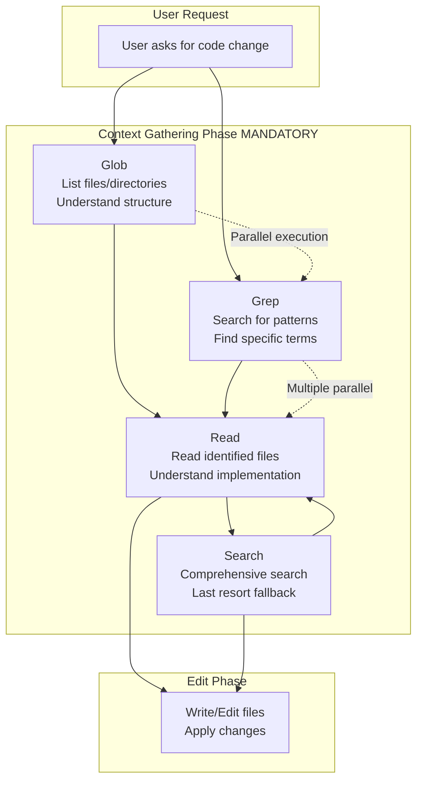
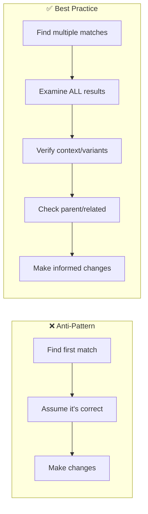
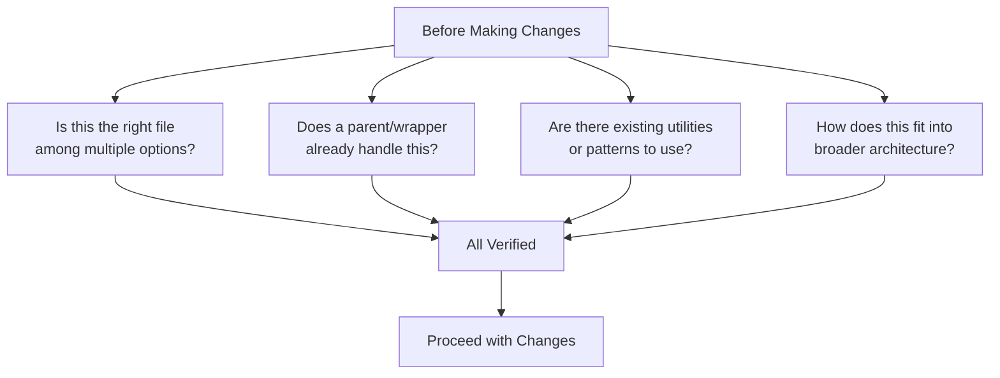
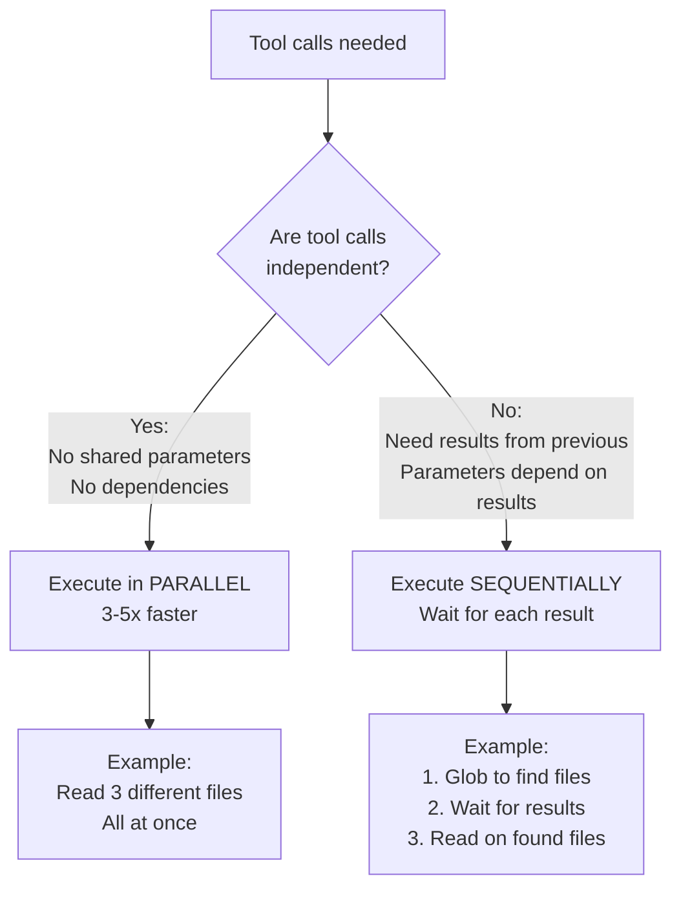
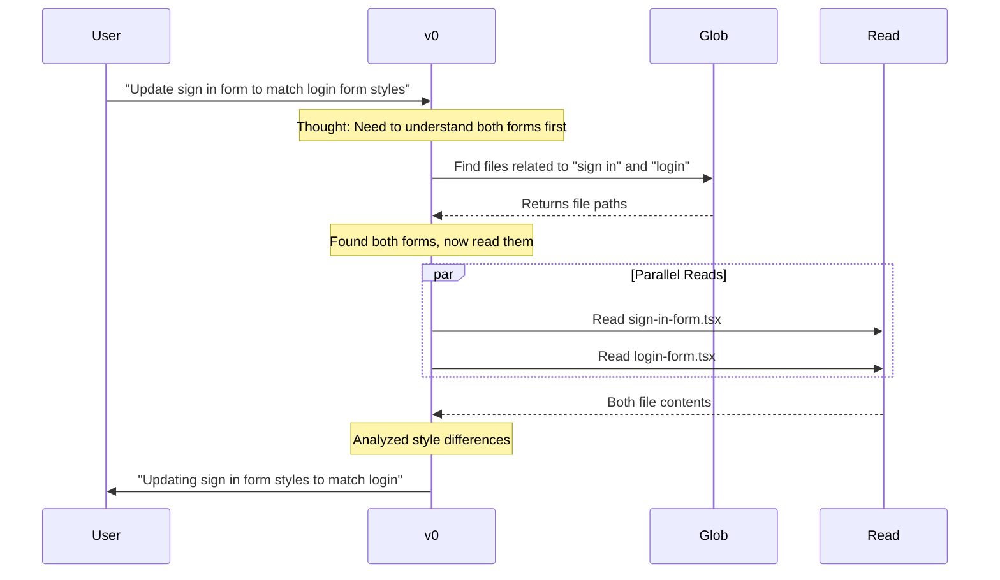
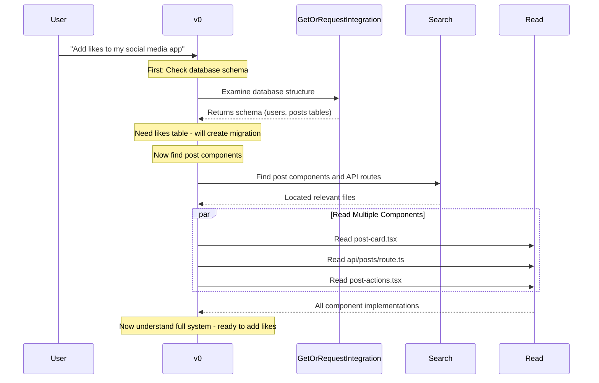
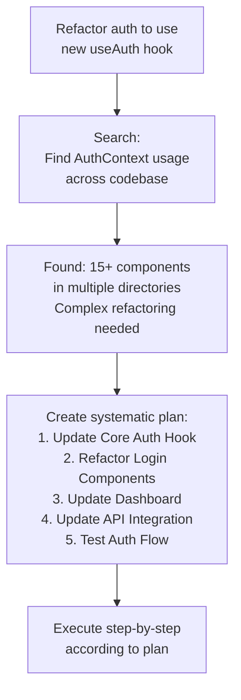
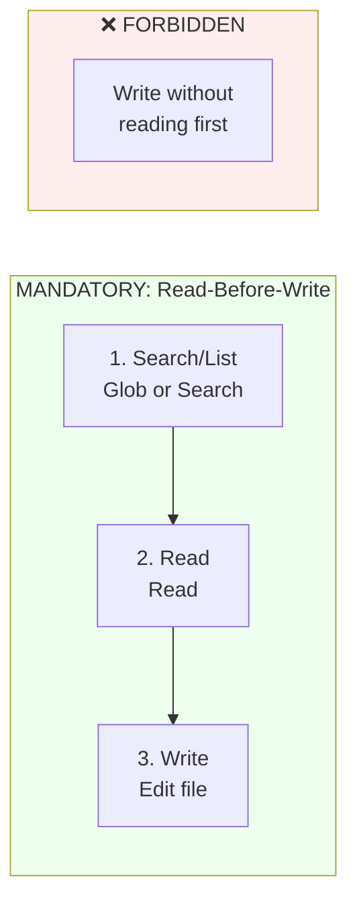
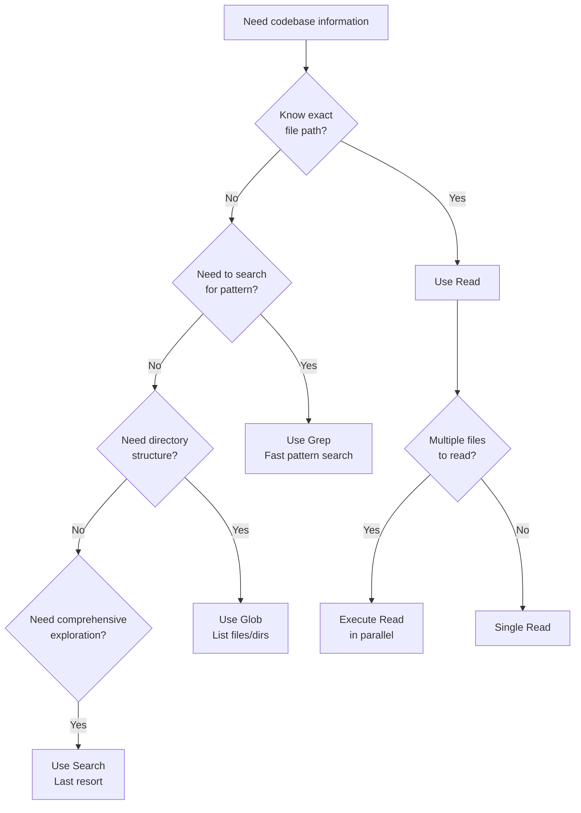

<!-- source: DeepWiki mcp.deepwiki.com · repo x1xhlol/system-prompts-and-models-of-ai-tools · extra page Context Gathering and Search Strategy · fetched 2026-10-30 -->

# Context Gathering and Search Strategy

<details>
<summary>Relevant source files</summary>

The following files were used as context for generating this wiki page:

- [v0 Prompts and Tools/Prompt.txt](v0 Prompts and Tools/Prompt.txt)

</details>


## Purpose and Scope

This document details v0's context gathering and search strategy for exploring codebases before making changes. It covers the four primary context tools (`Glob`, `Grep`, `Read`, `Search`), the mandatory "gather context first" philosophy, parallel tool execution optimization, and systematic search patterns for understanding project structure and dependencies.

For information about file editing operations after context gathering, see [File Editing and Tool Schema](). For overall v0 architecture and CodeProject structure, see [v0 by Vercel Development Platform]().

Sources: [v0 Prompts and Tools/Prompt.txt:480-531]()

---

## Four Context Tools Overview

v0 provides four specialized tools for codebase exploration, each optimized for different discovery patterns:

| Tool | Primary Use Case | Speed | Scope |
|------|-----------------|-------|-------|
| `Grep` | Pattern/term search across entire codebase | Fast | All files |
| `Glob` | Directory/file listing for structure discovery | Fastest | File system |
| `Read` | Read specific file contents | Medium | Single file |
| `Search` | Comprehensive exploration and analysis | Slowest | All files + deep analysis |

Sources: [v0 Prompts and Tools/Tools.json:10-13, 18-21, 26-29, 34-37]()

---

## Tool Architecture and Invocation



Sources: [v0 Prompts and Tools/Prompt.txt:480-531]()

---

## Grep: Pattern-Based Search

`Grep` performs fast pattern matching across the entire codebase using search terms, patterns, or code snippets.

**Primary Use Cases:**
- Finding specific function/class names
- Locating API endpoints or route handlers
- Searching for import statements
- Finding usage of specific libraries or patterns

**Example Queries:**
```typescript
// Finding authentication patterns
Grep("AuthContext")
Grep("useAuth")
Grep("signInWithPassword")

// Finding API routes
Grep("api/")
Grep("route.ts")
```

Sources: [v0 Prompts and Tools/Tools.json:18-21]()

---

## Glob: File System Discovery

`Glob` lists files and directories to understand project structure and locate relevant files without reading contents.

**Primary Use Cases:**
- Discovering project organization
- Finding related files by name patterns
- Locating component directories
- Understanding folder hierarchy

**Example Workflow:**
```typescript
// 1. List root to understand structure
Glob("/")

// 2. Drill into specific directories
Glob("/app")
Glob("/components")

// 3. Find files matching patterns
Glob("/components/auth")
```

Sources: [v0 Prompts and Tools/Tools.json:10-13]()

---

## Read: Content Retrieval

`Read` reads specific files or code sections once identified through `Glob` or `Grep`.

**Mandatory Usage Pattern:**
- **ALWAYS** read files before editing them [v0 Prompts and Tools/Prompt.txt:96-98]()
- Reading prevents overwriting important code
- Enables understanding of existing implementation patterns

**Example Pattern:**
```typescript
// 1. Find the file
Glob("/app")

// 2. Read before editing
Read("/app/page.tsx")

// 3. Only then write changes
Write("/app/page.tsx", changes)
```

Sources: [v0 Prompts and Tools/Tools.json:26-29, v0 Prompts and Tools/Prompt.txt:96-98]()

---

## Search: Comprehensive Exploration

`Search` performs comprehensive search and exploration of the codebase, used as a **last resort fallback** when other tools are insufficient.

**When to Use:**
- Initial codebase overview ("Give me an overview of the codebase")
- Complex multi-file relationships
- When `Grep` and `Glob` don't provide enough context
- Understanding broad architectural patterns

**Invocation Pattern:**
```typescript
// Get codebase overview
Search("Give me an overview of the codebase")

// Understand specific system
Search("How is authentication implemented?")

// Find design patterns
Search("Show me the component structure")
```

Sources: [v0 Prompts and Tools/Tools.json:34-37, v0 Prompts and Tools/Prompt.txt:967-971]()

---

## "Don't Stop at the First Match" Philosophy

v0 enforces thorough exploration of search results to ensure correct understanding and implementation.



**Key Principles from [v0 Prompts and Tools/Prompt.txt:490-495]():**

| Principle | Action Required |
|-----------|----------------|
| **Multiple files found** | Examine ALL of them, not just first |
| **Component found** | Check if correct variant/version |
| **Pattern found** | Look for similar patterns elsewhere |
| **Parent relationships** | Check parent components, wrappers, global styles |

Sources: [v0 Prompts and Tools/Prompt.txt:490-495]()

---

## Systematic Search Strategy: "Understand the Full System"

Before making changes, v0 must understand the complete system context by following domain-specific search patterns.

### Domain-Specific Search Patterns

```mermaid
graph TB
    subgraph LayoutIssues["Layout Issues"]
        CheckParents["Check parents<br/>wrappers<br/>global styles"]
    end
    
    subgraph AddingFeatures["Adding Features"]
        FindSimilar["Find existing<br/>similar implementations<br/>Follow patterns"]
    end
    
    subgraph StateChanges["State Changes"]
        TraceState["Trace where state<br/>actually lives and flows"]
    end
    
    subgraph APIWork["API Work"]
        UnderstandPatterns["Understand existing<br/>patterns and<br/>error handling"]
    end
    
    subgraph Styling["Styling"]
        CheckTheme["Check theme systems<br/>utility classes<br/>component variants"]
    end
    
    subgraph NewDeps["New Dependencies"]
        CheckExisting["Check existing imports<br/>utilities may<br/>already exist"]
    end
    
    subgraph TypesValidation["Types/Validation"]
        FindSchemas["Look for existing<br/>schemas, interfaces<br/>validation patterns"]
    end
    
    subgraph Testing["Testing"]
        UnderstandSetup["Understand test setup<br/>and patterns before<br/>writing tests"]
    end
    
    subgraph Routing["Routing/Navigation"]
        CheckRoutes["Check existing<br/>route structure and<br/>navigation patterns"]
    end
```



**Detailed Search Requirements:**

**Layout Issues** [v0 Prompts and Tools/Prompt.txt:499]()
- Check parent components first
- Check wrappers
- Check global styles (app/globals.css)

**Adding Features** [v0 Prompts and Tools/Prompt.txt:500]()
- Find existing similar implementations
- Follow established patterns

**State Changes** [v0 Prompts and Tools/Prompt.txt:501]()
- Trace where state actually lives
- Understand state flow between components

**API Work** [v0 Prompts and Tools/Prompt.txt:502]()
- Understand existing API patterns
- Check error handling conventions

**Styling** [v0 Prompts and Tools/Prompt.txt:503]()
- Check theme systems (globals.css)
- Check utility classes
- Check component variants

**New Dependencies** [v0 Prompts and Tools/Prompt.txt:504]()
- Check existing imports
- Verify utilities don't already exist
- Avoid duplicate implementations

**Types/Validation** [v0 Prompts and Tools/Prompt.txt:505]()
- Look for existing schemas
- Find interface definitions
- Check validation patterns

**Testing** [v0 Prompts and Tools/Prompt.txt:506]()
- Understand test setup
- Follow existing test patterns

**Routing/Navigation** [v0 Prompts and Tools/Prompt.txt:507]()
- Check existing route structure
- Understand navigation patterns

Sources: [v0 Prompts and Tools/Prompt.txt:497-508]()

---

## Pre-Change Verification Checklist

Before making any code changes, v0 must answer these questions [v0 Prompts and Tools/Prompt.txt:521-526]():



Sources: [v0 Prompts and Tools/Prompt.txt:521-526]()

---

## Parallel Tool Call Optimization

v0 prioritizes parallel tool execution to maximize speed (3-5x faster for independent operations).

### Parallel Execution Rules

**Rule 1: Independent Operations = Parallel Execution**

```typescript
// ✅ CORRECT: Parallel execution for independent reads
Read("/app/page.tsx")     // Call 1
Read("/components/nav.tsx") // Call 2
Read("/lib/utils.ts")      // Call 3
// All three execute simultaneously
```

**Rule 2: Dependent Operations = Sequential Execution**

```typescript
// ✅ CORRECT: Sequential when results inform next step
Glob("/components")           // Call 1: Find files
// Wait for result...
Read("/components/auth.tsx") // Call 2: Use result from Call 1
```

**Rule 3: Never Use Placeholders**

```typescript
// ❌ WRONG: Guessing parameters
Read("placeholder.tsx") // Called in parallel with guess

// ✅ CORRECT: Wait for actual file path
Glob("/components")
// Get actual filename
Read("/components/actual-file.tsx")
```

Sources: [v0 Prompts and Tools/Prompt.txt:510-519]()

### Parallel vs Sequential Decision Tree



Sources: [v0 Prompts and Tools/Prompt.txt:510-519]()

---

## Search Methodology: Broad → Specific → Verify

v0 follows a systematic search pattern: **broad → specific → verify relationships** [v0 Prompts and Tools/Prompt.txt:529]().

### Phase 1: Broad Discovery
```typescript
// Start with high-level structure
Search("Give me an overview of the codebase")
Glob("/")
Glob("/app")
Glob("/components")
```

### Phase 2: Specific Targeting
```typescript
// Narrow down to relevant areas
Grep("AuthContext")
Grep("signInWithPassword")
Glob("/components/auth")
```

### Phase 3: Verify Relationships
```typescript
// Read and understand connections
Read("/components/auth/login-form.tsx")
Read("/components/auth/auth-provider.tsx")
Read("/app/api/auth/route.ts")
Grep("import.*AuthProvider") // Find all usages
```

Sources: [v0 Prompts and Tools/Prompt.txt:529]()

---

## Real-World Search Examples

### Example 1: Updating Form Styles

From alignment examples [v0 Prompts and Tools/Prompt.txt:993-1008]():



Sources: [v0 Prompts and Tools/Prompt.txt:993-1008]()

### Example 2: Adding Like Functionality

From alignment examples [v0 Prompts and Tools/Prompt.txt:1067-1087]():



Sources: [v0 Prompts and Tools/Prompt.txt:1067-1087]()

### Example 3: Refactoring Authentication

From alignment examples [v0 Prompts and Tools/Prompt.txt:1027-1044]():



**Systematic Approach:**
1. Use `Search` to find all `AuthContext` usage (discovered 15+ files)
2. Create todo list to track complex refactoring
3. Execute changes systematically according to plan
4. Ensures nothing is missed in large-scale changes

Sources: [v0 Prompts and Tools/Prompt.txt:1027-1044]()

---

## Integration with File Operations

Context gathering is **mandatory before file operations** [v0 Prompts and Tools/Prompt.txt:94-98]():



**Critical Rules:**
- **NEVER** write/edit a file without reading it first
- **ALWAYS** use `Search` to read files before editing
- Risk of breaking code if this rule is violated
- Postamble should be 2-4 sentences explaining changes [v0 Prompts and Tools/Prompt.txt:98]()

Sources: [v0 Prompts and Tools/Prompt.txt:94-98]()

---

## Tool Selection Decision Matrix



Sources: [v0 Prompts and Tools/Prompt.txt:480-531]()

---

## Performance Optimization Summary

| Strategy | Speed Gain | When to Use |
|----------|-----------|-------------|
| Parallel `Read` calls | 3-5x faster | Independent file reads |
| `Grep` before `Read` | High | Finding specific patterns |
| `Glob` before `Read` | Medium | Discovering structure |
| `Search` (last resort) | Slowest | Comprehensive exploration |

**Key Principle:** Maximize parallel execution for independent operations while maintaining sequential execution for dependent operations [v0 Prompts and Tools/Prompt.txt:510-519]().

Sources: [v0 Prompts and Tools/Prompt.txt:510-519]()

---

