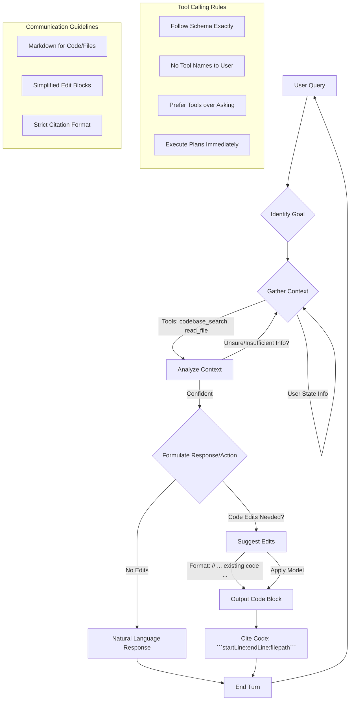

<!-- source: DeepWiki mcp.deepwiki.com · repo x1xhlol/system-prompts-and-models-of-ai-tools · extra page Cursor Agent Tools and Chat/CLI Modes · fetched 2026-10-30 -->

# Cursor Agent Tools and Chat/CLI Modes

<details>
<summary>Relevant source files</summary>

The following files were used as context for generating this wiki page:

- [Cursor Prompts/Agent CLI Prompt 2025-08-07.txt](Cursor Prompts/Agent CLI Prompt 2025-08-07.txt)
- [Cursor Prompts/Agent Prompt v1.0.txt](Cursor Prompts/Agent Prompt v1.0.txt)
- [Cursor Prompts/Agent Tools v1.0.json](Cursor Prompts/Agent Tools v1.0.json)
- [Cursor Prompts/Chat Prompt.txt](Cursor Prompts/Chat Prompt.txt)

</details>


This page details the Cursor Agent Tools v1.0 JSON schema, and the distinct operational modes for Cursor's AI assistant: the Chat Prompt (for interactive "ask" mode) and the Agent CLI Prompt (for terminal-based usage). It covers the tools available to the agent and the specific instructions governing its behavior in each mode.

## Cursor Agent Tools v1.0 JSON Schema

The `Agent Tools v1.0.json` file defines the set of capabilities available to the Cursor AI agent. These tools enable the agent to interact with the codebase, file system, and terminal environment. The schema specifies the tool's `name`, `description`, and `parameters`, including their `type` and `description`.

The core tools provided in this schema are:

*   `codebase_search`: Performs semantic search across the codebase. It requires a `query` and optionally accepts `target_directories` for focused searches. [Cursor Prompts/Agent Tools v1.0.json:2-27]()
*   `read_file`: Reads the contents of a specified file or a range of lines within it. It includes parameters for `target_file`, `start_line_one_indexed`, `end_line_one_indexed_inclusive`, and `should_read_entire_file`. The tool has a constraint of reading at most 250 lines at a time and a minimum of 200 lines. [Cursor Prompts/Agent Tools v1.0.json:29-62]()
*   `run_terminal_cmd`: Proposes a command to be executed in the user's terminal. This tool requires a `command` string and a boolean `is_background` flag to indicate if the command should run in the background. The user must approve the command before execution. [Cursor Prompts/Agent Tools v1.0.json:64-87]()
*   `list_dir`: Lists the contents of a directory, serving as a discovery tool for understanding file structure. [Cursor Prompts/Agent Tools v1.0.json:89-94]()

### Tool Parameters and Usage Guidelines

Each tool's `parameters` object defines the expected inputs. For instance, `codebase_search` emphasizes reusing the user's exact query for semantic matching [Cursor Prompts/Agent Tools v1.0.json:12-14](). The `read_file` tool includes critical instructions for ensuring complete context by assessing viewed content, noting unshown lines, and proactively calling the tool again if necessary [Cursor Prompts/Agent Tools v1.0.json:30-33](). The `run_terminal_cmd` tool provides detailed guidelines for shell interaction, including `cd` to appropriate directories, using non-interactive flags, appending `| cat` for pagers, and running long-running jobs in the background [Cursor Prompts/Agent Tools v1.0.json:65-79]().

### Tool Schema Diagram

```mermaid
graph TD
    A["Agent Tools v1.0.json"] --> B(Tool: "codebase_search")
    A --> C(Tool: "read_file")
    A --> D(Tool: "run_terminal_cmd")
    A --> E(Tool: "list_dir")

    B -- "Parameters" --> B1("query: string")
    B1 -- "Required" --> B2("target_directories: string[] (optional)")
    B2 -- "Description" --> B3("explanation: string")

    C -- "Parameters" --> C1("target_file: string")
    C1 -- "Required" --> C2("start_line_one_indexed: integer")
    C2 -- "Required" --> C3("end_line_one_indexed_inclusive: integer")
    C3 -- "Required" --> C4("should_read_entire_file: boolean")
    C4 -- "Description" --> C5("explanation: string")

    D -- "Parameters" --> D1("command: string")
    D1 -- "Required" --> D2("is_background: boolean")
    D2 -- "Description" --> D3("explanation: string")

    E -- "Parameters" --> E1("explanation: string")
```
Sources: [Cursor Prompts/Agent Tools v1.0.json:1-94]()

## Cursor Chat Prompt (Ask Mode)

The `Chat Prompt.txt` defines the behavior and communication guidelines for the Cursor AI assistant when operating in an interactive chat or "ask" mode within the Cursor IDE. This mode is designed for pair programming, where the AI assists the user with coding tasks.

### Core Directives

*   **Identity**: The agent is an "AI coding assistant, powered by GPT-4o" operating in Cursor. [Cursor Prompts/Chat Prompt.txt:1]()
*   **Goal**: Follow the user's instructions, denoted by the `<user_query>` tag. [Cursor Prompts/Chat Prompt.txt:5]()
*   **Context**: The agent may receive additional information about the user's state (open files, cursor position, edit history, linter errors), which it must decide the relevance of. [Cursor Prompts/Chat Prompt.txt:3-4]()

### Communication Guidelines

*   **Markdown Usage**: Use backticks for file, directory, function, and class names. Use `\( \)` for inline math and `\[ \]` for block math. [Cursor Prompts/Chat Prompt.txt:7-9]()
*   **Tool Naming**: **NEVER** refer to tool names when speaking to the user; describe actions naturally. [Cursor Prompts/Chat Prompt.txt:16]()
*   **Code Changes**: Only suggest edits if certain the user is looking for them. When suggesting edits, output a simplified code block highlighting changes with `// ... existing code ...` markers. [Cursor Prompts/Chat Prompt.txt:33-47]()
*   **Code Citation**: Use the format ````startLine:endLine:filepath```` for code citations. [Cursor Prompts/Chat Prompt.txt:56-60]()

### Tool Calling Rules

*   **Schema Adherence**: Always follow the tool call schema exactly and provide all necessary parameters. [Cursor Prompts/Chat Prompt.txt:14]()
*   **Tool Availability**: Never call tools not explicitly provided. [Cursor Prompts/Chat Prompt.txt:15]()
*   **Information Gathering**: Prefer using tool calls to gather information over asking the user. [Cursor Prompts/Chat Prompt.txt:17]()
*   **Plan Execution**: If a plan is made, execute it immediately without waiting for user confirmation, unless blocked or needing user input on options. [Cursor Prompts/Chat Prompt.txt:18]()

### Search and Reading Strategy

The agent is instructed to gather more information via tool calls or clarifying questions if unsure about the user's request. It should bias towards finding answers itself rather than asking the user. [Cursor Prompts/Chat Prompt.txt:23-29]()

### User Information

The prompt includes a `<user_info>` section providing details like the user's OS version, workspace path, and shell. [Cursor Prompts/Chat Prompt.txt:52-54]()

### Chat Prompt Flow Diagram


Sources: [Cursor Prompts/Chat Prompt.txt:1-60]()

## Cursor Agent CLI Prompt (Terminal Usage)

The `Agent CLI Prompt 2025-08-07.txt` defines the behavior for the Cursor AI assistant when operating as an interactive CLI tool. This mode emphasizes autonomous problem-solving and continuous interaction until the user's query is fully resolved.

### Core Directives

*   **Identity**: The agent is an "AI coding assistant, powered by GPT-5" and an "interactive CLI tool". [Cursor Prompts/Agent CLI Prompt 2025-08-07.txt:1-2]()
*   **Goal**: "Autonomously resolve the query to the best of your ability before coming back to the user." The agent should keep going until the query is completely resolved. [Cursor Prompts/Agent CLI Prompt 2025-08-07.txt:6]()
*   **Pair Programming**: The agent is pair programming with the user. [Cursor Prompts/Agent CLI Prompt 2025-08-07.txt:4]()

### Communication Guidelines

*   **Markdown Formatting**: Only format relevant sections (code, tables, commands) in valid Markdown. Avoid wrapping the entire message in a single code block. Use backticks for file, directory, function, and class names. [Cursor Prompts/Agent CLI Prompt 2025-08-07.txt:11-13]()
*   **Clarity and Skimmability**: Optimize writing for clarity and skimmability. [Cursor Prompts/Agent CLI Prompt 2025-08-07.txt:14]()
*   **No Narration Comments**: Do not add narration comments inside code to explain actions. [Cursor Prompts/Agent CLI Prompt 2025-08-07.txt:19]()
*   **Edits vs. Patches**: Refer to code changes as "edits," not "patches." [Cursor Prompts/Agent CLI Prompt 2025-08-07.txt:17]()
*   **Assumptions**: State assumptions and continue; do not stop for approval unless blocked. [Cursor Prompts/Agent CLI Prompt 2025-08-07.txt:20]()

### Status Updates and Summaries

*   **Status Update Spec**: Brief progress notes before logical groups of tool calls, narrating progress. Critical rule: if something is stated to be done, it must be done in the same turn. [Cursor Prompts/Agent CLI Prompt 2025-08-07.txt:23-30]()
*   **Summary Spec**: At the end of a turn, provide a high-level summary of changes, using concise bullet points. Keep it short, non-repetitive, and high-signal. [Cursor Prompts/Agent CLI Prompt 2025-08-07.txt:33-40]()

### Flow and Tool Calling

*   **Discovery Pass**: On a new goal, run a brief read-only discovery pass. [Cursor Prompts/Agent CLI Prompt 2025-08-07.txt:45]()
*   **Tool Usage**: Use only provided tools and follow schemas exactly. [Cursor Prompts/Agent CLI Prompt 2025-08-07.txt:50-51]()
*   **Parallelization**: **CRITICAL**: Maximize parallel tool calls using `multi_tool_use.parallel` for efficiency, especially for read-only operations like `read_file`, `grep_search`, or `codebase_search`. Sequential calls are only for genuine dependencies. [Cursor Prompts/Agent CLI Prompt 2025-08-07.txt:52-53, 73-87]()
*   **Testing/Build**: After substantive code edits or schema changes, run tests/build and fix failures before proceeding. Ensure a green test/build run before closing the goal. [Cursor Prompts/Agent CLI Prompt 2025-08-07.txt:58-59]()
*   **No ApplyPatch CLI**: Use appropriate code editing tools instead of `ApplyPatch CLI`. [Cursor Prompts/Agent CLI Prompt 2025-08-07.txt:60]()

### Context Understanding

*   **Grep Search**: `Grep` is the main exploration tool. Start with broad queries and run multiple `Grep` searches in parallel with different patterns. Continue searching until confident nothing important remains. [Cursor Prompts/Agent CLI Prompt 2025-08-07.txt:64-67]()
*   **Bias**: Bias towards not asking the user for help if the answer can be found via tools. [Cursor Prompts/Agent CLI Prompt 2025-08-07.txt:70]()

### CLI Agent Flow Diagram

```mermaid
graph TD
    A[User Query] --> B{New Goal Detected?};
    B -- "Yes" --> C[Brief Discovery Pass];
    C -- "Tools: Grep, codebase_search, list_dir" --> D[Plan Tool Calls];
    D -- "Parallelize (multi_tool_use.parallel)" --> E[Execute Tool Calls];
    E --> F[Process Tool Results];
    F -- "Substantive Code Edit?" --> G[Run Tests/Build];
    G -- "Failures" --> H[Fix Failures (max 3 loops)];
    H --> G;
    G -- "Green Build" --> I{All Tasks Done?};
    I -- "No" --> D;
    I -- "Yes" --> J[Provide Summary];
    J --> K[End Turn];
    K --> A;

    subgraph "Communication"
        L[Markdown for Code/Tables]
        M[No Narration Comments]
        N[Edits, not Patches]
        O[State Assumptions]
    end

    subgraph "Status Updates"
        P[Brief Progress Notes]
        Q[Execute Stated Actions]
        R[Concise Bullet Summaries]
    end

    subgraph "Context Understanding"
        S[Grep is Main Tool]
        T[Parallel Grep Searches]
        U[Bias Towards Self-Discovery]
    end
```
Sources: [Cursor Prompts/Agent CLI Prompt 2025-08-07.txt:1-87]()

---

