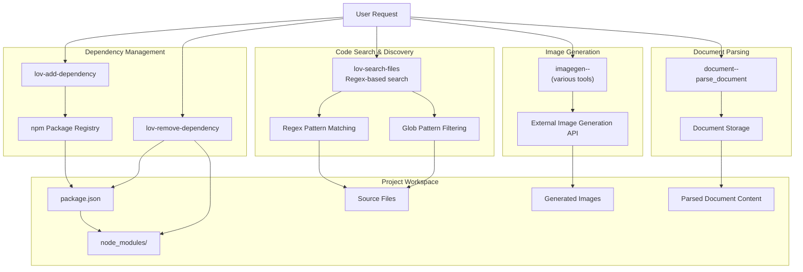
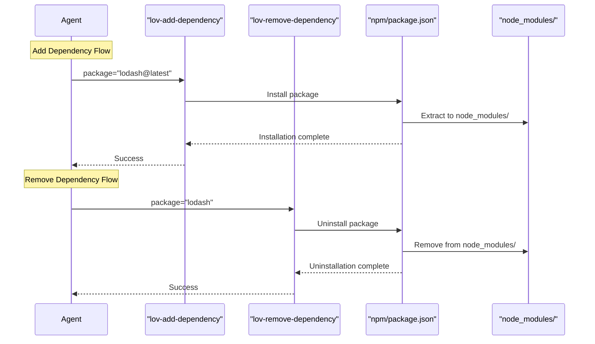
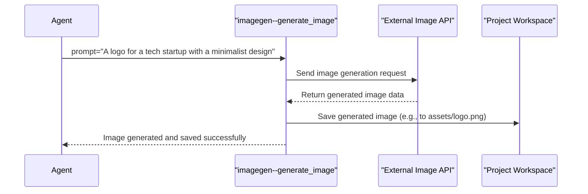
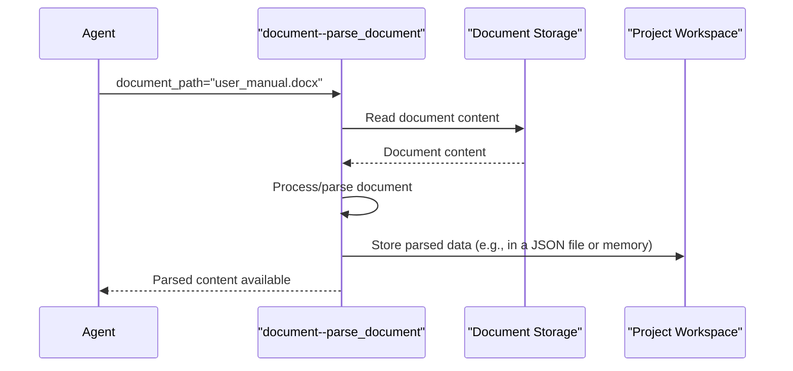

<!-- source: DeepWiki mcp.deepwiki.com · repo x1xhlol/system-prompts-and-models-of-ai-tools · extra page Dependency, Search, Image and Document Tools · fetched 2026-10-30 -->

# Dependency, Search, Image and Document Tools

Relevant source files

The following files were used as context for generating this wiki page:

- [Lovable/Agent Tools.json](Lovable/Agent Tools.json)

This document details Lovable's dependency management, code search, image generation, and document parsing capabilities. It covers the `lov-add-dependency`, `lov-remove-dependency`, `lov-search-files`, `imagegen--` tools, and `document--parse_document`. These tools enable package installation/removal, regex-based code discovery, visual asset creation, and content extraction from documents within the project workspace.

For file modification operations, see [4.3.2](). For other file system operations (rename, delete, copy), see [4.3.1]().

Sources: [Lovable/Agent Tools.json:1-437]()

## Tool Ecosystem Overview

The dependency, search, image, and document tools form Lovable's foundation for project exploration, dependency management, content creation, and information extraction. These tools operate on the project workspace and integrate with npm's package ecosystem, external image generation services, and document parsing functionalities.

Sources: [Lovable/Agent Tools.json:2-13](), [Lovable/Agent Tools.json:15-38](), [Lovable/Agent Tools.json:187-198](), [Lovable/Agent Tools.json:286-300](), [Lovable/Agent Tools.json:302-316]()

## Dependency Management

### lov-add-dependency Tool

The `lov-add-dependency` tool installs npm packages into the project. It accepts a package specification string that includes the package name and optional version.

**Parameter Schema:**

| Parameter | Type | Required | Example | Description |
|-----------|------|----------|---------|-------------|
| `package` | string | Yes | `"lodash@latest"` | Valid npm package name with optional version specifier |

Sources: [Lovable/Agent Tools.json:2-13]()

#### Package Specification Format

The tool accepts standard npm package specification syntax:
- **Bare package name:** `"lodash"` (installs latest version)
- **Version pinned:** `"react@18.2.0"` (specific version)
- **Version range:** `"next@^14.0.0"` (semver range)
- **Latest tag:** `"typescript@latest"` (latest stable)
- **Specific tag:** `"react@beta"` (pre-release tag)

Sources: [Lovable/Agent Tools.json:6-9]()

### lov-remove-dependency Tool

The `lov-remove-dependency` tool uninstalls packages from the project. It requires only the package name without version specifiers.

**Parameter Schema:**

| Parameter | Type | Required | Example | Description |
|-----------|------|----------|---------|-------------|
| `package` | string | Yes | `"lodash"` | Package name to uninstall (no version) |

Sources: [Lovable/Agent Tools.json:187-198]()

#### Dependency Modification Workflow

Sources: [Lovable/Agent Tools.json:2-13](), [Lovable/Agent Tools.json:187-198]()

## Search Tools

### lov-search-files Tool

The `lov-search-files` tool performs regex-based code search with file filtering capabilities. It searches across the project using regex patterns and supports glob-based include/exclude patterns.

**Parameter Schema:**

| Parameter | Type | Required | Default | Example | Description |
|-----------|------|----------|---------|---------|-------------|
| `query` | string | Yes | - | `"useEffect\\("` | Regex pattern to search for |
| `include_pattern` | string | Yes | - | `"src/**"` | Glob pattern for files to include |
| `exclude_pattern` | string | No | None | `"**/*.test.tsx"` | Glob pattern for files to exclude |
| `case_sensitive` | boolean | No | `false` | `false` | Whether to match case |

Sources: [Lovable/Agent Tools.json:15-38]()

#### Search Pattern Syntax

The tool description explicitly documents regex escaping requirements:

> "Tip: Use \\\\ to escape special characters in regex patterns." [Lovable/Agent Tools.json:16]()

This means regex metacharacters must be escaped with double backslashes:
- `"useEffect\\("` - searches for `useEffect(` function calls
- `"useState\\<.*\\>"` - searches for `useState<...>` with type parameters
- `"import.*from\\s+['\"]react['\"]"` - searches for React imports

Sources: [Lovable/Agent Tools.json:16](), [Lovable/Agent Tools.json:31-33]()

#### Glob Pattern Filtering

Include and exclude patterns use glob syntax for file path matching:
- `"src/**"` - all files under src/
- `"src/**/*.tsx"` - all TypeScript React files under src/
- `"**/*.test.tsx"` - all test files (for exclusion)
- `"src/components/ui/**"` - all files under ui components

Sources: [Lovable/Agent Tools.json:23-29]()

## Image Generation Tools

### imagegen-- Tools

The `imagegen--` tools are a category of tools designed for generating images. The specific tool `imagegen--generate_image` is available for creating images based on a textual prompt.

**Parameter Schema for `imagegen--generate_image`:**

| Parameter | Type | Required | Example | Description |
|-----------|------|----------|---------|-------------|
| `prompt` | string | Yes | `"A futuristic city at sunset"` | The textual description for the image to be generated. |

Sources: [Lovable/Agent Tools.json:286-300]()

#### Image Generation Workflow

Sources: [Lovable/Agent Tools.json:286-300]()

## Document Parsing Tools

### document--parse_document Tool

The `document--parse_document` tool is used to extract structured information from a given document. This is useful for processing various document types and integrating their content into the project's context.

**Parameter Schema for `document--parse_document`:**

| Parameter | Type | Required | Example | Description |
|-----------|------|----------|---------|-------------|
| `document_path` | string | Yes | `"docs/requirements.pdf"` | The path to the document to be parsed. |

Sources: [Lovable/Agent Tools.json:302-316]()

#### Document Parsing Workflow

Sources: [Lovable/Agent Tools.json:302-316]()

## Integration with Other Tools

The dependency, search, image, and document tools integrate with other Lovable tools to form complete workflows:

| Tool Category | Integration Point | Purpose |
|---------------|-------------------|---------|
| **File Operations** | `lov-search-files` → `lov-line-replace` | Search for code patterns, then modify matches |
| **File Operations** | `lov-search-files` → `lov-write` | Search for relevant files, then write new files based on context |
| **Web Search** | `websearch--web_search` → `lov-add-dependency` | Find package recommendations, install them |
| **Documentation** | `document--parse_document` → `lov-search-files` | Parse a document, then search codebase for related implementations |
| **Image Generation** | `imagegen--generate_image` → `lov-write` | Generate an image, then write its path or embed it in a file |

Sources: [Lovable/Agent Tools.json:15-38](), [Lovable/Agent Tools.json:40-55](), [Lovable/Agent Tools.json:57-61](), [Lovable/Agent Tools.json:256-284](), [Lovable/Agent Tools.json:286-300](), [Lovable/Agent Tools.json:302-316]()

## Performance Considerations

### Parallel Tool Invocation

While `lov-search-files` and `lov-add-dependency` are typically single-invocation tools for a given task, the `imagegen--` and `document--` tools might benefit from parallel execution if multiple images need to be generated or multiple documents parsed simultaneously. The general principle of parallel execution for independent tasks applies across Lovable's toolset.

Sources: [Lovable/Agent Tools.json:40-55]() (Implicitly, the `lov-write` tool's parallel usage guidance suggests a general principle for independent operations.)

## Tool Naming Convention

All tools follow the `lov-` prefix convention for core Lovable tools, or a category-specific prefix followed by `--` for specialized tools (e.g., `imagegen--`, `document--`, `supabase--`, `stripe--`). This distinguishes core functionalities from integration-specific or domain-specific tools.

- `lov-add-dependency` - core package management
- `lov-remove-dependency` - core package management
- `lov-search-files` - core code search
- `imagegen--generate_image` - image generation
- `document--parse_document` - document parsing

Sources: [Lovable/Agent Tools.json:2](), [Lovable/Agent Tools.json:15](), [Lovable/Agent Tools.json:187](), [Lovable/Agent Tools.json:286](), [Lovable/Agent Tools.json:302]()

## Case Sensitivity Behavior

The `lov-search-files` tool defaults to case-insensitive search (`case_sensitive: false`), which affects regex matching:

- `"useState"` matches `useState`, `UseState`, `USESTATE`
- Set `case_sensitive: true` for exact case matching
- Regex patterns like `"[A-Z]"` are affected by this setting

This default behavior prioritizes discovery over precision, making it easier to find code patterns without worrying about casing conventions.

Sources: [Lovable/Agent Tools.json:19-21]()

---

