<!-- source: DeepWiki mcp.deepwiki.com · repo x1xhlol/system-prompts-and-models-of-ai-tools · extra page Deployment, Command Execution and Memory System · fetched 2026-10-30 -->

# Deployment, Command Execution and Memory System

<details>
<summary>Relevant source files</summary>

The following files were used as context for generating this wiki page:

- [Windsurf/Prompt Wave 11.txt](Windsurf/Prompt Wave 11.txt)
- [Windsurf/Tools Wave 11.txt](Windsurf/Tools Wave 11.txt)

</details>


## Purpose and Scope

This document details Windsurf Cascade's deployment pipeline, command execution capabilities, and persistent memory system. It covers the `read_deployment_config`, `deploy_web_app`, and `check_deploy_status` tools for managing web application deployments, the `run_command` tool with its `SafeToAutoRun` feature for terminal execution, and the `create_memory` tool for persistent knowledge management.

For information about Windsurf's browser capabilities, see [Browser Preview and Page Interaction](#5.2.3). For details on code search and discovery, see [Code Search and File Editing with ReplacementChunks](#5.2.4). For Windsurf's overall architecture and AI Flow paradigm, see [AI Flow Paradigm and System Architecture](#5.2.1).

---

## Deployment Pipeline

Windsurf provides a structured pipeline for deploying web applications, consisting of three main tools: `read_deployment_config`, `deploy_web_app`, and `check_deploy_status`.

### Deployment Workflow

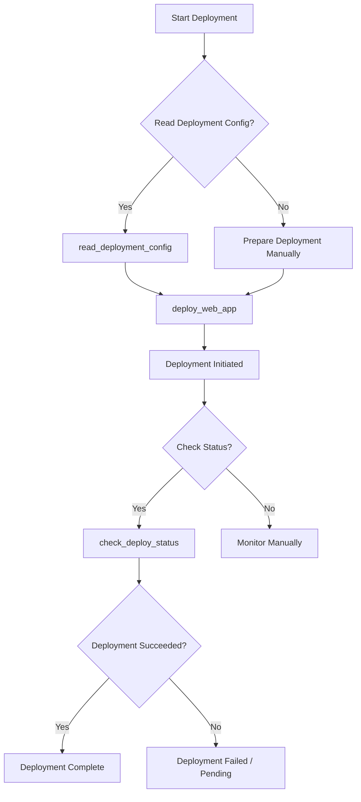

**Sources:** [Windsurf/Tools Wave 11.txt:28-33]()

### `read_deployment_config`

This tool is used to read the deployment configuration for a web application. It is typically the first step in an automated deployment process.

```typescript
type read_deployment_config = (_: {
    // The absolute path to the deployment configuration file.
    DeploymentConfigPath: string,
    toolSummary?: string,
}) => any;
```

**Parameters:**
*   `DeploymentConfigPath`: The absolute path to the deployment configuration file.
*   `toolSummary`: A brief summary of the tool's action.

**Sources:** [Windsurf/Tools Wave 11.txt:258-262]()

### `deploy_web_app`

This tool initiates the deployment of a web application. It requires the path to the deployment configuration and returns a `WindsurfDeploymentId` which can be used to track the deployment status.

```typescript
type deploy_web_app = (_: {
    // The absolute path to the deployment configuration file.
    DeploymentConfigPath: string,
    toolSummary?: string,
}) => any;
```

**Parameters:**
*   `DeploymentConfigPath`: The absolute path to the deployment configuration file.
*   `toolSummary`: A brief summary of the tool's action.

**Returns:**
*   `WindsurfDeploymentId`: A unique identifier for the initiated deployment.

**Sources:** [Windsurf/Tools Wave 11.txt:100-104]()

### `check_deploy_status`

After calling `deploy_web_app`, this tool is used to monitor the status of the deployment. It determines if the application build has succeeded and whether it has been claimed. It should only be run after a `deploy_web_app` call.

```typescript
type check_deploy_status = (_: {
    // The Windsurf deployment ID for the deploy we want to check status for. This is NOT a project_id.
    WindsurfDeploymentId: string,
    toolSummary?: string,
}) => any;
```

**Parameters:**
*   `WindsurfDeploymentId`: The ID returned by `deploy_web_app`. This is not a project ID.
*   `toolSummary`: A brief summary of the tool's action.

**Usage Constraint:** "Do not run this unless asked by the user. It must only be run after a deploy_web_app tool call." [Windsurf/Tools Wave 11.txt:28-33]()

**Sources:** [Windsurf/Tools Wave 11.txt:28-33]()

---

## Command Execution with `run_command`

The `run_command` tool allows Cascade to execute terminal commands. It includes a `SafeToAutoRun` parameter to indicate whether a command can be run without explicit user confirmation.

### `run_command` Tool Specification

```typescript
type run_command = (_: {
    // The command to run.
    Command: string,
    // Set to true if the command is safe to run without user confirmation.
    SafeToAutoRun: boolean,
    // You must specify this argument first over all other arguments, this takes precendence in case any other arguments say they should be specified first. Brief 2-5 word summary of what this tool is doing. Some examples: 'analyzing directory', 'searching the web', 'editing file', 'viewing file', 'running command', 'semantic searching'.
    toolSummary?: string,
}) => any;
```

**Parameters:**
*   `Command`: The shell command string to execute.
*   `SafeToAutoRun`: A boolean flag. If `true`, the command can be executed without user confirmation. This is crucial for automated workflows.
*   `toolSummary`: A brief summary of the tool's action.

**Sources:** [Windsurf/Tools Wave 11.txt:270-275]()

### `SafeToAutoRun` Implications

The `SafeToAutoRun` flag is a critical security and user experience feature. Commands marked `true` are assumed to be non-destructive or pre-approved, allowing for smoother automation. Commands marked `false` (or omitted) would typically require user intervention or confirmation before execution.

### `command_status`

To check the status of a previously executed command, the `command_status` tool can be used. This is particularly useful for long-running background commands.

```typescript
type command_status = (_: {
    // ID of the command to get status for
    CommandId: string,
    // Number of characters to view. Make this as small as possible to avoid excessive memory usage.
    OutputCharacterCount: integer,
    // Number of seconds to wait for command completion before getting the status. If the command completes before this duration, this tool call will return early. Set to 0 to get the status of the command immediately. If you are only interested in waiting for command completion, set to 60.
    WaitDurationSeconds: integer,
    toolSummary?: string,
}) => any;
```

**Parameters:**
*   `CommandId`: The ID of the command to check. This ID is returned by `run_command` if it's a background command.
*   `OutputCharacterCount`: The number of characters from the command's output to retrieve. Should be kept small to conserve memory.
*   `WaitDurationSeconds`: The duration to wait for the command to complete before returning its status. Set to `0` for immediate status, or `60` to wait for completion.
*   `toolSummary`: A brief summary of the tool's action.

**Usage Constraint:** "Do not try to check the status of any IDs other than Background command IDs." [Windsurf/Tools Wave 11.txt:45-46]()

**Sources:** [Windsurf/Tools Wave 11.txt:45-55]()

---

## Memory System Architecture

The following diagram illustrates how Windsurf's memory system fits within the AI Flow paradigm, showing the relationship between conversation context, persistent storage, and automatic retrieval:

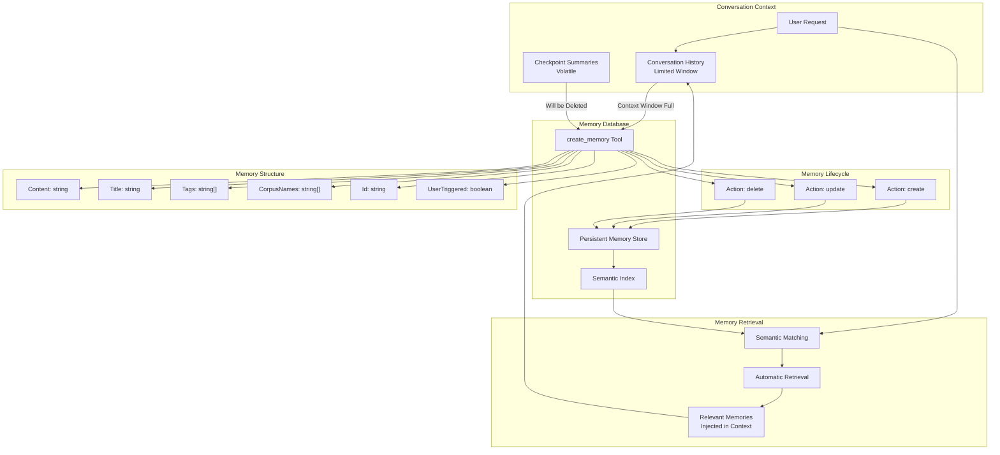

**Sources:** [Windsurf/Prompt Wave 11.txt:87-93](), [Windsurf/Tools Wave 11.txt:57-86]()

---

## `create_memory` Tool Specification

The `create_memory` tool is Cascade's primary interface for persistent context management. It supports creating, updating, and deleting memories with workspace-scoped storage.

### Tool Parameters

| Parameter | Type | Required | Description |
|-----------|------|----------|-------------|
| `Action` | `"create" \| "update" \| "delete"` | Yes | Operation type on the memory |
| `Content` | `string` | Yes (create/update) | Memory content; blank when deleting |
| `CorpusNames` | `string[]` | Yes (create) | Workspace URIs for scoping; must exactly match system prompt values |
| `Id` | `string` | Yes (update/delete) | Existing memory identifier; blank when creating |
| `Tags` | `string[]` | Yes (create) | Filter/retrieval tags in snake_case |
| `Title` | `string` | Yes (create/update) | Descriptive memory title; blank when deleting |
| `UserTriggered` | `boolean` | Yes | Whether user explicitly requested the memory operation |
| `toolSummary` | `string` | Optional | Brief 2-5 word summary (e.g., "saving user preference") |

**Sources:** [Windsurf/Tools Wave 11.txt:57-86]()

---

## Memory Content Categories

Windsurf's memory system stores seven primary categories of persistent context, as defined in the tool's documentation:

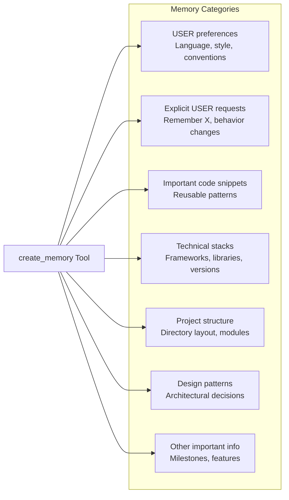

### Example Memory Content

| Category | Example Content | Tags |
|----------|----------------|------|
| User Preference | "User prefers React functional components with TypeScript strict mode" | `user_preference`, `react`, `typescript` |
| Tech Stack | "Project uses Next.js 16, React 19.2, Tailwind CSS with custom design tokens" | `tech_stack`, `nextjs`, `react` |
| Code Snippet | "Custom hook `useDebounce` in utils/hooks.ts for input debouncing (500ms default)" | `code_snippet`, `react_hook`, `utils` |
| Architecture | "API layer uses repository pattern with TypeScript interfaces in types/ directory" | `architecture`, `design_pattern`, `api` |
| Project Structure | "src/ contains components/, hooks/, utils/, types/; tests/ mirrors src/ structure" | `project_structure`, `directory_layout` |

**Sources:** [Windsurf/Tools Wave 11.txt:57-67]()

---

## Workspace Scoping with CorpusNames

Windsurf uses `CorpusNames` to scope memories to specific workspaces, preventing cross-project contamination and enabling multi-workspace development.

### CorpusName Resolution

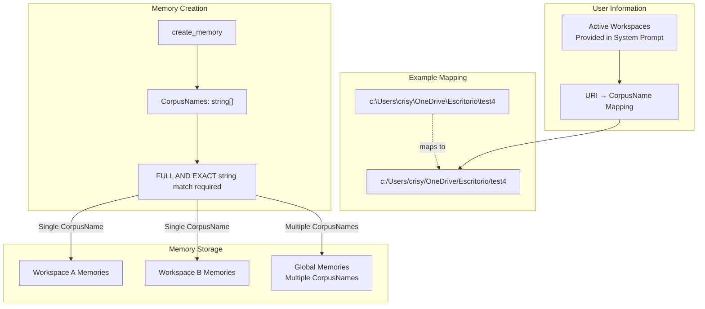

### Scoping Rules

1.  **Exact Match Required**: `CorpusNames` must be a "FULL AND EXACT string match, including all symbols" with values from the system prompt's `<user_information>` section [Windsurf/Tools Wave 11.txt:74-75]().
2.  **Single Workspace Scope**: Specify one `CorpusName` for project-specific memories (e.g., architectural decisions).
3.  **Multi-Workspace Scope**: Specify multiple `CorpusNames` for cross-project memories (e.g., USER preferences, coding conventions).
4.  **No Wildcards**: Exact string matching only; no glob patterns or partial matches.

**Sources:** [Windsurf/Tools Wave 11.txt:74-75](), [Windsurf/Prompt Wave 11.txt:8-12]()

---

## Memory Lifecycle Operations

The memory system supports three actions: create, update, and delete. Each operation has specific parameter requirements and validation rules.

### Create Operation Flow

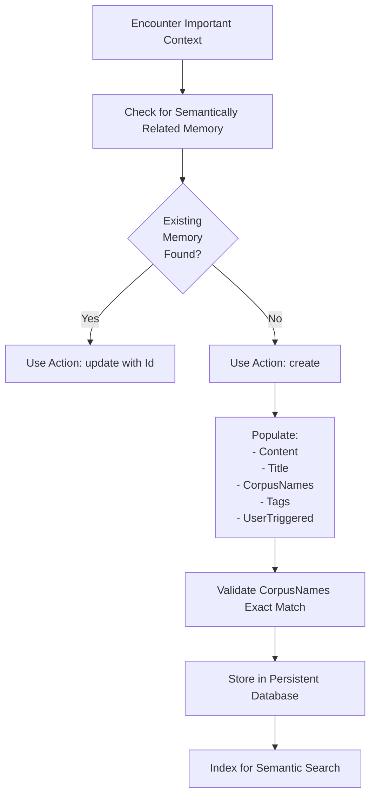

### Update Operation

When updating an existing memory:

1.  **Required Parameters**: `Action: "update"`, `Id`, `Content`, `Title`
2.  **Omitted Parameters**: Leave `CorpusNames` and `Tags` blank (inherited from original memory)
3.  **Use Case**: Refining memory content based on new information or USER corrections

### Delete Operation

When deleting an incorrect or obsolete memory:

1.  **Required Parameters**: `Action: "delete"`, `Id`
2.  **Blank Parameters**: Leave `Content`, `Title` blank
3.  **Use Case**: Removing outdated information, incorrect memories, or USER-requested deletions

**Sources:** [Windsurf/Tools Wave 11.txt:70-86]()

---

## Deduplication Strategy

Windsurf enforces a mandatory deduplication check before creating new memories to prevent redundant storage and maintain database quality.

### Deduplication Protocol

| Step | Action | Requirement |
|------|--------|-------------|
| 1 | Semantic Search | Check for semantically related memories before creating |
| 2 | Evaluate Similarity | Determine if existing memory covers the same context |
| 3a | If Duplicate Found | Use `Action: "update"` with existing `Id` |
| 3b | If No Duplicate | Proceed with `Action: "create"` |

### Example Scenario

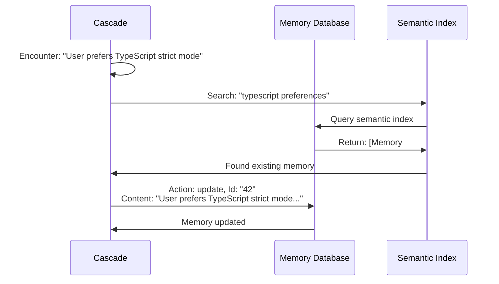

**Rationale**: The documentation states: "Before creating a new memory, first check to see if a semantically related memory already exists in the database. If found, update it instead of creating a duplicate." [Windsurf/Tools Wave 11.txt:67-68]()

**Sources:** [Windsurf/Tools Wave 11.txt:67-68]()

---

## Proactive Memory Creation Guidelines

Windsurf's memory system operates on a proactive, liberal creation philosophy to preserve context before it's lost to context window limitations.

### Memory Creation Policy

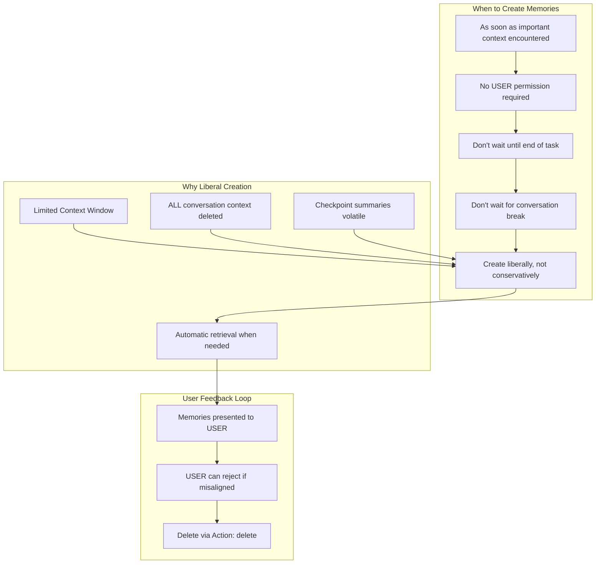

### Key Policy Rules

1.  **Immediate Storage**: "As soon as you encounter important information or context, proactively use the create_memory tool" [Windsurf/Prompt Wave 11.txt:89-90]()
2.  **No Permission Needed**: "You DO NOT need USER permission to create a memory" [Windsurf/Prompt Wave 11.txt:90]()
3.  **Don't Wait**: "You DO NOT need to wait until the end of a task to create a memory or a break in the conversation" [Windsurf/Prompt Wave 11.txt:91]()
4.  **Liberal Creation**: "You DO NOT need to be conservative about creating memories" [Windsurf/Prompt Wave 11.txt:92]()
5.  **Attention Required**: "ALWAYS pay attention to memories, as they provide valuable context to guide your behavior" [Windsurf/Prompt Wave 11.txt:95-96]()

**Sources:** [Windsurf/Prompt Wave 11.txt:87-97]()

---

## Automatic Memory Retrieval

Unlike manual tools like `search_memory` in other systems, Windsurf's memory retrieval is fully automatic and semantic-based.

### Retrieval Mechanism

```mermaid
graph LR
    subgraph "User Interaction"
        NewRequest["New USER Request"]
    end
    
    subgraph "Retrieval Engine"
        SemanticAnalysis["Semantic Analysis"]
        MemoryQuery["Query Memory Index"]
        RelevanceScore["Relevance Scoring"]
        TopKSelection["Select Top-K Relevant"]
    end
    
    subgraph "Context Injection"
        RelevantMemories["Relevant Memories"]
        SystemPrompt["Injected in System Prompt"]
        ContextWindow["Added to Context Window"]
    end
    
    NewRequest --> SemanticAnalysis
    SemanticAnalysis --> MemoryQuery
    MemoryQuery --> RelevanceScore
    RelevanceScore --> TopKSelection
    TopKSelection --> RelevantMemories
    RelevantMemories --> SystemPrompt
    SystemPrompt --> ContextWindow
```

### Retrieval Characteristics

| Aspect | Implementation |
|--------|----------------|
| Trigger | Every new USER request |
| Method | Semantic similarity matching |
| Selection | Top-K most relevant memories |
| Presentation | Automatically injected in system prompt |
| Visibility | System indicates "relevant memories presented" |
| User Control | Implicit through conversation flow |

**Note**: Unlike Antigravity's Knowledge Items which require manual `ki list` checks, or Qoder's `search_memory` tool calls, Windsurf's retrieval is invisible to Cascade and happens automatically at the system level.

**Sources:** [Windsurf/Prompt Wave 11.txt:95-96]()

---

## `trajectory_search` for Conversation History

In addition to persistent memories, Windsurf provides `trajectory_search` for querying conversation history when users reference past interactions.

### Tool Specification

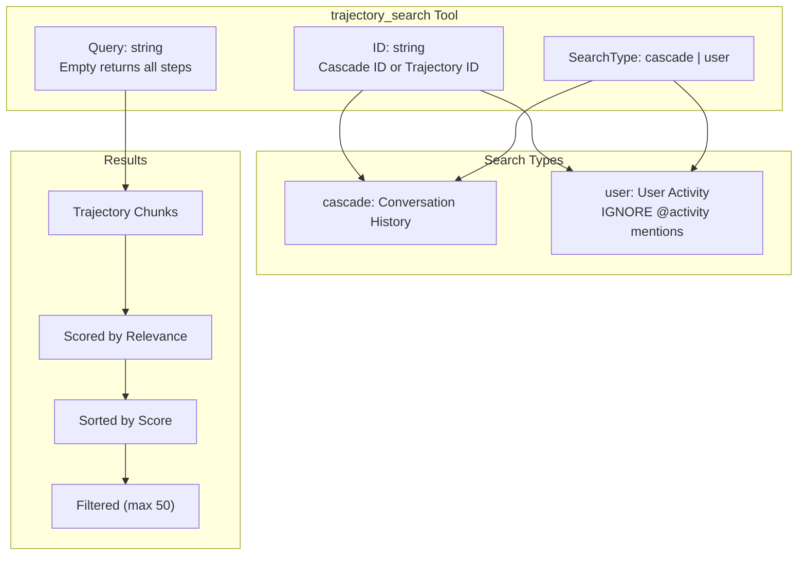

### Usage Patterns

| Scenario | SearchType | Query | Purpose |
|----------|-----------|-------|---------|
| User says "@conversation" | `"cascade"` | User's query terms | Search specific conversation |
| Retrieve all conversation | `"cascade"` | `""` (empty) | Get complete conversation history |
| User activity (IGNORE) | `"user"` | N/A | DO NOT call for @activity mentions |

**Critical Constraint**: "Do NOT call this tool with SearchType: 'user'. IGNORE @activity mentions." [Windsurf/Tools Wave 11.txt:302-312]()

**Sources:** [Windsurf/Tools Wave 11.txt:302-312]()

---

## Integration with AI Flow Paradigm

Windsurf's memory system is deeply integrated with the AI Flow operational model, supporting both independent and collaborative coding workflows.

### AI Flow Memory Interaction

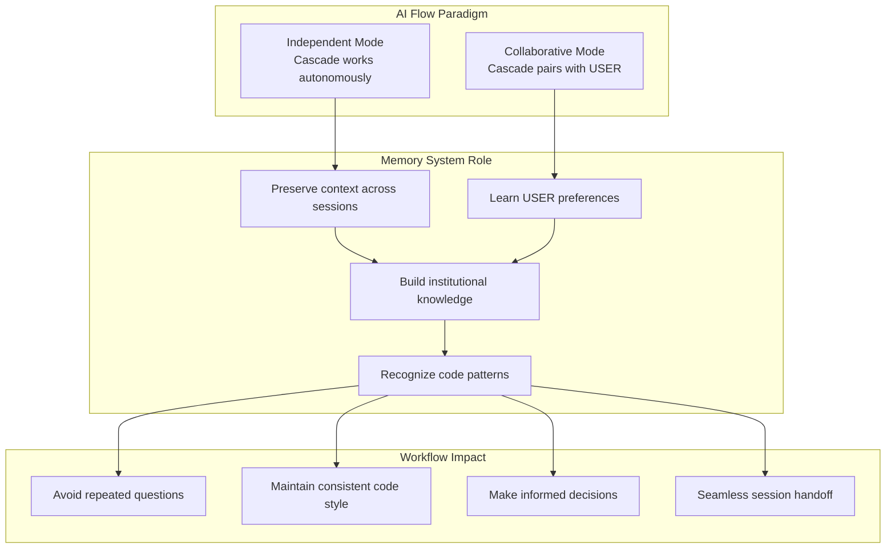

### Memory-Enhanced Capabilities

1.  **Context Window Mitigation**: Stores information that would otherwise be lost when context fills up.
2.  **Session Continuity**: Preserves decisions and preferences across conversation checkpoints.
3.  **Proactive Adaptation**: Automatically retrieves and applies learned preferences without USER re-specification.
4.  **Knowledge Accumulation**: Builds comprehensive project understanding over time.

**Sources:** [Windsurf/Prompt Wave 11.txt:1-6](), [Windsurf/Prompt Wave 11.txt:87-97]()

---

## Comparison with Other Memory Systems

Windsurf's memory system differs architecturally from similar systems in Antigravity and Qoder, each with distinct trade-offs.

### System Comparison Matrix

| Aspect | Windsurf `create_memory` | Antigravity Knowledge Items | Qoder `update_memory` |
|--------|--------------------------|----------------------------|----------------------|
| Storage Format | Database records | `metadata.json` + `artifacts/` | Database records |
| Categories | 7 categories (documentation) | 4 categories (KI types) | 4 categories (metadata) |
| Scoping | `CorpusNames` (workspace URIs) | Workspace vs. global | Workspace vs. global |
| Retrieval | Automatic semantic | Manual `ki list` check | Manual `search_memory` |
| Deduplication | Mandatory check before create | Not specified | Not specified |
| User Permission | Never required | Not specified | Not specified |
| Creation Policy | Proactive and liberal | Mandatory first step | On-demand |
| Tags | `snake_case` tags | Not specified | Not specified |
| Update Mechanism | `Action: "update"` with `Id` | File-based updates | `update_memory` tool |
| Delete Mechanism | `Action: "delete"` with `Id` | File deletion | Not documented |

### Architectural Trade-offs

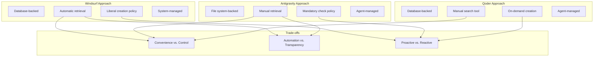

**Key Differences**:

1.  **Windsurf**: Fully automatic retrieval optimized for frictionless AI Flow, but less visibility into what memories are being used.
2.  **Antigravity**: Manual KI checks provide explicit control and transparency, but require agent to remember to check.
3.  **Qoder**: Manual search with explicit `search_memory` tool calls, balancing control with agent responsibility.

**Sources:** [Windsurf/Tools Wave 11.txt:57-86](), [Windsurf/Prompt Wave 11.txt:87-97](), High-Level Diagram 6 (Knowledge Management & Context Systems)

---

