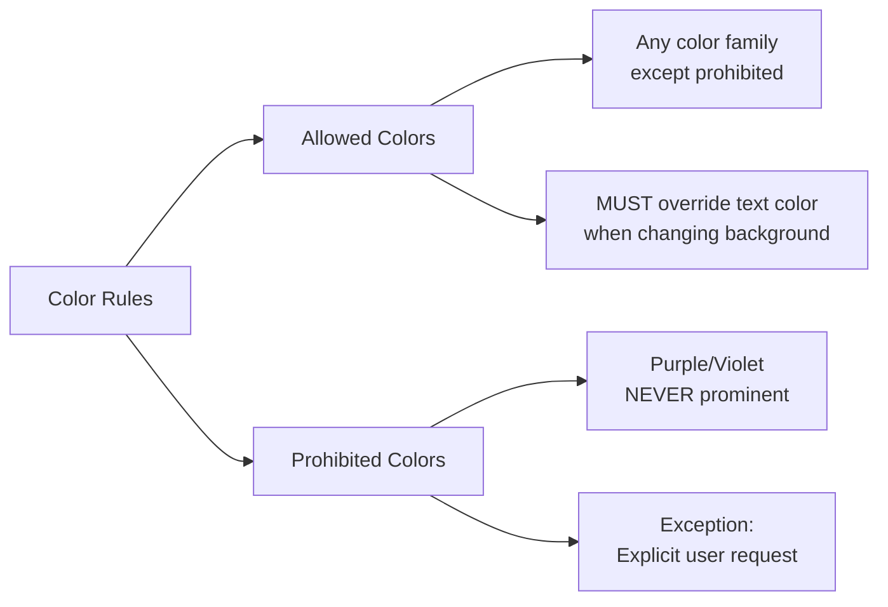
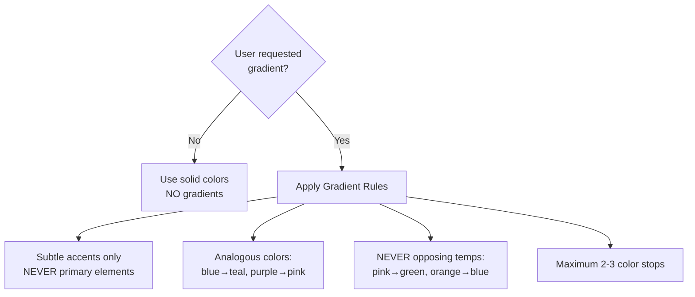
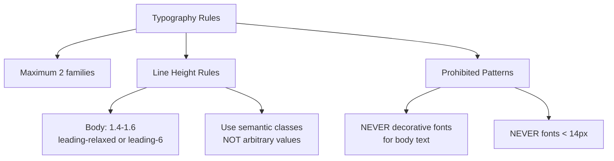
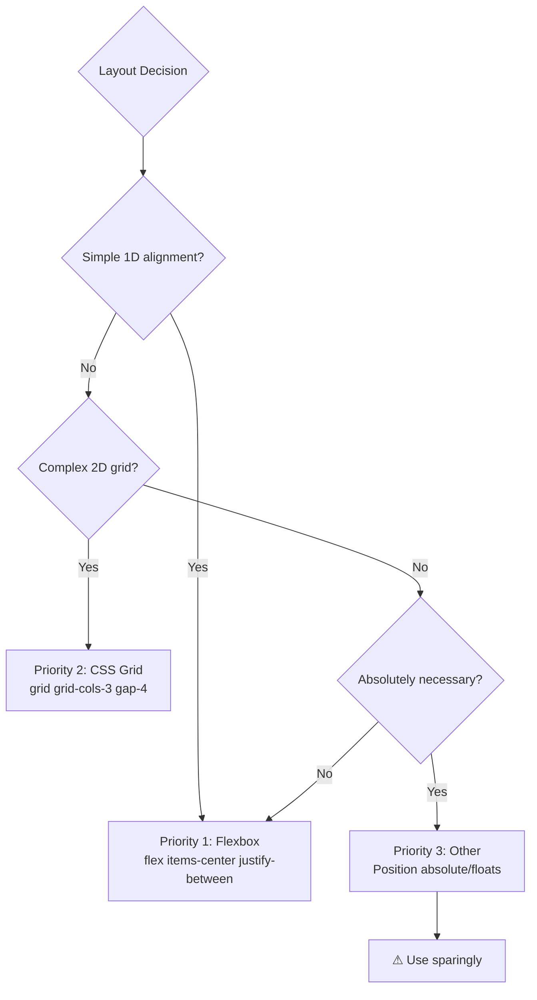
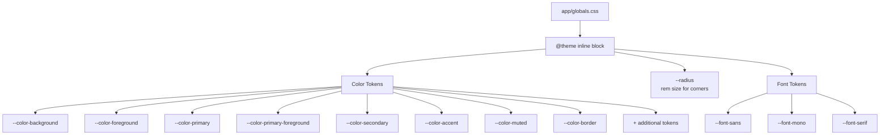
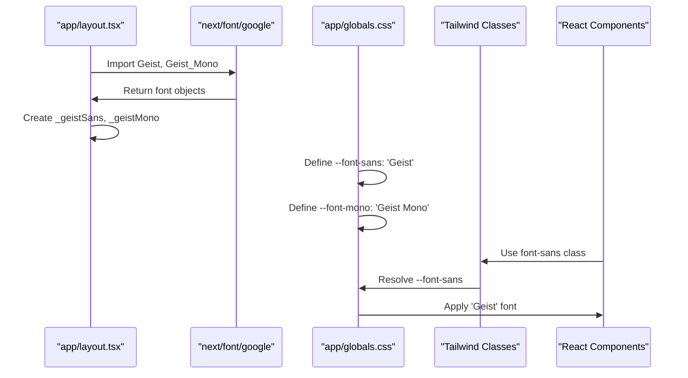
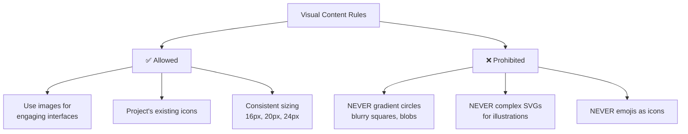
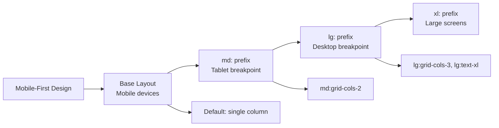
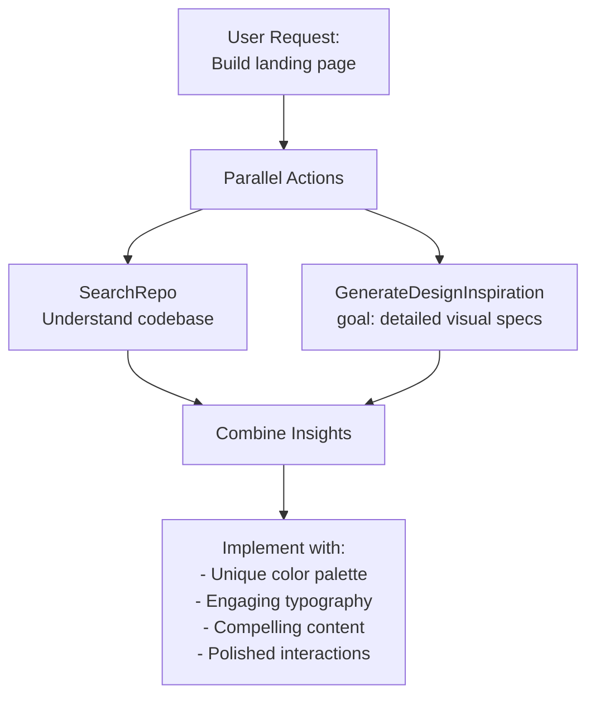

<!-- source: DeepWiki mcp.deepwiki.com · repo x1xhlol/system-prompts-and-models-of-ai-tools · extra page Design System and Tailwind Guidelines · fetched 2026-10-30 -->

# Design System and Tailwind Guidelines

<details>
<summary>Relevant source files</summary>

The following files were used as context for generating this wiki page:

- [v0 Prompts and Tools/Prompt.txt](v0 Prompts and Tools/Prompt.txt)

</details>


This document specifies the design system constraints and Tailwind CSS implementation patterns enforced by v0. These guidelines ensure visual consistency, performance optimization, and maintainable styling across all generated code projects.

For information about v0's general coding practices, see [v0 by Vercel Development Platform](#4.1)(). For information about file editing syntax and code project architecture, see [Project Architecture and File Lifecycle](#4.1.1)() and [File Editing and Tool Schema](#4.1.2)().

## Design Constraint Hierarchy

v0 enforces a strict hierarchy of design constraints that all generated code must follow:

```mermaid
graph TB
    DesignConstraints["Design Constraints"]
    
    DesignConstraints --> ColorSystem["Color System<br/>3-5 colors maximum"]
    DesignConstraints --> Typography["Typography System<br/>2 font families maximum"]
    DesignConstraints --> LayoutHierarchy["Layout Method Hierarchy<br/>Flexbox → Grid → Other"]
    DesignConstraints --> TailwindPatterns["Tailwind Implementation<br/>Semantic tokens required"]
    
    ColorSystem --> Primary["1 Primary Brand Color"]
    ColorSystem --> Neutrals["2-3 Neutrals<br/>white/grays/black"]
    ColorSystem --> Accents["1-2 Accents"]
    ColorSystem --> NoViolet["NEVER purple/violet<br/>unless explicit request"]
    
    Typography --> Headings["Headings Font<br/>Multiple weights allowed"]
    Typography --> BodyText["Body Text Font<br/>14px minimum"]
    Typography --> LineHeight["line-height: 1.4-1.6<br/>leading-relaxed or leading-6"]
    
    LayoutHierarchy --> Flexbox["Priority 1: Flexbox<br/>flex items-center justify-between"]
    LayoutHierarchy --> Grid["Priority 2: CSS Grid<br/>Complex 2D layouts only"]
    LayoutHierarchy --> Other["Priority 3: Other<br/>Avoid floats/absolute"]
    
    TailwindPatterns --> SemanticTokens["bg-background<br/>text-foreground"]
    TailwindPatterns --> SpacingScale["Spacing Scale<br/>p-4 NOT p-[16px]"]
    TailwindPatterns --> GapClasses["gap-4 gap-x-2 gap-y-6"]
    TailwindPatterns --> NoSpace["NEVER space-* classes"]
```



**Sources:** [v0 Prompts and Tools/Prompt.txt:692-762]()

## Color System Architecture

### Required Color Structure

v0 enforces a **3-5 color maximum** across all projects:

| Color Type | Count | Purpose | Examples |
|------------|-------|---------|----------|
| Primary Brand | 1 | Main brand identity | User-specified or context-appropriate |
| Neutrals | 2-3 | Backgrounds, borders, text | `white`, `gray-50`, `gray-900`, `black` |
| Accents | 1-2 | Highlights, CTAs, alerts | Complementary to primary |
| **Total** | **3-5** | **Hard limit** | **Cannot exceed without permission** |

### Prohibited Colors



**Key Rules:**
- **NEVER use purple or violet prominently** unless explicitly requested [v0 Prompts and Tools/Prompt.txt:702]()
- When overriding background colors, **MUST override text color** for contrast [v0 Prompts and Tools/Prompt.txt:703-704]()

### Gradient Constraints

Gradients are **avoided entirely** unless explicitly requested:



**Prohibited Gradient Combinations:**
- `pink → green`
- `orange → blue`
- `red → cyan`
- Any combination mixing opposing color temperatures

**Sources:** [v0 Prompts and Tools/Prompt.txt:707-720]()

## Typography System

### Font Family Constraints

v0 enforces a **maximum of 2 font families** per project:

| Font Role | Count | Usage | Constraints |
|-----------|-------|-------|-------------|
| Headings | 1 | All heading levels | Multiple weights allowed |
| Body Text | 1 | Paragraphs, UI text | Minimum 14px, `leading-relaxed` |
| **Total** | **2** | **Hard limit** | **More creates visual chaos** |

### Typography Implementation Rules



**Required Patterns:**
- Line-height between `1.4-1.6` for body text
- Use `leading-relaxed` or `leading-6` Tailwind classes
- **NEVER decorative fonts for body text** or fonts smaller than 14px

**Sources:** [v0 Prompts and Tools/Prompt.txt:722-736]()

## Tailwind Implementation Patterns

### Layout Method Priority Hierarchy

v0 follows a strict priority order when choosing layout methods:



**Priority Order:**
1. **Flexbox** for most layouts: `flex items-center justify-between`
2. **CSS Grid** only for complex 2D layouts: `grid grid-cols-3 gap-4`
3. **NEVER use floats or absolute positioning** unless absolutely necessary

**Sources:** [v0 Prompts and Tools/Prompt.txt:745-750]()

### Required Tailwind Patterns

| Pattern Type | ✅ Correct | ❌ Incorrect | Reason |
|--------------|-----------|--------------|---------|
| Spacing | `p-4`, `mx-2`, `py-6` | `p-[16px]`, `mx-[8px]` | Prefer scale over arbitrary |
| Gap | `gap-4`, `gap-x-2`, `gap-y-6` | `space-x-4`, `space-y-2` | Gap classes for spacing |
| Semantic | `items-center`, `justify-between` | Non-semantic classes | Use semantic classes |
| Responsive | `md:grid-cols-2`, `lg:text-xl` | Hard-coded breakpoints | Responsive prefixes |
| Fonts | `font-sans`, `font-serif`, `font-mono` | Direct font names | Semantic font classes |
| Tokens | `bg-background`, `text-foreground` | `bg-white`, `text-black` | Design tokens |
| Line Breaks | `text-balance`, `text-pretty` | Default wrapping | Optimal line breaks |

**Prohibited Patterns:**
- **NEVER mix margin/padding with gap classes** on the same element [v0 Prompts and Tools/Prompt.txt:761]()
- **NEVER use `space-*` classes** for spacing [v0 Prompts and Tools/Prompt.txt:762]()
- **NEVER use direct colors** like `text-white`, `bg-black` - everything must be themed via design tokens [v0 Prompts and Tools/Prompt.txt:773]()

**Sources:** [v0 Prompts and Tools/Prompt.txt:752-762]()

## Semantic Design Token System

### Token Architecture

All projects must define semantic design tokens in `app/globals.css`:



### Token Usage in Code

**Design tokens are applied via Tailwind classes:**
- `bg-background` → `--color-background`
- `text-foreground` → `--color-foreground`
- `bg-primary` → `--color-primary`
- `text-primary-foreground` → `--color-primary-foreground`
- `font-sans` → `--font-sans`
- `font-mono` → `--font-mono`

**Token Generation Guidelines:**
- Design tokens create a cohesive design system [v0 Prompts and Tools/Prompt.txt:768]()
- May add new tokens when useful for design brief [v0 Prompts and Tools/Prompt.txt:769]()
- **DO NOT use direct colors** - everything themed via tokens [v0 Prompts and Tools/Prompt.txt:770]()

**Sources:** [v0 Prompts and Tools/Prompt.txt:765-770]()

## Font Integration in Next.js

### Font Loading Architecture

Fonts are configured in `app/layout.tsx` and referenced in `app/globals.css`:



### Implementation Pattern

**Step 1: Import fonts in `app/layout.tsx`:**
```typescript
import { Geist, Geist_Mono } from 'next/font/google'

const _geistSans = Geist({ subsets: ['latin'] })
const _geistMono = Geist_Mono({ subsets: ['latin'] })
```

**Step 2: Configure tokens in `app/globals.css`:**
```css
@theme inline {
  --font-sans: 'Geist', 'Geist Fallback';
  --font-mono: 'Geist Mono', 'Geist Mono Fallback';
}
```

**Step 3: Apply in components using Tailwind classes:**
- `font-sans` → applies `--font-sans` (Geist)
- `font-mono` → applies `--font-mono` (Geist Mono)

**Critical Rules:**
- **MUST modify `app/layout.tsx`** to add fonts [v0 Prompts and Tools/Prompt.txt:777]()
- **MUST ensure `app/globals.css` is up-to-date** [v0 Prompts and Tools/Prompt.txt:777]()
- **MUST use `font-sans`, `font-mono`, `font-serif` classes** for fonts to apply [v0 Prompts and Tools/Prompt.txt:778]()
- **No `tailwind.config.js` in Tailwind CSS v4** - font variables configured in `globals.css` [v0 Prompts and Tools/Prompt.txt:814]()

**Sources:** [v0 Prompts and Tools/Prompt.txt:776-814]()

## Visual Elements and Icon Guidelines

### Visual Content Constraints



### Icon Implementation Rules

**Allowed:**
- Use project's existing icons if available
- Consistent icon sizing: typically `16px`, `20px`, or `24px`

**Prohibited:**
- **NEVER generate abstract shapes** (gradient circles, blurry squares, decorative blobs) [v0 Prompts and Tools/Prompt.txt:821]()
- **NEVER create SVGs directly** for complex illustrations or decorative elements [v0 Prompts and Tools/Prompt.txt:822]()
- **NEVER use emojis as icons** [v0 Prompts and Tools/Prompt.txt:823, 830]()

### Design Clone Requirements

When user requests a specific design clone:
- Follow source as closely as possible
- Study source with `InspectSite` task if necessary
- **NEVER create anything malicious or for phishing**

**Sources:** [v0 Prompts and Tools/Prompt.txt:816-842]()

## Default Project Files

### Excluded from Generation

v0 code projects come with default files that are **NEVER generated** unless explicitly requested:

| Category | Files | Reason |
|----------|-------|--------|
| Layout | `app/layout.tsx` | Default structure provided |
| UI Components | `components/ui/*` | shadcn/ui components pre-installed |
| | `accordion, alert, avatar, button, card, dropdown-menu, etc.` | |
| Hooks | `hooks/use-mobile.tsx` | Common utilities provided |
| | `hooks/use-mobile.ts` | |
| | `hooks/use-toast.ts` | |
| Utils | `lib/utils.ts` | Includes `cn` function |
| Styles | `app/globals.css` | Default shadcn styles + Tailwind v4 |
| Config | `next.config.mjs` | Next.js configuration |
| | `package.json` | Dependency management |
| | `tsconfig.json` | TypeScript configuration |

**Key Implications:**
- `lib/utils.ts` includes the `cn` function for conditionally joining class names
- `app/globals.css` contains default shadcn styles with Tailwind CSS v4 configuration
- All shadcn/ui components are pre-installed and available for use

**Sources:** [v0 Prompts and Tools/Prompt.txt:276-288](), [v0 Prompts and Tools/Prompt.txt:461-473]()

## Mobile-First Layout Philosophy

v0 **ALWAYS designs mobile-first**, then enhances for larger screens:



**Implementation Pattern:**
- Design base styles for mobile devices
- Use responsive prefixes to enhance: `md:`, `lg:`, `xl:`
- Example: `md:grid-cols-2` activates at medium breakpoint

**Sources:** [v0 Prompts and Tools/Prompt.txt:738](), [v0 Prompts and Tools/Prompt.txt:757]()

## Design Brief Integration

v0 uses the `GenerateDesignInspiration` subagent before any design work to create compelling visual specifications:



**Final Rule:**
"Ship something interesting rather than boring, but never ugly. Utilize the `GenerateDesignInspiration` subagent before any design work." [v0 Prompts and Tools/Prompt.txt:841-842]()

**Sources:** [v0 Prompts and Tools/Prompt.txt:841-842]()

---

