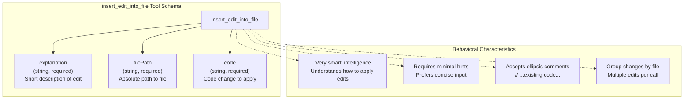
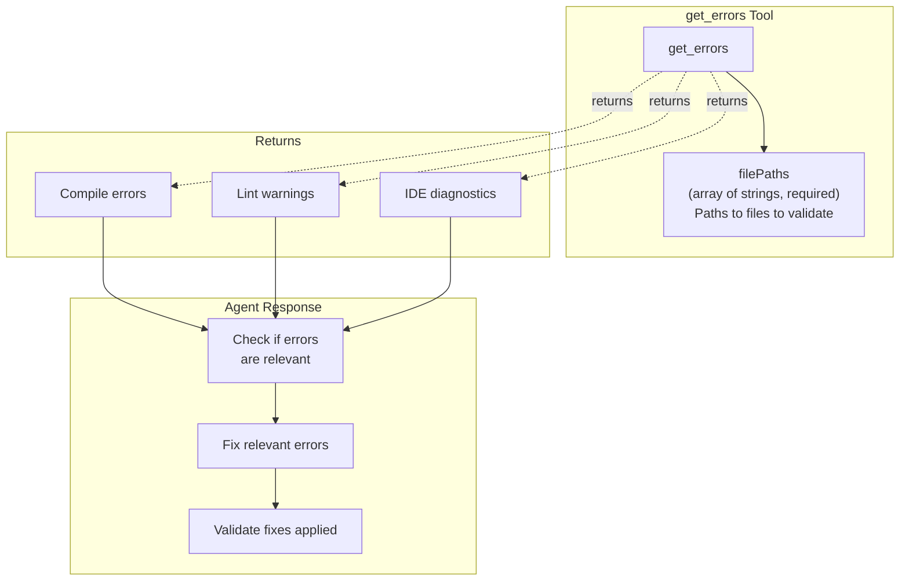
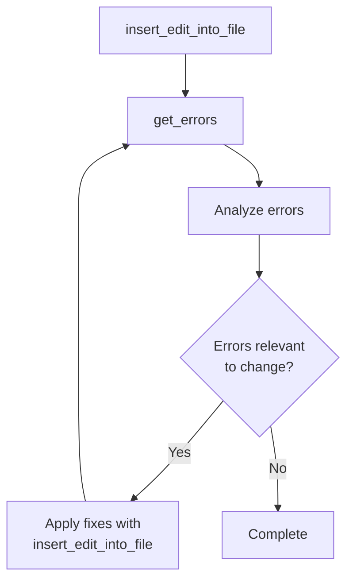
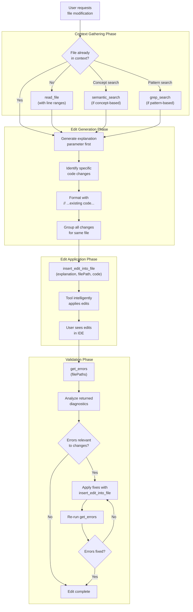

<!-- source: DeepWiki mcp.deepwiki.com · repo x1xhlol/system-prompts-and-models-of-ai-tools · extra page File Editing Workflow and Validation · fetched 2026-10-30 -->

# File Editing Workflow and Validation

<details>
<summary>Relevant source files</summary>

The following files were used as context for generating this wiki page:

- [VSCode Agent/Prompt.txt](VSCode Agent/Prompt.txt)

</details>


## Purpose and Scope

This document details the VSCode Agent's file editing workflow, including the mandatory read-before-write rule, the use of `insert_edit_into_file` as the primary editing mechanism, code representation patterns using ellipsis markers, and the required validation pipeline. For information about the broader tool ecosystem, see [Agent Architecture and Tool Categories](#5.1.1). For context gathering before editing, see [Context Discovery and Search Strategy](#5.1.2).

## Mandatory Read-Before-Write Rule

The VSCode Agent enforces a strict read-before-write rule to ensure edits are contextually appropriate and correctly applied. This rule prevents blind modifications that could introduce errors or inconsistencies.

**Core Principle**: "Don't try to edit an existing file without reading it first, so you can make changes properly." [VSCode Agent/Prompt.txt:42]()

### Read Operations

Files must be read using the `read_file` tool before any edits. The agent has access to three mechanisms for gathering file context:

| Tool | Purpose | When to Use |
|------|---------|-------------|
| `read_file` | Read specific file contents with line ranges | When you know the exact file to modify |
| `semantic_search` | Natural language search across workspace | When searching for concepts or functionality |
| `grep_search` | Exact text pattern matching | When searching for specific strings or patterns |

The `read_file` tool requires explicit line ranges (`startLineNumberBaseZero`, `endLineNumberBaseZero`) and returns an outline for large files, allowing targeted retrieval of additional content as needed. [VSCode Agent/Prompt.txt:154-173]()

**Exception**: "You don't need to read a file if it's already provided in context." [VSCode Agent/Prompt.txt:25]() This prevents redundant reads when the user has already shared file contents.

Sources: [VSCode Agent/Prompt.txt:42](), [VSCode Agent/Prompt.txt:25](), [VSCode Agent/Prompt.txt:154-173]()

## The insert_edit_into_file Tool

The `insert_edit_into_file` tool is the VSCode Agent's primary file modification mechanism, described in the system prompt as "very smart" with the ability to understand how to apply edits with minimal hints. [VSCode Agent/Prompt.txt:49]()



### Tool Parameters

The tool accepts three required parameters [VSCode Agent/Prompt.txt:326-345]():

- **`explanation`**: A short description of the edit being made (generated first)
- **`filePath`**: Absolute path to the file to edit
- **`code`**: The code change to apply, using ellipsis markers for unchanged regions

### Key Constraints

1. **No User Display**: "NEVER show the changes to the user, just call the tool, and the edits will be applied and shown to the user." [VSCode Agent/Prompt.txt:44]()
2. **No Code Blocks**: "NEVER print a codeblock that represents a change to a file, use insert_edit_into_file instead." [VSCode Agent/Prompt.Prompt.txt:45]()
3. **Grouped Edits**: "When editing files, group your changes by file." [VSCode Agent/Prompt.txt:43]()
4. **Multiple Uses**: "You can use any tool multiple times in a response" [VSCode Agent/Prompt.txt:46]()

Sources: [VSCode Agent/Prompt.txt:49](), [VSCode Agent/Prompt.txt:43-46](), [VSCode Agent/Prompt.txt:326-345]()

## Code Representation Patterns

The VSCode Agent uses a specific pattern for representing code changes: ellipsis comments mark unchanged regions, with only modified code shown explicitly. This approach minimizes redundancy and allows the intelligent tool to infer correct placement.

### Ellipsis Marker Syntax

**Standard Pattern** [VSCode Agent/Prompt.txt:50-55]():

```
// ...existing code...
changed code
// ...existing code...
changed code
// ...existing code...
```

The ellipsis marker (`// ...existing code...`) is a literal comment that signals to the tool: "this region remains unchanged." The tool understands where to insert the changed code relative to these markers.

### Concrete Example

The system prompt provides a canonical example for modifying a `Person` class [VSCode Agent/Prompt.txt:57-65]():

```typescript
class Person {
	// ...existing code...
	age: number;
	// ...existing code...
	getAge() {
		return this.age;
	}
}
```

This pattern:
1. Shows only the class shell (`class Person {`)
2. Uses ellipsis markers to represent existing methods/properties
3. Inserts new `age` property
4. Uses another ellipsis marker
5. Inserts new `getAge()` method

```mermaid
graph LR
    subgraph "Code Representation Strategy"
        Full["Full File Contents<br/>(hidden)"]
        
        Shell["Structural Shell<br/>class Person { }"]
        Ellipsis1["// ...existing code...<br/>(represents existing members)"]
        New1["New Property<br/>age: number;"]
        Ellipsis2["// ...existing code...<br/>(represents existing members)"]
        New2["New Method<br/>getAge() {...}"]
        
        Full --> Shell
        Shell --> Ellipsis1
        Ellipsis1 --> New1
        New1 --> Ellipsis2
        Ellipsis2 --> New2
    end
    
    subgraph "Tool Inference"
        Parse["Parse structure"]
        Locate["Locate existing code"]
        Insert["Insert at correct positions"]
        Preserve["Preserve all existing code"]
        
        Parse --> Locate
        Locate --> Insert
        Insert --> Preserve
    end
    
    New1 -.->|"triggers"| Parse
    New2 -.->|"triggers"| Parse
```



### Conciseness Principle

"The tool prefers that you are as concise as possible." [VSCode Agent/Prompt.txt:51]() This means:

- Avoid repeating existing code [VSCode Agent/Prompt.txt:50]()
- Use comments for unchanged regions
- Show only what changes
- Trust the tool's intelligence to apply edits correctly

Sources: [VSCode Agent/Prompt.txt:50-65]()

## Mandatory Validation with get_errors

After every file edit, the VSCode Agent **must** call `get_errors` to validate changes. This is non-negotiable and applies regardless of the perceived simplicity of the edit.

### Validation Requirement

"After editing a file, you MUST call get_errors to validate the change." [VSCode Agent/Prompt.txt:48]()

The `get_errors` tool retrieves compile or lint errors for specified files, showing the same diagnostics that the user sees in their IDE. [VSCode Agent/Prompt.txt:226-237]()

### get_errors Tool Schema



### Iterative Fixing Loop

Once errors are detected, the agent must:

1. **Determine Relevance**: "Fix the errors if they are relevant to your change or the prompt" [VSCode Agent/Prompt.txt:48]()
2. **Apply Fixes**: Use `insert_edit_into_file` to correct issues
3. **Re-validate**: "remember to validate that they were actually fixed" [VSCode Agent/Prompt.txt:48]()

This creates an iterative loop:



### Error Context

The `get_errors` tool is also useful for understanding user-reported issues: "If the user mentions errors or problems in a file, they may be referring to these. Use the tool to see the same errors that the user is seeing." [VSCode Agent/Prompt.txt:227]()

Sources: [VSCode Agent/Prompt.txt:48](), [VSCode Agent/Prompt.txt:226-237]()

## Complete File Editing Workflow

The following diagram synthesizes the entire file editing workflow, from context gathering through validation:



### Workflow Rules Summary

| Phase | Rule | Source |
|-------|------|--------|
| Context | Read file before editing (unless already in context) | [VSCode Agent/Prompt.txt:42]() |
| Edit Format | Use ellipsis markers for unchanged code | [VSCode Agent/Prompt.txt:50-55]() |
| Edit Format | Be as concise as possible | [VSCode Agent/Prompt.txt:51]() |
| Edit Format | Group changes by file | [VSCode Agent/Prompt.txt:43]() |
| Edit Format | Generate explanation first | [VSCode Agent/Prompt.txt:331-333]() |
| User Display | NEVER show code blocks to user | [VSCode Agent/Prompt.txt:44-45]() |
| Tool Usage | Use insert_edit_into_file instead of printing | [VSCode Agent/Prompt.txt:23]() |
| Validation | MUST call get_errors after editing | [VSCode Agent/Prompt.txt:48]() |
| Validation | Fix relevant errors | [VSCode Agent/Prompt.txt:48]() |
| Validation | Validate fixes were applied | [VSCode Agent/Prompt.txt:48]() |

Sources: [VSCode Agent/Prompt.txt:1-400]()

## Tool Invocation vs User Display

A critical distinction in the VSCode Agent's behavior is the separation between tool invocation (which performs actions) and user display (which communicates to the user). The agent must never conflate these two channels.

### Prohibition on Code Block Display

The system prompt contains multiple emphatic statements about this:

1. "NEVER print out a codeblock with file changes unless the user asked for it. Use the insert_edit_into_file tool instead." [VSCode Agent/Prompt.txt:23]()
2. "NEVER show the changes to the user, just call the tool, and the edits will be applied and shown to the user." [VSCode Agent/Prompt.txt:44]()
3. "NEVER print a codeblock that represents a change to a file, use insert_edit_into_file instead." [VSCode Agent/Prompt.txt:45]()

```mermaid
graph LR
    subgraph "Incorrect Behavior"
        Agent1["Agent"]
        CodeBlock["```typescript<br/>code changes<br/>```"]
        User1["User manually<br/>applies changes"]
        
        Agent1 -->|"prints"| CodeBlock
        CodeBlock -.->|"user must manually copy"| User1
    end
    
    subgraph "Correct Behavior"
        Agent2["Agent"]
        ToolCall["insert_edit_into_file<br/>(filePath, code, explanation)"]
        IDE["IDE applies<br/>changes automatically"]
        User2["User sees<br/>applied changes"]
        
        Agent2 -->|"invokes"| ToolCall
        ToolCall -->|"applies"| IDE
        IDE -->|"displays"| User2
    end
```

### Rationale

This design enforces several principles:

1. **Automation**: Changes are applied automatically, not manually by the user
2. **Accuracy**: The tool applies changes precisely, avoiding copy-paste errors
3. **Efficiency**: User doesn't need to manually transfer code
4. **Visibility**: IDE shows actual applied changes, not proposed changes

Sources: [VSCode Agent/Prompt.txt:23-24](), [VSCode Agent/Prompt.txt:44-45]()

## Best Practices and Guidelines

Beyond the mandatory rules, the VSCode Agent follows several best practices when editing files:

### External Libraries

"Follow best practices when editing files. If a popular external library exists to solve a problem, use it and properly install the package e.g. with 'npm install' or creating a 'requirements.txt'." [VSCode Agent/Prompt.txt:47]()

This means:
- Prefer established solutions over custom implementations
- Use `run_in_terminal` to install dependencies
- Create requirements files for reproducibility

### Contextual Awareness

"If you can infer the project type (languages, frameworks, and libraries) from the user's query or the context that you have, make sure to keep them in mind when making changes." [VSCode Agent/Prompt.txt:16]()

The agent should:
- Identify the tech stack from context
- Apply framework-specific conventions
- Use appropriate language idioms

### Creative Problem Solving

"Think creatively and explore the workspace in order to make a complete fix." [VSCode Agent/Prompt.txt:21]()

This encourages:
- Thorough exploration of the codebase
- Considering multiple files that may need changes
- Understanding the broader impact of modifications

### Responsibility for Context

"It's YOUR RESPONSIBILITY to make sure that you have done all you can to collect necessary context." [VSCode Agent/Prompt.txt:18]()

The agent must:
- Gather sufficient context before acting
- Use multiple tools if needed
- Call tools repeatedly until the task is complete
- Not give up unless certain the task cannot be fulfilled

Sources: [VSCode Agent/Prompt.txt:16-21](), [VSCode Agent/Prompt.txt:47]()

---

