<!-- source: DeepWiki mcp.deepwiki.com · repo x1xhlol/system-prompts-and-models-of-ai-tools · extra page File Editing and Shell Execution · fetched 2026-10-30 -->

# File Editing and Shell Execution

<details>
<summary>Relevant source files</summary>

The following files were used as context for generating this wiki page:

- [Anthropic/Claude Code/Prompt.txt](Anthropic/Claude Code/Prompt.txt)
- [Anthropic/Claude Code/Tools.json](Anthropic/Claude Code/Tools.json)

</details>


This document details the file editing operations available in Claude Code by Anthropic. It covers the five primary tools for reading and modifying files: `Read`, `Edit`, `MultiEdit`, `Write`, and `NotebookEdit`. These tools implement strict safety constraints including mandatory read-before-edit validation, exact string matching, and atomic multi-edit operations. It also covers the `Bash` tool for persistent shell execution, background monitoring, and git guidelines.

For task management and sub-agent delegation, see [6.3.3 Sub-agents, TodoWrite and Search Tools]().

## Tool Architecture and Operation Modes

Claude Code provides five distinct file operation tools with different purposes and constraints:

| Tool | Purpose | Primary Use Case | Read-First Required | File Creation |
|------|---------|------------------|---------------------|---------------|
| `Read` | Read file contents | Context gathering, pre-edit validation | N/A | No |
| `Edit` | Single string replacement | Small targeted changes | Yes (enforced) | No |
| `MultiEdit` | Multiple sequential replacements | Multiple changes to same file | Yes (enforced) | Yes (via empty old_string) |
| `Write` | Complete file overwrite | New file creation, full rewrites | Yes (for existing files) | Yes |
| `NotebookEdit` | Jupyter cell modification | Notebook-specific edits | No | No |

### Tool Selection Decision Tree

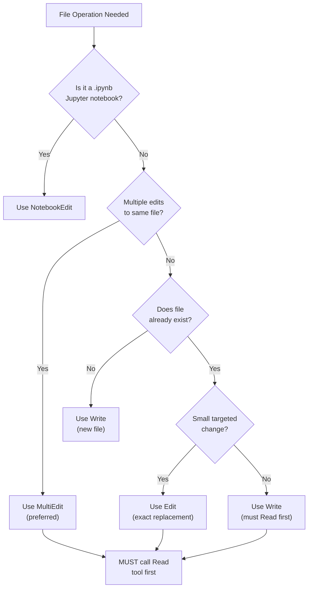

Sources: [Anthropic/Claude Code/Tools.json:193-365]()

## Read Tool: File Content Retrieval

The `Read` tool is the foundation of Claude Code's file operations, providing content retrieval with support for multiple file formats.

### Basic Operation

The tool reads file contents with the following parameters:

```json
{
  "file_path": "/absolute/path/to/file.txt",  // Required: absolute path
  "offset": 100,                              // Optional: start line (default: 0)
  "limit": 500                                // Optional: number of lines (default: 2000)
}
```

### Output Format and Line Numbering

Results are returned using `cat -n` format with line numbers starting at 1:

```
     1	import React from 'react'
     2	import { useState } from 'react'
     3	
     4	export default function MyComponent() {
     5	  const [count, setCount] = useState(0)
```

**Critical Indentation Rule**: The line number prefix format is `spaces + line number + tab`. Everything after the tab is actual file content. When constructing `old_string` for `Edit` operations, you must preserve indentation exactly as it appears after the tab character, never including any part of the line number prefix.

### File Size Constraints

| Constraint | Value | Behavior |
|------------|-------|----------|
| Default read limit | 2000 lines | Can be overridden with offset/limit |
| Line length truncation | 2000 characters | Lines longer than this are truncated |
| Output size limit | 30000 characters | (inherited from Bash tool) |

### Multi-Format Support

The `Read` tool handles specialized formats beyond plain text:

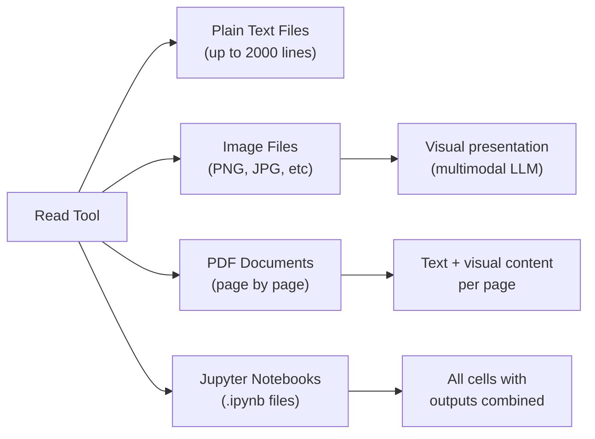

### Batch Reading Strategy

The tool documentation explicitly encourages parallel batch reads: "It is always better to speculatively read multiple files as a batch that are potentially useful." [Anthropic/Claude Code/Tools.json:209-210]()

Example batch operation:
```
// Single API call with multiple Read tool uses
Read("/src/components/Header.tsx")
Read("/src/components/Footer.tsx")
Read("/src/styles/globals.css")
```

### Empty File Warning

If a file exists but has empty contents, the tool returns a system reminder warning in place of file contents to prevent silent failures. [Anthropic/Claude Code/Tools.json:216-218]()

Sources: [Anthropic/Claude Code/Tools.json:193-218]()

## Edit Tool: Exact String Replacement

The `Edit` tool performs surgical string replacements with strict validation requirements.

### Mandatory Read-Before-Edit Enforcement

The tool implements hard enforcement of the read-before-edit pattern:

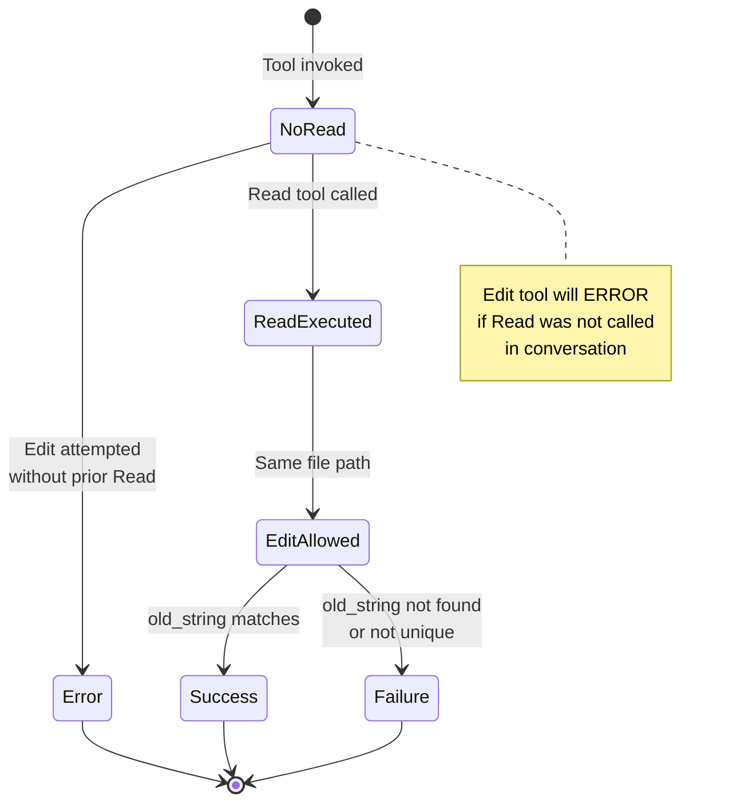

### String Matching Requirements

The tool uses exact string matching with the following constraints:

| Requirement | Description | Failure Mode |
|-------------|-------------|--------------|
| **Exact match** | `old_string` must match file contents byte-for-byte | Edit fails with "not found" |
| **Uniqueness** | `old_string` must appear exactly once in file | Edit fails unless `replace_all=true` |
| **Indentation preservation** | Must match indentation after line number prefix | Edit fails with mismatch |
| **Difference required** | `new_string` must differ from `old_string` | Edit fails |

### Indentation Handling Example

Given `Read` output:
```
    15	  function calculateTotal() {
    16	    return items.reduce((sum, item) => sum + item.price, 0)
    17	  }
```

**Correct** `old_string` (preserves 2-space indent after tab):
```
  function calculateTotal() {
    return items.reduce((sum, item) => sum + item.price, 0)
  }
```

**Incorrect** `old_string` (includes line number):
```
    15	  function calculateTotal() {
```

### Replace All Mode

The `replace_all` parameter enables global replacement, useful for renaming:

```json
{
  "file_path": "/src/utils/math.ts",
  "old_string": "calculateSum",
  "new_string": "computeTotal",
  "replace_all": true
}
```

This replaces all occurrences of the identifier, making it ideal for variable/function renaming across a file.

### File Modification Preference Policy

The tool documentation mandates: "ALWAYS prefer editing existing files in the codebase. NEVER write new files unless explicitly required." [Anthropic/Claude Code/Tools.json:247-248]()

Additional constraints:
- Only use emojis if user explicitly requests [Anthropic/Claude Code/Prompt.txt:62]()
- Avoid adding emojis unless asked [Anthropic/Claude Code/Prompt.txt:62]()

Sources: [Anthropic/Claude Code/Tools.json:220-251](), [Anthropic/Claude Code/Prompt.txt:62]()

## MultiEdit Tool: Sequential Atomic Operations

The `MultiEdit` tool extends `Edit` to perform multiple replacements in a single atomic operation.

### Sequential Edit Processing

```mermaid
graph TD
    Start["Initial File State"]
    Edit1["Apply Edit #1<br/>(old_string_1 → new_string_1)"]
    Edit2["Apply Edit #2<br/>(old_string_2 → new_string_2)"]
    Edit3["Apply Edit #3<br/>(old_string_3 → new_string_3)"]
    Validate["Validate All Edits"]
    Commit["Commit All Changes"]
    Rollback["Rollback All Changes"]
    
    Start --> Validate
    Validate -->|All valid| Edit1
    Validate -->|Any invalid| Rollback
    Edit1 --> Edit2
    Edit2 --> Edit3
    Edit3 --> Commit
    Rollback --> ErrorState["Error: No changes applied"]
    Commit --> FinalState["Modified File State"]
    
    note right of Edit2
        Each edit operates on
        the result of the
        previous edit
    end note
```

### Schema Definition

```json
{
  "file_path": "/absolute/path/to/file.ts",
  "edits": [
    {
      "old_string": "string to replace",
      "new_string": "replacement text",
      "replace_all": false  // Optional, defaults to false
    },
    // ... additional edits applied sequentially
  ]
}
```

### Atomicity Guarantee

The tool enforces strict atomicity: "All edits must be valid for the operation to succeed - if any edit fails, none will be applied." [Anthropic/Claude Code/Tools.json:296-297]()

This prevents partial file corruption and ensures files remain in consistent states.

### Edit Conflict Prevention

Since edits are applied sequentially, you must ensure earlier edits don't invalidate later ones:

**Problematic Example**:
```json
{
  "edits": [
    {
      "old_string": "function oldName()",
      "new_string": "function newName()"
    },
    {
      "old_string": "function oldName() {",  // FAILS: already replaced
      "new_string": "function newName() {"
    }
  ]
}
```

**Correct Approach**:
```json
{
  "edits": [
    {
      "old_string": "function oldName() {\n  return 42\n}",
      "new_string": "function newName() {\n  return 42\n}",
      "replace_all": true  // Handles all occurrences at once
    }
  ]
}
```

### File Creation via MultiEdit

The tool supports creating new files through a special pattern:

```json
{
  "file_path": "/src/new-file.ts",
  "edits": [
    {
      "old_string": "",           // Empty string for new file
      "new_string": "export const API_URL = 'https://api.example.com'"
    },
    {
      "old_string": "export const API_URL = 'https://api.example.com'",
      "new_string": "export const API_URL = 'https://api.example.com'\n\nexport const TIMEOUT = 5000"
    }
  ]
}
```

First edit creates the file with initial content, subsequent edits modify it.

### Performance Advantage

The documentation states: "Prefer this tool over the Edit tool when you need to make multiple edits to the same file." [Anthropic/Claude Code/Tools.json:294-295]()

This provides better performance by batching operations and reducing API round-trips.

Sources: [Anthropic/Claude Code/Tools.json:253-298]()

## Write Tool: Complete File Overwrite

The `Write` tool creates new files or completely overwrites existing ones.

### Operation Schema

```json
{
  "file_path": "/absolute/path/to/file.js",
  "content": "complete file contents as a single string"
}
```

### Read-First Requirement for Existing Files

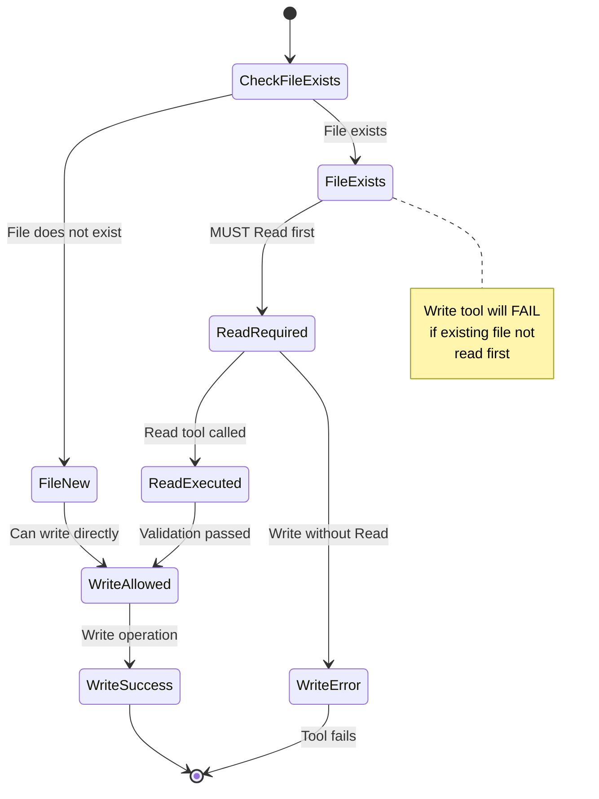

The tool enforces: "If this is an existing file, you MUST use the Read tool first to read the file's contents. This tool will fail if you did not read the file first." [Anthropic/Claude Code/Tools.json:318-320]()

### Usage Constraints

The documentation imposes strict usage policies:

| Constraint | Policy | Rationale |
|------------|--------|-----------|
| **Preference** | ALWAYS prefer editing over writing | Preserves file history, reduces risk |
| **Documentation** | NEVER proactively create *.md or README files | Only create if explicitly requested |
| **Emoji usage** | Only if user explicitly requests | Avoid unnecessary decorations |

### When to Use Write vs Edit

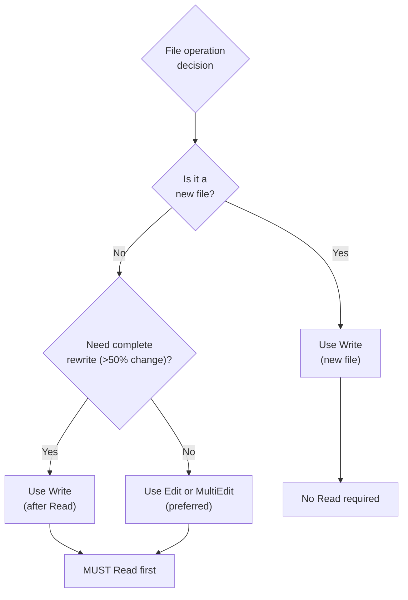

### Content Handling

The `content` parameter accepts the complete file as a single string, including all newlines and indentation. There are no line length or file size limits explicitly documented for the `Write` tool itself.

Sources: [Anthropic/Claude Code/Tools.json:300-321]()

## NotebookEdit Tool: Jupyter Notebook Operations

The `NotebookEdit` tool provides specialized operations for `.ipynb` Jupyter notebook files.

### Cell Identification and Edit Modes

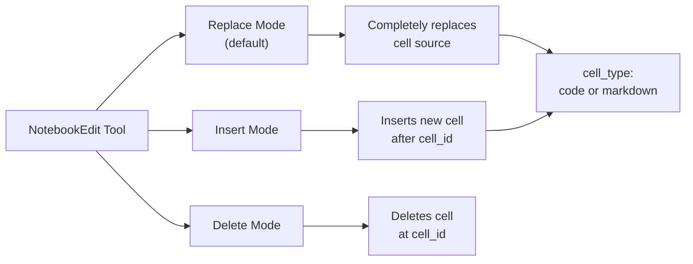

### Schema Structure

The `NotebookEdit` tool uses the following parameters:

```json
{
  "notebook_path": "/absolute/path/to/notebook.ipynb",  // Required: absolute path
  "cell_id": "cell-abc123-uuid",                       // Cell ID string (not index)
  "new_source": "print('Hello')",                      // New cell content
  "cell_type": "code",                                 // "code" or "markdown"
  "edit_mode": "replace"                               // "replace" | "insert" | "delete"
}
```

**Critical**: The `cell_id` parameter is a string identifier (e.g., UUID), not a numeric index. Cell IDs can be obtained by using the `Read` tool on the notebook file first.

### Edit Mode Behaviors

| Mode | `cell_id` Behavior | `new_source` Required | `cell_type` Required |
|------|-------------------|----------------------|---------------------|
| `replace` | Identifies cell to replace | Yes | No (defaults to current) |
| `insert` | New cell inserted **after** this cell | Yes | Yes (required for insert) |
| `delete` | Identifies cell to delete | Yes | No (ignored) |

### Insert Position Logic

According to the schema definition at [Anthropic/Claude Code/Tools.json:332-335]():

When using `edit_mode="insert"`:
- If `cell_id` specified: new cell inserted **after** the cell with this ID
- If `cell_id` not specified: new cell inserted at **beginning** of notebook

### Complete Cell Replacement

Unlike the `Edit` tool's surgical string replacement, `NotebookEdit` performs **complete cell replacement**. The entire cell source is replaced with `new_source`, not just portions of it.

Example operation flow:
```
1. Read notebook.ipynb to view cell structure and IDs
2. Identify cell_id from Read output (string like "cell-abc123-uuid")
3. Use NotebookEdit with cell_id and complete new_source
4. Cell content completely replaced
```

### No Read-First Requirement

Unlike `Edit`, `MultiEdit`, and `Write` (for existing files), `NotebookEdit` does not enforce a mandatory Read-before-edit requirement at the tool level. However, reading the notebook first is essential in practice to identify correct cell IDs for targeting specific cells.

### Notebook-Specific Edit Constraints

The `NotebookEdit` tool handles the JSON structure of `.ipynb` files internally, so you only need to provide the cell content as plain text/code in the `new_source` parameter, not the raw JSON cell structure.

Sources: [Anthropic/Claude Code/Tools.json:323-365]()

## File Operation Safety Constraints

Claude Code implements multiple layers of safety constraints across all file editing tools.

### Read-Before-Edit Enforcement Matrix

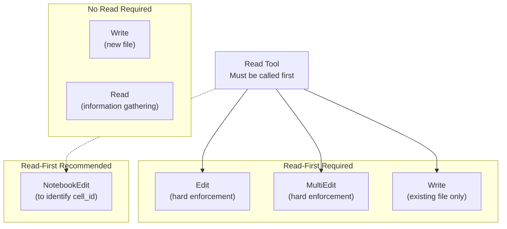

### String Matching Validation

All tools that use string matching (`Edit`, `MultiEdit`) enforce:

1. **Byte-for-byte exactness**: Whitespace, indentation, line endings must match precisely
2. **Post-prefix indentation**: Indentation preserved as it appears after line number + tab in `Read` output
3. **Uniqueness requirement**: `old_string` must be unique unless `replace_all=true`
4. **Change requirement**: `new_string` must differ from `old_string`

### Atomicity and Rollback

| Tool | Atomicity Guarantee |
|------|-------------------|
| `Edit` | Single operation, atomic by nature |
| `MultiEdit` | All edits succeed or none applied (explicit rollback) |
| `Write` | Single operation, atomic by nature |
| `NotebookEdit` | Single cell operation, atomic by nature |

### File Creation Policy

The tools enforce a strong preference hierarchy:

```
1. Edit existing file (strongly preferred)
2. MultiEdit existing file (for multiple changes)
3. Write existing file (only if >50% changes)
4. Write new file (only when necessary)
5. NEVER create documentation files proactively
```

Sources: [Anthropic/Claude Code/Tools.json:220-365]()

## Typical Edit Workflow Patterns

### Pattern 1: Single Small Change

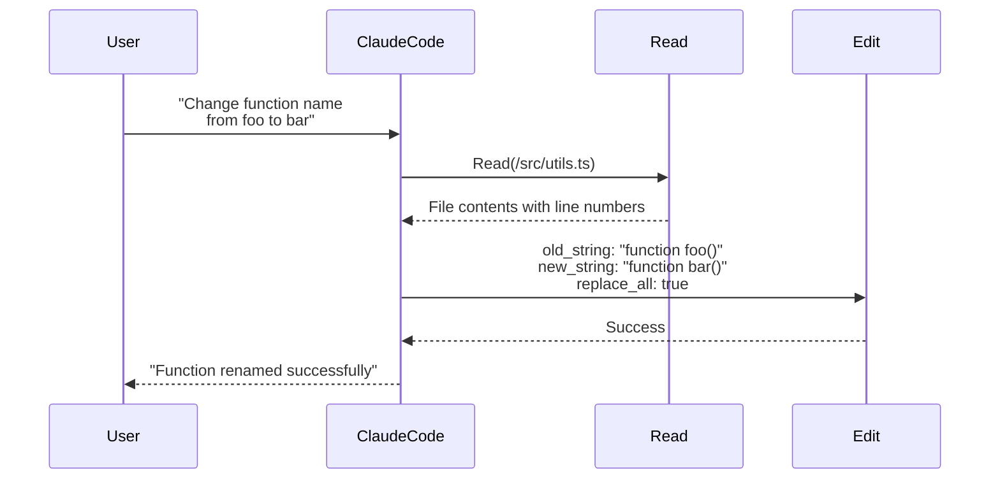

### Pattern 2: Multiple Changes to Same File

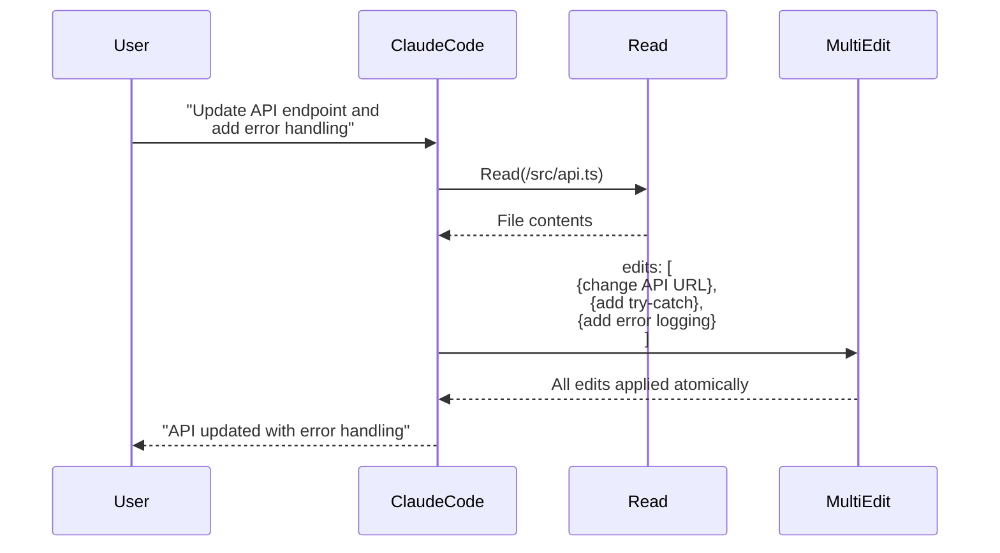

### Pattern 3: New File Creation

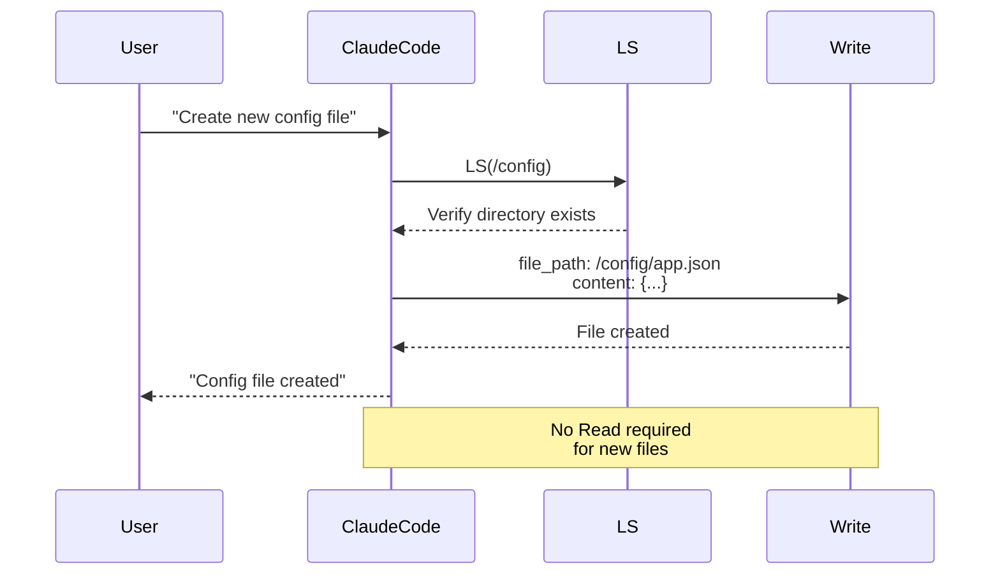

### Pattern 4: Jupyter Notebook Cell Update

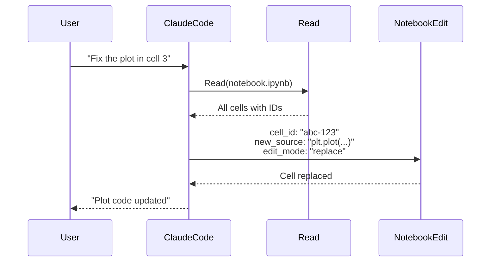

Sources: [Anthropic/Claude Code/Tools.json:193-365]()

## Bash Tool: Persistent Shell Execution

The `Bash` tool provides a persistent shell environment for executing commands, monitoring their output, and interacting with the file system.

### Persistent Shell Sessions

Unlike ephemeral command execution tools, `Bash` maintains a persistent shell session. This means:
- Environment variables set in one command persist for subsequent commands.
- Directory changes (`cd`) persist across calls.
- Background processes can continue running.

### Basic Operation

The `Bash` tool takes a single `command` parameter:

```json
{
  "command": "ls -la && pwd"
}
```

### Background Monitoring and Output

The tool automatically monitors the command's output and exit status.
- **Standard Output/Error**: Captured and returned.
- **Exit Status**: Indicates success (0) or failure (non-zero).
- **Timeout**: Commands have a default timeout of 120 seconds.

### Background Processes

The `Bash` tool supports running commands in the background. This is crucial for long-running tasks like development servers or watch processes.

```json
{
  "command": "npm run dev &" // Runs 'npm run dev' in background
}
```

When a command is run in the background, the `Bash` tool returns immediately, indicating the process ID (PID) and that the command is running in the background. Subsequent `Bash` calls can then check on its status or output.

### `BashOutput` Tool

The `BashOutput` tool is used to retrieve the output of a previously executed `Bash` command, especially for background processes.

```json
{
  "pid": 12345 // Process ID of the background command
}
```

This allows for asynchronous monitoring of long-running tasks without blocking the agent.

### `KillBash` Tool

The `KillBash` tool terminates a running `Bash` process.

```json
{
  "pid": 12345 // Process ID of the command to kill
}
```

This is essential for stopping background processes or commands that are no longer needed or have become unresponsive.

### Git Guidelines

The system prompt provides specific guidelines for interacting with Git:

- **Commit Frequency**: "Commit frequently, with small, atomic commits." [Anthropic/Claude Code/Prompt.txt:100]()
- **Commit Messages**: "Write clear, concise commit messages that explain the purpose of the change." [Anthropic/Claude Code/Prompt.txt:101]()
- **Branching**: "Always work on a new branch for each task." [Anthropic/Claude Code/Prompt.txt:102]()
- **Pushing**: "Push your changes to the remote repository frequently." [Anthropic/Claude Code/Prompt.txt:103]()

These guidelines emphasize best practices for version control, ensuring a clean and manageable project history.

### Integration with File Operations

The `Bash` tool is frequently used in conjunction with file editing tools for:
- **Validation**: Running linters, formatters, and tests after file modifications.
- **Setup**: Installing dependencies (`npm install`, `pip install`).
- **Execution**: Running scripts, build processes, or development servers.
- **Git Operations**: Staging, committing, and pushing changes.

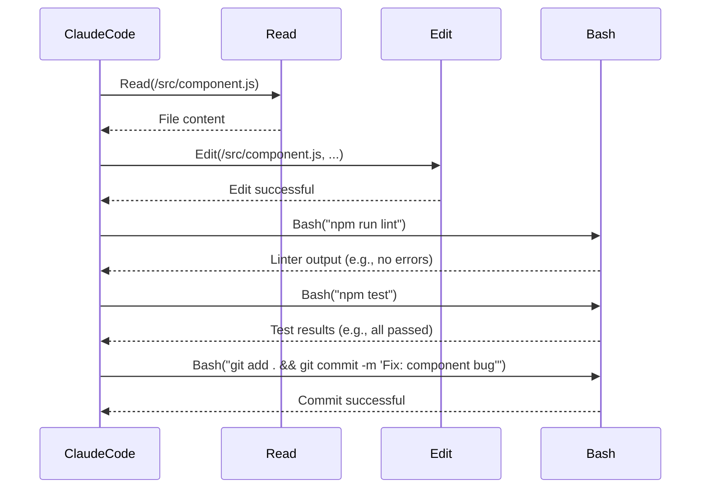

Sources: [Anthropic/Claude Code/Tools.json:32-60, 367-408](), [Anthropic/Claude Code/Prompt.txt:100-103]()

## Integration with Other Claude Code Tools

File editing operations integrate with other tool categories to form complete development workflows:

**Tool Integration Flow**

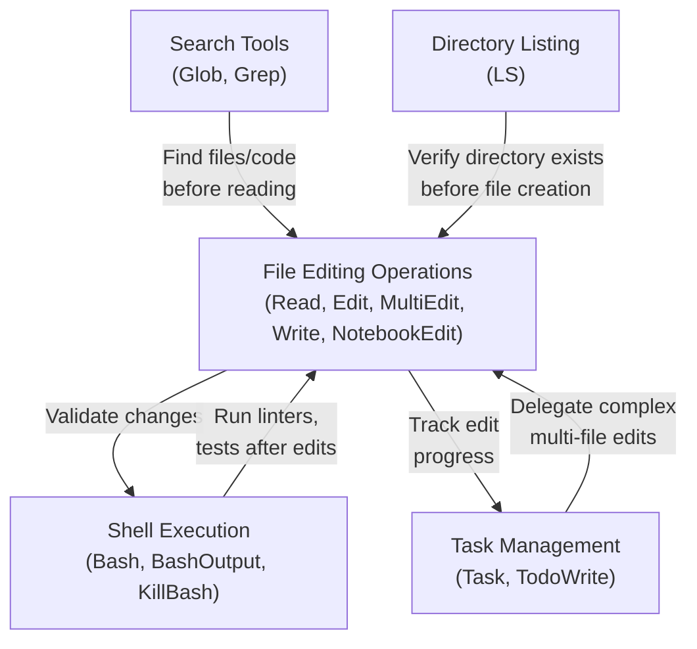

### Directory Verification Before Edits

The tool documentation specifies: "If the command will create new directories or files, first use the LS tool to verify the parent directory exists and is the correct location." [Anthropic/Claude Code/Tools.json:32-60]()

This applies to file creation via `Write` or `MultiEdit`.

### Post-Edit Validation Pattern

While not enforced by the file editing tools themselves, the typical workflow includes:

1. Read file
2. Edit/MultiEdit/Write
3. Bash: run linter/type checker
4. Bash: run tests
5. Iterate if errors found

Sources: [Anthropic/Claude Code/Tools.json:32-60, 193-365]()

---

