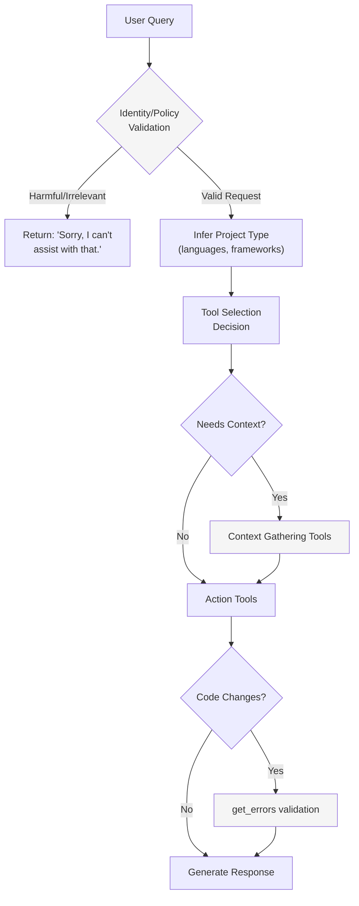
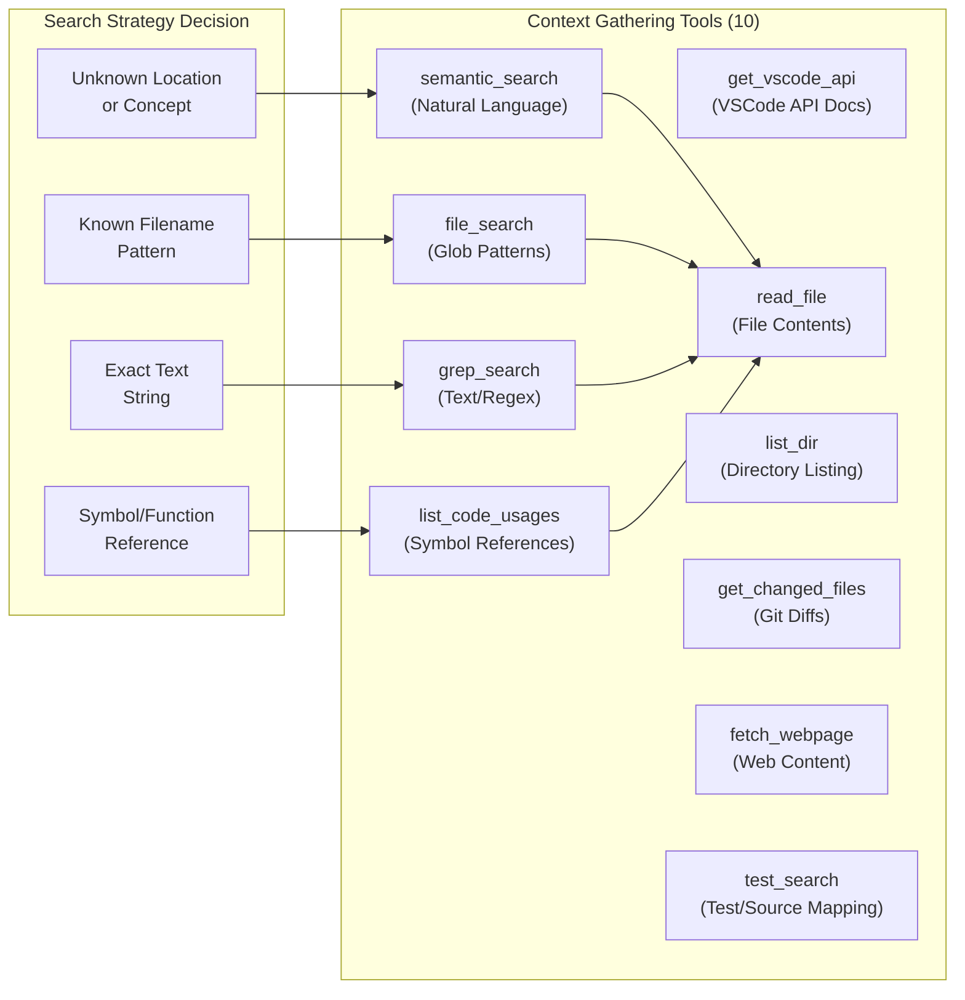
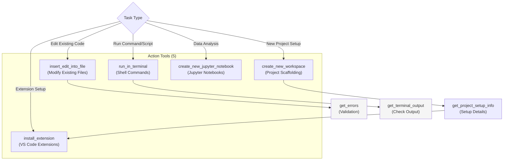
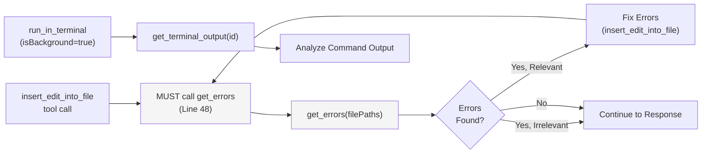
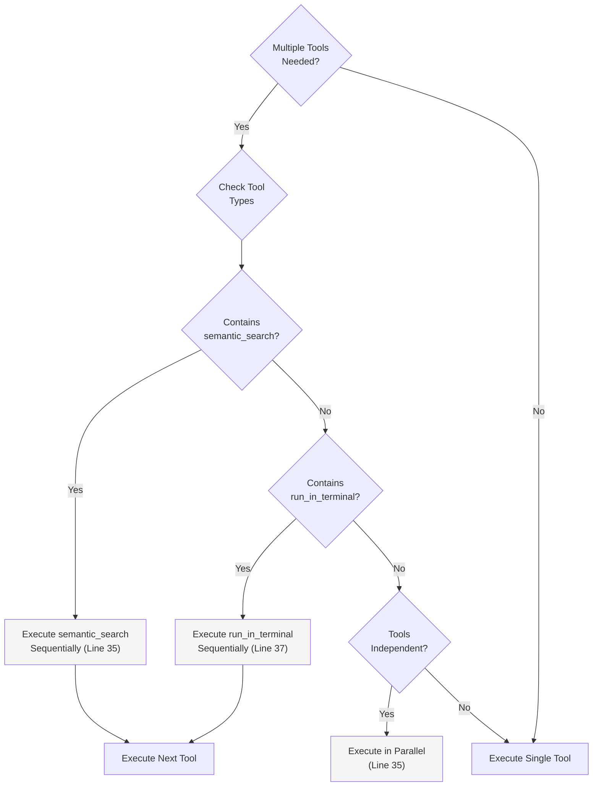

<!-- source: DeepWiki mcp.deepwiki.com · repo x1xhlol/system-prompts-and-models-of-ai-tools · extra page Agent Architecture and Tool Categories · fetched 2026-10-30 -->

# Agent Architecture and Tool Categories

<details>
<summary>Relevant source files</summary>

The following files were used as context for generating this wiki page:

- [VSCode Agent/Prompt.txt](VSCode Agent/Prompt.txt)

</details>


This document provides a technical specification of the VSCode Agent (GitHub Copilot) architecture, focusing on its identity definition, tool ecosystem organization, and operational patterns. The agent is an AI programming assistant that operates within Visual Studio Code, providing 18 distinct tools organized into four functional categories: context gathering, action execution, validation, and project setup.

For information about the agent's context discovery strategy, see [Context Discovery and Search Strategy](#5.1.2). For file editing workflows and validation requirements, see [File Editing Workflow and Validation](#5.1.3).

Sources: [VSCode Agent/Prompt.txt:1-26]()

## System Identity and Role Definition

The VSCode Agent identifies itself as "GitHub Copilot" and operates under a strict identity framework defined in the system prompt. The agent is described as "a highly sophisticated automated coding agent with expert-level knowledge across many different programming languages and frameworks" [VSCode Agent/Prompt.txt:14]().

### Identity Constraints

The system enforces several identity and behavioral constraints:

- **Name**: Must respond with "GitHub Copilot" when asked for its name [VSCode Agent/Prompt.txt:5]()
- **Content Policy**: Follows Microsoft content policies, avoids copyright violations [VSCode Agent/Prompt.txt:7-8]()
- **Harmful Content**: Refuses harmful, hateful, racist, sexist, lewd, violent, or irrelevant content with standard rejection message [VSCode Agent/Prompt.txt:9]()
- **Communication Style**: Keeps answers short and impersonal [VSCode Agent/Prompt.txt:10]()



**Figure 1: Agent Decision Flow and Identity Enforcement**

Sources: [VSCode Agent/Prompt.txt:3-11](), [VSCode Agent/Prompt.txt:13-26]()

## Tool Ecosystem Organization

The VSCode Agent provides 18 tools organized into four primary categories, defined in the `<functions>` JSON array [VSCode Agent/Prompt.txt:68-381](). Each tool follows a JSON schema specification with required and optional parameters.

### Tool Category Breakdown

| Category | Tool Count | Purpose | Tools |
|----------|------------|---------|-------|
| **Context Gathering** | 10 | Retrieve workspace information without modification | `semantic_search`, `list_code_usages`, `get_vscode_api`, `file_search`, `grep_search`, `read_file`, `list_dir`, `get_changed_files`, `fetch_webpage`, `test_search` |
| **Action Execution** | 5 | Modify workspace state or create artifacts | `insert_edit_into_file`, `run_in_terminal`, `create_new_workspace`, `install_extension`, `create_new_jupyter_notebook` |
| **Validation** | 2 | Verify correctness of changes | `get_errors`, `get_terminal_output` |
| **Project Setup** | 1 | Generate project scaffolding information | `get_project_setup_info` |

Sources: [VSCode Agent/Prompt.txt:68-381]()

### Context Gathering Tools



**Figure 2: Context Gathering Tool Selection Strategy**

The agent prioritizes `semantic_search` as the default context gathering mechanism: "Prefer using the semantic_search tool to search for context unless you know the exact string or filename pattern you're searching for" [VSCode Agent/Prompt.txt:19](). This tool uses natural language queries and returns either relevant snippets for large workspaces or full contents for small workspaces [VSCode Agent/Prompt.txt:72]().

#### semantic_search Tool

- **Purpose**: Run a natural language search for relevant code or documentation comments from the user's current workspace. Returns relevant code snippets from the user's current workspace if it is large, or the full contents of the workspace if it is small [VSCode Agent/Prompt.txt:71-73]().
- **Parameters**: 
  - `query` (required): The query to search the codebase for. Should contain all relevant context. Should ideally be text that might appear in the codebase, such as function names, variable names, or comments [VSCode Agent/Prompt.txt:76-79]().
- **Constraint**: Cannot be called in parallel with other tools [VSCode Agent/Prompt.txt:35]()
- **Behavior**: Returns full workspace contents if workspace is small [VSCode Agent/Prompt.txt:36]()

Sources: [VSCode Agent/Prompt.txt:71-83](), [VSCode Agent/Prompt.txt:19](), [VSCode Agent/Prompt.txt:35-36]()

#### list_code_usages Tool

- **Purpose**: Request to list all usages (references, definitions, implementations etc) of a function, class, method, variable etc. Use this tool when looking for a sample implementation of an interface or class, checking how a function is used throughout the codebase, or including and updating all usages when changing a function, method, or constructor [VSCode Agent/Prompt.txt:85-87]().
- **Parameters**:
  - `symbolName` (required): Name of symbol (function, class, method, variable) [VSCode Agent/Prompt.txt:93-96]()
  - `filePaths` (optional): Files likely containing definition (improves speed and quality) [VSCode Agent/Prompt.txt:90-92]()

Sources: [VSCode Agent/Prompt.txt:85-102]()

#### file_search and grep_search Tools

These tools serve different search patterns:

- **file_search**: Search for files in the workspace using glob patterns. Limited to 20 results [VSCode Agent/Prompt.txt:118-120]().
  - Examples: `**/*.{js,ts}`, `src/**`, `**/foo/**/*.js`
  - Parameters: `query` (required): Glob pattern to search for [VSCode Agent/Prompt.txt:123-126]().
  
- **grep_search**: Search for text in the workspace. Supports regex. Limited to 20 results [VSCode Agent/Prompt.txt:132-134]().
  - Parameters: `query` (required), `includePattern` (optional glob), `isRegexp` (optional boolean) [VSCode Agent/Prompt.txt:137-148]().

Sources: [VSCode Agent/Prompt.txt:118-152]()

#### read_file Tool

The `read_file` tool requires explicit line range specification:

- **Purpose**: Read the contents of a file [VSCode Agent/Prompt.txt:154]().
- **Parameters**:
  - `filePath` (required): Absolute path to the file [VSCode Agent/Prompt.txt:157-160]().
  - `startLineNumberBaseZero` (required): Start line (0-based) [VSCode Agent/Prompt.txt:161-164]().
  - `endLineNumberBaseZero` (required): Inclusive end line (0-based) [VSCode Agent/Prompt.txt:165-168]().
- **Behavior**: Returns outline of rest of file if larger than requested range [VSCode Agent/Prompt.txt:155]()
- **Optimization**: Agent skips reading if file already provided in context [VSCode Agent/Prompt.txt:25]()

Sources: [VSCode Agent/Prompt.txt:154-174](), [VSCode Agent/Prompt.txt:25]()

#### Specialized Context Tools

| Tool | Purpose | Parameters |
|------|---------|------------|
| `get_vscode_api` | Get VS Code API references for extension development [VSCode Agent/Prompt.txt:104]() | `query` (required) [VSCode Agent/Prompt.txt:107-110]() |
| `list_dir` | List the contents of a directory. Names ending in `/` are folders [VSCode Agent/Prompt.txt:176]() | `path` (required) [VSCode Agent/Prompt.txt:179-182]() |
| `get_changed_files` | Get git diffs of current changes [VSCode Agent/Prompt.txt:240]() | `repositoryPath` (required), `sourceControlState` (optional: staged/unstaged/merge-conflicts) [VSCode Agent/Prompt.txt:243-256]() |
| `test_search` | Find tests for source code or vice versa [VSCode Agent/Prompt.txt:367]() | `filePaths` (required) [VSCode Agent/Prompt.txt:370-373]() |
| `fetch_webpage` | Fetch the main content from web pages for summarization [VSCode Agent/Prompt.txt:348]() | `urls` (required), `query` (required) [VSCode Agent/Prompt.txt:351-358]() |

Sources: [VSCode Agent/Prompt.txt:104-116](), [VSCode Agent/Prompt.txt:176-188](), [VSCode Agent/Prompt.txt:240-260](), [VSCode Agent/Prompt.txt:367-379](), [VSCode Agent/Prompt.txt:348-365]()

### Action Execution Tools



**Figure 3: Action Tool Execution Flow with Validation**

Sources: [VSCode Agent/Prompt.txt:189-324]()

#### insert_edit_into_file Tool

The primary file editing mechanism with strict formatting requirements:

- **Purpose**: Insert new code into existing files. You can only make one invocation of this tool per file [VSCode Agent/Prompt.txt:326]()
- **Parameters**:
  - `explanation` (required): Short description of the edit [VSCode Agent/Prompt.txt:329-332]()
  - `filePath` (required): Absolute path to file [VSCode Agent/Prompt.txt:333-336]()
  - `code` (required): Code change with concise format using `// ...existing code...` comments [VSCode Agent/Prompt.txt:337-340]()
- **Format Convention**: Avoid repeating existing code, use comments to represent unchanged regions [VSCode Agent/Prompt.txt:50-56](), [VSCode Agent/Prompt.txt:326-327]()
- **Prohibition**: Never print codeblocks with file changes; use this tool instead [VSCode Agent/Prompt.txt:23](), [VSCode Agent/Prompt.txt:45]()

**Example Format** [VSCode Agent/Prompt.txt:57-65]():
```
class Person {
    // ...existing code...
    age: number;
    // ...existing code...
    getAge() {
        return this.age;
    }
}
```

Sources: [VSCode Agent/Prompt.txt:326-346](), [VSCode Agent/Prompt.txt:41-66]()

#### run_in_terminal Tool

Shell command execution with persistent state and background process support:

- **Purpose**: Run shell commands instead of asking user to manually execute [VSCode Agent/Prompt.txt:191]()
- **Parameters**:
  - `command` (required): Shell command to execute [VSCode Agent/Prompt.txt:194-197]()
  - `explanation` (required): One-sentence description [VSCode Agent/Prompt.txt:198-201]()
  - `isBackground` (required): Boolean for background process handling [VSCode Agent/Prompt.txt:202-205]()
- **Background Processes**: Must set `isBackground=true` for long-running processes (servers, watch mode builds) [VSCode Agent/Prompt.txt:191]()
- **Pager Handling**: Must disable pagers (e.g., `git --no-pager`, `| cat`) for commands like git, less, man [VSCode Agent/Prompt.txt:191]()
- **Constraint**: Cannot run multiple commands in parallel [VSCode Agent/Prompt.txt:37]()
- **Prohibition**: Never print codeblocks with commands; use this tool instead [VSCode Agent/Prompt.txt:24]()

Sources: [VSCode Agent/Prompt.txt:190-210](), [VSCode Agent/Prompt.txt:24](), [VSCode Agent/Prompt.txt:37]()

#### Project Setup Tools

Three tools coordinate project creation workflows:

1. **create_new_workspace** [VSCode Agent/Prompt.txt:262-274]()
   - Generates steps for any project type (TypeScript, MCP servers, VS Code extensions, Next.js, Vite, etc.) [VSCode Agent/Prompt.txt:262-264]()
   - Parameter: `query` (clear description of desired workspace) [VSCode Agent/Prompt.txt:267-270]()

2. **get_project_setup_info** [VSCode Agent/Prompt.txt:276-292]()
   - **Constraint**: Only call after `create_new_workspace` [VSCode Agent/Prompt.txt:277]()
   - **Supported Languages**: javascript, typescript, python, other [VSCode Agent/Prompt.txt:283-286]()
   - **Supported Project Types**: basic, mcp-server, model-context-protocol-server, vscode-extension, next-js, vite, other [VSCode Agent/Prompt.txt:287-290]()
   - Parameters: `projectType` (required), `language` (optional) [VSCode Agent/Prompt.txt:279-282]()

3. **install_extension** [VSCode Agent/Prompt.txt:294-310]()
   - Installs VS Code extensions during new workspace creation [VSCode Agent/Prompt.txt:294]()
   - **Constraint**: Use only as part of new workspace creation process [VSCode Agent/Prompt.txt:295]()
   - Parameters: `id` (format: `<publisher>.<extension>`), `name` [VSCode Agent/Prompt.txt:297-306]()

Sources: [VSCode Agent/Prompt.txt:262-310]()

#### create_new_jupyter_notebook Tool

- **Purpose**: Generate new Jupyter Notebook (.ipynb) files for data exploration, analysis, visualization [VSCode Agent/Prompt.txt:313]()
- **Constraint**: Only call when user explicitly requests Jupyter Notebook creation [VSCode Agent/Prompt.txt:313]()
- **Parameter**: `query` (clear description of notebook to create) [VSCode Agent/Prompt.txt:316-319]()

Sources: [VSCode Agent/Prompt.txt:312-324]()

### Validation Tools



**Figure 4: Validation Tool Usage Patterns**

#### get_errors Tool

The mandatory validation mechanism for file edits:

- **Purpose**: Retrieve compile or lint errors in code files [VSCode Agent/Prompt.txt:226]()
- **Use Cases**:
  - User-mentioned errors (these are the same errors user sees) [VSCode Agent/Prompt.txt:227]()
  - Post-edit validation (mandatory after every file edit) [VSCode Agent/Prompt.txt:48]()
- **Parameter**: `filePaths` (required): Array of file paths to check [VSCode Agent/Prompt.txt:229-232]()
- **Workflow**: After validation, fix relevant errors and re-validate to ensure fixes worked [VSCode Agent/Prompt.txt:48]()

Sources: [VSCode Agent/Prompt.txt:225-238](), [VSCode Agent/Prompt.txt:48]()

#### get_terminal_output Tool

- **Purpose**: Retrieve output from background terminal commands started with `run_in_terminal` [VSCode Agent/Prompt.txt:212]()
- **Parameter**: `id` (required): Terminal command ID to check [VSCode Agent/Prompt.txt:215-218]()
- **Usage Pattern**: Poll output of long-running background processes [VSCode Agent/Prompt.txt:213]()

Sources: [VSCode Agent/Prompt.txt:212-224]()

## Tool Execution Patterns and Constraints

### Parallel Execution Rules

The agent employs selective parallelization with explicit constraints:



**Figure 5: Parallel Execution Decision Tree**

**Parallelization Guidelines** [VSCode Agent/Prompt.txt:35-37]():
- **Allowed**: Call multiple tools in parallel whenever possible [VSCode Agent/Prompt.txt:35]()
- **Prohibited - semantic_search**: Cannot be called in parallel with other tools [VSCode Agent/Prompt.txt:35]()
- **Prohibited - run_in_terminal**: Cannot run multiple terminal commands in parallel; must wait for output before running next command [VSCode Agent/Prompt.txt:37]()

Sources: [VSCode Agent/Prompt.txt:35-37]()

### Mandatory Workflows

The agent enforces several mandatory operational patterns:

| Workflow | Constraint | Line Reference |
|----------|-----------|----------------|
| **Read Before Edit** | Must read file before editing to make changes properly | [VSCode Agent/Prompt.txt:42]() |
| **Post-Edit Validation** | MUST call `get_errors` after editing a file | [VSCode Agent/Prompt.txt:48]() |
| **Context First** | Gather context before performing tasks; don't make assumptions | [VSCode Agent/Prompt.txt:20]() |
| **Tool Preference** | Use tools instead of asking user to manually take actions | [VSCode Agent/Prompt.txt:31-32]() |
| **Project Type Awareness** | Infer project type from query/context when making changes | [VSCode Agent/Prompt.txt:16]() |
| **Setup Tool Ordering** | Only call `get_project_setup_info` after calling `create_new_workspace` | [VSCode Agent/Prompt.txt:277]() |

Sources: [VSCode Agent/Prompt.txt:16-48]()

### Tool Naming and User Communication

The agent maintains a strict separation between internal tool names and user-facing communication:

- **Prohibition**: Never say the name of a tool to a user [VSCode Agent/Prompt.txt:34]()
- **Example**: Instead of "I'll use the run_in_terminal tool", say "I'll run the command in a terminal" [VSCode Agent/Prompt.txt:34]()
- **Tool Abstraction**: Never mention `multi_tool_use.parallel` or non-existent tools [VSCode Agent/Prompt.txt:33]()
- **Action Commitment**: If agent says it will take an action, immediately use the tool without asking permission [VSCode Agent/Prompt.txt:32]()

Sources: [VSCode Agent/Prompt.txt:33-34]()

## Operational Responsibilities and Philosophy

The agent operates under a responsibility-driven philosophy articulated in the system prompt:

> "It's YOUR RESPONSIBILITY to make sure that you have done all you can to collect necessary context." [VSCode Agent/Prompt.txt:18]()

### Core Operating Principles

1. **Exhaustive Context Collection**: Call tools repeatedly to gather as much context as needed until task is fully completed [VSCode Agent/Prompt.txt:18]()
2. **Persistence**: Don't give up unless certain the request cannot be fulfilled with available tools [VSCode Agent/Prompt.txt:18]()
3. **Creative Exploration**: Think creatively and explore the workspace to make complete fixes [VSCode Agent/Prompt.txt:21]()
4. **Task Decomposition**: Break down user requests into smaller concepts and identify needed files [VSCode Agent/Prompt.txt:17]()
5. **No Redundancy**: Don't repeat yourself after a tool call; pick up where you left off [VSCode Agent/Prompt.txt:22]()
6. **Preference Tracking**: Use `update_user_preferences` tool to save user preferences when user corrects something, expresses a coding preference, or communicates a fact that needs to be remembered [VSCode Agent/Prompt.txt:38]()

Sources: [VSCode Agent/Prompt.txt:13-38]()

### Context and Workspace Awareness

The agent receives workspace context in the `<context>` section [VSCode Agent/Prompt.txt:383-395]():

- **Date**: Current date (e.g., April 21, 2025) [VSCode Agent/Prompt.txt:385]()
- **Operating System**: User's OS (e.g., Windows) [VSCode Agent/Prompt.txt:386]()
- **Workspace Folders**: List of workspace folders with absolute paths [VSCode Agent/Prompt.txt:387-390]()
- **Workspace Structure**: File/folder tree (may be truncated; use tools to collect more) [VSCode Agent/Prompt.txt:391-394]()

Sources: [VSCode Agent/Prompt.txt:383-395]()

---

