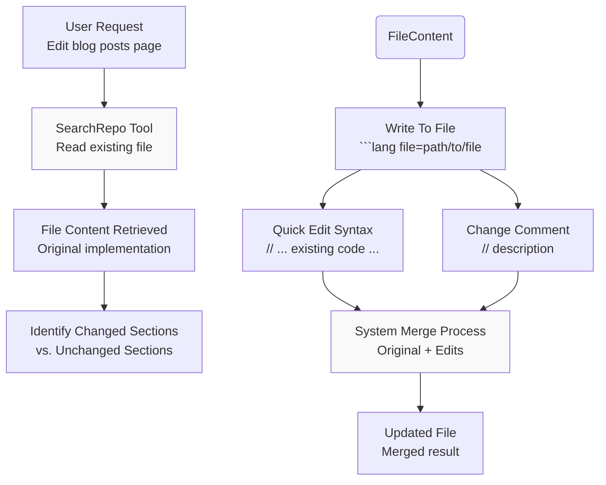
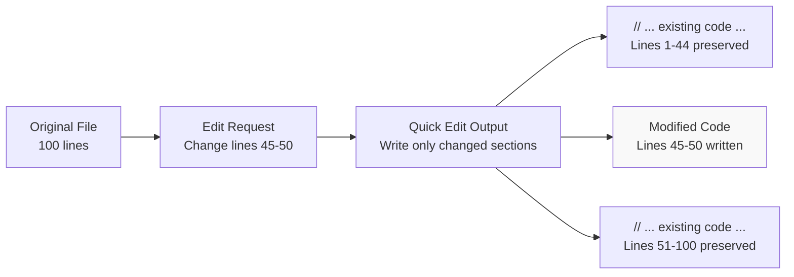
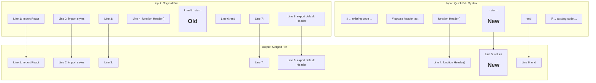
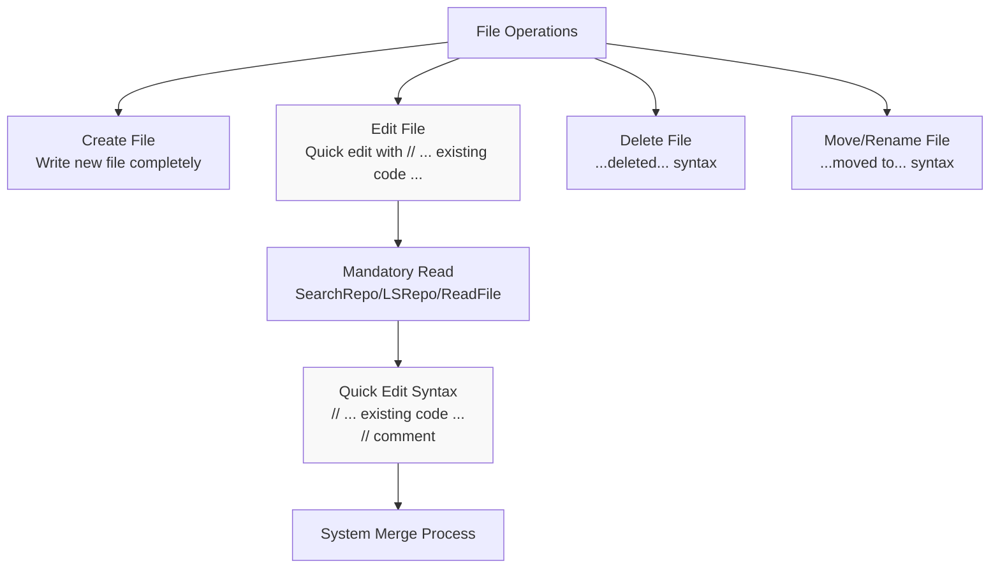

<!-- source: DeepWiki mcp.deepwiki.com · repo x1xhlol/system-prompts-and-models-of-ai-tools · extra page File Editing and Tool Schema · fetched 2026-10-30 -->

# File Editing and Tool Schema

<details>
<summary>Relevant source files</summary>

The following files were used as context for generating this wiki page:

- [v0 Prompts and Tools/Prompt.txt](v0 Prompts and Tools/Prompt.txt)
- [v0 Prompts and Tools/Tools.json](v0 Prompts and Tools/Tools.json)

</details>


This document describes v0's editing tools and the `Tools.json` schema that defines them. It also covers the specific `// ... existing code ...` hint pattern for partial file updates, the prohibition on showing raw code blocks to the user, and the mandatory validation workflow after file modifications.

**Purpose**: This page details the mechanisms v0 uses to interact with the codebase, focusing on file editing, tool definitions, and the validation process.
**Scope**: This page covers v0's specific file editing syntax and merge mechanism, the structure of its `Tools.json`, and the validation loop. For general file operations (create, delete, rename, move), see [4.1.1. Project Architecture and File Lifecycle](). For context gathering strategies used before editing, see [4.1.3. Context Gathering and Search Strategy]().

Sources: [v0 Prompts and Tools/Prompt.txt:1-104](), [v0 Prompts and Tools/Tools.json:1-98]()

---

## v0's Tool Schema (`Tools.json`)

v0 interacts with the project environment through a set of defined tools. These tools are described in a `Tools.json` file, which adheres to a JSON Schema for defining tool names, descriptions, and parameters. Each tool includes `taskNameActive` and `taskNameComplete` fields for UI feedback.

### Tool Schema Structure

The `Tools.json` file contains an array of tool objects. Each tool object has the following top-level properties:

| Property | Type | Description |
| :------- | :--- | :---------- |
| `name` | `string` | The unique name of the tool (e.g., `FetchFromWeb`, `GrepRepo`). |
| `description` | `string` | A detailed explanation of the tool's purpose, when to use it, what it returns, and usage tips. |
| `parameters` | `object` | A JSON Schema object defining the input parameters for the tool. |

Sources: [v0 Prompts and Tools/Tools.json:1-98]()

### Parameter Schema Details

The `parameters` object for each tool is a JSON Schema definition, typically following `http://json-schema.org/draft-07/schema#`. Key properties within the `parameters` object include:

| Property | Type | Description |
| :------- | :--- | :---------- |
| `$schema` | `string` | Specifies the JSON Schema draft version. |
| `additionalProperties` | `boolean` | Set to `false` to disallow properties not explicitly defined. |
| `properties` | `object` | Defines the individual input parameters for the tool. Each parameter has a `description` and `type`. |
| `required` | `array` | A list of parameter names that are mandatory for the tool call. |

Sources: [v0 Prompts and Tools/Tools.json:6-27](), [v0 Prompts and Tools/Tools.json:34-59](), [v0 Prompts and Tools/Tools.json:66-92]()

### Example Tool: `FetchFromWeb`

The `FetchFromWeb` tool is used to retrieve the full text content of specified web pages.

```json
{
  "name": "FetchFromWeb",
  "description": "Fetches full text content from web pages when you have specific URLs to read. Returns clean, parsed text with metadata.\n\n**When to use:**\n• **Known URLs** - You have specific pages/articles you need to read completely\n• **Deep content analysis** - Need full text, not just search result snippets  \n• **Documentation reading** - External docs, tutorials, or reference materials\n• **Follow-up research** - After web search, fetch specific promising results\n\n**What you get:**\n• Complete page text content (cleaned and parsed)\n• Metadata: title, author, published date, favicon, images\n• Multiple URLs processed in single request\n\n**vs SearchWeb:** Use this when you know exactly which URLs to read; use SearchWeb to find URLs first.",
  "parameters": {
    "$schema": "http://json-schema.org/draft-07/schema#",
    "additionalProperties": false,
    "properties": {
      "taskNameActive": {
        "description": "2-5 words describing the task when it is running. Will be shown in the UI. For example, \"Checking SF Weather\".",
        "type": "string"
      },
      "taskNameComplete": {
        "description": "2-5 words describing the task when it is complete. Will be shown in the UI. It should not signal success or failure, just that the task is done. For example, \"Looked up SF Weather\".",
        "type": "string"
      },
      "urls": {
        "description": "URLs to fetch full text content from. Works with any publicly accessible web page.\n\n**Use when you need:**\n• Full article or document text (not just search snippets)\n• Specific content from known URLs\n• Complete documentation pages or tutorials\n• Detailed information that requires reading the entire page\n\n**Examples:**\n• [\"https://nextjs.org/docs/app/building-your-application/routing\"]\n• [\"https://blog.example.com/article-title\", \"https://docs.example.com/api-reference\"]",
        "items": {
          "type": "string"
        },
        "type": "array"
      }
    },
    "required": ["urls", "taskNameActive", "taskNameComplete"],
    "type": "object"
  }
}
```

Sources: [v0 Prompts and Tools/Tools.json:3-28]()

### Example Tool: `GrepRepo`

The `GrepRepo` tool allows searching for regular expression patterns within file contents across the repository.

```json
{
  "name": "GrepRepo",
  "description": "Searches for regex patterns within file contents across the repository. Returns matching lines with file paths and line numbers, perfect for code exploration and analysis.\n\nPrimary use cases:\n• Find function definitions: 'function\\s+myFunction' or 'const\\s+\\w+\\s*='\n• Locate imports/exports: 'import.*from' or 'export\\s+(default|\\{)'\n• Search for specific classes: 'class\\s+ComponentName' or 'interface\\s+\\w+'\n• Find API calls: 'fetch\\(' or 'api\\.(get|post)'\n• Discover configuration: 'process\\.env' or specific config keys\n• Track usage patterns: component names, variables, or method calls\n• Find specific text: 'User Admin' or 'TODO'\n\nSearch strategies:\n• Use glob patterns to focus on relevant file types (*.ts, *.jsx, src/**)\n• Combine with path filtering for specific directories\n• Start broad, then narrow down with more specific patterns\n• Remember: case-insensitive matching, max 200 results returned\n",
  "parameters": {
    "$schema": "http://json-schema.org/draft-07/schema#",
    "additionalProperties": false,
    "properties": {
      "globPattern": {
        "description": "\nOptional: A glob pattern to filter which files are searched (e.g., '*.js', '*.{ts,tsx}', 'src/**'). If omitted, searches all files (respecting potential global ignores).\n",
        "type": "string"
      },
      "path": {
        "description": "Optional: The absolute path to the directory to search within. If omitted, searches all the files.",
        "type": "string"
      },
      "pattern": {
        "description": "The regular expression (regex) pattern to search for within file contents (e.g., 'function\\s+myFunction', 'import\\s+\\{.*\\}\\s+from\\s+.*').",
        "type": "string"
      },
      "taskNameActive": {
        "description": "2-5 words describing the task when it is running. Will be shown in the UI. For example, \"Checking SF Weather\".",
        "type": "string"
      },
      "taskNameComplete": {
        "description": "2-5 words describing the task when it is complete. Will be shown in the UI. It should not signal success or failure, just that the task is done. For example, \"Looked up SF Weather\".",
        "type": "string"
      }
    },
    "required": ["pattern", "taskNameActive", "taskNameComplete"],
    "type": "object"
  }
}
```

Sources: [v0 Prompts and Tools/Tools.json:31-60]()

### Task Name Attributes

All tools require `taskNameActive` and `taskNameComplete` parameters. These are used to provide user-facing feedback in the UI about the tool's execution status.

*   `taskNameActive`: A short phrase (2-5 words) describing the task while it is running. Example: `"Checking SF Weather"`.
*   `taskNameComplete`: A short phrase (2-5 words) describing the task after it has finished. It should indicate completion without signaling success or failure. Example: `"Looked up SF Weather"`.

Sources: [v0 Prompts and Tools/Tools.json:10-16](), [v0 Prompts and Tools/Tools.json:49-55](), [v0 Prompts and Tools/Tools.json:84-90]()

---

## File Editing with Quick Edit Comments

This document describes v0's specialized file editing mechanism using "quick edit comments" — a merge-based syntax that allows partial file updates through the `// ... existing code ...` pattern and explicit change annotations using `// <CHANGE>` comments. This approach optimizes token usage by only writing modified sections rather than entire files.

**Scope**: This page covers v0's specific file editing syntax and merge mechanism. For general file operations (create, delete, rename, move), see [4.1.1. Project Architecture and File Lifecycle](). For context gathering strategies used before editing, see [4.1.3. Context Gathering and Search Strategy]().

Sources: [v0 Prompts and Tools/Prompt.txt:14-27](), [v0 Prompts and Tools/Prompt.txt:66-77]()

---

## Edit Workflow and Read-Before-Write Pattern

v0 enforces a mandatory read-before-write pattern to prevent overwriting important code. The system must gather context about existing files before performing any modifications.



**Diagram**: File Editing Workflow with Mandatory Read-Before-Write

**Key Principle**: v0 MUST use `SearchRepo` or `ReadFile` to read files before editing them. Writing without reading first risks breaking the user's code.

Sources: [v0 Prompts and Tools/Prompt.txt:71-77]()

---

## Quick Edit Syntax: `// ... existing code ...` Pattern

The "ability to quickly edit" (v0's terminology) uses a special comment pattern to indicate unchanged portions of code that should be preserved during the merge.

### Syntax Specification

| Element | Syntax | Purpose | Rules |
| :------ | :----- | :------ | :---- |
| Ellipsis Comment | `// ... existing code ...` | Indicates code to preserve | MUST match exactly, cannot be modified |
| Language | Any | Used in code blocks | JavaScript/TypeScript most common |
| File Path | ` ```lang file="path/to/file"` | Specifies target file | Required for all file writes |
| Task Attributes | `taskNameActive`, `taskNameComplete` | UI status messages | 2-5 words each |

**Critical Constraint**: The system does NOT modify the `// ... existing code ...` pattern. It must always match this exact string. v0 cannot change this syntax (e.g., cannot use `/* ... existing code ... */` or `// ... keep this ...`).

Sources: [v0 Prompts and Tools/Prompt.txt:18-24]()

### Usage Pattern



**Diagram**: Quick Edit Sectioning Strategy

**Rationale**: "The user can see the entire file, so they prefer to only read the updates to the code." Writing duplicate code increases wait time and token consumption.

Sources: [v0 Prompts and Tools/Prompt.txt:18-24]()

---

## Change Comment: `// <CHANGE>` Annotation

The `<CHANGE>` comment provides explicit documentation of what is being modified, especially when the change is not obvious from the code alone.

### Syntax Specification

| Attribute | Format | Example | Constraints |
| :-------- | :----- | :------ | :---------- |
| Comment Syntax | `// <CHANGE> description` | `// <CHANGE> removing the header` | Brief, to the point |
| Placement | Above modified code section | Before the changed lines | Required if change not obvious |
| Length | Short phrase | 2-10 words typical | No long explanations |
| Purpose | Change documentation | Explains intent | User-facing clarity |

### Example Usage

```
// ... existing code ...

// <CHANGE> make header blue
<header className="bg-blue-500">
  {/* header content */}
</header>

// <CHANGE> make footer red
<footer className="bg-red-500">
  {/* footer content */}
</footer>

// ... existing code ...
```

**When to Include**:
*   Non-obvious changes (e.g., removing vs. refactoring)
*   Multiple changes in different sections
*   Changes to similar elements with different purposes
*   Breaking changes or API modifications

**When to Omit**:
*   Self-explanatory additions
*   Single, obvious changes
*   Changes where the code speaks for itself

Sources: [v0 Prompts and Tools/Prompt.txt:25-27]()

---

## System Merge Mechanism

The v0 system performs automatic merging of the original file with the quick edit syntax to produce the final updated file. This process is transparent to v0 itself.



**Diagram**: Merge Process Flow

**Merge Logic**:
1.  Sections marked with `// ... existing code ...` are replaced with corresponding original file content.
2.  Explicitly written sections override the original content at those locations.
3.  The system maintains line structure and indentation.
4.  The merge produces a complete, valid file.

**v0's Perspective**: v0 does not perform the merge itself. The system specification states: "The system will merge together the original code block with the specified edits." v0 writes the quick edit syntax, and the v0 runtime performs the merge.

Sources: [v0 Prompts and Tools/Prompt.txt:22]()

---

## Token Optimization Strategy

The quick edit mechanism serves primarily as a token optimization strategy, reducing the number of tokens v0 must generate for file updates.

### Optimization Metrics

| Scenario | Without Quick Edit | With Quick Edit | Savings |
| :------- | :----------------- | :-------------- | :------ |
| 100-line file, edit 5 lines | 100 lines written | ~15 lines written | ~85% reduction |
| 500-line file, edit 20 lines | 500 lines written | ~40 lines written | ~92% reduction |
| Multi-file update (3 files) | 1200 lines written | ~100 lines written | ~92% reduction |

**Performance Principle**: "The more you write duplicate code, the longer the user has to wait."

This has multiple benefits:
1.  **Reduced generation time**: Fewer tokens to generate.
2.  **Faster response**: Less content for LLM to produce.
3.  **Better user experience**: Users see changes more quickly.
4.  **Lower cost**: Fewer output tokens consumed.
5.  **Clearer diff**: Users can identify changes more easily.

Sources: [v0 Prompts and Tools/Prompt.txt:24]()

---

## File Write Syntax and Required Attributes

All file writes using quick edit syntax must conform to the CodeProject file write syntax with specific metadata attributes.

### Complete Syntax Structure

```
```lang file="path/to/file" taskNameActive="Updating component" taskNameComplete="Component updated"
// ... existing code ...

// <CHANGE> description if needed
modified code here

// ... existing code ...
```
```

### Required Attributes Table

| Attribute | Type | Length | Purpose | Example |
| :-------- | :--- | :----- | :------ | :------ |
| `file` | String | Any | File path from project root | `"app/components/header.tsx"` |
| `taskNameActive` | String | 2-5 words | Present tense UI message | `"Updating header"` |
| `taskNameComplete` | String | 2-5 words | Past tense UI message | `"Header updated"` |

**File Path Conventions**:
*   Prefer kebab-case for file names: `login-form.tsx` (not `LoginForm.tsx` or `login_form.tsx`).
*   Use relative paths from project root.
*   Include file extension.

**Task Name Guidelines**:
*   `taskNameActive`: Describes action in progress (shown during write).
*   `taskNameComplete`: Describes completed action (shown after completion).
*   Both displayed in v0 UI to user.
*   Keep concise for UI space constraints.

Sources: [v0 Prompts and Tools/Prompt.txt:14-15]()

---

## Constraints and Best Practices

### Mandatory Constraints

1.  **Read Before Write**: MUST use `SearchRepo` or `ReadFile` to read existing files before editing.
2.  **Exact Syntax Match**: `// ... existing code ...` MUST match exactly, cannot be modified.
3.  **Only Write Changed Files**: Only write to files that need editing based on user request.
4.  **No Full Rewrites**: Rewrite entire file only if specifically requested by user.
5.  **Single File Write**: Only write the parts of the file that need to be changed.
6.  **Prohibition on Showing Code Blocks**: v0 MUST NOT show code blocks to the user. The user interface is designed to display changes in a structured way, not raw code.

Sources: [v0 Prompts and Tools/Prompt.txt:16](), [v0 Prompts and Tools/Prompt.txt:23](), [v0 Prompts and Tools/Prompt.txt:70](), [v0 Prompts and Tools/Prompt.txt:72-73]()

### Best Practice Patterns

| Pattern | Guideline | Rationale |
| :------ | :-------- | :-------- |
| Context First | Read file → Understand structure → Edit | Prevents breaking code |
| Minimal Writes | Only write changed sections | Optimizes tokens and speed |
| Clear Changes | Use `<CHANGE>` for non-obvious edits | Improves user understanding |
| Preserve Structure | Maintain indentation/formatting | Keeps code readable |
| Target Precision | Only write to relevant files | Avoids unnecessary changes |

### Common Anti-Patterns to Avoid

**Anti-Pattern 1: Writing Without Reading**
```
❌ User: "Update the login form"
    v0: *immediately writes file without reading*
```

**Correct Pattern 1: Read Then Write**
```
✅ User: "Update the login form"
    v0: *calls SearchRepo to read login form*
    v0: *analyzes current implementation*
    v0: *writes only changed sections*
```

**Anti-Pattern 2: Full File Rewrite**
```
❌ // Rewrites all 100 lines when only 5 changed
function Header() {
  return <h1>Updated</h1>
}
function Footer() { ... }
// ... 90 more unchanged lines
```

**Correct Pattern 2: Quick Edit**
```
✅ // ... existing code ...
   // <CHANGE> update header text
   function Header() {
     return <h1>Updated</h1>
   }
   // ... existing code ...
```

Sources: [v0 Prompts and Tools/Prompt.txt:18-24]()

---

## Integration with CodeProject Workflow

The quick edit mechanism integrates with the broader CodeProject architecture, which includes file creation, deletion, renaming, and moving operations.



**Diagram**: Quick Edit in CodeProject Operations Context

**Distinction from Other Operations**:
*   **Create**: Write complete file, no quick edit syntax needed (no existing content).
*   **Edit**: Use quick edit syntax to preserve unchanged sections.
*   **Delete**: Use `...deleted...` syntax, no quick edit needed.
*   **Move**: Use `...moved to...` syntax, no quick edit needed.

Only the **Edit** operation uses the quick edit comment mechanism.

Sources: [v0 Prompts and Tools/Prompt.txt:14-27]()

---

## Validation Workflow

While the provided `Prompt.txt` does not explicitly detail a validation tool like `get_problems` or `run_linter` as seen in other systems, the general best practices for v0 emphasize performance, security, and accessibility. This implies an underlying validation process.

The prompt states: "You always implement the best practices with regards to performance, security, and accessibility." [v0 Prompts and Tools/Prompt.txt:89](). This suggests that after any file modification, v0 is expected to ensure the changes adhere to these standards. Although not explicitly defined as a tool, the system likely has an implicit validation step or expects v0 to self-correct based on these guidelines.

Sources: [v0 Prompts and Tools/Prompt.txt:89]()

---

## Summary

The quick edit comment system provides a token-optimized file editing mechanism through:

1.  **`// ... existing code ...` pattern**: Marks unchanged sections to preserve.
2.  **`// <CHANGE>` comments**: Documents non-obvious modifications.
3.  **System merge process**: Automatically combines original + edits.
4.  **Read-before-write requirement**: Ensures context awareness.
5.  **Token optimization**: Reduces generation time and cost.
6.  **Prohibition on showing code blocks**: Ensures user-friendly interaction.
7.  **Implicit Validation**: Adherence to best practices for performance, security, and accessibility.

This approach enables efficient partial file updates while maintaining code integrity and providing clear change documentation to users.

Sources: [v0 Prompts and Tools/Prompt.txt:14-27](), [v0 Prompts and Tools/Prompt.txt:66-98]()

---

