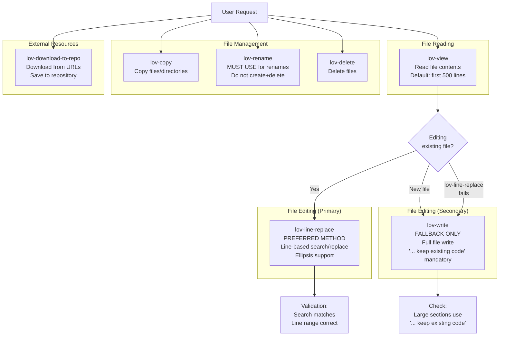
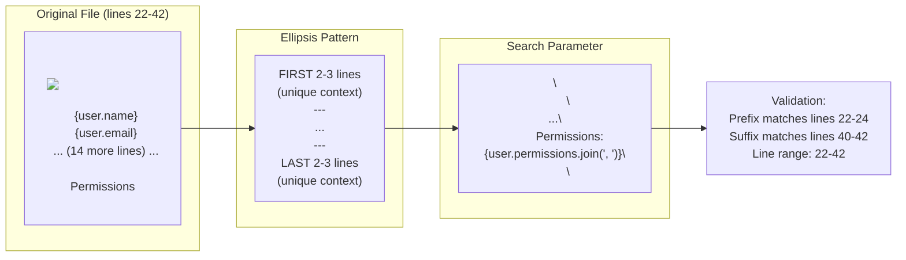
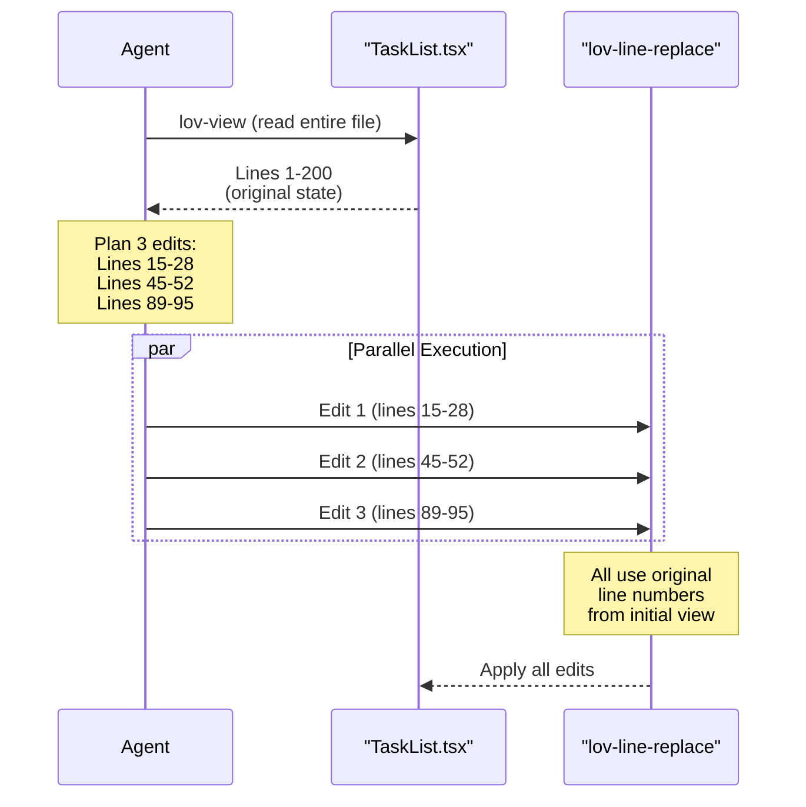
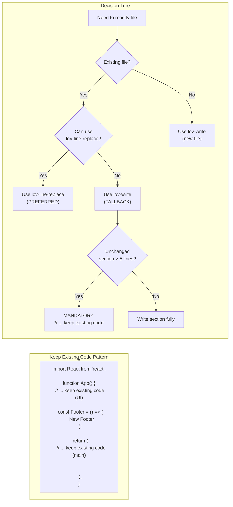
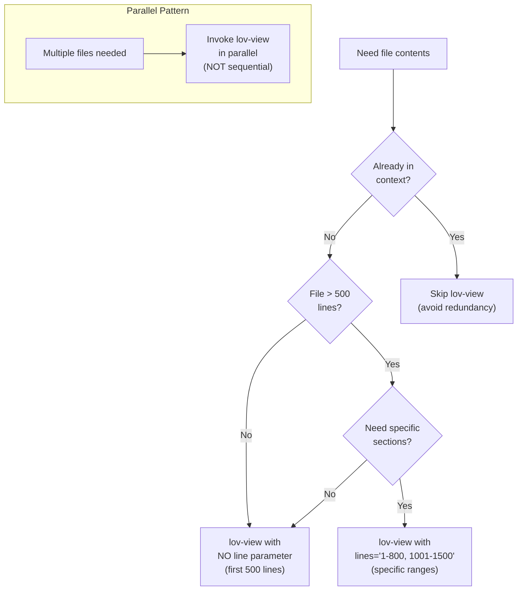
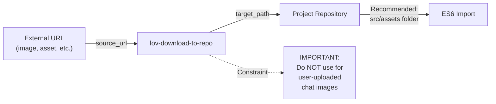
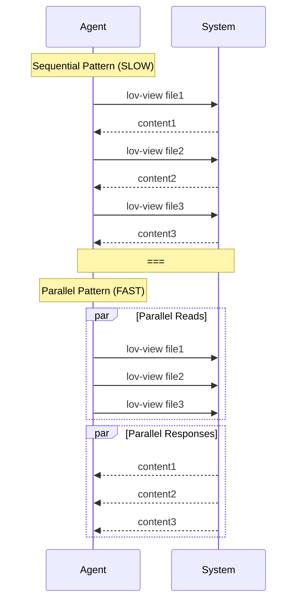
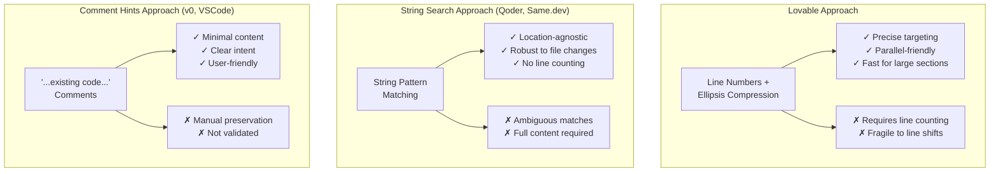

<!-- source: DeepWiki mcp.deepwiki.com · repo x1xhlol/system-prompts-and-models-of-ai-tools · extra page File Operations and Line-Replace Strategy · fetched 2026-10-30 -->

# File Operations and Line-Replace Strategy

Relevant source files

The following files were used as context for generating this wiki page:

- [Lovable/Agent Tools.json](Lovable/Agent Tools.json)

This document details Lovable's file operation tools and its distinctive line-replace editing strategy. Lovable emphasizes precise, minimal modifications to existing files through the `lov-line-replace` tool, which uses explicit line numbers and ellipsis compression for large sections. This approach contrasts with full file rewrites and is designed to preserve existing code while making targeted changes.

For information about Lovable's broader tool ecosystem, see [Agent Prompt, Tool Naming Conventions and Categories](#4.3.1). For deployment and integration capabilities, see [Secrets, Security Scanning and External Integrations](#4.3.4).

## File Operation Tool Ecosystem

Lovable provides six core file operation tools, each with specific use cases and constraints. The system enforces a strict hierarchy: `lov-line-replace` is the preferred method for editing existing files, with `lov-write` serving as a secondary option only for new file creation or fallback scenarios.

**Sources:** [Lovable/Agent Tools.json:40-229]()

## lov-line-replace: Primary Editing Strategy

The `lov-line-replace` tool is explicitly designated as the **PREFERRED and PRIMARY tool for editing existing files** in Lovable's architecture. It operates using a line-based search-and-replace mechanism with four required parameters and sophisticated ellipsis compression for large sections.

### Core Parameters and Validation

| Parameter | Type | Description | Example |
|-----------|------|-------------|---------|
| `file_path` | string | Relative path to project root | `src/components/TaskList.tsx` |
| `search` | string | Content to find (ellipsis allowed) | `const handleTask...onTaskUpdate?.();` |
| `first_replaced_line` | number | First line number (1-indexed) | `15` |
| `last_replaced_line` | number | Last line number (1-indexed) | `28` |
| `replace` | string | New content without line numbers | `const handleTaskComplete = ...` |

The tool validates that the `search` content (excluding ellipsis sections) exactly matches the file content at the specified line range before performing the replacement.

**Sources:** [Lovable/Agent Tools.json:57-89]()

### Ellipsis Compression for Large Sections

For code sections longer than approximately 6 lines, Lovable mandates the use of ellipsis (`...`) to reduce the amount of content that must be specified. This optimization significantly improves performance by minimizing the lines written in tool parameters.

The system extracts prefix and suffix portions from the search parameter, validates them against actual file content, and performs the replacement. The key principle is providing **enough unique context at the beginning and end** to ensure accurate matching—sometimes 2 lines suffice, sometimes 4 are needed.

**Sources:** [Lovable/Agent Tools.json:57-89]()

### Parallel Editing with Original Line Numbers

When making multiple edits to the same file, Lovable requires using the **original line numbers from the initial view** of the file. Line numbers are not adjusted based on previous edits when tool calls execute in parallel.

This design choice enables true parallel execution without complex line number recalculation, significantly improving performance for multi-edit operations.

**Sources:** [Lovable/Agent Tools.json:57-89]()

## lov-write: Secondary Strategy with Preservation Mandates

The `lov-write` tool is explicitly designated for **creating new files** or as a **fallback if lov-line-replace fails**. When it must be used for files with existing content, Lovable enforces strict preservation rules through the `// ... keep existing code` comment pattern.

### Mandatory Preservation Rules

The tool description at [Lovable/Agent Tools.json:40-56]() establishes four critical constraints:

1.  **MINIMIZE CODE WRITING**: Prefer `lov-line-replace` for most changes
2.  **MAXIMIZE "keep existing code" comments**: Maintain unmodified sections
3.  **5-Line Threshold**: Any unchanged block over 5 lines MUST use the comment
4.  **EXACT String Requirement**: Comment must contain `... keep existing code`

**Sources:** [Lovable/Agent Tools.json:40-56]()

### Parallel File Creation

When creating multiple new files, `lov-write` supports parallel execution to improve performance. The tool description emphasizes: "If you need to create multiple files, it is very important that you create all of them at once instead of one by one, because it's much faster."

**Sources:** [Lovable/Agent Tools.json:40-56]()

## File Viewing and Reading Strategy

The `lov-view` tool reads file contents with intelligent default behavior and optional line range specification. The system is designed to minimize unnecessary reads and support efficient parallel operations.

### Default Behavior and Line Range Specification

| Feature | Behavior | Constraint |
|---------|----------|------------|
| Default read | First 500 lines | Applied when `lines` parameter omitted |
| Line range syntax | `"1-800, 1001-1500"` | Comma-separated ranges |
| Use cases | Large files (>500 lines) | Only specify ranges when needed |
| Parallel reads | Multiple files simultaneously | Invoke tool in parallel, not sequentially |

### Critical Guidelines from Tool Description

The `lov-view` tool at [Lovable/Agent Tools.json:144-160]() specifies three important prohibitions:

1.  **Do NOT use if contents already provided** in context
2.  **Do NOT specify line ranges** unless file is very large (>500 lines)
3.  **Rely on default behavior** which shows first 500 lines

**Sources:** [Lovable/Agent Tools.json:144-160]()

## Additional File Operations

Lovable provides three file management operations with specific constraints and use cases.

### lov-copy: Cross-Filesystem Support

The `lov-copy` tool copies files or directories, with primary utility for moving content from virtual file systems (e.g., `user-uploads://`) to the project repository.

**Parameters:**
- `source_file_path`: Original location (supports virtual paths)
- `destination_file_path`: Target location in project

**Sources:** [Lovable/Agent Tools.json:127-143]()

### lov-rename: Mandatory for File Renaming

The `lov-rename` tool carries an explicit mandate: **"You MUST use this tool to rename a file instead of creating new files and deleting old ones."** This prevents inefficient patterns of copying content to a new file and deleting the original.

**Parameters:**
- `original_file_path`: Current file path
- `new_file_path`: Desired file path

**Sources:** [Lovable/Agent Tools.json:200-216]()

### lov-delete: Simple File Deletion

The `lov-delete` tool removes files using a relative path from project root.

**Parameter:**
- `file_path`: File to delete (relative to project root)

**Sources:** [Lovable/Agent Tools.json:217-229]()

### lov-download-to-repo: External Resource Retrieval

The `lov-download-to-repo` tool downloads files from URLs and saves them to the repository, with specific guidance for image handling.

**Critical Constraint:** The tool description explicitly warns: "DO NOT USE this tool to handle the image uploaded by users in the chat and follow the instructions given with the images!"

**Sources:** [Lovable/Agent Tools.json:90-108]()

## Performance Optimization Through Parallel Execution

Lovable's file operation tools are designed to support parallel execution patterns, significantly improving performance for multi-file operations.

### Parallel Execution Capabilities

| Tool | Parallel Support | Key Benefit |
|------|-----------------|-------------|
| `lov-view` | Multiple files simultaneously | "Invoke this tool multiple times in parallel (not sequentially)" |
| `lov-line-replace` | Multiple edits to same file | Use original line numbers, no recalculation |
| `lov-write` | Multiple new files | "Create all of them at once instead of one by one, because it's much faster" |

### Workflow Pattern

**Sources:** [Lovable/Agent Tools.json:40-56, 57-89, 144-160]()

## Comparison with Other System File Editing Strategies

Lovable's line-replace strategy with ellipsis compression represents a unique position in the spectrum of file editing approaches across AI assistant systems.

| System | Primary Strategy | Key Characteristics |
|--------|-----------------|---------------------|
| **Lovable** | `lov-line-replace` with ellipsis | Explicit line numbers, ellipsis for >6 lines, preserve via compression |
| **Qoder** | `search_replace` mandatory | String search/replace, $100M penalty for `edit_file`, 600-line limit |
| **v0** | `insert_edit_into_file` | `...existing code...` comments, never show code blocks to users |
| **Same.dev** | `edit_file` vs `string_replace` | 2500-line threshold decision point |
| **VSCode Agent** | `insert_edit_into_file` | Read before edit, concise hints, `...existing code...` |
| **Windsurf** | `replace_file_content` | ReplacementChunks with TargetContent/ReplacementContent pairs |

### Architectural Trade-offs

Lovable's line-replace with ellipsis combines precision (explicit line numbers) with efficiency (ellipsis compression), optimized for parallel execution but requiring accurate line number tracking. This contrasts with Qoder's mandatory `search_replace` (see [File Operations and Editing Constraints](#2.7)) and v0's `insert_edit_into_file` with comment hints (see [File Editing and Tool Schema](#4.1.2)).

**Sources:** [Lovable/Agent Tools.json:40-89]()

---

