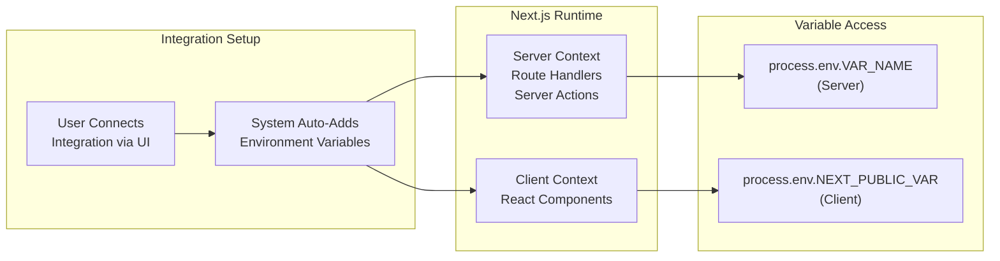
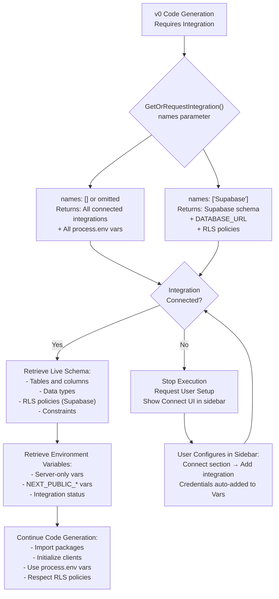
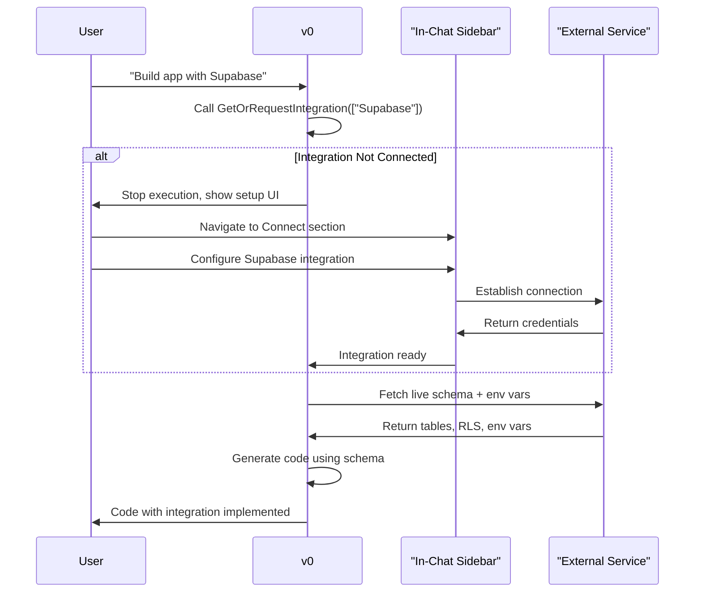
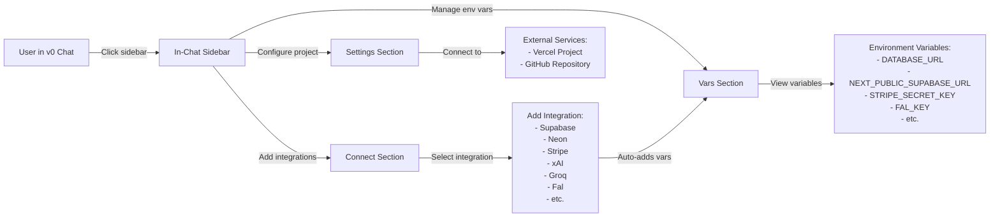
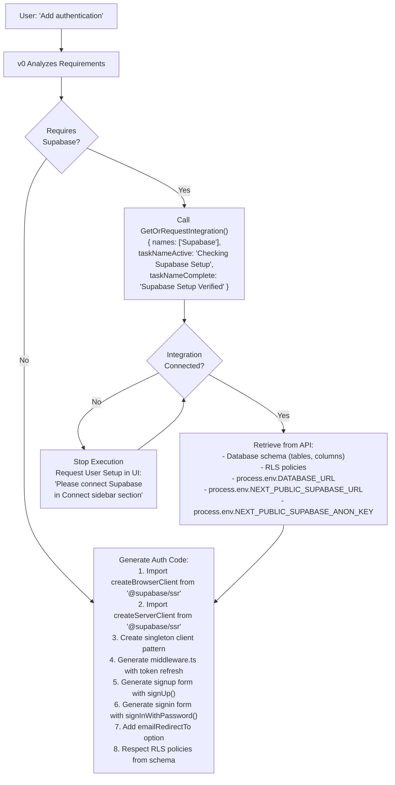

<!-- source: DeepWiki mcp.deepwiki.com · repo x1xhlol/system-prompts-and-models-of-ai-tools · extra page Integration Ecosystem and Configuration · fetched 2026-10-30 -->

# Integration Ecosystem and Configuration

<details>
<summary>Relevant source files</summary>

The following files were used as context for generating this wiki page:

- [v0 Prompts and Tools/Prompt.txt](v0 Prompts and Tools/Prompt.txt)

</details>


This document describes v0's comprehensive integration system for connecting Code Projects to external services including databases, AI providers, and payment processors. It covers the `GetOrRequestIntegration` tool, environment variable management, service-specific implementation requirements, and in-chat sidebar configuration for integration setup.

For general v0 architecture and file operations, see page 4.1.1. For AI SDK usage patterns, see page 4.1.7.

---

## Overview

v0 provides first-class support for specific integrations that automatically configure environment variables and provide live schema information. The system handles three categories of external services: storage/databases, AI/ML providers, and payment processors. All integration setup occurs within the v0 UI without requiring users to leave the platform.

**Sources:** [v0 Prompts and Tools/Prompt.txt:531-543](), [v0 Prompts and Tools/Tools.json:285-323]()

---

## Integration Categories and Supported Services

### Integration Ecosystem Architecture

```mermaid
graph TB
    subgraph Storage["Storage Integrations"]
        Supabase["Supabase<br/>createBrowserClient()<br/>createServerClient()<br/>process.env.DATABASE_URL"]
        Neon["Neon<br/>neon(process.env.DATABASE_URL)<br/>@neondatabase/serverless"]
        Upstash["Upstash Redis<br/>process.env.KV_REST_API_URL<br/>process.env.KV_REST_API_TOKEN"]
        VercelBlob["Vercel Blob<br/>process.env.BLOB_READ_WRITE_TOKEN"]
    end
    
    subgraph AI["AI Integrations"]
        xAI["xAI Grok<br/>xai('grok-4')<br/>process.env.XAI_API_KEY"]
        Groq["Groq<br/>process.env.GROQ_API_KEY"]
        Fal["Fal AI<br/>fal(process.env.FAL_KEY)<br/>@fal-ai/serverless"]
        DeepInfra["DeepInfra<br/>process.env.DEEPINFRA_API_KEY"]
        Gateway["Vercel AI Gateway<br/>generateText({ model: 'openai/gpt-5-mini' })<br/>No API key required"]
    end
    
    subgraph Payments["Payment Integrations"]
        Stripe["Stripe<br/>process.env.STRIPE_SECRET_KEY<br/>process.env.NEXT_PUBLIC_STRIPE_PUBLISHABLE_KEY"]
    end
    
    subgraph Core["v0 Code Project"]
        EnvVars["process.env Variables<br/>Server: process.env.VAR<br/>Client: process.env.NEXT_PUBLIC_VAR"]
        GetOrRequest["GetOrRequestIntegration<br/>names: string[]<br/>Returns: schema + env vars"]
        CodeGen["Generated Code<br/>Route Handlers<br/>Server Actions<br/>React Components"]
    end
    
    GetOrRequest -->|"Checks Status"| Supabase
    GetOrRequest -->|"Checks Status"| Neon
    GetOrRequest -->|"Checks Status"| Upstash
    GetOrRequest -->|"Checks Status"| xAI
    GetOrRequest -->|"Checks Status"| Groq
    GetOrRequest -->|"Checks Status"| Fal
    GetOrRequest -->|"Checks Status"| DeepInfra
    GetOrRequest -->|"Checks Status"| Stripe
    GetOrRequest -->|"Checks Status"| Gateway
    
    Supabase -->|"Provides Env Vars"| EnvVars
    Neon -->|"Provides Env Vars"| EnvVars
    Upstash -->|"Provides Env Vars"| EnvVars
    xAI -->|"Provides Env Vars"| EnvVars
    Groq -->|"Provides Env Vars"| EnvVars
    Fal -->|"Provides Env Vars"| EnvVars
    DeepInfra -->|"Provides Env Vars"| EnvVars
    Stripe -->|"Provides Env Vars"| EnvVars
    VercelBlob -->|"Provides Env Vars"| EnvVars
    Gateway -->|"Auto-configured"| EnvVars
    
    EnvVars -->|"Available to"| CodeGen
```



**Sources:** [v0 Prompts and Tools/Prompt.txt:547-687]()

### Supported Integrations Table

| Category | Integration | Package(s) | Environment Variables | Auto-Schema |
|----------|-------------|------------|----------------------|-------------|
| **Storage** | Supabase | `@supabase/ssr` | `DATABASE_URL`, auth vars | Yes (tables, columns, RLS) |
| | Neon | `@neondatabase/serverless` | `DATABASE_URL` | Yes (tables, columns) |
| | Upstash for Redis | Built-in | `KV_REST_API_URL`, `KV_REST_API_TOKEN` | No |
| | Vercel Blob | Built-in | `BLOB_READ_WRITE_TOKEN` | No |
| | Upstash Search | Built-in | Search-specific vars | No |
| | Edge Config | Built-in | Config-specific vars | No |
| **AI/ML** | xAI (Grok) | AI SDK | `XAI_API_KEY` | No |
| | Groq | AI SDK | `GROQ_API_KEY` | No |
| | Fal AI | `@fal-ai/serverless` | `FAL_KEY` | No |
| | DeepInfra | AI SDK | `DEEPINFRA_API_KEY` | No |
| | Vercel AI Gateway | AI SDK (default) | None (automatic) | No |
| **Payments** | Stripe | Built-in | `STRIPE_SECRET_KEY`, `STRIPE_PUBLISHABLE_KEY`, `NEXT_PUBLIC_STRIPE_PUBLISHABLE_KEY` | No |

**Sources:** [v0 Prompts and Tools/Prompt.txt:547-687](), [v0 Prompts and Tools/Tools.json:293-309]()

---

## Environment Variable System

### Variable Scope and Access

v0 supports environment variables from Vercel but does not support `.env` files in the browser runtime. Variables follow Next.js conventions for server/client access:

- **Server-only variables**: Available in Server Actions and Route Handlers without prefix
- **Client-accessible variables**: Must be prefixed with `NEXT_PUBLIC_` 
- **Automatic injection**: Integration-provided variables are automatically added to the project

**Sources:** [v0 Prompts and Tools/Prompt.txt:456-458](), [v0 Prompts and Tools/Prompt.txt:534-536]()

### Environment Variable Flow



**Sources:** [v0 Prompts and Tools/Prompt.txt:456-458](), [v0 Prompts and Tools/Prompt.txt:534-536]()

### Variable Verification and Troubleshooting

When generated code references environment variables, v0 automatically prompts users to verify they are added to the Vercel project. Users troubleshoot integration issues by:

1. Checking integrations in the **Connect** section of the in-chat sidebar
2. Verifying environment variables in the **Vars** section of the in-chat sidebar

**Sources:** [v0 Prompts and Tools/Prompt.txt:534-542]()

---

## GetOrRequestIntegration Tool

### Tool Purpose and Behavior

The `GetOrRequestIntegration` tool performs three critical functions:

1. **Status checking**: Verifies which integrations are connected and configured
2. **Schema retrieval**: Fetches live database schemas for SQL integrations (tables, columns, RLS policies)
3. **Automatic requesting**: Stops execution and requests user setup for missing required integrations

**Sources:** [v0 Prompts and Tools/Tools.json:285-323]()

### GetOrRequestIntegration Tool Workflow



**Sources:** [v0 Prompts and Tools/Prompt.txt:534-542](), [v0 Prompts and Tools/Tools.json:285-323]()

### Tool Parameters

| Parameter | Type | Required | Description |
|-----------|------|----------|-------------|
| `names` | `string[]` | No | Specific integration names to check. Omit or use empty array for overview of all integrations. Valid values: `"Upstash for Redis"`, `"Upstash Search"`, `"Neon"`, `"Supabase"`, `"Groq"`, `"Grok"`, `"fal"`, `"Deep Infra"`, `"Stripe"`, `"Blob"`, `"Edge Config"`, `"Vercel AI Gateway"` |
| `taskNameActive` | `string` | Yes | 2-5 words describing running task (e.g., "Checking Database Setup") |
| `taskNameComplete` | `string` | Yes | 2-5 words describing completed task (e.g., "Database Setup Verified") |

**Sources:** [v0 Prompts and Tools/Tools.json:285-323]()

### Usage Patterns

**Before building integration features:**
```typescript
// v0 calls GetOrRequestIntegration before generating auth code
GetOrRequestIntegration({
  names: ["Supabase"],
  taskNameActive: "Checking Supabase Setup",
  taskNameComplete: "Supabase Setup Verified"
})
```

**For database schema retrieval:**
```typescript
// Get live schema instead of reading SQL scripts
GetOrRequestIntegration({
  names: ["Neon"],
  taskNameActive: "Getting Database Schema",
  taskNameComplete: "Schema Retrieved"
})
// Returns: tables, columns, types, constraints
```

**For project discovery:**
```typescript
// Omit names parameter to get overview
GetOrRequestIntegration({
  names: [],
  taskNameActive: "Checking Available Services",
  taskNameComplete: "Services Checked"
})
// Returns: all connected integrations + all env vars
```

**Sources:** [v0 Prompts and Tools/Tools.json:285-323]()

---

## Storage Integration Details

### Supabase Integration

#### Package Requirements

v0 **MUST** use the `@supabase/ssr` package for both client-side and server-side Supabase operations. The standard `@supabase/supabase-js` package is not used.

```typescript
// Client-side
import { createBrowserClient } from '@supabase/ssr'

// Server-side
import { createServerClient } from '@supabase/ssr'
```

**Sources:** [v0 Prompts and Tools/Prompt.txt:587-603]()

#### Client Initialization Pattern

v0 implements the **singleton pattern** for Supabase clients to prevent initialization errors. This pattern is required when using `createBrowserClient()` from `@supabase/ssr`:

```typescript
// CORRECT: Singleton pattern with createBrowserClient()
import { createBrowserClient } from '@supabase/ssr'

let supabase: SupabaseClient | null = null
export function getSupabase() {
  if (!supabase) {
    supabase = createBrowserClient(
      process.env.NEXT_PUBLIC_SUPABASE_URL!,
      process.env.NEXT_PUBLIC_SUPABASE_ANON_KEY!
    )
  }
  return supabase
}
```

For server-side operations in Route Handlers or Server Actions, use `createServerClient()`:

```typescript
import { createServerClient } from '@supabase/ssr'

// In middleware.ts for token refresh
const supabase = createServerClient(
  process.env.NEXT_PUBLIC_SUPABASE_URL!,
  process.env.NEXT_PUBLIC_SUPABASE_ANON_KEY!,
  { cookies }
)
```

**Sources:** [v0 Prompts and Tools/Prompt.txt:587-603]()

#### Authentication Implementation

**Email/Password Authentication:**
- v0 **MUST** use only default email and password authentication unless user explicitly requests other methods
- OAuth and other authentication methods are **NEVER** implemented unless explicitly requested
- Client-side authentication is preferred; server actions only when explicitly requested

**Required Pattern for supabase.auth.signUp():**

The `emailRedirectTo` option in the `options` parameter **MUST** be set using `NEXT_PUBLIC_DEV_SUPABASE_REDIRECT_URL` environment variable for development and `window.location.origin` for production:

```typescript
const { data, error } = await supabase.auth.signUp({
  email,
  password,
  options: { 
    emailRedirectTo: process.env.NEXT_PUBLIC_DEV_SUPABASE_REDIRECT_URL || window.location.origin 
  },
})

// OR with specific path for post-auth redirect
options: { 
  emailRedirectTo: process.env.NEXT_PUBLIC_DEV_SUPABASE_REDIRECT_URL || `${window.location.origin}/protected` 
}
```

Available authentication methods:
- `supabase.auth.signInWithPassword({ email, password })` - for login
- `supabase.auth.signUp({ email, password, options })` - for registration
- OAuth methods only when explicitly requested by user

**Server-side middleware for token refresh:**

v0 **MUST** use `createServerClient()` in `middleware.ts` (or `proxy.js` in Next.js 16) to refresh tokens and set cookies:

```typescript
// middleware.ts
import { createServerClient } from '@supabase/ssr'

// Create server client with cookie handling
const supabase = createServerClient(
  process.env.NEXT_PUBLIC_SUPABASE_URL!,
  process.env.NEXT_PUBLIC_SUPABASE_ANON_KEY!,
  { cookies }
)
```

**Sources:** [v0 Prompts and Tools/Prompt.txt:599-637]()

#### Row Level Security (RLS) Mandate

v0 **MUST** use Row Level Security to protect data. Security is **non-negotiable**. When retrieving database schema via `GetOrRequestIntegration`, RLS policies are included in the response and must be respected in code generation.

**Sources:** [v0 Prompts and Tools/Prompt.txt:637-638]()

#### Dashboard Access Restrictions

- v0 **NEVER** tells users to go to Supabase dashboard for integration setup (done in v0 UI)
- v0 **NEVER** recommends using Supabase SQL editor to run scripts (scripts run from `/scripts` folder directly)

**Sources:** [v0 Prompts and Tools/Prompt.txt:592-595]()

### Neon Integration

#### Package and Connection Pattern

v0 **MUST** use the `@neondatabase/serverless` package and the `neon()` function for creating SQL clients:

```typescript
import { neon } from '@neondatabase/serverless'

const sql = neon(process.env.DATABASE_URL!)
```

v0 **NEVER** uses the `@vercel/postgres` package for Neon databases.

**Sources:** [v0 Prompts and Tools/Prompt.txt:643-648]()

### Upstash for Redis Integration

Uses two environment variables:
- `KV_REST_API_URL`: Redis instance REST endpoint
- `KV_REST_API_TOKEN`: Authentication token for REST API

**Sources:** [v0 Prompts and Tools/Prompt.txt:650-653]()

---

## AI Provider Integrations

### AI SDK and Vercel AI Gateway

#### Default AI Provider Pattern

The AI SDK uses the **Vercel AI Gateway by default**. Provider packages are not necessary—v0 passes a model string to the `model` parameter, and Next.js automatically handles API keys and configurations.

**Supported providers in AI Gateway (no API key required):**
- AWS Bedrock
- Google Vertex
- OpenAI (e.g., `"openai/gpt-5-mini"`)
- Fireworks AI
- Anthropic (e.g., `"anthropic/claude-sonnet-4.5"`)

```typescript
import { generateText } from "ai"

const { text } = await generateText({
  model: "openai/gpt-5-mini",
  prompt: "What is love?"
})
```

**Sources:** [v0 Prompts and Tools/Prompt.txt:319-343]()

### xAI (Grok) Integration

#### Environment Variable
- `XAI_API_KEY`: API key for xAI Grok models

#### Usage Pattern

v0 **MUST** use `xai("grok-4")` as the model parameter unless user requests a different Grok model. The xAI integration should **ONLY** be used if Grok is explicitly requested; otherwise, v0 uses the Vercel AI Gateway with model strings like `"openai/gpt-5-mini"`.

```typescript
import { xai } from '@ai-sdk/xai'
import { generateText } from 'ai'

const result = await generateText({
  model: xai("grok-4"),
  prompt: "What is love?"
})
```

Alternative Vercel AI Gateway pattern (no integration required):
```typescript
import { generateText } from 'ai'

const result = await generateText({
  model: "xai/grok-4-fast",  // Gateway handles authentication
  prompt: "What is love?"
})
```

**Sources:** [v0 Prompts and Tools/Prompt.txt:319-343](), [v0 Prompts and Tools/Prompt.txt:655-661]()

### Groq Integration

#### Environment Variable
- `GROQ_API_KEY`: API key for Groq LLM inference

Groq should **ONLY** be used if explicitly requested by the user. Otherwise, v0 uses the Vercel AI Gateway to avoid requiring user configuration.

**Sources:** [v0 Prompts and Tools/Prompt.txt:663-667]()

### Fal AI Integration

#### Package and Client Pattern

v0 **MUST** use the `@fal-ai/serverless` package and the `fal()` function to create a reusable Fal client:

```typescript
import { fal } from '@fal-ai/serverless'

// Initialize Fal client with API key
const falClient = fal(process.env.FAL_KEY!)

// Use for image generation
const result = await falClient.run("fal-ai/flux/dev", {
  input: { prompt: "A beautiful landscape" }
})
```

#### Environment Variable
- `FAL_KEY`: API key for Fal AI image generation services

**Sources:** [v0 Prompts and Tools/Prompt.txt:669-674]()

### DeepInfra Integration

#### Environment Variable
- `DEEPINFRA_API_KEY`: API key for DeepInfra AI infrastructure

DeepInfra should **ONLY** be used if explicitly requested. Otherwise, v0 uses the Vercel AI Gateway.

**Sources:** [v0 Prompts and Tools/Prompt.txt:676-680]()

---

## Payment Integration: Stripe

### Environment Variables

Stripe integration uses three environment variables:
- `STRIPE_SECRET_KEY`: Server-side secret key
- `STRIPE_PUBLISHABLE_KEY`: Public key for server-side usage
- `NEXT_PUBLIC_STRIPE_PUBLISHABLE_KEY`: Public key for client-side usage

**Sources:** [v0 Prompts and Tools/Prompt.txt:682-687]()

### Sandbox and Production Workflow

1. By default, Stripe integration creates a **claimable sandbox**
2. Users claim the sandbox from the **Connect** section of the in-chat sidebar
3. To go live, users replace test environment variables with live environment variables from the Stripe dashboard

**Sources:** [v0 Prompts and Tools/Prompt.txt:682-687]()

### Usage Requirements

- v0 **MUST** use a payment integration to create e-commerce, checkout, and subscription experiences
- v0 **MUST** prompt the user to install the payment integration before building UI to display products

**Sources:** [v0 Prompts and Tools/Prompt.txt:682-687]()

---

## SQL Database Operations

### Script Execution Model

v0 generates SQL scripts in the `/scripts` folder of Code Projects. Key characteristics:

- Users **do NOT** need to leave v0 to run scripts—v0 executes them directly
- v0 **NEVER** uses an ORM to connect to SQL databases (Supabase, Neon) unless explicitly requested
- Instead of editing existing scripts, v0 **MUST** create new files with version numbers

**Script versioning example:**
```
/scripts/001-create-users-table.sql
/scripts/002-add-profiles-table.sql
/scripts/003-update-users-add-email.sql
```

**Sources:** [v0 Prompts and Tools/Prompt.txt:556-561](), [v0 Prompts and Tools/Prompt.txt:205-210]()

### Live Schema vs. Script Files

When an integration is connected, v0 uses `GetOrRequestIntegration` to retrieve the **live database schema** instead of reading SQL scripts from files. This ensures accuracy and reflects the current state of the database, including:

- Tables and columns
- Data types and constraints
- RLS policies (for Supabase)

**Sources:** [v0 Prompts and Tools/Tools.json:287-288]()

---

## Integration Setup Workflow

### User-Facing Setup Process



**Sources:** [v0 Prompts and Tools/Prompt.txt:534-542](), [v0 Prompts and Tools/Tools.json:285-323]()

### In-Chat Sidebar Configuration

Users access integration and configuration management through the in-chat sidebar on the left side of the screen. This sidebar provides five sections for project configuration:

#### Sidebar Sections

| Section | Purpose | Key Functions |
|---------|---------|---------------|
| **Design** | Visual styling controls | Edit app styling with UI controls, enter Design Mode |
| **Rules** | Custom instructions | Add custom instructions for v0 to follow in code generation |
| **Connect** | Integration management | Add and manage integrations (Supabase, Neon, Stripe, etc.), claim sandboxes, view connection status |
| **Vars** | Environment variable management | Add, edit, and manage `process.env` variables, verify `NEXT_PUBLIC_*` prefixes |
| **Settings** | Project configuration | Manage Vercel project connection, GitHub repository connection, deployment settings |

**Sources:** [v0 Prompts and Tools/Prompt.txt:862-869]()

#### Integration Setup Workflow via Sidebar



**Sources:** [v0 Prompts and Tools/Prompt.txt:862-869]()

#### Troubleshooting Path

When v0-generated code encounters integration issues, the troubleshooting path directs users to specific sidebar sections:

1. **Integration not working**: Check **Connect** section → verify integration is added and connected
2. **Environment variables missing**: Check **Vars** section → verify variables are present and correctly named
3. **Deployment issues**: Check **Settings** section → verify Vercel project connection

**Sources:** [v0 Prompts and Tools/Prompt.txt:538-542](), [v0 Prompts and Tools/Prompt.txt:862-869]()

---

## Integration Selection Strategy

### When to Use Specific Integrations

v0 follows these guidelines for integration selection:

**AI Provider Selection:**
1. **Default to Vercel AI Gateway** when no specific provider is requested (supports OpenAI, Anthropic, etc. without configuration)
2. **Use xAI integration** only when user explicitly requests Grok models
3. **Use Groq integration** only when user explicitly requests Groq
4. **Use DeepInfra integration** only when user explicitly requests DeepInfra
5. **Use Fal AI integration** when user requests image generation capabilities

**Database Selection:**
- User preference determines choice between Supabase and Neon
- Supabase is preferred when authentication is required (built-in auth)
- Neon is suitable for pure database operations without auth

**Payment Processing:**
- Stripe is the only supported payment integration
- Must be explicitly requested or prompted before building payment UI

**Sources:** [v0 Prompts and Tools/Prompt.txt:655-680](), [v0 Prompts and Tools/Prompt.txt:581-585]()

---

## Integration Code Generation Patterns

### Pre-Generation Integration Check Pattern



**Sources:** [v0 Prompts and Tools/Prompt.txt:531-543](), [v0 Prompts and Tools/Tools.json:285-323](), [v0 Prompts and Tools/Prompt.txt:587-638]()

### Example Integration Usage in Generated Code

#### Supabase Authentication Pattern
```typescript
// Client-side signup component
import { createBrowserClient } from '@supabase/ssr'

const supabase = createBrowserClient(
  process.env.NEXT_PUBLIC_SUPABASE_URL!,
  process.env.NEXT_PUBLIC_SUPABASE_ANON_KEY!
)

const { data, error } = await supabase.auth.signUp({
  email: email,
  password: password,
  options: { 
    emailRedirectTo: process.env.NEXT_PUBLIC_DEV_SUPABASE_REDIRECT_URL || window.location.origin 
  }
})
```
**Source:** [v0 Prompts and Tools/Prompt.txt:599-633]()

#### Neon Database Query Pattern
```typescript
// Server-side database query
import { neon } from '@neondatabase/serverless'

const sql = neon(process.env.DATABASE_URL!)

const result = await sql`SELECT * FROM users WHERE id = ${userId}`
```
**Source:** [v0 Prompts and Tools/Prompt.txt:643-648]()

#### AI SDK with Vercel Gateway Pattern
```typescript
// No integration required - auto-configured
import { generateText } from 'ai'

const { text } = await generateText({
  model: "openai/gpt-5-mini",  // or "anthropic/claude-sonnet-4.5"
  prompt: "What is love?"
})
```
**Source:** [v0 Prompts and Tools/Prompt.txt:336-343]()

#### Fal AI Image Generation Pattern
```typescript
// Image generation with Fal AI
import { fal } from '@fal-ai/serverless'

const falClient = fal(process.env.FAL_KEY!)

const result = await falClient.run("fal-ai/flux/dev", {
  input: { 
    prompt: "A beautiful landscape",
    image_size: "landscape_16_9"
  }
})
```
**Source:** [v0 Prompts and Tools/Prompt.txt:669-674]()

---

## Integration Troubleshooting

### Common Issues and Resolution

| Issue | Resolution Path | Reference |
|-------|----------------|-----------|
| Integration not working | Check **Connect** section in sidebar | [v0 Prompts and Tools/Prompt.txt:538-541]() |
| Environment variables missing | Check **Vars** section in sidebar | [v0 Prompts and Tools/Prompt.txt:538-541]() |
| Database schema mismatch | Call `GetOrRequestIntegration` to get live schema | [v0 Prompts and Tools/Tools.json:287-288]() |
| Supabase client errors | Verify singleton pattern implementation | [v0 Prompts and Tools/Prompt.txt:591]() |
| RLS policy violations | Check policies in `GetOrRequestIntegration` response | [v0 Prompts and Tools/Prompt.txt:637-638]() |
| AI provider not responding | Verify using Vercel AI Gateway (default) | [v0 Prompts and Tools/Prompt.txt:323-327]() |

### Integration Examples and Documentation

When `GetOrRequestIntegration` returns integration information, it includes links to example code templates when available. These provide reference implementations for common integration patterns.

**Sources:** [v0 Prompts and Tools/Tools.json:287-288]()

---

## Summary

v0's integration ecosystem provides automatic environment variable management, live schema retrieval, and seamless service connection for 12+ external services across storage, AI, and payment categories. The `GetOrRequestIntegration` tool ensures integrations are configured before code generation, preventing runtime errors. All integration setup occurs within the v0 UI, and generated code follows service-specific best practices including RLS for Supabase, singleton patterns for client initialization, and Vercel AI Gateway for AI operations.

**Sources:** [v0 Prompts and Tools/Prompt.txt:531-687](), [v0 Prompts and Tools/Tools.json:285-323]()

---

