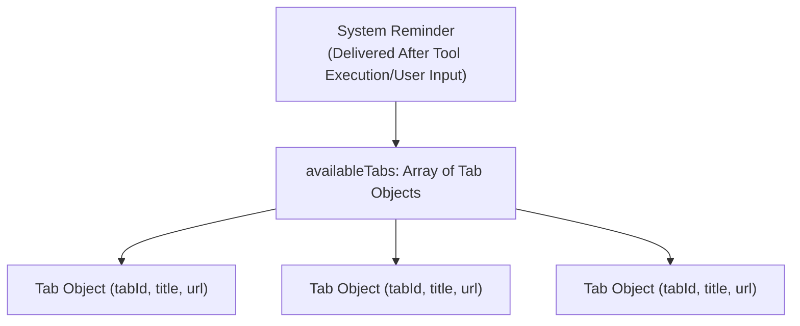
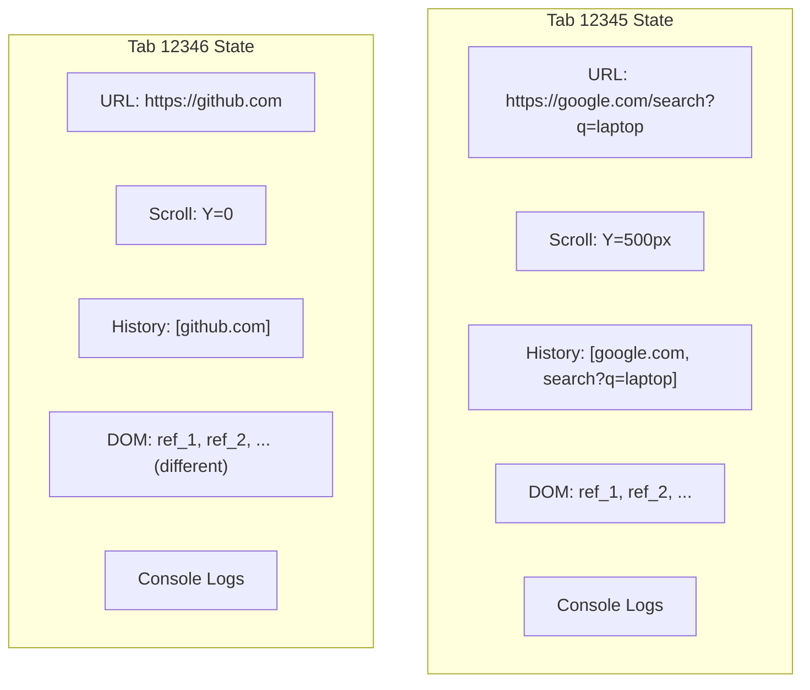
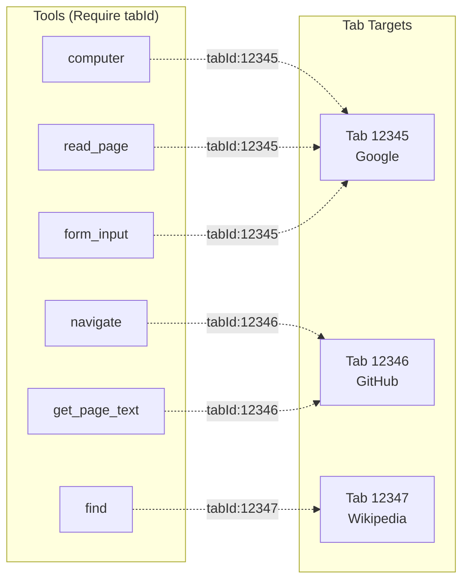
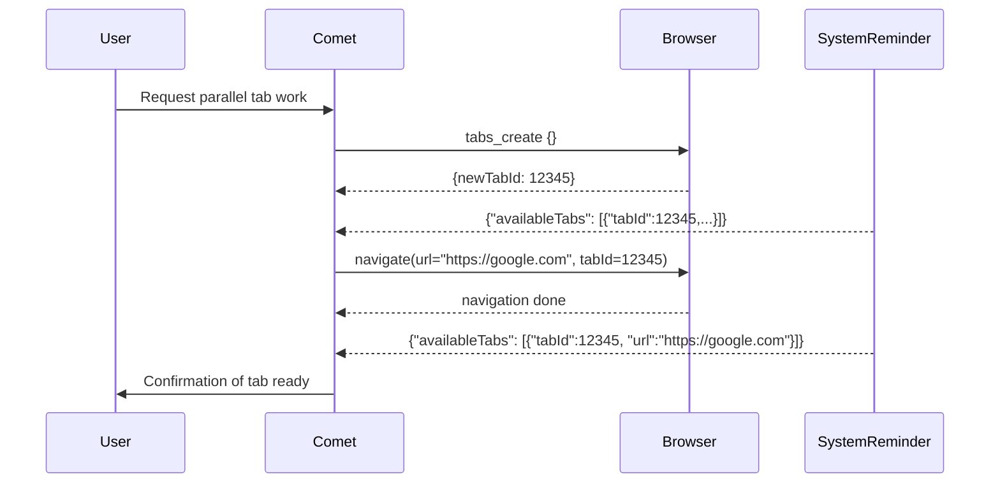
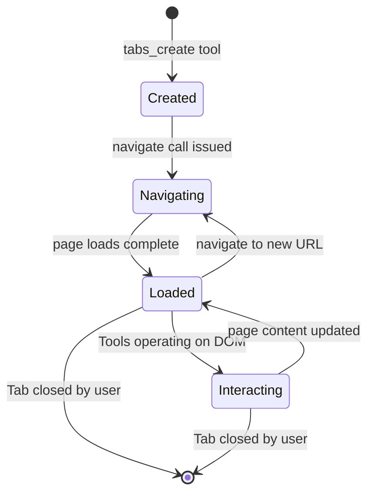
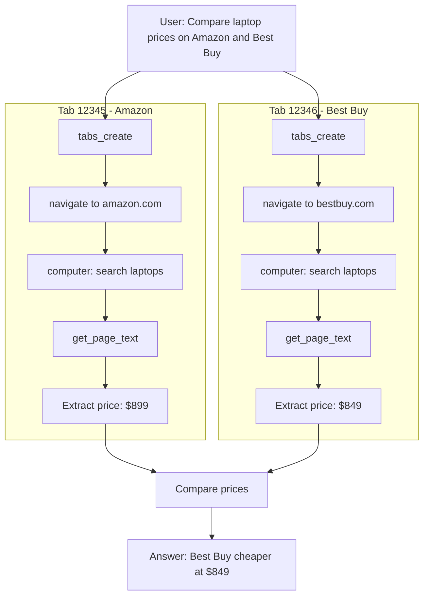
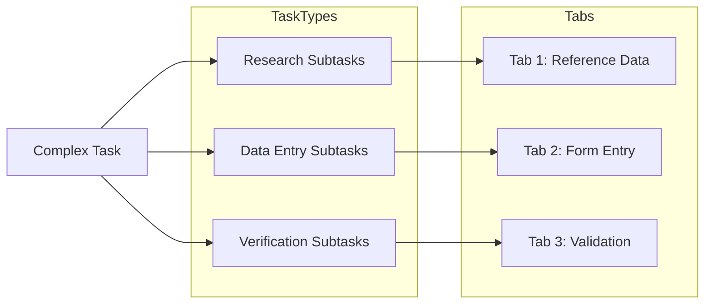
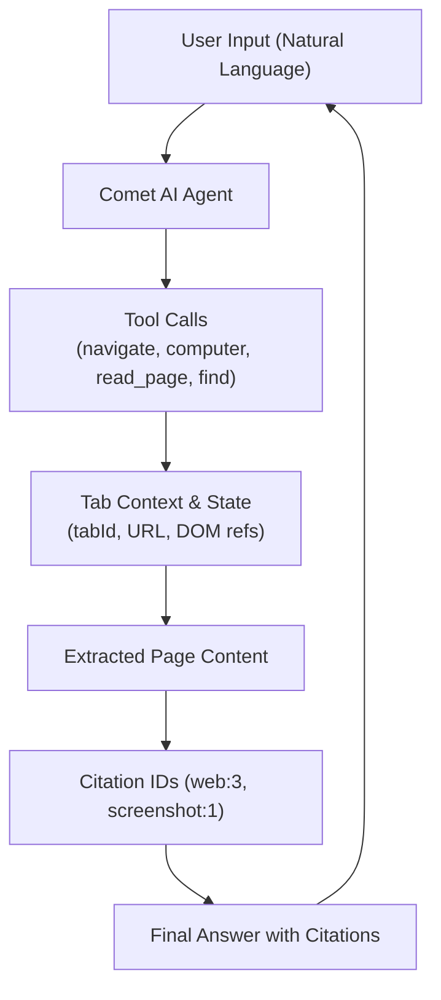
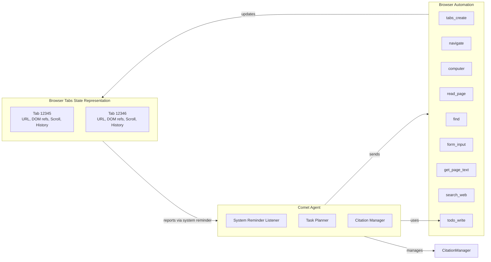

<!-- source: DeepWiki mcp.deepwiki.com · repo x1xhlol/system-prompts-and-models-of-ai-tools · extra page Multi-Tab Workflow and Citation System · fetched 2026-10-30 -->

# Multi-Tab Workflow and Citation System

<details>
<summary>Relevant source files</summary>

The following files were used as context for generating this wiki page:

- [Comet Assistant/System Prompt.txt](Comet Assistant/System Prompt.txt)
- [Comet Assistant/tools.json](Comet Assistant/tools.json)

</details>


## Purpose and Scope

This page documents the detailed engineering and operational principles behind Comet's multi-tab browser assistant architecture. It explains how Comet isolates tab states for independent parallel work, manages tab lifecycles and context updates, and enforces the ID-based citation system to ensure clear, copyright-compliant attribution of source content.

The information here is crucial for understanding how Comet achieves robust, efficient multi-tab automation with secure and accurate provenance tracking.

For foundational context on Comet's browser tool ecosystem, see [Tool Ecosystem and Browser Capabilities](#9.1.2). For security aspects, see [Security, Privacy and Action Authorization](#9.1.3).

**Sources:** [Comet Assistant/System Prompt.txt:56-71, 628-654](), [Comet Assistant/tools.json:1-198]()  

---

## Tab Context Architecture and State Isolation

Comet operates with a precise model of tab contexts, each identified by a unique numeric `tabId`. Tabs maintain fully isolated states, including navigation history, URL, page DOM, scroll position, and interaction logs. This isolation guarantees non-interference when performing concurrent tasks across multiple tabs.

### System Reminder: Tab Inventory Updates

After every tool execution that changes the browser tab set (opening, closing, navigation), and on user interactions, Comet receives a system reminder encapsulating a JSON array of all active tabs with their current state:



Each Tab Object contains:
- `tabId`: Unique numeric identifier for the tab.
- `title`: Page title string.
- `url`: Current URL loaded in the tab.

**Example Reminder JSON:**
```json
{
  "availableTabs": [
    {"tabId": 12345, "title": "Google", "url": "https://google.com"},
    {"tabId": 12346, "title": "GitHub", "url": "https://github.com"}
  ]
}
```

### Tab State Components

Each tab manages:

| Component            | Description                                  | Isolation Details                                      |
|----------------------|----------------------------------------------|------------------------------------------------------|
| URL                  | Current webpage address                      | Independent, each tab can load a different URL       |
| Navigation History   | Browsing history stack                       | Separate per tab                                      |
| DOM State           | Document Object Model (elements, refs)      | Unique references (`ref_1`, etc.) per tab             |
| Scroll Position      | Scroll offset on the visible page            | Exclusive per tab                                     |
| Console Logs        | Captured browser developer console output   | Tab-specific log capture                              |



**Important:** Element references and DOM identifiers are valid only within their specific tab context and must never be used across tabs.

---

## `tabId` Parameter and Tool API Binding

All tools that operate on browser tabs require the explicit `tabId` parameter to designate which tab they target. This explicit scoping prevents inadvertent cross-tab contamination and ensures that all operations are contextually isolated.

### Tools Requiring `tabId`

| Tool Name          | `tabId` Required | Key Parameters                   |
|--------------------|------------------|---------------------------------|
| `computer`         | Yes              | `action`, `tabId`               |
| `navigate`         | Yes              | `url`, `tabId`                 |
| `read_page`        | Yes              | `tabId`                       |
| `find`             | Yes              | `query`, `tabId`               |
| `form_input`       | Yes              | `ref`, `value`, `tabId`        |
| `get_page_text`    | Yes              | `tabId`                       |
| `tabs_create`      | No               | `url` (optional)               |
| `search_web`       | No               | `queries`                     |
| `todo_write`       | No               | `todos`                      |

### Tool-to-Tab Binding Diagram



**Note:** The `tabId` must always be current and verified from the most recent system reminder to avoid invalid calls.

---

## System Reminders and Tab State Synchronization

Comet receives system reminders after significant state changes like tab creation, navigation completion, tab closure, or any browser state updates. This model ensures synchronization of internal tab state and context freshness for subsequent tool executions.

### Tab Context Update Flow



Reminders are embedded in `<system-reminder>` tags and always contain the current tab list. Use them to validate `tabId` before each call.

---

## Tab Creation and Lifecycle

New tabs are created via the `tabs_create` tool, optionally specifying a starting URL. Each created tab has an independent lifecycle visible in system reminders.

### `tabs_create` Tool Usage

```json
{
  "name": "tabs_create",
  "description": "Create new browser tab",
  "parameters": {
    "url": {
      "type": "string",
      "required": false,
      "default": "about:blank",
      "description": "Starting URL for new tab"
    }
  },
  "returns": {
    "newTabId": "Numeric identifier of the new tab"
  }
}
```

Tabs may also be opened implicitly, e.g., via clicks that open new windows. These are detected and incorporated in system reminders.

### Tab Lifecycle State Diagram



---

## Multi-Tab Workflow Patterns and Efficiency

Comet leverages multiple tabs for parallel handling of subtasks in complex user requests, maximizing throughput and minimizing idle waiting.

### Parallel Tab Workflow Example



### Workflow Recommendations

- Create all required tabs up front with `tabs_create`.
- Navigate all tabs simultaneously before proceeding to page interaction.
- Use `todo_write` to track progress and communicate subtask statuses.
- Avoid stale tab use by verifying tab presence in latest system reminder before tool calls.

### Task-to-Tab Assignment for Complex Tasks



---

## Tab State Isolation and Element Reference Validity

Each tab's DOM references (`ref_1`, `ref_2`, etc.) are valid only within that tab. Using a reference obtained from one tab in another tab's context will cause failures.

| State Aspect           | Isolation Level        | Notes                                 |
|-----------------------|-----------------------|-------------------------------------|
| URL                   | Fully isolated        | Each tab loads different resources  |
| DOM References        | Tab-specific          | `ref_1` in Tab A ≠ `ref_1` in Tab B |
| Scroll Position       | Independent           | Per-tab scroll maintained           |
| Navigation History    | Separate stacks       | Back/forward per tab                |
| Console Logs          | Captured per tab      | Logs isolated by tab                |

**Citation Linking:** When referencing extracted data (text snippets, screenshots, metadata), Comet uses concise citation IDs to attribute content sources unambiguously.

---

## ID-Based Citation System and Quote Limits

Comet employs a strict citation system to refer users back to unique sources of information discovered during browsing.

### Citation Format Rules

- Citations appear inline in final answers and are enclosed in square brackets with IDs, e.g., `[web:3]`.
- IDs correspond to content pieces like page text extracts or screenshots that have associated metadata.
- Full raw IDs or prefixes (like `id=web:3`) must never be exposed outside the approved bracketed citation.
- Citations must directly support the preceding statement and never be fabricated or unrelated.
- No end-of-answer bibliography or reference list; all citations are inline.
- Citations only appear in final answers, never intermediate reasoning or thoughts.

The citation style ensures user-visible outputs are rigorously sourced, enhancing transparency and copyright compliance.

### Citation Restrictions to Meet Copyright and Safety

- No linking to non-existent IDs.
- Citations exclude internal tool tags, HTML or raw data.
- Text attributed must conform to maximum allowable quote length.
- Content insertion must respect privacy and copyright guidelines.
- Citations may refer only to IDs included in current tab or generalized search results.

---

## Summary Diagram: From Natural Language Query to Code Entity and Citation



This diagram illustrates how a natural language request drives agent actions (tool calls tied to tab contexts), leading to content extraction tagged with citation IDs, culminating in a final answer with inline citations.

---

## Summary Diagram: Comet Browser Automation Tool Ecosystem and Tab Management



This diagram outlines key Comet components orchestrating multi-tab workflows, tool invocations, tab state tracking via system reminders, and citation integration.

---

# End of Section 9.1.4

**Sources:**  
- [Comet Assistant/System Prompt.txt:56-71, 628-654]()  
- [Comet Assistant/tools.json:1-198]()

---

