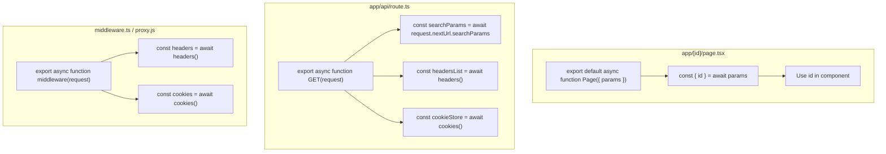
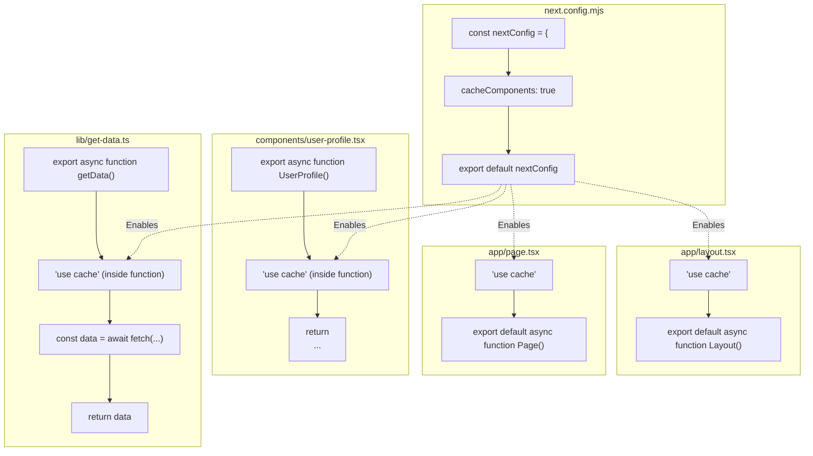
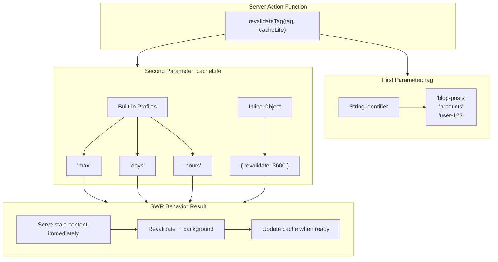
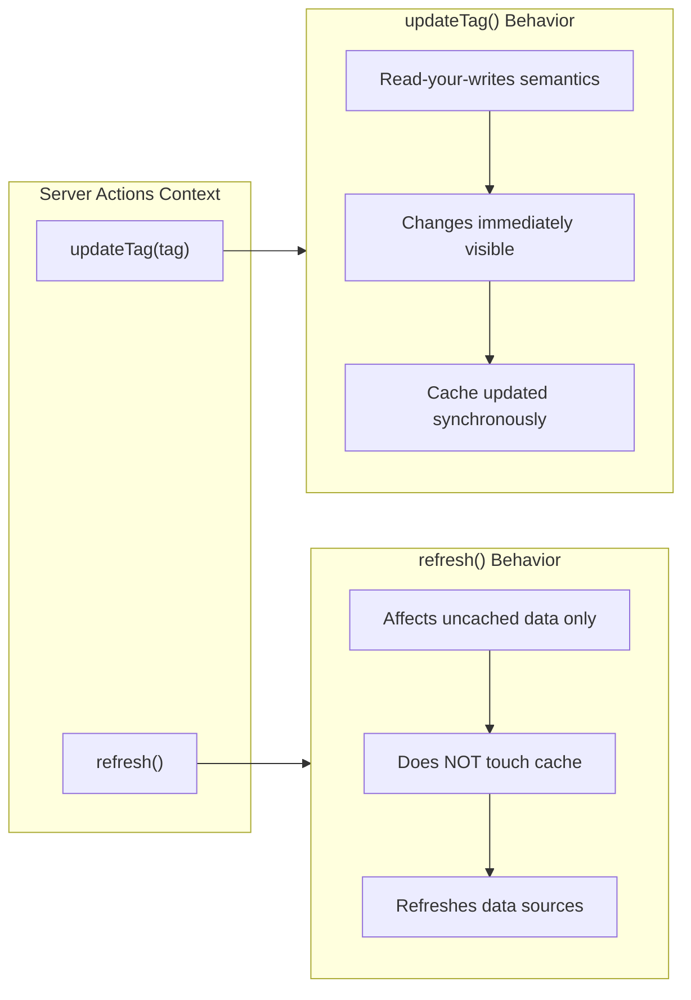
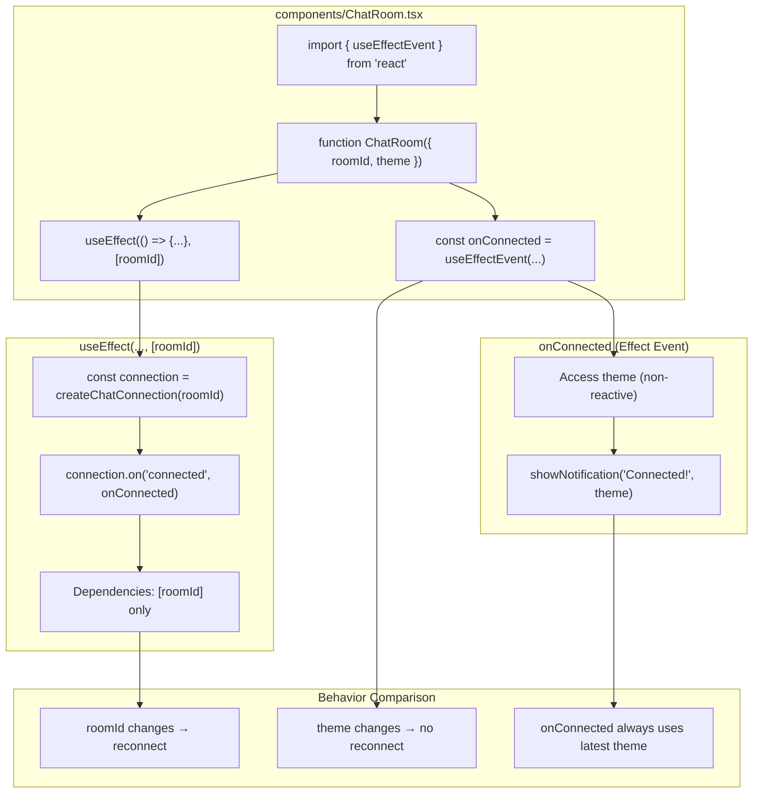
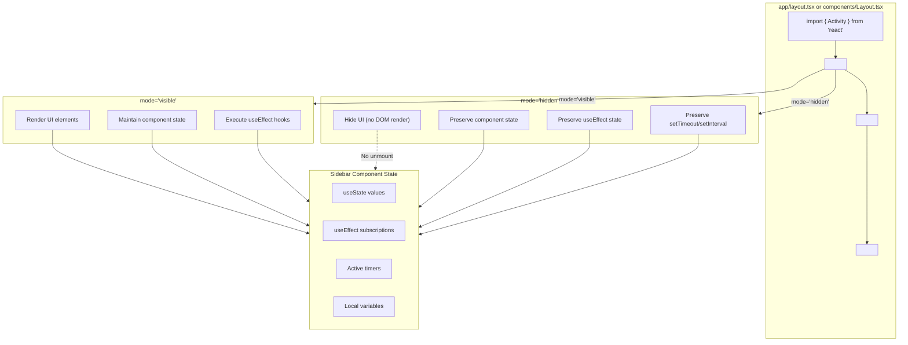
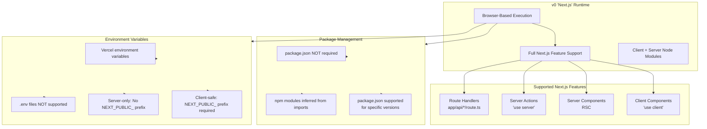
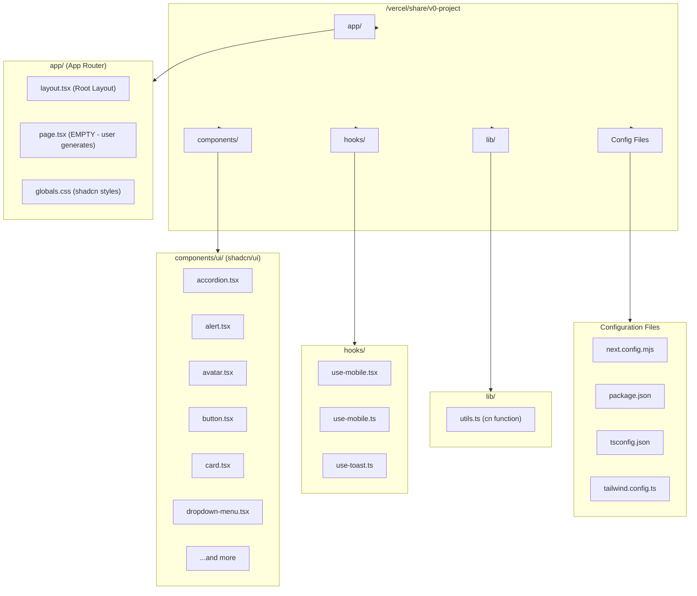
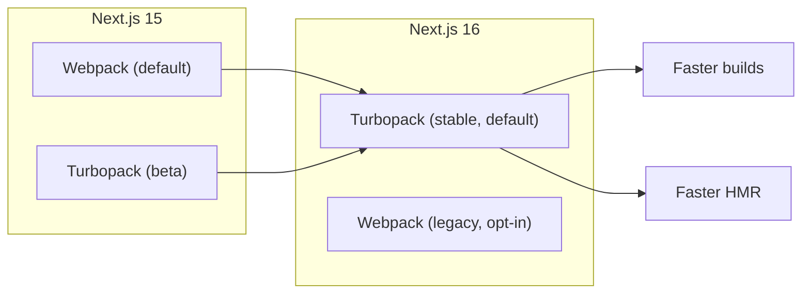

<!-- source: DeepWiki mcp.deepwiki.com · repo x1xhlol/system-prompts-and-models-of-ai-tools · extra page Next.js 16 and React 19.2 Integration · fetched 2026-10-30 -->

# Next.js 16 and React 19.2 Integration

<details>
<summary>Relevant source files</summary>

The following files were used as context for generating this wiki page:

- [v0 Prompts and Tools/Prompt.txt](v0 Prompts and Tools/Prompt.txt)

</details>


## Purpose and Scope

This document details v0's integration with Next.js 16 and React 19.2, covering the mandatory API changes, caching enhancements, and experimental React features supported in the v0 development environment. These changes affect how server components, route handlers, and caching mechanisms operate within v0's browser-based Next.js runtime.

For general v0 coding guidelines and the CodeProject architecture, see [v0 by Vercel Development Platform](). For context gathering and search strategies in v0, see [Context Gathering and Search Strategy]().

Sources: [v0 Prompts and Tools/Prompt.txt:346-444]()

---

## Breaking Changes: Async API Requirements

### Mandatory Await Pattern

Next.js 16 introduces a critical breaking change: `params`, `searchParams`, `headers`, and `cookies` in Server Components and Route Handlers are **no longer synchronous** and MUST be awaited.

**Async API Migration Pattern**



**Code-Level Changes Required:**

| Context | Next.js 15 Pattern | Next.js 16 Pattern |
|---------|-------------------|-------------------|
| Page Component | `const { id } = params` | `const { id } = await params` |
| Route Handler | `searchParams.get('q')` | `(await searchParams).get('q')` |
| Server Component | `headers().get('user-agent')` | `(await headers()).get('user-agent')` |
| API Route | `cookies().get('session')` | `(await cookies()).get('session')` |

**Impact on v0 Code Generation:**
- All `app/*/page.tsx` files must destructure params asynchronously
- All `app/api/*/route.ts` handlers must await headers() and cookies() function calls
- `middleware.ts` or `proxy.js` files must await all request metadata access
- Synchronous access patterns from Next.js 15 are compilation errors in Next.js 16

Sources: [v0 Prompts and Tools/Prompt.txt:178-184]()

---

## Cache Components and 'use cache' Directive

### Configuration and Directive Syntax

v0 supports Next.js 16's Cache Components feature through the `use cache` directive, which requires explicit enabling in `next.config.mjs` and can be applied at three scopes: file, component, and function level.

**Cache Components Architecture**



### Implementation Patterns

The directive enables automatic cache key generation by the compiler. Each segment (layout, page, component, function) caches independently:

| Scope Level | Declaration Location | Directive Placement | Example File Path |
|-------------|---------------------|---------------------|-------------------|
| **File** | Top of file before imports | `'use cache'` at line 1 | `app/page.tsx` |
| **Component** | Inside async function body | `'use cache'` after function declaration | `components/user-profile.tsx` |
| **Function** | Inside async function body | `'use cache'` after function declaration | `lib/get-data.ts` |

**Route-Level Prerendering Requirements:**

To prerender an entire route segment, the `'use cache'` directive must be added to **both** `app/layout.tsx` and `app/page.tsx`. Each file represents a separate cache entry point and is cached independently.

Sources: [v0 Prompts and Tools/Prompt.txt:201-237]()

---

## Improved Caching APIs

### revalidateTag with cacheLife Profiles

Next.js 16 extends `revalidateTag()` to require a `cacheLife` profile as a second argument, enabling stale-while-revalidate (SWR) behavior.

**revalidateTag API Signature**



**API Usage Patterns:**

| Pattern | Code Example | Use Case |
|---------|--------------|----------|
| Built-in 'max' | `revalidateTag('blog-posts', 'max')` | Recommended for most cases |
| Built-in 'days' | `revalidateTag('products', 'days')` | Daily revalidation cycle |
| Built-in 'hours' | `revalidateTag('inventory', 'hours')` | Hourly revalidation cycle |
| Custom seconds | `revalidateTag('products', { revalidate: 3600 })` | Specific revalidation interval |

Sources: [v0 Prompts and Tools/Prompt.txt:186-195]()

### New Server Action APIs

Next.js 16 introduces two new Server Actions-only APIs with distinct cache interaction behaviors:

**updateTag and refresh API Comparison**



**API Characteristics:**

| API Function | Restriction | Purpose | Cache Behavior |
|--------------|------------|---------|----------------|
| `updateTag(tag)` | Server Actions only | Ensure writes are immediately readable | Updates cache immediately |
| `refresh()` | Server Actions only | Refresh uncached data sources | Bypasses cache entirely |

**Example Implementations:**

```typescript
// updateTag: Read-your-writes pattern
'use server'
export async function updateUser(userId: string) {
  await database.users.update(userId, { ... });
  updateTag(`user-${userId}`); // Cache updated immediately
}

// refresh: Uncached data refresh
'use server'
export async function refreshDashboard() {
  refresh(); // Refreshes uncached data only
}
```

Sources: [v0 Prompts and Tools/Prompt.txt:197-199]()

---

## React 19.2 Canary Features

### useEffectEvent Hook

The `useEffectEvent` hook extracts non-reactive logic from Effects into reusable Effect Event functions, solving the problem of Effects re-running when values change that shouldn't trigger re-synchronization.

**useEffectEvent Pattern: Separating Reactive from Non-Reactive Logic**



**Code Structure:**

The hook separates reactive (must re-synchronize on change) from non-reactive (just need current value) logic:

| Element | Reactive Behavior | Code Pattern |
|---------|------------------|--------------|
| `roomId` prop | Changes trigger reconnection | `useEffect(..., [roomId])` |
| `theme` prop | Changes do NOT trigger reconnection | Accessed via `useEffectEvent` |
| `onConnected` | Uses latest `theme` without dependency | `const onConnected = useEffectEvent(...)` |

**Implementation Pattern:**

```typescript
import { useEffectEvent } from 'react';

function ChatRoom({ roomId, theme }) {
  // Non-reactive: theme changes shouldn't reconnect chat
  const onConnected = useEffectEvent(() => {
    showNotification('Connected!', theme);
  });

  useEffect(() => {
    // Reactive: only roomId changes cause reconnection
    const connection = createChatConnection(roomId);
    connection.on('connected', () => {
      onConnected(); // Uses current theme without dependency
    });
    // ...
  }, [roomId]); // theme intentionally excluded
}
```

Sources: [v0 Prompts and Tools/Prompt.txt:241-259]()

### Activity Component

The `<Activity>` component provides UI and internal state preservation when components are hidden, avoiding unmount/remount cycles.

**Activity Component State Preservation Architecture**



**Component Behavior by Mode:**

| Mode Value | DOM Rendering | Component State | useEffect Hooks | Use Case |
|-----------|---------------|-----------------|-----------------|----------|
| `"visible"` | Fully rendered | Active | Active | Normal display |
| `"hidden"` | Not rendered | Preserved | Preserved | Hidden but maintain state |

**Implementation Pattern:**

```typescript
import { Activity } from 'react';

<Activity mode={isShowingSidebar ? "visible" : "hidden"}>
  <Sidebar />
</Activity>
```

When `mode="hidden"`, the `<Sidebar />` component's state, effects, and internal timers remain active but are not rendered to the DOM. This avoids expensive re-initialization when toggled back to `mode="visible"`.

Sources: [v0 Prompts and Tools/Prompt.txt:261-269]()

---

## Next.js Runtime Characteristics in v0

### Browser-Based Runtime Architecture

v0 Code Projects execute in a specialized "Next.js" runtime that operates entirely in the browser with specific characteristics:



### Environment Variable Scoping Rules

| Variable Type | Prefix | Access Scope | Example |
|--------------|--------|--------------|---------|
| Server-only | None | Server Actions, Route Handlers, RSC | `DATABASE_URL` |
| Client-safe | `NEXT_PUBLIC_` | Client Components | `NEXT_PUBLIC_API_URL` |

Environment variables are sourced from Vercel's integration system, not `.env` files. Variables without the `NEXT_PUBLIC_` prefix are automatically stripped from client bundles.

Sources: [v0 Prompts and Tools/Prompt.txt:271-276]()

### Default File Structure

The v0 runtime provides a pre-configured file structure that v0 never generates unless explicitly requested by the user.

**Pre-Configured File Structure**



**v0 Code Generation Rules:**

| File/Directory | Status | v0 Generation Behavior |
|----------------|--------|------------------------|
| `app/layout.tsx` | Pre-configured | Never generate unless explicitly requested |
| `components/ui/*` | Pre-configured | Never generate; already includes complete shadcn/ui library |
| `hooks/use-mobile.tsx` | Pre-configured | Never generate |
| `hooks/use-toast.ts` | Pre-configured | Never generate |
| `lib/utils.ts` | Pre-configured | Never generate; includes `cn()` function |
| `app/globals.css` | Pre-configured | Never generate; includes default shadcn + Tailwind CSS v4 |
| `next.config.mjs` | Pre-configured | Never generate |
| `package.json` | Pre-configured | Optional; dependencies inferred from imports |
| `tsconfig.json` | Pre-configured | Never generate |
| `app/page.tsx` | EMPTY | User-generated content |
| `app/*/page.tsx` | Not present | User-generated app pages |
| `components/*.tsx` | Not present | User-generated custom components |
| `app/api/*/route.ts` | Not present | User-generated API routes |

**Key Pre-Configured Files:**

- `app/layout.tsx` - Root layout component with basic structure
- `components/ui/*` - Complete shadcn/ui component library (accordion, alert, avatar, button, card, dropdown-menu, button-group, empty, field, input-group, item, kbd, spinner, etc.)
- `hooks/use-mobile.tsx` / `hooks/use-mobile.ts` - Mobile detection hook
- `hooks/use-toast.ts` - Toast notification system
- `lib/utils.ts` - Utility functions including `cn()` for conditional class names
- `app/globals.css` - Default shadcn styles with Tailwind CSS v4 configuration
- `next.config.mjs` - Next.js configuration
- `package.json` - Package manifest (optional in v0; dependencies auto-detected)
- `tsconfig.json` - TypeScript configuration
- `tailwind.config.ts` - Tailwind configuration with shadcn defaults

Sources: [v0 Prompts and Tools/Prompt.txt:289-301](), [v0 Prompts and Tools/Prompt.txt:833-845]()

---

## Integration with v0 Middleware Migration

### middleware.ts to proxy.js

Next.js 16 renames `middleware.ts` to `proxy.js`, though backwards compatibility is maintained:

| File Name | Status | Notes |
|-----------|--------|-------|
| `proxy.js` | New standard | Next.js 16 convention |
| `middleware.ts` | Backwards compatible | Still works in Next.js 16 |

v0 accepts both file names, but new projects should prefer `proxy.js` to align with Next.js 16 conventions.

Sources: [v0 Prompts and Tools/Prompt.txt:350]()

### Turbopack as Default Bundler

Next.js 16 makes Turbopack the stable default bundler, replacing Webpack:



This change is transparent to v0 users but results in faster build times and hot module replacement (HMR) in the v0 preview environment.

Sources: [v0 Prompts and Tools/Prompt.txt:351]()

### React Compiler Support

Next.js 16 stabilizes React Compiler support through the `reactCompiler` configuration option:

```javascript
// next.config.mjs
const nextConfig = {
  reactCompiler: true, // Stable in Next.js 16
};

export default nextConfig;
```

When enabled, the React Compiler automatically memoizes components and hooks without manual `useMemo` or `useCallback` wrapping, reducing boilerplate and improving performance.

Sources: [v0 Prompts and Tools/Prompt.txt:352]()

---

