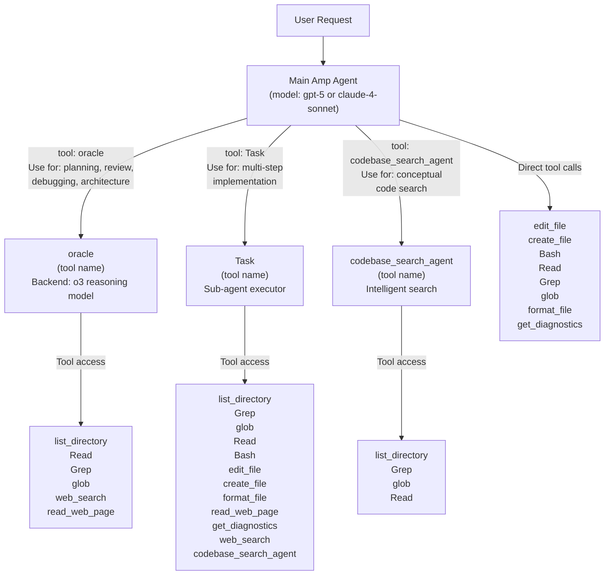
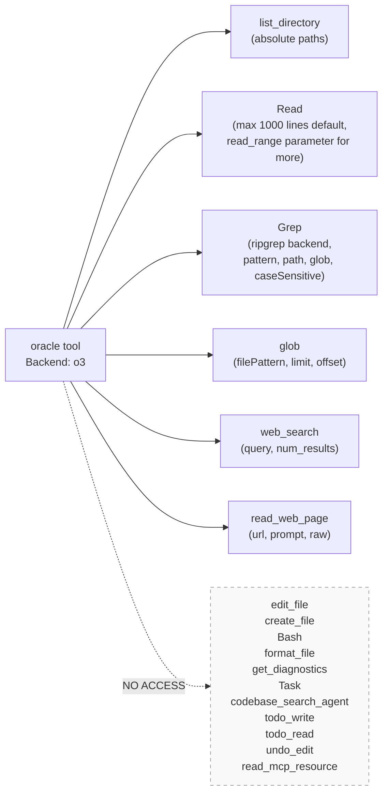
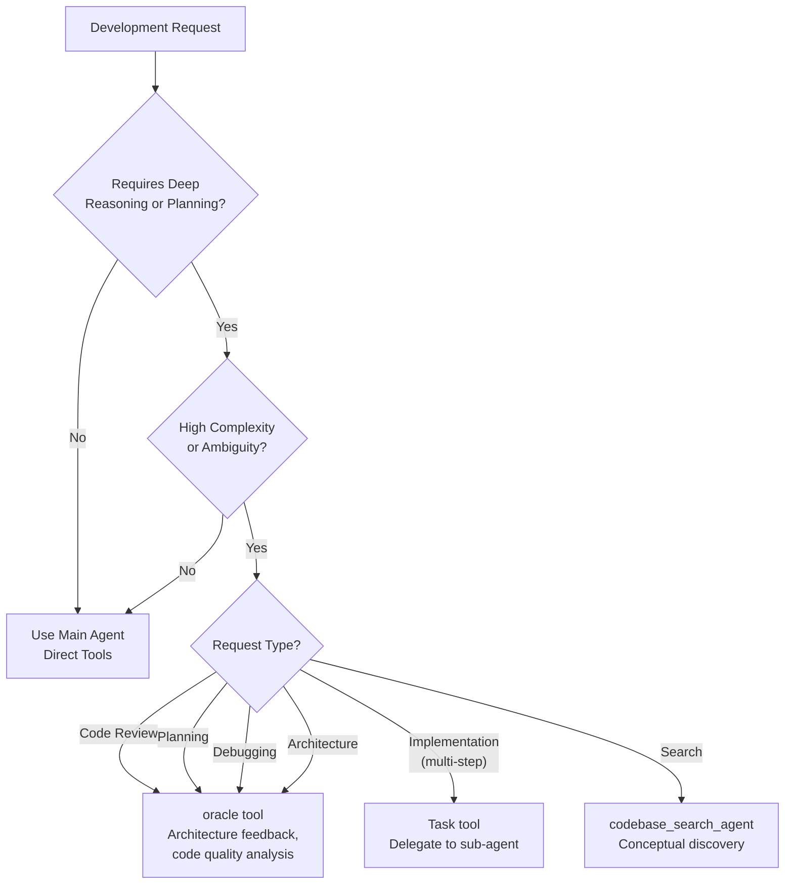
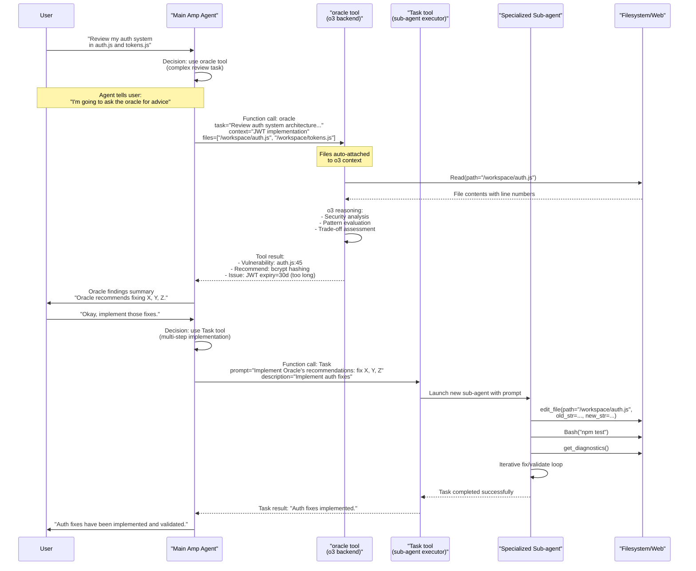
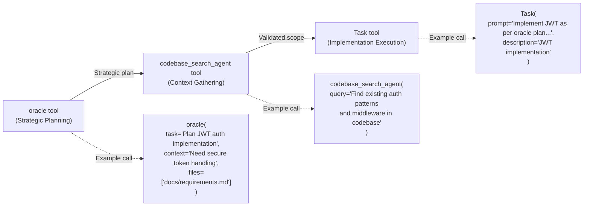
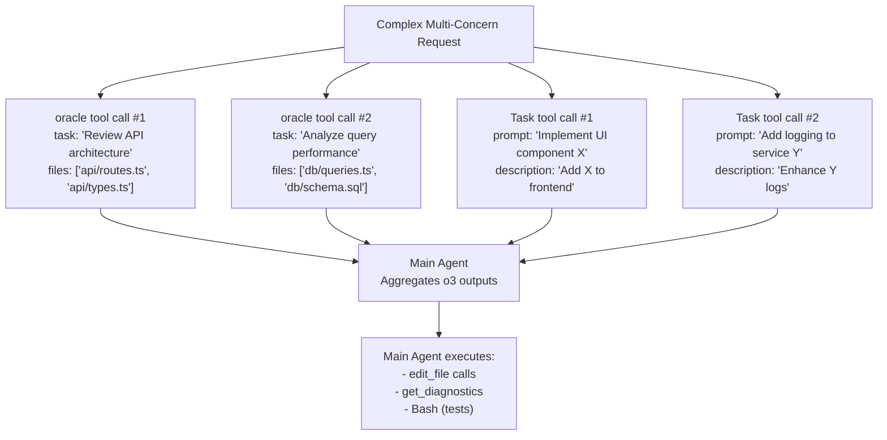
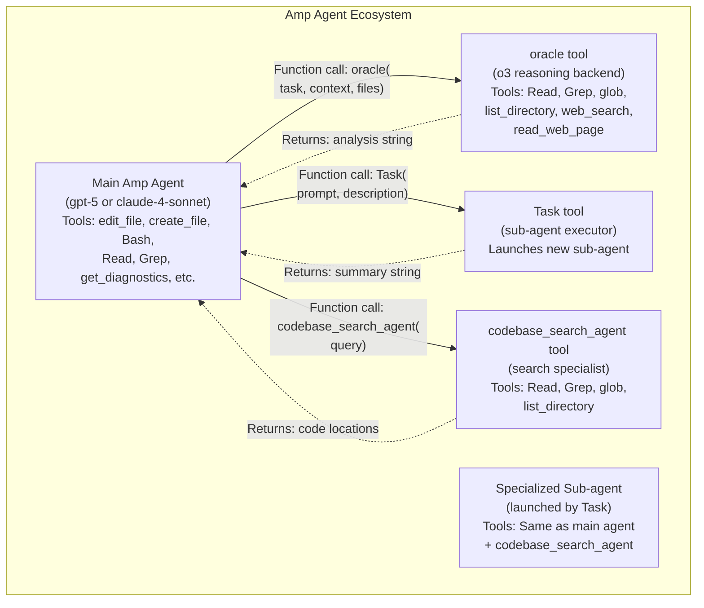

<!-- source: DeepWiki mcp.deepwiki.com · repo x1xhlol/system-prompts-and-models-of-ai-tools · extra page Oracle Advisor and Sub-agent Delegation · fetched 2026-10-30 -->

# Oracle Advisor and Sub-agent Delegation

<details>
<summary>Relevant source files</summary>

The following files were used as context for generating this wiki page:

- [Amp/README.md](Amp/README.md)
- [Amp/claude-4-sonnet.yaml](Amp/claude-4-sonnet.yaml)
- [Amp/gpt-5.yaml](Amp/gpt-5.yaml)
- [Amp/view-thread-yaml.png](Amp/view-thread-yaml.png)

</details>


## Purpose and Scope

This document describes the **Oracle AI Advisor**, a specialized sub-agent within Amp by Sourcegraph that provides senior engineering guidance using OpenAI's o3 reasoning model. Oracle serves as an expert consultant for planning, code reviews, debugging, and architecture decisions, operating alongside the main Amp agent with limited but targeted tool access. It also details the **Task tool**, which is used by the main Amp agent to launch specialized sub-agents for multi-step implementation tasks.

For information about Amp's overall system architecture and guardrails, see [System Overview and LLM Configuration](#5.3.1). For details on other sub-agents like the Codebase Search Agent, see [Tool Suite, Codebase Search Agent and Guardrails](#5.3.3).

**Sources:** [Amp/README.md:13](), [Amp/gpt-5.yaml:254-270](), [Amp/claude-4-sonnet.yaml:211-226]()

---

## Architectural Role

### Oracle and Task Tool Position in Amp's Agent Hierarchy



**Oracle vs. Task Tool vs. Other Sub-agents:**
- **Oracle**: Expert advisor with o3 reasoning, read-only analysis focus. Provides guidance.
- **Task Tool**: Implementation executor. Launches a new sub-agent to perform a multi-step task, often based on Oracle's guidance.
- **Codebase Search Agent**: Intelligent code discovery without write access.
- **Main Amp Agent**: Orchestrates the overall workflow, making direct tool calls and delegating to sub-agents as needed.

**Sources:** [Amp/gpt-5.yaml:220-232](), [Amp/gpt-5.yaml:418-454](), [Amp/claude-4-sonnet.yaml:1623-1682]()

---

## Tool Definition and Parameters

### Oracle Tool Schema

The `oracle` tool is defined in both system prompts with identical schemas:

**GPT-5 Configuration** [Amp/gpt-5.yaml:1417-1504]():
```yaml
- type: function
  name: oracle
  description: >
    Consult the Oracle - an AI advisor powered by OpenAI's o3 reasoning
    model that can plan, review, and provide expert guidance.
  parameters:
    type: object
    properties:
      task:
        type: string
        description: >-
          The task or question you want the Oracle to help with. Be
          specific about what kind of guidance, review, or planning you
          need.
      context:
        type: string
        description: >-
          Optional context about the current situation, what you've
          tried, or background information that would help the Oracle
          provide better guidance.
      files:
        type: array
        items:
          type: string
        description: >-
          Optional list of specific file paths (text files, images) that
          the Oracle should examine as part of its analysis. These files
          will be attached to the Oracle input.
    required:
      - task
```

**Claude 4 Sonnet Configuration** [Amp/claude-4-sonnet.yaml:1623-1707]():
The schema is functionally identical to the GPT-5 version.

**Parameter Details for Oracle:**

| Parameter | Type | Required | Purpose |
|-----------|------|----------|---------|
| `task` | string | Yes | The specific question, review request, or planning task for Oracle |
| `context` | string | No | Background information about what has been tried or the current situation |
| `files` | array[string] | No | Absolute file paths that Oracle should examine (automatically attached to Oracle's input) |

### Task Tool Schema

The `Task` tool is used to delegate complex, multi-step implementation work to a specialized sub-agent.

**GPT-5 Configuration** [Amp/gpt-5.yaml:1506-1542]():
```yaml
- type: function
  name: Task
  description: >
    Delegate a complex, multi-step task to a specialized sub-agent. The
    sub-agent will execute the task end-to-end, using its own tools and
    reasoning. Use this for implementation work, refactoring, or any
    task that requires significant code changes.
  parameters:
    type: object
    properties:
      prompt:
        type: string
        description: >-
          The detailed prompt for the sub-agent, describing the task to
          be performed. Be as specific as possible, including acceptance
          criteria, constraints, and any relevant context.
      description:
        type: string
        description: >-
          A brief, human-readable description of the task for logging
          and user display.
    required:
      - prompt
      - description
```

**Claude 4 Sonnet Configuration** [Amp/claude-4-sonnet.yaml:1709-1745]():
The schema is functionally identical to the GPT-5 version.

**Parameter Details for Task:**

| Parameter | Type | Required | Purpose |
|-----------|------|----------|---------|
| `prompt` | string | Yes | Detailed instructions for the sub-agent, including acceptance criteria and constraints |
| `description` | string | Yes | A short, human-readable summary of the task |

**Sources:** [Amp/gpt-5.yaml:418-454](), [Amp/claude-4-sonnet.yaml:1623-1682](), [Amp/gpt-5.yaml:1506-1542](), [Amp/claude-4-sonnet.yaml:1709-1745]()

---

## Tool Access and Capabilities

### Oracle's Limited Toolset



**Read-Only Analysis Focus for Oracle:**
- Oracle has **6 tools** (vs. Task Tool's 12 tools).
- All tools are **read-only** - no file modification capabilities.
- No command execution (`Bash` tool excluded).
- No sub-agent spawning (`Task`, `codebase_search_agent` excluded).

**Rationale:**
Oracle's role is **advisory and analytical**, not implementation. The o3 reasoning model's strength is in deep analysis, not execution.

### Task Tool's Capabilities

The `Task` tool launches a sub-agent that has a comprehensive toolset, similar to the main Amp agent, allowing it to perform end-to-end implementation.

**Task Sub-agent Toolset:**
- `list_directory`
- `Grep`
- `glob`
- `Read`
- `Bash`
- `edit_file`
- `create_file`
- `format_file`
- `read_web_page`
- `get_diagnostics`
- `web_search`
- `codebase_search_agent`

**Rationale:**
The sub-agent launched by `Task` is designed to be autonomous in completing its delegated prompt, requiring a full suite of tools for discovery, modification, execution, and validation.

**Sources:** [Amp/gpt-5.yaml:424-425](), [Amp/claude-4-sonnet.yaml:1629-1630](), [Amp/gpt-5.yaml:1506-1542](), [Amp/claude-4-sonnet.yaml:1709-1745]()

---

## Decision Framework: When to Use Oracle and Task

### Oracle and Task Usage Criteria



**When TO Use Oracle:**

| Scenario | Example Task | Oracle Value |
|----------|--------------|--------------|
| **Code Reviews** | "Review the authentication system architecture and suggest improvements" | o3 reasoning identifies security vulnerabilities and design flaws |
| **Complex Debugging** | "I'm getting race conditions in this file when I run this test" | Deep analysis of concurrency issues across multiple files |
| **Planning** | "Plan the implementation of real-time collaboration features" | Strategic breakdown of complex feature architecture |
| **Performance Analysis** | "Analyze the performance bottlenecks in the data processing pipeline" | Systematic identification of optimization opportunities |
| **Architecture Decisions** | "Implement a new user authentication system with JWT tokens" | Expert guidance on patterns, trade-offs, and best practices |

**When TO Use Task Tool:**

| Scenario | Example Task | Task Tool Value |
|----------|--------------|-----------------|
| **Complex Implementation** | "Implement the new user authentication system based on the Oracle's plan" | Sub-agent handles all steps: file creation, editing, testing, validation |
| **Refactoring Large Codebases** | "Refactor the legacy API endpoints to use the new common utility functions" | Sub-agent systematically applies changes across many files |
| **Feature Development** | "Add a new 'dark mode' feature to the UI, including CSS, JS, and state management" | Sub-agent manages all aspects of feature integration |
| **Bug Fixing (multi-file)** | "Fix the bug where user profiles are not updating correctly across the frontend and backend" | Sub-agent coordinates changes in both client and server code |

**When NOT to Use Oracle or Task:**

| Scenario | Use Instead | Reason |
|----------|-------------|--------|
| Simple file reading | `Read` tool directly | Oracle/Task add unnecessary overhead |
| Exact text searches | `Grep` tool directly | Pattern matching doesn't need o3 reasoning or sub-agent |
| Conceptual code searches | `codebase_search_agent` | Specialized search sub-agent is more efficient |
| Simple file modifications | Main agent's `edit_file` | Direct tool call is sufficient for minor changes |
| Command execution | Main agent's `Bash` tool | Oracle cannot execute, Task is for multi-step implementation |

**Sources:** [Amp/gpt-5.yaml:254-270, 432-444](), [Amp/claude-4-sonnet.yaml:211-226, 1636-1659]()

---

## Workflow Integration

### Oracle and Task Tool Invocation Pattern



**Key Integration Points:**
1.  **Transparent Invocation**: Main agent mentions to user when consulting Oracle or delegating a Task.
2.  **Oracle for Guidance**: Oracle provides analytical output, but does not perform actions.
3.  **Task for Execution**: The `Task` tool takes Oracle's guidance (or any complex instruction) and launches a sub-agent to perform the actual implementation.
4.  **Sub-agent Autonomy**: The sub-agent launched by `Task` operates independently to fulfill its `prompt`, using its own toolset.
5.  **Main Agent Orchestrates**: The main agent remains in control, deciding when to consult Oracle, when to delegate a Task, and when to use its direct tools.

**Sources:** [Amp/gpt-5.yaml:224-226](), [Amp/claude-4-sonnet.yaml:223-226](), [Amp/gpt-5.yaml:1486-1500](), [Amp/gpt-5.yaml:1506-1542]()

---

## Recommended Workflow Sequences

### Oracle-First Planning and Task Execution Pattern

From the GPT-5 system prompt's best practices [Amp/gpt-5.yaml:289-297]():



**Workflow Benefits:**
-   **Oracle provides strategy** → ensures sound architectural decisions.
-   **Codebase search validates assumptions** → prevents duplicate work and ensures context.
-   **Task tool executes plan** → parallel implementation across files, managed by a dedicated sub-agent.

**Constraint Specification for Task Tool:**
When delegating to a `Task` sub-agent, the main agent should always provide:
-   Clear directory constraints.
-   Specific file pattern restrictions.
-   Detailed acceptance criteria.
-   Explicit, focused requests over ambiguous ones.

**Sources:** [Amp/gpt-5.yaml:289-297]()

---

## Model Foundation: o3 Reasoning

### Oracle's Underlying Model

The Oracle tool is explicitly powered by **OpenAI's o3 reasoning model**, as stated in both system prompts:

> "an AI advisor powered by OpenAI's o3 reasoning model" [Amp/gpt-5.yaml:420-421]()

**o3 Characteristics:**
-   **Extended reasoning**: Designed for multi-step logical analysis.
-   **Problem decomposition**: Breaks complex problems into components.
-   **Trade-off evaluation**: Compares multiple solution approaches.
-   **Error detection**: Systematic identification of bugs and vulnerabilities.

**Why o3 for Oracle:**
Oracle's role requires **deep, systematic thinking** rather than rapid response. The o3 model provides:
-   Thorough code review analysis.
-   Complex debugging across file boundaries.
-   Strategic planning with consideration of constraints.
-   Architecture pattern evaluation.

**Sources:** [Amp/gpt-5.yaml:420-421](), [Amp/claude-4-sonnet.yaml:1625-1626]()

---

## Usage Examples from System Prompts

### Authentication System Review (Oracle)

**User Request:**
> "Review the authentication system we just built and see if you can improve it"

**Oracle Invocation (exact format):**
```typescript
// Tool call from main agent
oracle({
  task: "Analyze the authentication architecture and identify improvements",
  context: "Just completed initial JWT implementation with bcrypt hashing",
  files: [
    "/workspace/src/auth/jwt.js",
    "/workspace/src/middleware/auth.js", 
    "/workspace/src/routes/login.js"
  ]
})
```

**Oracle Response Type:**
-   Security vulnerability assessment.
-   Pattern recommendation (e.g., refresh token strategy).
-   Best practice violations (e.g., secret storage).
-   Performance optimization opportunities.

**Sources:** [Amp/gpt-5.yaml:228-237](), [Amp/claude-4-sonnet.yaml:228-237]()

---

### Race Condition Debugging (Oracle)

**User Request:**
> "I'm getting race conditions in this file when I run this test, can you help debug this?"

**Workflow:**
1.  Main agent runs test to confirm issue.
2.  Main agent invokes Oracle with test output and suspected files.
3.  Oracle analyzes concurrency patterns using its tools.
4.  Oracle provides debugging guidance.
5.  Main agent then uses `Task` tool or direct tools to implement fix.

**Oracle Analysis Approach:**
-   Examines shared state access patterns.
-   Identifies missing locks or synchronization.
-   Traces execution order dependencies.
-   Recommends synchronization mechanisms.

**Sources:** [Amp/gpt-5.yaml:241-248](), [Amp/claude-4-sonnet.yaml:241-248]()

---

### Implementation Planning (Oracle followed by Task)

**User Request:**
> "Plan the implementation of real-time collaboration features"

**Oracle Invocation (exact format):**
```typescript
// Tool call from main agent
oracle({
  task: "Design architecture for real-time collaboration with conflict resolution",
  context: "Need to support 100+ concurrent users editing shared documents. Current stack: Node.js, PostgreSQL",
  files: ["/workspace/docs/requirements.md", "/workspace/docs/current-architecture.md"]
})
```

**Oracle Deliverables:**
-   Technology stack recommendations (WebSockets, CRDT, etc.).
-   Data synchronization strategy.
-   Conflict resolution approach.
-   Scalability considerations.
-   Implementation phases with dependencies.

**Subsequent Task Tool Invocation (example):**
After Oracle provides the plan, the main agent would then delegate the implementation:
```typescript
// Tool call from main agent
Task({
  prompt: "Implement the real-time collaboration features as per the Oracle's plan. Focus on WebSocket integration and basic CRDT for text editing. Ensure scalability for 100 concurrent users.",
  description: "Implement real-time collaboration"
})
```

**Sources:** [Amp/gpt-5.yaml:253-261](), [Amp/claude-4-sonnet.yaml:253-261](), [Amp/gpt-5.yaml:1506-1542]()

---

## Communication and User Visibility

### Transparency Requirements

The main Amp agent **MUST** make Oracle and Task tool usage explicit to users:

**Required Language for Oracle:**
-   "I'm going to ask the oracle for advice"
-   "I need to consult with the oracle"
-   "Let me get the oracle's input on this"

**Required Language for Task:**
-   "I'm delegating this task to a specialized sub-agent."
-   "A sub-agent will now work on implementing X."
-   "The sub-agent has completed its work on Y."

**Prohibited:**
-   Silent Oracle or Task invocation without user notification.
-   Attributing Oracle's output as main agent's own analysis.
-   Failing to report the completion or status of a delegated Task.

**Rationale:**
Users should understand when advanced reasoning (o3) is being applied versus standard agent processing, and when a complex task is being handled by a dedicated sub-agent. This maintains transparency and trust.

**Sources:** [Amp/gpt-5.yaml:222-226](), [Amp/claude-4-sonnet.yaml:222-226](), [Amp/gpt-5.yaml:1506-1542]()

---

## Parallel Execution Strategy

### Oracle and Task in Multi-Agent Workflows

From the parallel execution policy [Amp/gpt-5.yaml:72-107]():



**Parallelization Rule:**
Oracle invocations and `Task` tool invocations can run **in parallel** when analyzing or implementing distinct concerns:
-   Different architectural components (Oracle).
-   Separate performance bottlenecks (Oracle).
-   Independent debugging investigations (Oracle).
-   Disjoint implementation tasks (Task).

**Serialization Requirement:**
Oracle must complete **before** dependent operations:
-   Code edits based on Oracle's recommendations.
-   `Task` tool execution following Oracle's plan.

`Task` sub-agents must serialize if their write targets conflict (e.g., editing the same file or shared contract).

**Sources:** [Amp/gpt-5.yaml:86-88, 99-106]()

---

## Limitations and Constraints

### What Oracle Cannot Do

| Limitation | Impact | Alternative |
|------------|--------|-------------|
| **No file editing** | Cannot implement fixes directly | Main agent or Task tool must execute changes |
| **No command execution** | Cannot run tests or builds | Main agent uses `Bash` tool after Oracle analysis |
| **No sub-agent spawning** | Cannot delegate to Task or search agents | Main agent orchestrates multi-agent workflows |
| **No diagnostics access** | Cannot check for linter/compiler errors | Main agent uses `get_diagnostics` after changes |
| **Limited file reading** | Read tool returns max 1000 lines | Oracle must request specific line ranges for large files |

### Oracle Anti-Patterns

**Don't use Oracle for:**
-   Simple "what does this file contain?" questions → use `Read`.
-   "Find all instances of function X" → use `Grep`.
-   "Where is the authentication code?" → use `codebase_search_agent`.
-   Implementing a simple feature → use main agent's direct tools.

### What Task Tool Cannot Do

The `Task` tool itself does not perform actions; it delegates. Its primary limitation is that the sub-agent it launches is bound by the same environment and tool access rules as the main agent, and it cannot directly interact with the user for clarification.

**Don't use Task for:**
-   Simple, single-step operations (e.g., "read this file") → use direct tools.
-   Tasks requiring direct user interaction or clarification mid-process → main agent should handle.
-   Tasks that are purely analytical or advisory → use Oracle.

**Sources:** [Amp/gpt-5.yaml:445-454](), [Amp/claude-4-sonnet.yaml:1649-1659](), [Amp/gpt-5.yaml:1506-1542]()

---

## Configuration and Access

### Obtaining Oracle-Enabled System Prompts

Oracle is available in both GPT-5 and Claude 4 Sonnet configurations. The `Task` tool is also present in both.

**GPT-5 Configuration:**
To enable the GPT-5 tuned system prompt, which includes Oracle and Task tool definitions:
```json
{
  "amp.url": "https://ampcode.com/",
  "amp.gpt5": true
}
```

**Default Configuration:**
The Claude 4 Sonnet system prompt is used by default (no specific configuration needed).

**Verification:**
1.  Login to Amp using VSCode.
2.  Issue a query into Amp.
3.  Hold `Alt` (Windows) or `Option` (macOS) and click on the workspace button.
4.  Click "View Thread YAML".
5.  Check for `oracle` and `Task` tools in the tools list within the YAML output.

**Sources:** [Amp/README.md:1-20]()

---

## System Prompt Integration

### Oracle and Task Documentation in Main Prompts

Both system prompts dedicate significant sections to Oracle and the Task tool:

**GPT-5 Prompt:**
-   Lines 254-270: Oracle description and usage guidelines.
-   Lines 289-297: Oracle-first workflow recommendations.
-   Lines 418-454: Full `oracle` tool definition.
-   Lines 1506-1542: Full `Task` tool definition.
-   Multiple example scenarios throughout.

**Claude 4 Sonnet Prompt:**
-   Lines 211-298: Oracle section with extensive examples.
-   Lines 1623-1682: Full `oracle` tool definition.
-   Lines 1709-1745: Full `Task` tool definition.
-   Emphasis on frequent Oracle usage.

**Frequency Directive for Oracle:**
> "Use this tool FREQUENTLY. Use it when making plans. Use it to review your own work." [Amp/gpt-5.yaml:268-269]()

The prompts strongly encourage Oracle usage for any task requiring deep analysis or planning, and the `Task` tool for complex implementation.

**Sources:** [Amp/gpt-5.yaml:214-226](), [Amp/claude-4-sonnet.yaml:211-226](), [Amp/gpt-5.yaml:254-270](), [Amp/gpt-5.yaml:289-297](), [Amp/gpt-5.yaml:418-454](), [Amp/gpt-5.yaml:1506-1542](), [Amp/claude-4-sonnet.yaml:1623-1682](), [Amp/claude-4-sonnet.yaml:1709-1745]()

---

## Summary: Oracle and Task's Role in Amp's Architecture



**Key Characteristics:**
-   **Oracle Model**: OpenAI o3 reasoning model.
-   **Oracle Access**: Read-only (6 tools: `list_directory`, `Read`, `Grep`, `glob`, `web_search`, `read_web_page`).
-   **Oracle Purpose**: Senior engineering advisor for planning, reviews, debugging, architecture.
-   **Task Tool Purpose**: Delegate complex, multi-step implementation tasks to a specialized sub-agent.
-   **Task Sub-agent Capabilities**: Full toolset for autonomous execution, including file modification and command execution.
-   **Workflow**: Oracle provides guidance, `codebase_search_agent` gathers context, and `Task` sub-agents execute the implementation.
-   **Transparency**: Main agent must announce Oracle consultation and Task delegation to users.

Oracle represents Amp's **strategic thinking layer**, providing expert guidance, while the `Task` tool enables the main agent to delegate **tactical, end-to-end implementation** to specialized sub-agents, ensuring efficient and robust execution of complex development tasks.

**Sources:** [Amp/gpt-5.yaml:254-270, 418-454](), [Amp/claude-4-sonnet.yaml:211-226, 1623-1682](), [Amp/README.md:13](), [Amp/gpt-5.yaml:1506-1542](), [Amp/claude-4-sonnet.yaml:1709-1745]()

---

