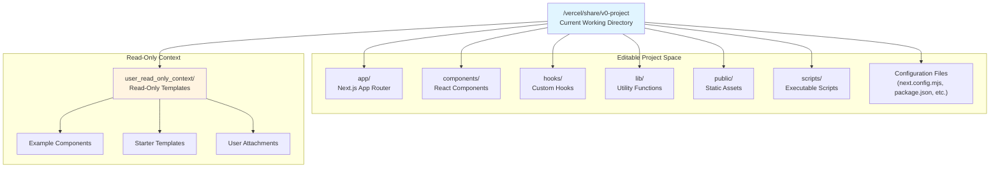
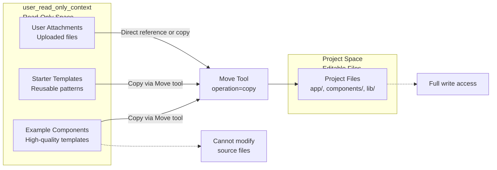
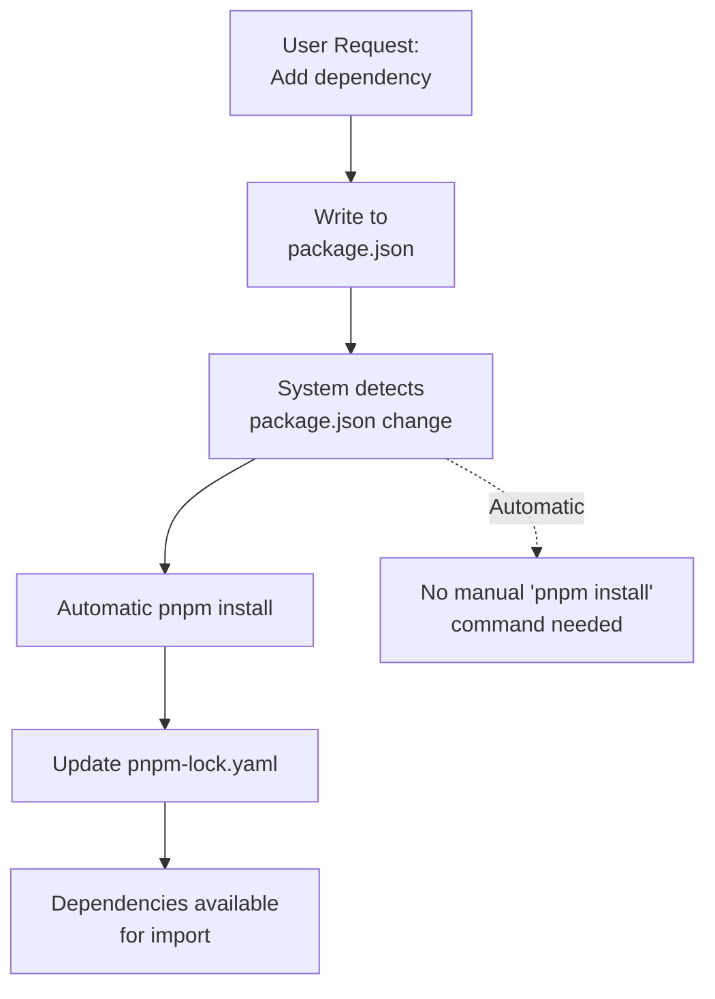
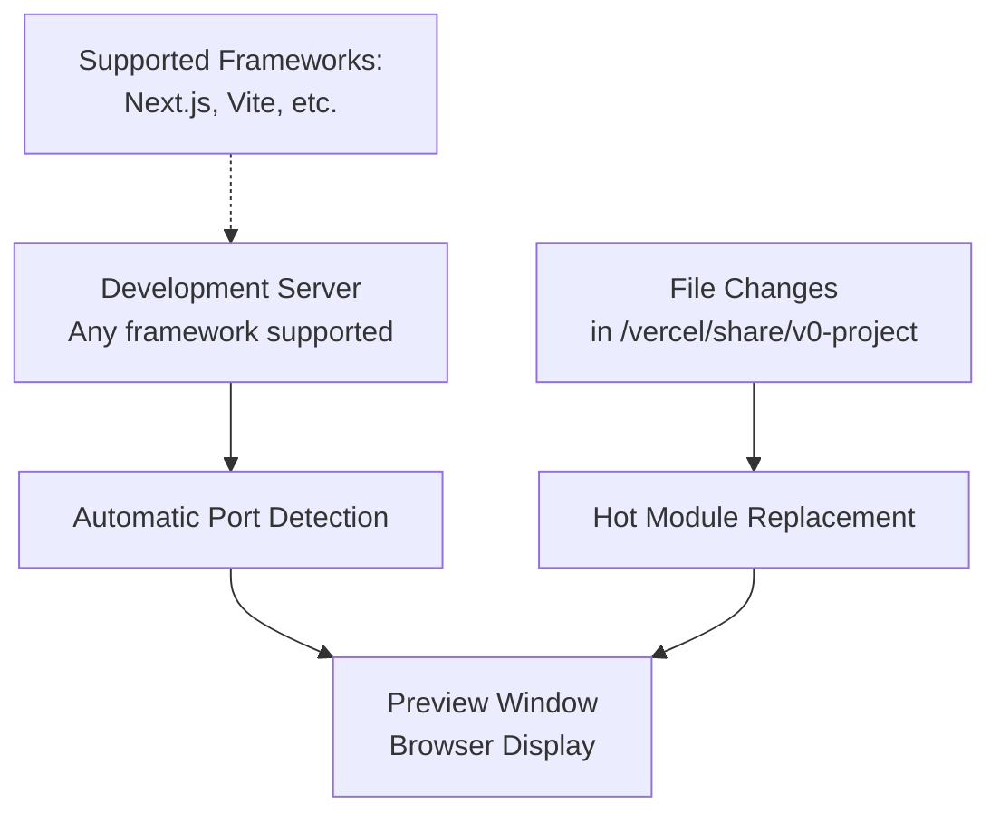
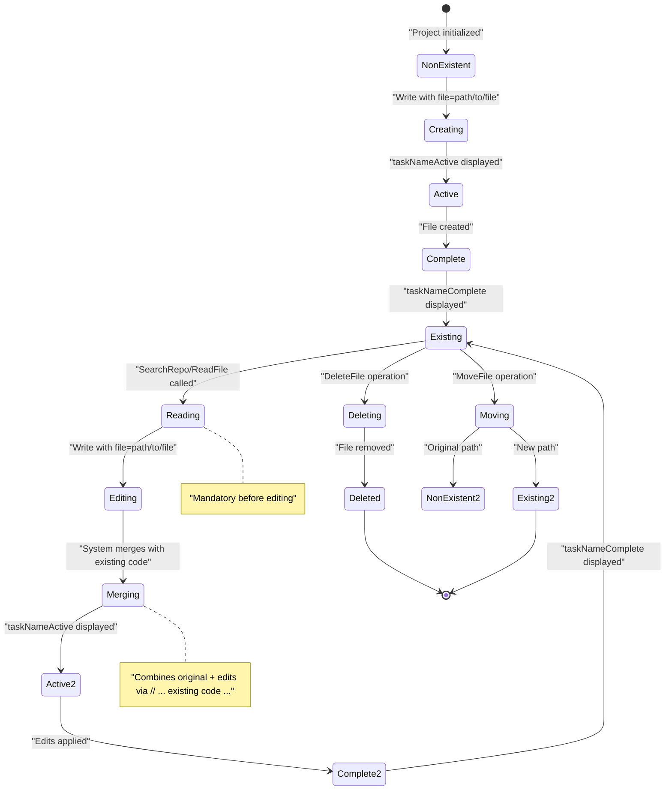
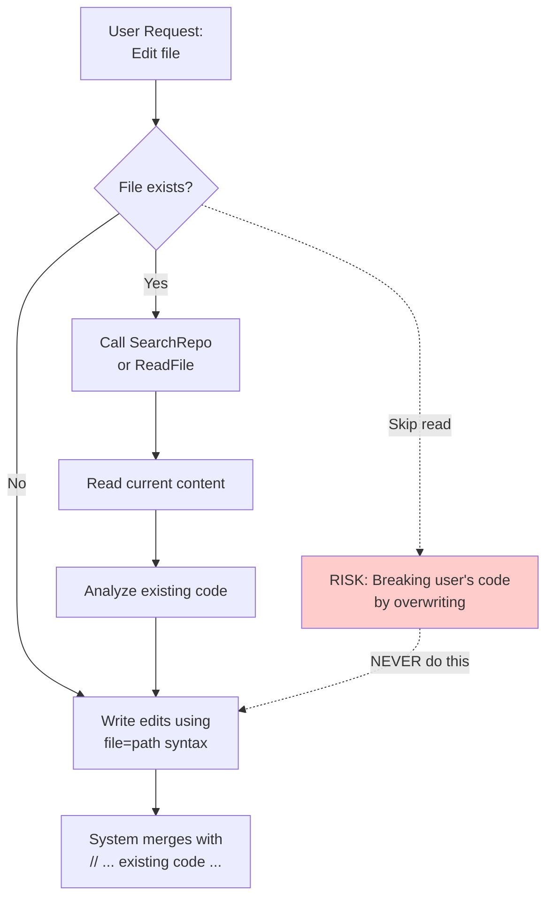
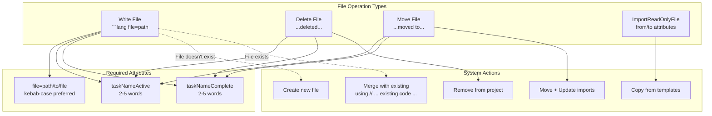
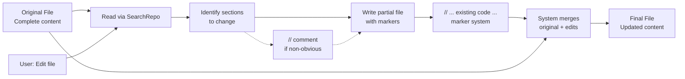
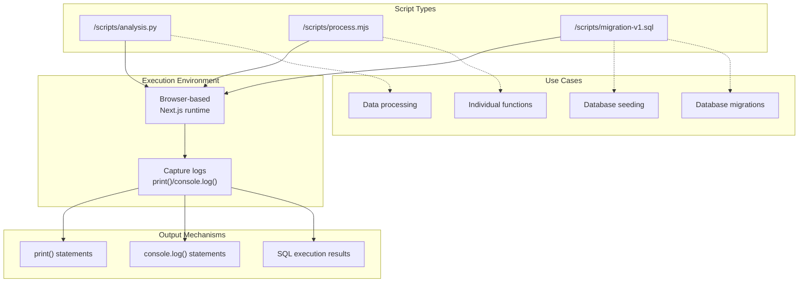
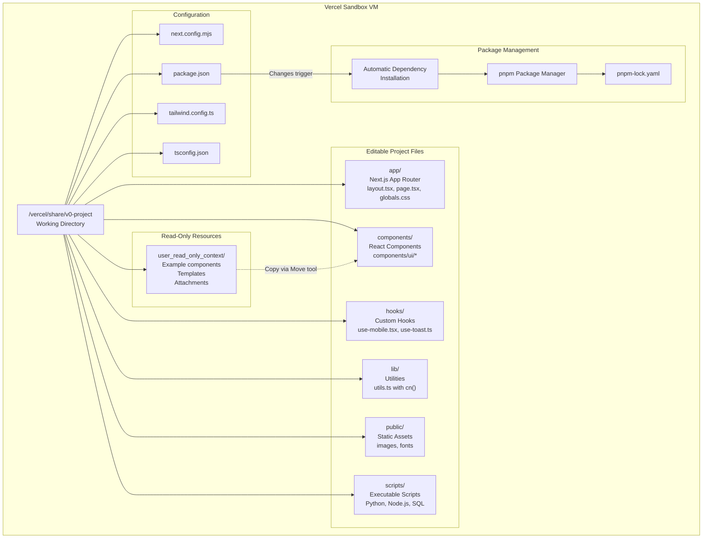

<!-- source: DeepWiki mcp.deepwiki.com · repo x1xhlol/system-prompts-and-models-of-ai-tools · extra page Project Architecture and File Lifecycle · fetched 2026-10-30 -->

# Project Architecture and File Lifecycle

<details>
<summary>Relevant source files</summary>

The following files were used as context for generating this wiki page:

- [v0 Prompts and Tools/Prompt.txt](v0 Prompts and Tools/Prompt.txt)

</details>


This document describes v0's project architecture within the `/vercel/share/v0-project` working directory, the distinction between read-only context and editable project space, and the automatic dependency installation system. It covers the directory structure, file operation patterns, and the package management lifecycle.

For information about v0's context gathering and search strategy, see [Context Gathering and Search Strategy](#4.1.3). For details about the specialized editing syntax using quick edit comments, see [File Editing and Tool Schema](#4.1.2).

## Project Directory Structure

v0 operates within a Linux VM powered by Vercel Sandbox with a fixed working directory structure. All file operations occur within this predefined directory tree.

### Working Directory Architecture



**Sources:** [v0 Prompts and Tools/Prompt.txt:10-13]()

### Absolute Path Requirement

All file paths in v0 **must** be absolute paths relative to the working directory. The system transitioned from relative paths to absolute paths.

| Path Format | Valid | Example |
|-------------|-------|---------|
| Absolute | ✅ Yes | `/vercel/share/v0-project/app/page.tsx` |
| Relative | ❌ No | `app/page.tsx` |

**Migration Note:** Tool calls from earlier conversations may use the old relative path format, but all current and future tool calls **must** use absolute paths.

**Sources:** [v0 Prompts and Tools/Prompt.txt:10-13]()

## Read-Only Context vs Editable Project Space

v0 maintains a clear separation between read-only template/example files and the editable project workspace. This architecture prevents accidental modification of shared resources while enabling code reuse.

### Two-Space Model



**Sources:** [v0 Prompts and Tools/Prompt.txt:10-13]()

### Importing Read-Only Files into Project

To use example components or templates from `user_read_only_context`, v0 **must** use the Move tool with `operation="copy"`:

```
Move(
  taskNameActive="Adding spinner button",
  taskNameComplete="Added spinner button",
  operation="copy",
  source_path="user_read_only_context/text_attachments/spinner-button.tsx",
  destination_path="components/spinner-button.tsx"
)
```

**Key Rules:**
- `sourcePath`: Original read-only file path in `user_read_only_context`
- `destinationPath`: New file path in editable project space
- Operation type: **Must** be `"copy"` to duplicate rather than move
- The example components and templates are high-quality and should be searched first before creating new implementations

**Sources:** [v0 Prompts and Tools/Prompt.txt:10-23]()

## Package Management and Dependency Installation

v0 uses **pnpm** as the default package manager with automatic dependency installation triggered by `package.json` changes.

### Automatic Dependency Installation Workflow



**Sources:** [v0 Prompts and Tools/Prompt.txt:10-13]()

### Package Manager Characteristics

| Characteristic | Value | Notes |
|----------------|-------|-------|
| Package Manager | **pnpm** | Default for all v0 projects |
| Installation Trigger | `package.json` changes | Fully automatic |
| User Terminal Access | None | Users do **not** have terminal access |
| Manual Commands | Not recommended | System handles installation automatically |

**Critical Constraint:** Users do **not** have access to a terminal. v0 must **never** suggest running commands like `pnpm install` or `npm install` for issues encountered in the preview.

**Sources:** [v0 Prompts and Tools/Prompt.txt:10-13]()

## Preview Environment and Hot Module Replacement

The preview environment automatically detects the open port from the development server and displays the application with Hot Module Replacement (HMR). File changes reflect immediately without a full page reload.

### Preview Environment Architecture



**Supported Frameworks:** The preview automatically picks up any framework (Next.js, Vite, etc.) running on an open port.

**Sources:** [v0 Prompts and Tools/Prompt.txt:10-13]()

## File Operation Syntax

v0 uses a specialized markdown code block syntax to perform file operations within CodeProject blocks. The syntax follows the pattern:

```
```lang file="path/to/file"
```

This single syntax serves dual purposes: creating new files and editing existing files. The system determines the operation type based on whether the file already exists in the project.

### Required Attributes for File Operations

All file write operations require two task status attributes that provide user interface feedback:

| Attribute | Purpose | Format | Example |
|-----------|---------|--------|---------|
| `taskNameActive` | Describes changes while in progress | 2-5 words | "Adding login form" |
| `taskNameComplete` | Describes changes after completion | 2-5 words | "Login form added" |

**Sources:** [v0 Prompts and Tools/Prompt.txt:18-20]()

## File Lifecycle State Diagram



**Sources:** [v0 Prompts and Tools/Prompt.txt:10-23]()

## Mandatory Read-Before-Write Pattern

v0 enforces a strict read-before-write requirement to prevent accidental code overwriting. This pattern is critical to the system's safety model.

### Read-Before-Write Workflow



**Critical Rule:** The system **must** read a file before editing it. Skipping this step risks breaking the user's code by overwriting important implementations.

**Sources:** [v0 Prompts and Tools/Prompt.txt:10-13]()

## File Operation Types

### Write Operation (Create and Edit)

The write operation uses identical syntax for both creating new files and editing existing files. The system differentiates based on file existence.

**Syntax:**
```
```typescriptreact file="path/to/file.tsx" taskNameActive="Adding component" taskNameComplete="Component added"
```

**Naming Convention:** v0 prefers kebab-case for file names (e.g., `login-form.tsx`).

**Sources:** [v0 Prompts and Tools/Prompt.txt:10-13]()

### Delete Operation

The delete operation removes files from the CodeProject using a specialized marker.

**Syntax:**
```
```typescriptreact file="path/to/file.tsx"
...deleted...
```
```

**Constraint:** `DeleteFile` does not support batch deletion. Each file requires a separate delete operation.

**Sources:** [v0 Prompts and Tools/Prompt.txt:10-13]()

### Move/Rename Operation

The move operation relocates files and requires updating all import references.

**Syntax:**
```
```typescriptreact file="original/path.tsx"
...moved to new/path.tsx...
```

```typescriptreact file="new/path.tsx"
```
```

**Post-Move Requirement:** After moving a file, v0 **must** fix all import statements that reference the moved file. The system **does not** rewrite the file itself after moving.

**Sources:** [v0 Prompts and Tools/Prompt.txt:10-13]()

### Import Read-Only Files Operation

The `ImportReadOnlyFile` operation copies files from the `user_read_only_context` directory (example components, templates) into the active CodeProject.

**Syntax:**
```xml
<ImportReadOnlyFile from="user_read_only_context/path/to/file" to="path/to/new-file" />
```

**Use Case:** Required for using example components or templates that exist in the read-only context directory.

**Sources:** [v0 Prompts and Tools/Prompt.txt:10-13]()

## File Operation Architecture



**Sources:** [v0 Prompts and Tools/Prompt.txt:10-23]()

## Edit Merge System

When editing existing files, v0 uses a specialized merge system that combines the original file content with the new edits. This system relies on the `// ... existing code ...` comment marker.

### Merge Mechanism

The merge system operates in three stages:

1. **Original Content Preservation**: The user can see the entire file, so v0 only writes the updates
2. **Marker Recognition**: The system identifies `// ... existing code ...` markers to indicate skipped sections
3. **Merge Execution**: The system combines the original file with the specified edits

**Key Rule:** v0 **does not** modify the `// ... existing code ...` marker—it must always match exactly. The system uses this exact string for merge logic.

**Sources:** [v0 Prompts and Tools/Prompt.txt:10-13]()

### Edit Strategy and Token Optimization

v0 minimizes duplicate code writing to reduce user wait time. The more duplicate code written, the longer the user waits. Therefore:

- Only write files that need editing
- Only write parts of the file that changed
- Skip file start/end sections when possible
- Use `// ... existing code ...` extensively

**Sources:** [v0 Prompts and Tools/Prompt.txt:10-13]()

### Change Comments

For non-obvious edits, v0 includes `<CHANGE>` comments explaining the modification:

```typescript
// <CHANGE> removing the header
```

These comments must be brief and to-the-point, avoiding long explanations.

**Sources:** [v0 Prompts and Tools/Prompt.txt:10-13]()

## Merge System Data Flow



**Sources:** [v0 Prompts and Tools/Prompt.txt:10-13]()

## Assets and Non-Text Files

### Image and Asset Embedding

v0 uses specialized syntax to embed non-text files like images and assets in CodeProject blocks:

```
```plaintext file="path/to/image.png"

```
```

This adds the image to the file system at the specified path.

### Asset Reference Rules

When users provide images or assets:

1. **Must** add the image to the CodeProject using the proper file syntax
2. **Must** reference images using file paths (e.g., `/images/dashboard.png`)
3. **Never** use blob URLs directly in HTML, JSX, or CSS code unless explicitly requested

**Invalid:** ``  
**Valid:** ``

**Sources:** [v0 Prompts and Tools/Prompt.txt:28-32]()

### Generated Images

v0 can generate images by passing a query to the file metadata:

```
```plaintext file="path/to/hero-image.png"

```
```

This generates an image for the query and places it at the specified file path.

**Sources:** [v0 Prompts and Tools/Prompt.txt:33-35]()

## Executable Scripts Architecture

v0 supports executing Python, Node.js, and SQL code within CodeProject blocks using the `/scripts` folder.

### Script Requirements

| Requirement | Description |
|-------------|-------------|
| **Location** | Scripts **must** be in `/scripts` folder |
| **CodeProject** | Scripts **must** be part of a CodeProject |
| **Languages** | Python, Node.js (ES6+), SQL |

### Python Script Guidelines

- Use popular libraries: NumPy, Matplotlib, Pillow
- Use `print()` for output (execution environment captures logs)
- Write pure function implementations when possible
- Read directly from attachments; don't copy data into the project

### Node.js Script Guidelines

- Use ES6+ syntax
- Always use `import` statements (never `require`)
- Use built-in `fetch` for HTTP requests
- Use `sharp` for image processing
- Use `console.log()` for output

### SQL Script Guidelines

- Verify tables exist before updating data
- Split scripts into multiple files for organization
- Never rewrite or delete executed scripts; create new versioned scripts for modifications

**Sources:** [v0 Prompts and Tools/Prompt.txt:10-13]()

## Script Execution Data Flow



**Sources:** [v0 Prompts and Tools/Prompt.txt:10-13]()

## Debugging with Console Logs

v0 uses a specialized console.log pattern for debugging: `console.log("[v0] ...")`. These debug statements help trace execution flow, inspect variables, and identify issues.

### Debug Log Examples

```typescript
console.log("[v0] User data received:", userData)
console.log("[v0] API call starting with params:", params)
console.log("[v0] Component rendered with props:", props)
console.log("[v0] Error occurred in function:", error.message)
console.log("[v0] State updated:", newState)
```

### Debug Log Workflow

1. Insert `console.log("[v0] ...")` statements in code
2. System executes code and captures logs
3. Logs returned in `<v0_app_debug_logs>` tags
4. v0 analyzes logs to understand issues
5. Remove debug statements once issue resolved

**Best Practices:**
- Include relevant context in messages
- Log both successful operations and errors
- Include variable values and object states
- Use clear, descriptive messages

**Sources:** [v0 Prompts and Tools/Prompt.txt:36-53]()

## Default Project Structure

All projects in `/vercel/share/v0-project` come with a default set of files and folders that v0 **never** generates unless explicitly requested by the user. This starter template structure reduces token usage and improves response time.

### Pre-Existing Files and Directories

| File/Directory | Absolute Path | Purpose |
|----------------|---------------|---------|
| `app/layout.tsx` | `/vercel/share/v0-project/app/layout.tsx` | Root layout component |
| `app/page.tsx` | `/vercel/share/v0-project/app/page.tsx` | Empty page (create as needed) |
| `components/ui/*` | `/vercel/share/v0-project/components/ui/` | shadcn/ui components (accordion, alert, avatar, button, button-group, card, dropdown-menu, empty, field, input-group, item, kbd, spinner, etc.) |
| `hooks/use-mobile.tsx` | `/vercel/share/v0-project/hooks/use-mobile.tsx` | Mobile detection hook |
| `hooks/use-toast.ts` | `/vercel/share/v0-project/hooks/use-toast.ts` | Toast notification hook |
| `lib/utils.ts` | `/vercel/share/v0-project/lib/utils.ts` | Utility functions (includes `cn` function for classnames) |
| `app/globals.css` | `/vercel/share/v0-project/app/globals.css` | Global styles with default shadcn configuration |
| `next.config.mjs` | `/vercel/share/v0-project/next.config.mjs` | Next.js configuration |
| `package.json` | `/vercel/share/v0-project/package.json` | Package dependencies |
| `tsconfig.json` | `/vercel/share/v0-project/tsconfig.json` | TypeScript configuration |
| `tailwind.config.ts` | `/vercel/share/v0-project/tailwind.config.ts` | Tailwind CSS configuration |

**Note:** The `app/page.tsx` file is empty by default. v0 creates custom page content as needed based on user requests.

**Sources:** [v0 Prompts and Tools/Prompt.txt:10-13]()

### shadcn/ui Component Library

The default project includes a comprehensive set of shadcn/ui components. Recently introduced components include:

| Component | Purpose |
|-----------|---------|
| `button-group` | Grouped action buttons (not for state toggles) |
| `empty` | Empty state displays |
| `field` | Form field layouts with `FieldGroup`, `Field`, `FieldLabel` |
| `input-group` | Inputs with icons/buttons using `InputGroupInput` and `InputGroupAddon` |
| `item` | List item component |
| `kbd` | Keyboard shortcut display |
| `spinner` | Loading spinner for buttons |

**Usage Patterns:**
- Use `FieldGroup` + `Field` + `FieldLabel` for form layouts (not raw divs with `space-y-*`)
- Use `FieldSet` + `FieldLegend` for grouping checkboxes, radios, or switches
- Use `InputGroup` with `InputGroupInput` for inputs with icons/buttons
- Use `Spinner` for loading buttons
- Use `ButtonGroup` for grouped action buttons

**Sources:** [v0 Prompts and Tools/Prompt.txt:10-13]()

## Project Architecture Overview



**Sources:** [v0 Prompts and Tools/Prompt.txt:10-23]()

## File Lifecycle Summary Table

| Operation | Syntax | Required Read | Batch Support | Import Updates |
|-----------|--------|---------------|---------------|----------------|
| Create | `file="path"` + content | No | Yes (multiple files) | No |
| Edit | `file="path"` + content | **Yes** (mandatory) | Yes (multiple files) | No |
| Delete | `...deleted...` | No | No (one at a time) | No |
| Move | `...moved to...` | No | No (one at a time) | **Yes** (mandatory) |
| Import | `<ImportReadOnlyFile>` | No | No | No |

**Sources:** [v0 Prompts and Tools/Prompt.txt:10-23]()

---

