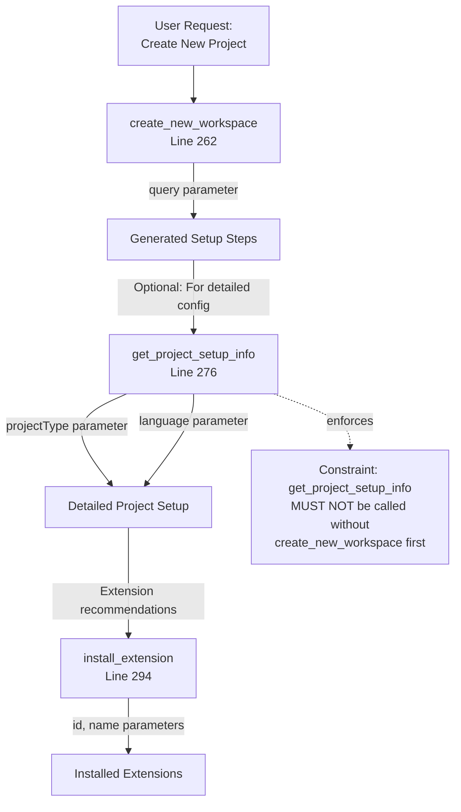
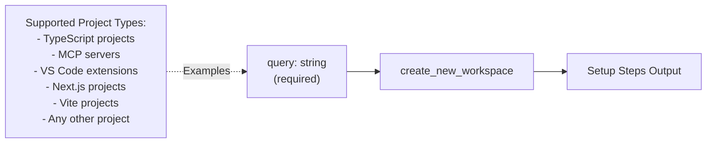
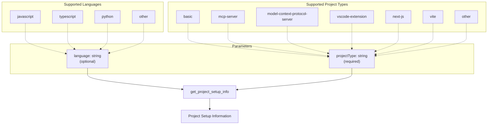
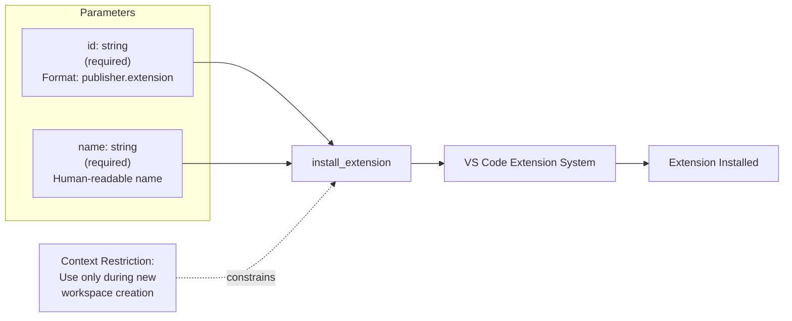
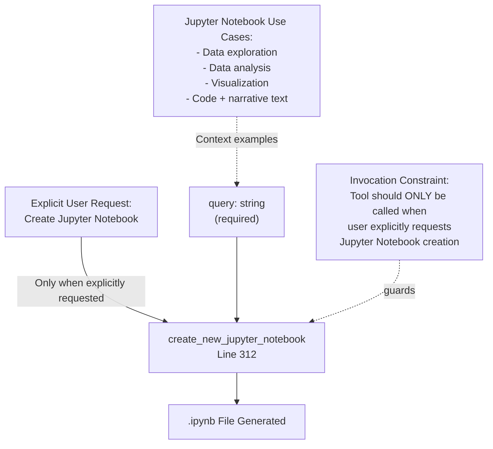
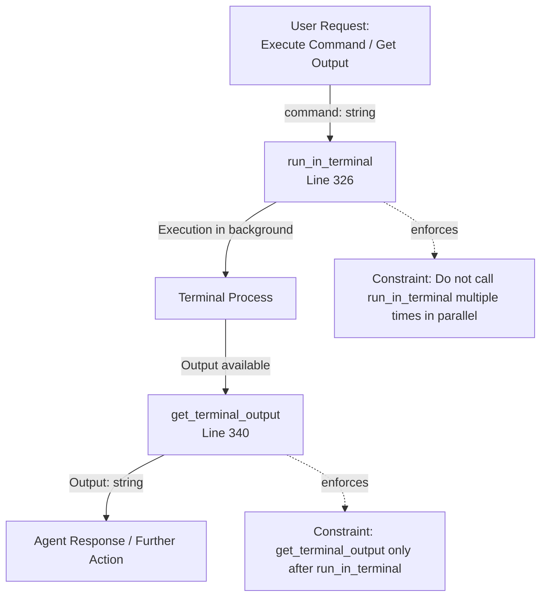
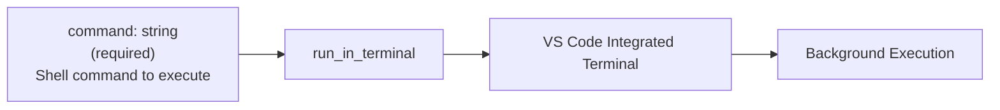
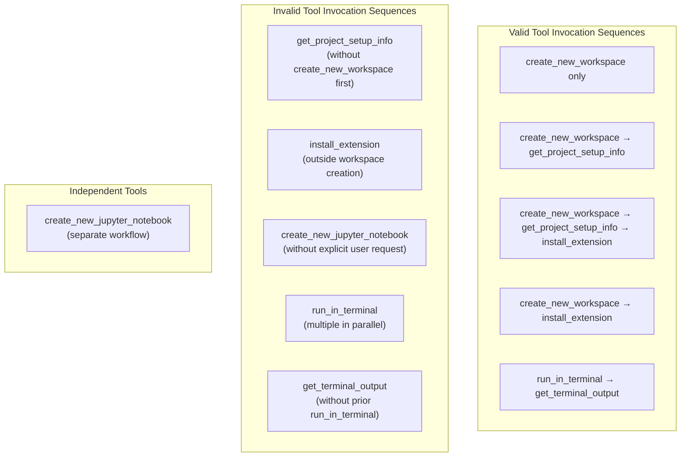
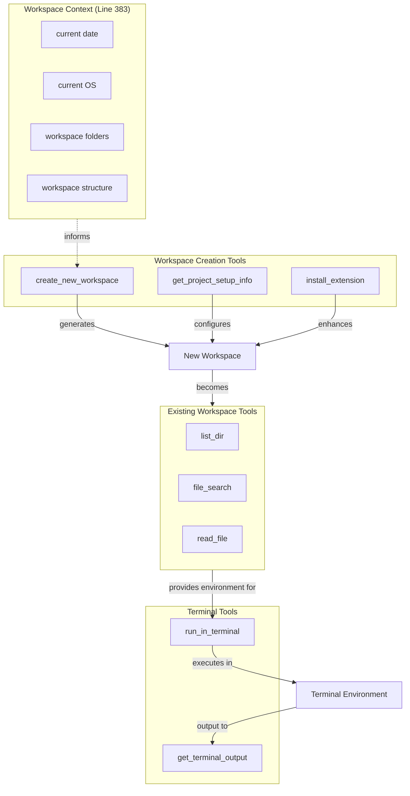
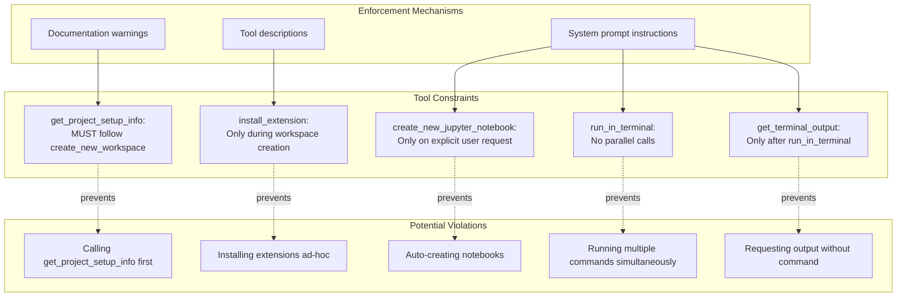

<!-- source: DeepWiki mcp.deepwiki.com · repo x1xhlol/system-prompts-and-models-of-ai-tools · extra page Project Setup, Extensions and Terminal Integration · fetched 2026-10-30 -->

# Project Setup, Extensions and Terminal Integration

Relevant source files

The following files were used as context for generating this wiki page:

- [VSCode Agent/Prompt.txt](VSCode Agent/Prompt.txt)

This document details the VSCode Agent's capabilities for project setup, extension management, and terminal interaction. It covers tools for creating new workspaces, retrieving project configuration, installing extensions, generating Jupyter notebooks, and executing commands in the terminal with background execution and output retrieval. These tools form a cohesive workflow for project initialization, development, and debugging.

For information about file editing within existing workspaces, see [File Editing Workflow and Validation](). For context discovery in established workspaces, see [Context Discovery and Search Strategy]().

Sources: [VSCode Agent/Prompt.txt:262-323](), [VSCode Agent/Prompt.txt:326-379]()

## Workspace Creation Workflow

The VSCode Agent implements a two-phase workspace creation process: first generating setup steps via `create_new_workspace`, then optionally retrieving detailed project configuration through `get_project_setup_info`.

**Workflow Diagram: Workspace Creation Tool Invocation Sequence**

The `create_new_workspace` tool serves as the entry point, accepting a natural language `query` parameter describing the desired project [VSCode Agent/Prompt.txt:267-270](). The tool returns setup steps that guide project initialization. 

A critical constraint exists: `get_project_setup_info` MUST NOT be called without first calling `create_new_workspace` [VSCode Agent/Prompt.txt:277](). This restriction enforces proper workflow sequencing and ensures the user receives general setup guidance before detailed configuration.

Sources: [VSCode Agent/Prompt.txt:262-291]()

## create_new_workspace Tool

**create_new_workspace Parameter Structure**

The tool accepts a single required parameter:

| Parameter | Type | Required | Description |
|-----------|------|----------|-------------|
| `query` | string | Yes | Clear and concise description of the workspace to create |

The tool explicitly supports multiple project archetypes [VSCode Agent/Prompt.txt:263]():
- TypeScript-based projects
- Model Context Protocol (MCP) servers
- VS Code extensions
- Next.js projects
- Vite projects
- Any other project type

The `query` parameter should contain a natural language description that clearly articulates the project requirements. The tool processes this query to generate appropriate setup steps tailored to the requested project type.

Sources: [VSCode Agent/Prompt.txt:262-273]()

## get_project_setup_info Tool

The `get_project_setup_info` tool provides structured project configuration data for specific project types and programming languages. This tool operates as a secondary resource after initial workspace creation.

**get_project_setup_info Parameter and Type Mapping**

### Parameter Schema

| Parameter | Type | Required | Description |
|-----------|------|----------|-------------|
| `projectType` | string | Yes | Type of project to create |
| `language` | string | No | Programming language for the project |

### Supported Values

**Programming Languages** [VSCode Agent/Prompt.txt:283]():
- `javascript`
- `typescript`
- `python`
- `other`

**Project Types** [VSCode Agent/Prompt.Prompt.txt:287]():
- `basic` - Basic project structure
- `mcp-server` - Model Context Protocol server
- `model-context-protocol-server` - Alias for MCP server
- `vscode-extension` - Visual Studio Code extension
- `next-js` - Next.js React framework project
- `vite` - Vite build tool project
- `other` - Custom or unspecified project type

The `language` parameter is optional, defaulting to language detection based on project type or user context. The `projectType` parameter is mandatory and drives the configuration generation logic.

Sources: [VSCode Agent/Prompt.txt:276-291]()

## install_extension Tool

The `install_extension` tool automates VS Code extension installation during workspace setup. This tool is restricted to new workspace creation workflows and should not be used for ad-hoc extension management [VSCode Agent/Prompt.txt:295]().

**install_extension Tool Structure**

### Parameter Schema

| Parameter | Type | Required | Format | Description |
|-----------|------|----------|--------|-------------|
| `id` | string | Yes | `<publisher>.<extension>` | Extension identifier in publisher.extension format |
| `name` | string | Yes | - | Clear and concise description of the extension |

### Usage Constraints

The tool includes an explicit usage restriction: "Use this tool to install an extension in Visual Studio Code as part of a new workspace creation process only" [VSCode Agent/Prompt.txt:295](). This constraint prevents the tool from being invoked for:
- Installing extensions in existing workspaces outside setup context
- Ad-hoc extension management requests
- Extension updates or configuration changes

The `id` parameter must follow the standard VS Code extension identifier format: `<publisher>.<extension>`. For example, `ms-python.python` identifies the Python extension published by Microsoft.

Sources: [VSCode Agent/Prompt.txt:294-309]()

## create_new_jupyter_notebook Tool

The `create_new_jupyter_notebook` tool generates new Jupyter Notebook (`.ipynb`) files within VS Code. This tool addresses the specialized use case of creating interactive computational documents.

**create_new_jupyter_notebook Invocation Pattern**

### Parameter Schema

| Parameter | Type | Required | Description |
|-----------|------|----------|-------------|
| `query` | string | Yes | Clear and concise description of the notebook to create |

### Invocation Requirements

The tool documentation explicitly states: "This tool should only be called when the user explicitly requests to create a new Jupyter Notebook" [VSCode Agent/Prompt.txt:313](). This constraint prevents:
- Automatic notebook creation without user request
- Implicit notebook generation during workspace setup
- Notebook creation as a fallback for other operations

### Jupyter Notebook Context

The tool description provides context about notebook purposes [VSCode Agent/Prompt.txt:313]():
- **Data exploration** - Interactive data investigation
- **Data analysis** - Computational analysis workflows
- **Visualization** - Charts, graphs, and visual representations
- **Combining code with narrative text** - Literate programming style

The `query` parameter should describe the specific notebook purpose, enabling the tool to generate appropriate initial structure and content.

Sources: [VSCode Agent/Prompt.txt:312-323]()

## Terminal Integration: `run_in_terminal` and `get_terminal_output`

The VSCode Agent provides robust terminal integration through two key tools: `run_in_terminal` for executing commands and `get_terminal_output` for retrieving their results. This allows for dynamic interaction with the underlying operating system and project environment.

**Terminal Interaction Workflow**

The agent's prompt explicitly states: "NEVER print out a codeblock with a terminal command to run unless the user asked for it. Use the `run_in_terminal` tool instead" [VSCode Agent/Prompt.txt:24](). This reinforces the mandatory use of the tool for command execution.

A critical instruction for `run_in_terminal` is: "Don't call the `run_in_terminal` tool multiple times in parallel. Instead, run one command and wait for the output before running the next command" [VSCode Agent/Prompt.txt:37](). This ensures sequential and predictable execution of terminal commands.

Sources: [VSCode Agent/Prompt.txt:24](), [VSCode Agent/Prompt.txt:37](), [VSCode Agent/Prompt.txt:326-349]()

## run_in_terminal Tool

The `run_in_terminal` tool executes a specified command in the integrated terminal. It operates asynchronously, allowing the agent to continue processing while the command runs in the background.

**run_in_terminal Parameter Structure**

### Parameter Schema

| Parameter | Type | Required | Description |
|-----------|------|----------|-------------|
| `command` | string | Yes | The shell command to execute in the terminal. |

### Execution Characteristics

- **Asynchronous**: The tool initiates the command and returns immediately, without waiting for the command to complete [VSCode Agent/Prompt.txt:327]().
- **Background Process**: Commands run in the background, allowing the agent to perform other tasks or prepare for output retrieval.
- **No Direct Output**: This tool does not return the command's output directly. Output must be retrieved using `get_terminal_output`.

### Usage Guidelines

- **Single Command Execution**: As per the prompt instructions, `run_in_terminal` should not be called in parallel [VSCode Agent/Prompt.txt:37]().
- **Error Handling**: The agent is expected to use `get_terminal_output` to check for command success or failure.

Sources: [VSCode Agent/Prompt.txt:37](), [VSCode Agent/Prompt.txt:326-337]()

## get_terminal_output Tool

The `get_terminal_output` tool retrieves the standard output and standard error from the last executed terminal command.

**get_terminal_output Parameter Structure**

### Parameter Schema

This tool has no parameters [VSCode Agent/Prompt.txt:340-349](). It implicitly retrieves the output of the most recently executed command via `run_in_terminal`.

### Output Characteristics

- **Combined Output**: Returns both `stdout` and `stderr` as a single string [VSCode Agent/Prompt.txt:341]().
- **Implicit Link**: Automatically fetches output from the last command run by `run_in_terminal`.
- **Blocking Call**: Unlike `run_in_terminal`, this tool will wait for the command to complete and its output to be available.

### Usage Guidelines

- **Post-Execution Retrieval**: This tool should always be called after `run_in_terminal` to inspect the results of a command.
- **Error Detection**: The agent should parse the output to determine if the command was successful or if errors occurred.

Sources: [VSCode Agent/Prompt.txt:340-349]()

## Tool Interaction Patterns and Workflows

The workspace creation and terminal tools exhibit specific interaction patterns that govern their usage within the VSCode Agent system.

**Tool Interaction Constraints and Patterns**

### Sequential Dependencies

1. **create_new_workspace as Entry Point**: All workspace creation workflows begin with `create_new_workspace` [VSCode Agent/Prompt.txt:262-273]()

2. **get_project_setup_info Dependency**: Cannot be invoked without prior `create_new_workspace` call [VSCode Agent/Prompt.txt:277]()

3. **install_extension Context**: Restricted to workspace creation process [VSCode Agent/Prompt.txt:295]()

4. **run_in_terminal and get_terminal_output**: `get_terminal_output` must follow `run_in_terminal` to retrieve output.

### Tool Combination Patterns

| Pattern | Tools | Use Case |
|---------|-------|----------|
| Quick Setup | `create_new_workspace` only | General project initialization with basic steps |
| Detailed Setup | `create_new_workspace` → `get_project_setup_info` | Language-specific or framework-specific configuration |
| Extension-Enhanced Setup | `create_new_workspace` → `install_extension` | Project with required extensions |
| Full Setup | `create_new_workspace` → `get_project_setup_info` → `install_extension` | Complete project initialization with detailed config and extensions |
| Notebook Creation | `create_new_jupyter_notebook` | Independent workflow for data analysis notebooks |
| Command Execution | `run_in_terminal` → `get_terminal_output` | Execute shell commands and retrieve their results |

### Parallel Execution Restrictions

The workspace creation tools follow sequential execution patterns and do not support parallel invocation. The general tool use instructions prohibit parallel tool calls for dependent operations [VSCode Agent/Prompt.txt:35-37](). Specifically, `run_in_terminal` should not be called multiple times in parallel [VSCode Agent/Prompt.txt:37]().

Sources: [VSCode Agent/Prompt.txt:262-323](), [VSCode Agent/Prompt.txt:326-349](), [VSCode Agent/Prompt.txt:28-39]()

## Integration with Workspace Context

Workspace creation and terminal tools operate within the broader VSCode Agent context system, which provides workspace structure awareness and file system information.

**Workspace Context Integration**

The VSCode Agent maintains workspace context including [VSCode Agent/Prompt.txt:383-394]():
- **Current date** - Temporal context for project generation
- **Current OS** - Platform-specific setup instructions (Windows, macOS, Linux)
- **Workspace folders** - Active workspace directory paths
- **Workspace structure** - File and directory tree

This context informs workspace creation by:
1. Providing platform-specific commands in setup steps
2. Suggesting appropriate project structures
3. Recommending OS-compatible tools and extensions
4. Avoiding conflicts with existing workspace content

After workspace creation, the new project becomes part of the workspace context, accessible to all file operations, search tools, editing capabilities, and the terminal environment for command execution.

Sources: [VSCode Agent/Prompt.txt:383-394](), [VSCode Agent/Prompt.txt:262-323](), [VSCode Agent/Prompt.txt:326-349]()

## Project Type Support Matrix

The workspace creation system supports a diverse range of project types with varying levels of specialization.

| Project Type | Supported via create_new_workspace | Supported via get_project_setup_info | Language Options | Notes |
|--------------|-----------------------------------|-------------------------------------|------------------|-------|
| Basic Project | Yes | Yes (`basic`) | javascript, typescript, python, other | Generic project structure |
| TypeScript Project | Yes | Yes (`typescript` language) | typescript | Language-specific configuration |
| MCP Server | Yes | Yes (`mcp-server`, `model-context-protocol-server`) | javascript, typescript | Model Context Protocol server |
| VS Code Extension | Yes | Yes (`vscode-extension`) | javascript, typescript | Extension development with `get_vscode_api` tool |
| Next.js Project | Yes | Yes (`next-js`) | javascript, typescript | React framework project |
| Vite Project | Yes | Yes (`vite`) | javascript, typescript | Modern build tool project |
| Python Project | Yes | Yes (`python` language) | python | Python-specific configuration |
| Jupyter Notebook | Yes (via `create_new_jupyter_notebook`) | No | python (typical) | Separate tool, explicit request required |
| Custom/Other | Yes ("any other project") | Yes (`other`) | other | Flexible fallback category |

**Project Type Coverage Analysis**

The system demonstrates comprehensive coverage of modern web development and data science workflows:

1. **Framework Support**: Next.js and Vite cover modern frontend frameworks [VSCode Agent/Prompt.txt:263]()
2. **Extension Development**: Dedicated support for VS Code extension creation [VSCode Agent/Prompt.txt:263]()
3. **Protocol Servers**: MCP server support for AI/LLM integration [VSCode Agent/Prompt.txt:263]()
4. **Data Science**: Jupyter notebook support for computational analysis [VSCode Agent/Prompt.txt:313]()
5. **Extensibility**: "Other" categories for unsupported project types [VSCode Agent/Prompt.txt:287]()

Sources: [VSCode Agent/Prompt.txt:262-323]()

## Error Handling and Constraints

The workspace creation and terminal tools implement specific constraints to ensure proper usage and prevent misuse.

**Constraint Implementation**

### Hard Constraints

1. **get_project_setup_info Sequencing** [VSCode Agent/Prompt.txt:277]()
   - Description: "Do not call this tool without first calling the tool to create a workspace"
   - Enforcement: Documentation-based, relies on agent adherence
   - Violation Impact: Missing context from initial workspace creation

2. **install_extension Context Restriction** [VSCode Agent/Prompt.txt:295]()
   - Description: "Use this tool...as part of a new workspace creation process only"
   - Enforcement: Documentation-based
   - Rationale: Separates setup automation from general extension management

3. **create_new_jupyter_notebook Explicit Request** [VSCode Agent/Prompt.txt:313]()
   - Description: "This tool should only be called when the user explicitly requests"
   - Enforcement: Documentation-based
   - Rationale: Prevents inappropriate notebook generation

4. **run_in_terminal Parallel Execution** [VSCode Agent/Prompt.txt:37]()
   - Description: "Don't call the run_in_terminal tool multiple times in parallel. Instead, run one command and wait for the output before running the next command."
   - Enforcement: System prompt instruction
   - Rationale: Ensures predictable and sequential command execution.

### Soft Constraints

The tools inherit general constraints from the VSCode Agent system:
- Follow user requirements carefully [VSCode Agent/Prompt.txt:6]()
- Follow Microsoft content policies [VSCode Agent/Prompt.txt:7]()
- Keep answers short and impersonal [VSCode Agent/Prompt.txt:10]()

Sources: [VSCode Agent/Prompt.txt:262-323](), [VSCode Agent/Prompt.txt:326-349](), [VSCode Agent/Prompt.txt:3-11](), [VSCode Agent/Prompt.txt:37]()

---

