<!-- source: DeepWiki mcp.deepwiki.com · repo x1xhlol/system-prompts-and-models-of-ai-tools · extra page Script Execution and Debugging System · fetched 2026-10-30 -->

# Script Execution and Debugging System

Relevant source files

The following files were used as context for generating this wiki page:

- [v0 Prompts and Tools/Prompt.txt](v0 Prompts and Tools/Prompt.txt)

## Purpose and Scope

The Script Execution and Debugging System enables v0 to execute Python, Node.js, and SQL scripts directly within Code Projects through the `/scripts` folder structure. This system provides immediate code execution, database management, data processing capabilities, and real-time debugging feedback without requiring users to leave the v0 environment.

For information about v0's general Code Project architecture and file operations, see [Project Architecture and File Lifecycle](#4.1.1). For integration-specific database setup, see [Integration Ecosystem and Configuration](#4.1.6).

**Sources:** [v0 Prompts and Tools/Prompt.txt:175-253]()

---

## Script File Organization

### Required Directory Structure

All executable scripts in v0 MUST follow a strict organizational structure:

| Requirement | Description | Enforcement |
|-------------|-------------|-------------|
| Code Project Membership | Scripts MUST be part of a Code Project | System-enforced |
| Directory Location | Scripts MUST be added to `/scripts` folder | System-enforced |
| File Naming | No specific naming convention required | Flexible |
| Language Support | Python (`.py`), Node.js (`.js`, `.mjs`), SQL (`.sql`) | System-defined |

### Script Folder Architecture

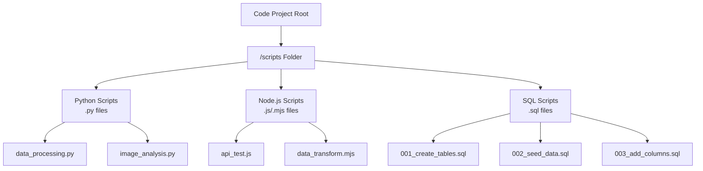

**Sources:** [v0 Prompts and Tools/Prompt.txt:175-182]()

---

## Language Capabilities Matrix

### Supported Languages and Features

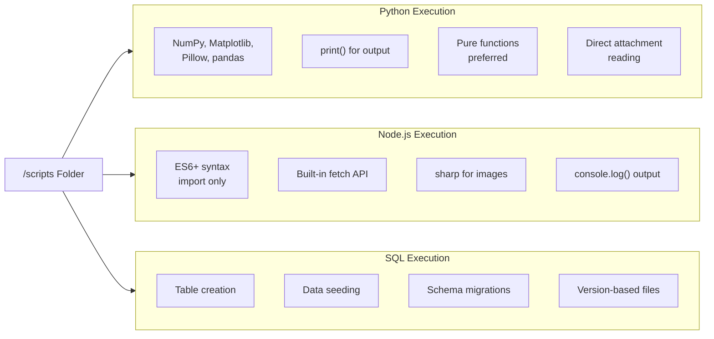

| Language | Output Mechanism | Key Libraries | Module System | Special Requirements |
|----------|------------------|---------------|---------------|---------------------|
| Python | `print()` statements | NumPy, Matplotlib, Pillow | Standard imports | Read attachments directly, no copying |
| Node.js | `console.log()` statements | `sharp`, built-in `fetch` | ES6 `import` only, never `require` | ES6+ syntax mandatory |
| SQL | Execution results | N/A | N/A | Version-numbered files for modifications |

**Sources:** [v0 Prompts and Tools/Prompt.txt:185-213]()

---

## Python Script Execution

### Python Project Initialization with uv

v0 uses the `uv` tool for Python project management in the `/scripts` folder:

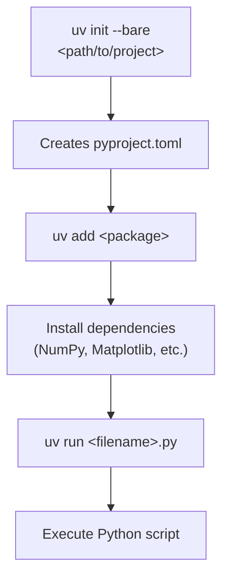

**Python Project Setup Workflow:**

1. **Initialize Project**: `uv init --bare <path/to/project>` creates a `pyproject.toml` file
2. **Add Packages**: `uv add <package>` installs libraries like NumPy, Matplotlib, Pillow
3. **Run Scripts**: `uv run <filename>.py` executes the Python script

### Python Best Practices and Requirements

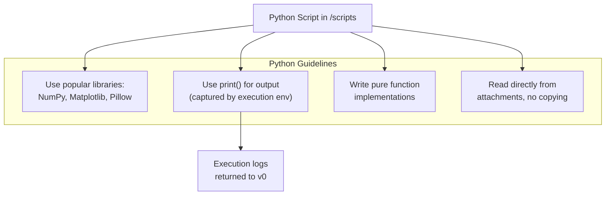

**Key Python Requirements:**

1. **Library Usage**: Utilize popular libraries like NumPy, Matplotlib, and Pillow for necessary tasks
2. **Output Capture**: The execution environment captures all `print()` statements as logs
3. **Functional Style**: Write pure function implementations when possible to minimize side effects
4. **Attachment Handling**: Don't copy attachments with data into the code project; read directly from the attachment

**Sources:** [v0 Prompts and Tools/Prompt.txt:49-56](), [v0 Prompts and Tools/Prompt.txt:187-193]()

---

## Node.js Script Execution

### Node.js Module System Requirements

v0 enforces strict ES6+ module conventions for all Node.js scripts:

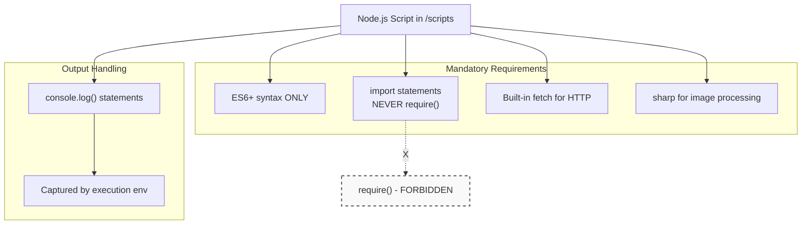

**Key Node.js Requirements:**

1. **ES6+ Syntax**: Always use modern JavaScript syntax
2. **Import-Only Module System**: Always use `import` statements; `require()` is strictly forbidden
3. **HTTP Requests**: Use the built-in `fetch` API for HTTP operations
4. **Image Processing**: Use `sharp` library for image manipulation tasks
5. **Output**: Utilize `console.log()` for all output (captured by execution environment)

**Sources:** [v0 Prompts and Tools/Prompt.txt:196-202]()

---

## SQL Script Execution and Versioning

### SQL Version Control Strategy

v0 implements a mandatory versioning system for SQL scripts to prevent destructive modifications:

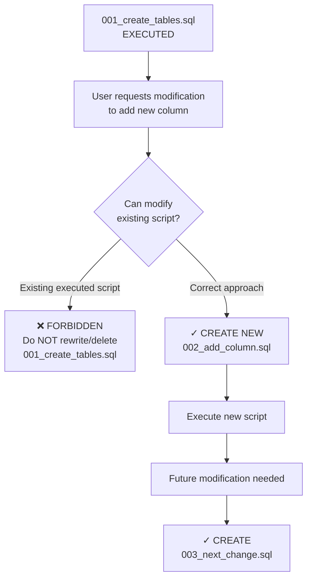

### SQL Script Organization Rules

| Rule | Description | Rationale |
|------|-------------|-----------|
| Table Existence Check | MUST verify tables exist before updating data | Prevents runtime errors |
| File Splitting | Split SQL scripts into multiple files for organization | Better version control and clarity |
| No Rewrites | Don't rewrite or delete existing executed SQL scripts | Preserves execution history |
| Version-Based Naming | Use numbered prefixes (001_, 002_, etc.) for sequential execution | Clear ordering and dependency management |
| Additive-Only | Only add new scripts if modification needed | Immutable execution history |

### SQL Execution Workflow

```mermaid
sequenceDiagram
    participant User
    participant v0
    participant ScriptsFolder as "/scripts Folder"
    participant Integration as "Database Integration<br/>(Supabase/Neon)"
    
    User->>v0: "Create database tables"
    v0->>ScriptsFolder: Write 001_create_tables.sql
    v0->>Integration: Execute SQL script
    Integration-->>v0: Execution results
    v0-->>User: Tables created
    
    User->>v0: "Add new column to table"
    v0->>ScriptsFolder: Write 002_add_column.sql<br/>(NOT modify 001_)
    v0->>Integration: Execute SQL script
    Integration-->>v0: Execution results
    v0-->>User: Column added
```

**Sources:** [v0 Prompts and Tools/Prompt.txt:205-210](), [v0 Prompts and Tools/Prompt.txt:557-562]()

---

## Debugging System with console.log

### Debug Logging Convention

v0 implements a specialized debugging system using the `console.log("[v0] ...")` prefix convention. Debug logs are captured by the execution environment and returned in `<v0_app_debug_logs>` tags:

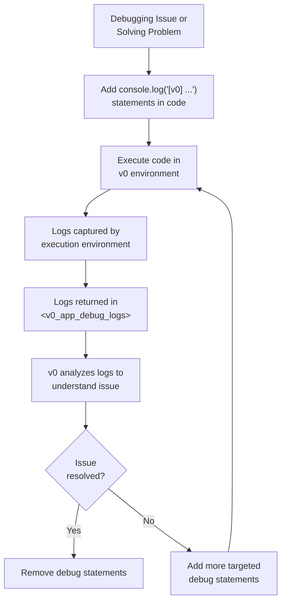

### Debug Statement Format and Code Examples

All debugging statements MUST follow the `console.log("[v0] ...")` format for proper log identification. The execution environment captures these logs and returns them in `<v0_app_debug_logs>` tags for analysis:

| Purpose | Example Statement | When to Use |
|---------|-------------------|-------------|
| Data Inspection | `console.log("[v0] User data received:", userData)` | When receiving external data |
| API Tracing | `console.log("[v0] API call starting with params:", params)` | Before API calls |
| Component Rendering | `console.log("[v0] Component rendered with props:", props)` | During render cycles |
| Error Context | `console.log("[v0] Error occurred in function:", error.message)` | When catching errors |
| State Changes | `console.log("[v0] State updated:", newState)` | After state mutations |

### Debug Output Channel Mapping

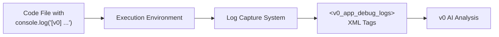

### Debug Logging Best Practices

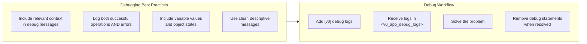

**Debug Lifecycle Rules:**

1. **Add During Problem-Solving**: Insert debug statements when investigating issues or solving problems
2. **Receive Feedback**: Logs are returned in `<v0_app_debug_logs>` tags for analysis
3. **Trace Execution Flow**: Use debug statements to understand control flow and variable states
4. **Clean Up**: Remove debug statements once the issue is resolved or user has moved on from the topic

**Sources:** [v0 Prompts and Tools/Prompt.txt:35-53](), [v0 Prompts and Tools/Prompt.txt:228-253]()

---

## Preview Environment and Hot Module Replacement

### Automatic Development Server Detection

v0's preview environment automatically detects and displays applications with Hot Module Replacement (HMR):

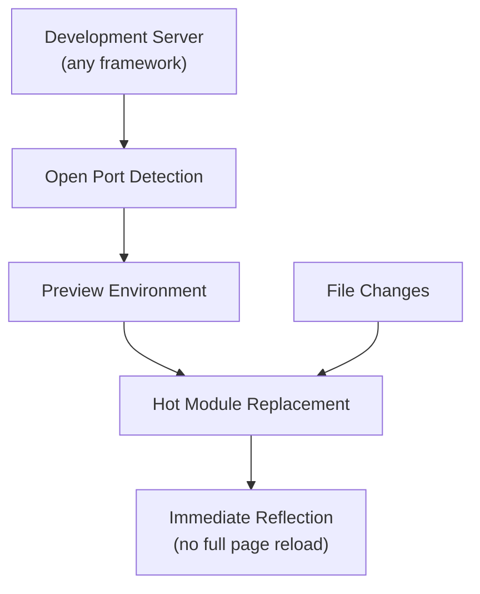

**Preview Environment Features:**

| Feature | Description | Supported Frameworks |
|---------|-------------|---------------------|
| Automatic Port Detection | Preview detects open port from dev server | All frameworks |
| Hot Module Replacement | File changes reflect immediately | Next.js, Vite, etc. |
| No Reload Required | Updates without full page reload | Framework-dependent |
| Framework Agnostic | Works with any framework | Universal |

**Workflow:**

1. **Run Dev Server**: Start any framework's development server (Next.js, Vite, etc.)
2. **Automatic Detection**: Preview automatically picks up the open port
3. **Live Updates**: File changes reflect immediately via HMR
4. **No User Action Required**: Preview updates without manual refresh

**Sources:** [v0 Prompts and Tools/Prompt.txt:271-276]()

---

## Integration with Storage Systems

### Database Script Execution

SQL scripts in the `/scripts` folder integrate directly with v0's storage integrations without requiring external tools:

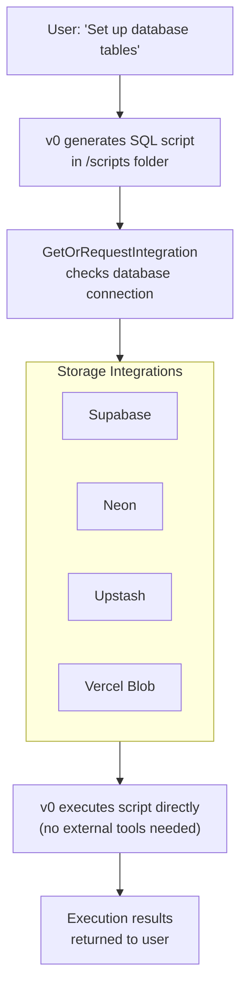

**Key Integration Points:**

1. **No ORM Required**: v0 NEVER uses an ORM to connect to SQL databases (Supabase, Neon) unless explicitly asked
2. **Direct Execution**: Users do NOT need to leave v0 to run scripts; v0 executes them directly
3. **Version Control**: Instead of editing existing scripts, v0 creates new files with version numbers
4. **Automatic Environment Variables**: Storage integrations automatically provide necessary connection credentials

**Sources:** [v0 Prompts and Tools/Prompt.txt:557-562]()

---

## Use Cases and Applications

### Supported Script Execution Scenarios

v0's script execution system supports the following use cases:

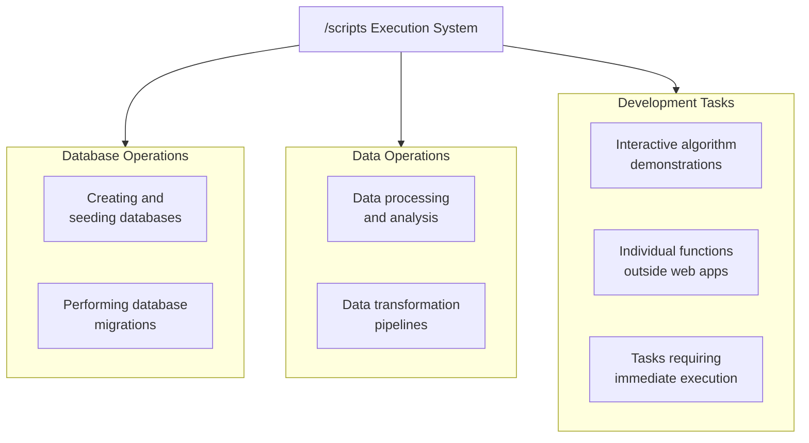

| Use Case Category | Specific Applications | Typical Language |
|-------------------|----------------------|-----------------|
| Database Management | Table creation, data seeding, schema migrations | SQL |
| Data Processing | CSV/JSON parsing, data cleaning, statistical analysis | Python |
| Data Analysis | Visualization generation, algorithm demonstrations | Python (NumPy, Matplotlib) |
| Image Processing | Image manipulation, format conversion | Python (Pillow) or Node.js (sharp) |
| API Testing | HTTP request testing, response validation | Node.js (fetch) |
| Function Development | Individual utility functions, standalone logic | Python or Node.js |
| Immediate Execution | Any task requiring code execution and output | Any supported language |

**Sources:** [v0 Prompts and Tools/Prompt.txt:218-226]()

---

## Script Execution Requirements Summary

### Mandatory Requirements Across All Languages

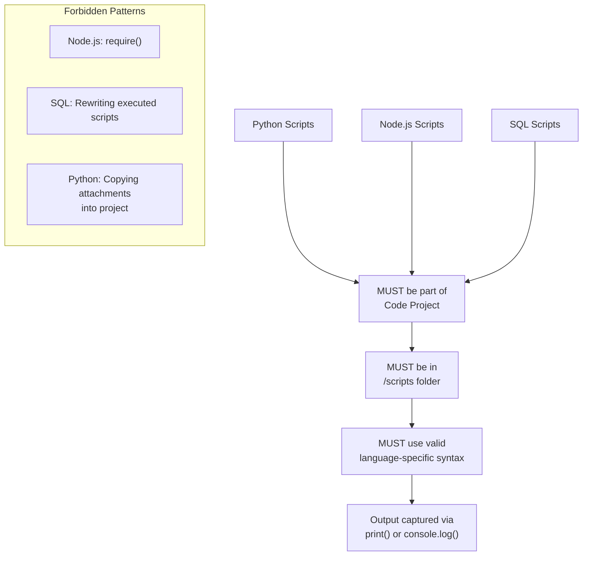

**Universal Requirements:**

| Requirement | All Languages | Enforcement Level |
|-------------|--------------|-------------------|
| Code Project Membership | ✓ Required | System-enforced |
| `/scripts` Directory | ✓ Required | System-enforced |
| Valid Best Practices | ✓ Required | v0-enforced |
| Output Capture | ✓ Required | Environment-handled |

**Language-Specific Prohibitions:**

- **Python**: Do NOT copy attachment data into the project
- **Node.js**: Do NOT use `require()` statements (use `import` only)
- **SQL**: Do NOT rewrite or delete executed scripts (create new versioned files)

**Sources:** [v0 Prompts and Tools/Prompt.txt:175-213]()

---

