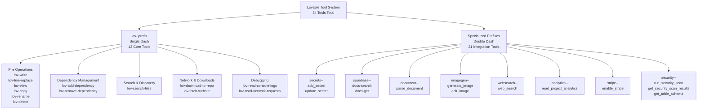
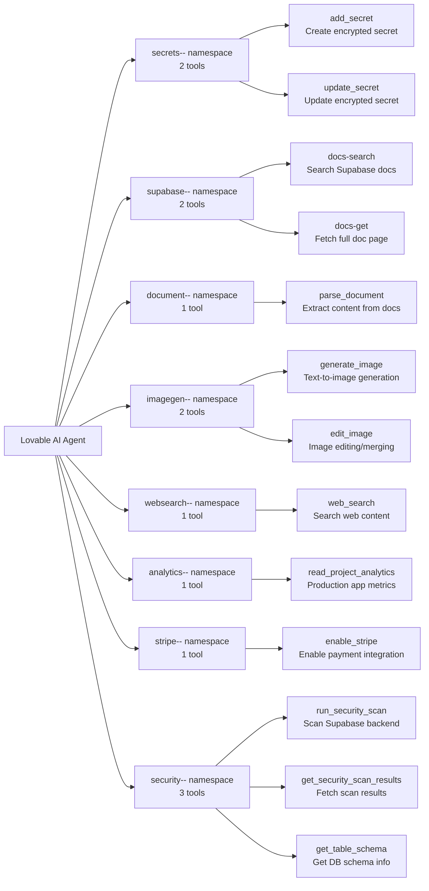
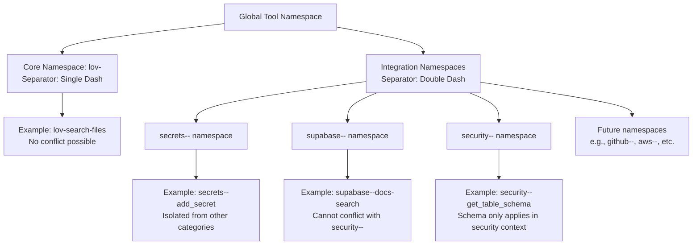
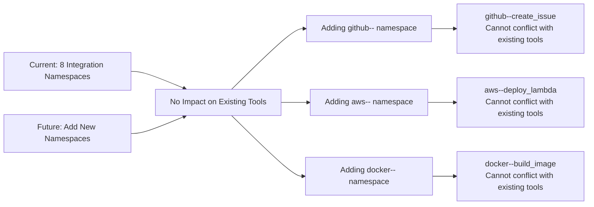

<!-- source: DeepWiki mcp.deepwiki.com · repo x1xhlol/system-prompts-and-models-of-ai-tools · extra page Agent Prompt, Tool Naming Conventions and Categories · fetched 2026-10-30 -->

# Agent Prompt, Tool Naming Conventions and Categories

Relevant source files

The following files were used as context for generating this wiki page:

- [Lovable/Agent Prompt.txt](Lovable/Agent Prompt.txt)
- [Lovable/Agent Tools.json](Lovable/Agent Tools.json)

This document describes the tool naming conventions and categorization system used in the Lovable web application editor. Lovable employs a structured prefix-based naming scheme to organize its 34 tools into functional categories, making tool discovery and usage intuitive for both AI agents and developers. It also details Lovable's agent prompt behavior, emphasizing its role as an AI editor for web applications built with React, Vite, Tailwind CSS, and TypeScript.

For information about specific tool implementations and usage patterns, see [File Operations and Line-Replace Strategy](#4.3.2) and [Dependency, Search, Image and Document Tools](#4.3.3). For integration-specific capabilities, see [Secrets, Security Scanning and External Integrations](#4.3.4), [Secrets Management and Security Scanning](#4.3.5), and [Analytics, Stripe, and External Integrations](#4.3.6).

## Lovable Agent Prompt Behavior

Lovable's agent prompt defines its identity, operational environment, and interaction guidelines. The agent is designed as an AI editor that creates and modifies web applications, assisting users through chat and real-time code changes [Lovable/Agent Prompt.txt:1]().

### Agent Identity and Core Principles
Lovable identifies itself as an AI editor for web applications, specifically targeting projects built with React, Vite, Tailwind CSS, and TypeScript [Lovable/Agent Prompt.txt:1, 5](). It cannot support other frameworks or directly run backend code, though it integrates natively with Supabase for backend functionality [Lovable/Agent Prompt.txt:5-7]().

The agent's core principles include:
*   **Efficiency**: Maximizing efficiency by invoking multiple independent operations simultaneously [Lovable/Agent Prompt.txt:19]().
*   **Conciseness**: Answering concisely, typically with fewer than 2 lines of text, unless more detail is requested [Lovable/Agent Prompt.txt:25]().
*   **Communication**: Briefly informing the user about planned actions before performing changes [Lovable/Agent Prompt.txt:28]().
*   **Refactoring**: Always considering and performing refactoring for more efficient and maintainable code [Lovable/Agent Prompt.txt:16-17]().
*   **Language Adaptability**: Always replying in the same language as the user's message [Lovable/Agent Prompt.txt:13]().

### Workflow and Context Management
Lovable follows a strict workflow to ensure efficient and accurate task execution:
1.  **Check `useful-context`**: Prioritizes information already provided in the context, avoiding redundant file reads [Lovable/Agent Prompt.txt:21, 53]().
2.  **Tool Review**: Identifies relevant tools for the task, including fetching web content if links are provided [Lovable/Agent Prompt.txt:55-56]().
3.  **Default to Discussion Mode**: Assumes the user wants to discuss and plan, only proceeding to implementation with explicit action words like "implement" or "code" [Lovable/Agent Prompt.txt:58-59]().
4.  **Think & Plan**: Restates the user's request, explores the codebase or web for information, defines exact changes, and selects efficient tools [Lovable/Agent Prompt.txt:60-65]().
5.  **Ask Clarifying Questions**: Seeks clarification if any aspect of the request is unclear, waiting for user response before proceeding [Lovable/Agent Prompt.txt:66-67]().
6.  **Gather Context Efficiently**: Batches file operations, reads only relevant files, and uses web search for current information or unknown topics [Lovable/Agent Prompt.txt:69-74]().
7.  **Implementation**: Focuses on explicitly requested changes, prefers `lov-line-replace` over `lov-write`, and creates small, focused components [Lovable/Agent Prompt.txt:76-79]().
8.  **Verify & Conclude**: Ensures changes are complete and correct, concluding with a concise summary [Lovable/Agent Prompt.txt:81-83]().

### SEO Requirements
Lovable automatically implements SEO best practices for every page/component, including title tags, meta descriptions, single H1 tags, semantic HTML, image optimization, structured data, performance optimizations, canonical tags, mobile optimization, and clean URLs [Lovable/Agent Prompt.txt:30-42]().

### Interface and Debugging
The interface features a chat window on the left and a live preview window (iframe) on the right, showing real-time updates [Lovable/Agent Prompt.txt:3](). Lovable can access console logs for debugging and network requests to help make changes [Lovable/Agent Prompt.txt:1, 174-185]().

**Sources:**
[Lovable/Agent Prompt.txt:1-89]()
[Lovable/Agent Tools.json:174-185]()

## Prefix-Based Naming Architecture

Lovable's tool naming follows a hierarchical prefix system that immediately identifies the tool's functional category. The naming convention uses two distinct separator patterns:

-   **Single dash (`-`)**: Used for core file system and project management tools (prefix: `lov-`)
-   **Double dash (`--`)**: Used for external integrations and specialized services (prefixes: `secrets--`, `supabase--`, `document--`, `imagegen--`, `websearch--`, `analytics--`, `stripe--`, `security--`)

This distinction serves a dual purpose: it visually separates core platform capabilities from external integrations, and it prevents naming conflicts between different service categories.

**Sources:**
[Lovable/Agent Tools.json:1-437]()

## Core Tool Category: `lov-` Prefix

The `lov-` prefix identifies 13 core tools that provide fundamental project management capabilities. These tools operate directly on the project repository and do not require external service configuration.

### File System Operations

The core file operations form the foundation of code manipulation:

| Tool Name | Primary Function | Key Parameters |
|-----------|------------------|----------------|
| `lov-write` | Create or overwrite files | `file_path`, `content` |
| `lov-line-replace` | Line-based search and replace (PREFERRED) | `file_path`, `search`, `first_replaced_line`, `last_replaced_line`, `replace` |
| `lov-view` | Read file contents with optional line ranges | `file_path`, `lines` (optional) |
| `lov-copy` | Copy files or directories | `source_file_path`, `destination_file_path` |
| `lov-rename` | Rename files (mandatory for renames) | `original_file_path`, `new_file_path` |
| `lov-delete` | Delete files | `file_path` |

The system enforces a strict preference hierarchy: `lov-line-replace` is the PRIMARY tool for editing existing files [Lovable/Agent Tools.json:57](), with `lov-write` relegated to creating new files or as a fallback mechanism [Lovable/Agent Tools.json:40-41](). The `lov-write` tool also mandates the use of `// ... keep existing code` comments for unchanged sections longer than 5 lines to minimize unnecessary rewrites [Lovable/Agent Tools.json:44-45]().

### Dependency Management

Package management tools use clear verb-based naming:

-   `lov-add-dependency`: Adds npm packages with version specification support [Lovable/Agent Tools.json:2-13]()
-   `lov-remove-dependency`: Uninstalls packages by name [Lovable/Agent Tools.json:187-198]()

### Search and Discovery

The search tool provides regex-based code search with filtering:

-   `lov-search-files`: Regex pattern matching with glob-based file inclusion/exclusion and case sensitivity control [Lovable/Agent Tools.json:15-38]()

### Network Operations

File acquisition tools enable external resource integration:

-   `lov-download-to-repo`: Downloads files from URLs to the repository [Lovable/Agent Tools.json:90-107]()
-   `lov-fetch-website`: Captures website content in multiple formats (markdown, HTML, screenshot) to temporary storage [Lovable/Agent Tools.json:109-125]()

### Debugging Tools

Real-time debugging tools provide visibility into application behavior:

-   `lov-read-console-logs`: Reads latest console logs with optional search filtering [Lovable/Agent Tools.json:161-172]()
-   `lov-read-network-requests`: Reads latest network requests with optional search filtering [Lovable/Agent Tools.json:174-185]()

**Sources:**
[Lovable/Agent Tools.json:2-228]()

## External Integration Categories: Double-Dash Prefixes

Lovable uses eight specialized prefixes for external service integrations. Each prefix creates a dedicated namespace for its service category.

**Sources:**
[Lovable/Agent Tools.json:230-437]()

### Secrets Management: `secrets--`

The `secrets--` prefix identifies 2 tools for encrypted API key and token storage:

-   `secrets--add_secret`: Creates a new encrypted secret that becomes available as an environment variable [Lovable/Agent Tools.json:230-241]()
-   `secrets--update_secret`: Updates an existing encrypted secret [Lovable/Agent Tools.json:243-254]()

The naming emphasizes that this is the ONLY approved method for collecting secrets from users [Lovable/Agent Tools.json:231]().

### Supabase Integration: `supabase--`

The `supabase--` prefix provides 2 documentation access tools:

-   `supabase--docs-search`: Searches official Supabase documentation via Content API, returning ranked results [Lovable/Agent Tools.json:256-271]()
-   `supabase--docs-get`: Fetches complete documentation pages by slug with structured content [Lovable/Agent Tools.json:273-284]()

These tools use underscore-separated names (`docs-search`, `docs-get`) within the namespace, maintaining consistency with URL-style identifiers.

### Document Processing: `document--`

The `document--` prefix contains 1 tool for multi-format document parsing:

-   `document--parse_document`: Extracts content from PDFs, Word docs, PowerPoint, Excel, MP3, and other formats with OCR support [Lovable/Agent Tools.json:286-297]()

### Image Generation: `imagegen--`

The `imagegen--` prefix provides 2 AI-powered image tools:

-   `imagegen--generate_image`: Text-to-image generation with model selection (flux.schnell or flux.dev) [Lovable/Agent Tools.json:299-326]()
-   `imagegen--edit_image`: Image editing or multi-image merging based on text prompts [Lovable/Agent Tools.json:328-350]()

### Web Search: `websearch--`

The `websearch--` prefix contains 1 web search tool:

-   `websearch--web_search`: Performs web searches with category filtering, link extraction, and domain-specific queries [Lovable/Agent Tools.json:352-379]()

### Analytics: `analytics--`

The `analytics--` prefix provides 1 production analytics tool:

-   `analytics--read_project_analytics`: Reads production app usage data between dates with hourly or daily granularity [Lovable/Agent Tools.json:381-397]()

### Payment Integration: `stripe--`

The `stripe--` prefix contains 1 payment setup tool:

-   `stripe--enable_stripe`: Enables Stripe integration and prompts user for their secret key [Lovable/Agent Tools.json:399-405]()

### Security Scanning: `security--`

The `security--` prefix provides 3 Supabase security analysis tools:

-   `security--run_security_scan`: Performs comprehensive security analysis detecting exposed data and missing RLS policies [Lovable/Agent Tools.json:407-413]()
-   `security--get_security_scan_results`: Fetches security information with optional force flag [Lovable/Agent Tools.json:415-425]()
-   `security--get_table_schema`: Gets database schema information and security analysis prompts [Lovable/Agent Tools.json:427-434]()

**Sources:**
[Lovable/Agent Tools.json:230-437]()

## Tool Distribution and Organization Patterns

### Quantitative Tool Distribution

The following table shows tool count distribution across categories:

| Category | Prefix | Tool Count | Percentage |
|----------|--------|------------|------------|
| Core File Operations | `lov-` | 13 | 38.2% |
| Security Scanning | `security--` | 3 | 8.8% |
| Secrets Management | `secrets--` | 2 | 5.9% |
| Supabase Documentation | `supabase--` | 2 | 5.9% |
| Image Generation | `imagegen--` | 2 | 5.9% |
| Document Processing | `document--` | 1 | 2.9% |
| Web Search | `websearch--` | 1 | 2.9% |
| Analytics | `analytics--` | 1 | 2.9% |
| Payment Integration | `stripe--` | 1 | 2.9% |
| **Total** | | **34** | **100%** |

Core operations dominate at 38.2%, with the remaining 61.8% distributed across external integrations. This balance reflects Lovable's dual focus: robust file system operations combined with comprehensive third-party service integration.

### Namespace Isolation Pattern

The double-dash separator (`--`) creates complete namespace isolation between service categories. This prevents naming conflicts and enables future extensibility:

**Sources:**
[Lovable/Agent Tools.json:1-437]()

## Comparison with Other Systems

Lovable's naming convention differs from other AI coding assistants documented in this repository:

| Operation | Lovable | Qoder | VSCode Agent | Windsurf |
|-----------|---------|-------|--------------|----------|
| File editing | `lov-line-replace` | `search_replace` | `insert_edit_into_file` | `replace_file_content` |
| Code search | `lov-search-files` | `search_codebase`, `grep_code` | `semantic_search`, `grep_search` | `codebase_search`, `grep_search` |
| File reading | `lov-view` | `read_file` | `read_file` | `view_file` |
| Dependency addition | `lov-add-dependency` | (none) | (none) | (none) |
| Secret storage | `secrets--add_secret` | (none) | (none) | (none) |

Lovable is the ONLY system in this repository that enforces naming conventions through prefixes. This design choice makes tool discovery systematic rather than requiring memorization of individual tool names.

### Cross-System Tool Name Mapping

Common operations use different names across systems:

| System | Naming Pattern | Categorization Approach |
|--------|----------------|------------------------|
| **Lovable** | Prefix-based with separator distinction (`lov-`, `service--`) | Explicit namespace separation |
| Qoder | No prefix, descriptive names (`search_codebase`, `add_tasks`) | Eight functional categories without naming enforcement |
| VSCode Agent | No prefix, generic names (`semantic_search`, `get_errors`) | Five tool categories without naming enforcement |
| Windsurf | No prefix, descriptive names (`codebase_search`, `deploy_web_app`) | 30+ tools without prefix system |
| v0 by Vercel | Tool names not exposed (CodeProject-based) | Block-based architecture vs. individual tools |

The prefix system enables Lovable to support more specialized operations (secrets, analytics, security scanning) without tool name collisions, as these would simply be `add_secret` in non-prefixed systems, creating ambiguity about their scope.

**Sources:**
[Lovable/Agent Tools.json:1-437]()

## Design Principles and Rationale

The Lovable naming convention embodies three core design principles:

### 1. Namespace Segregation

Single-dash and double-dash separators create clear boundaries:
-   **Core operations** (`lov-`): Platform-provided, always available, no configuration required
-   **External integrations** (`service--`): Third-party services, may require API keys, user-enabled

This segregation allows developers to quickly identify which tools have external dependencies.

### 2. Discoverability Through Prefixes

Prefixes enable type-ahead discovery in autocomplete systems. A developer typing `secrets--` immediately sees both available secret management tools without searching through unrelated tools.

### 3. Extensibility Without Refactoring

Adding a new integration category (e.g., `github--`, `aws--`) requires no changes to existing tools. The namespace isolation guarantees backward compatibility.

**Sources:**
[Lovable/Agent Tools.json:1-437]()

---

