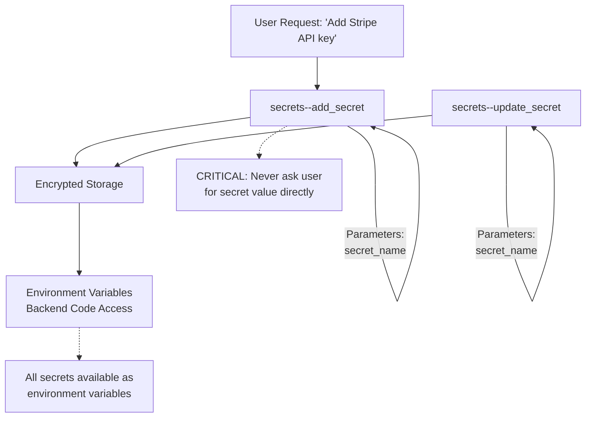
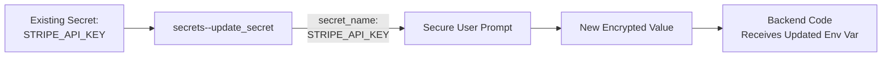
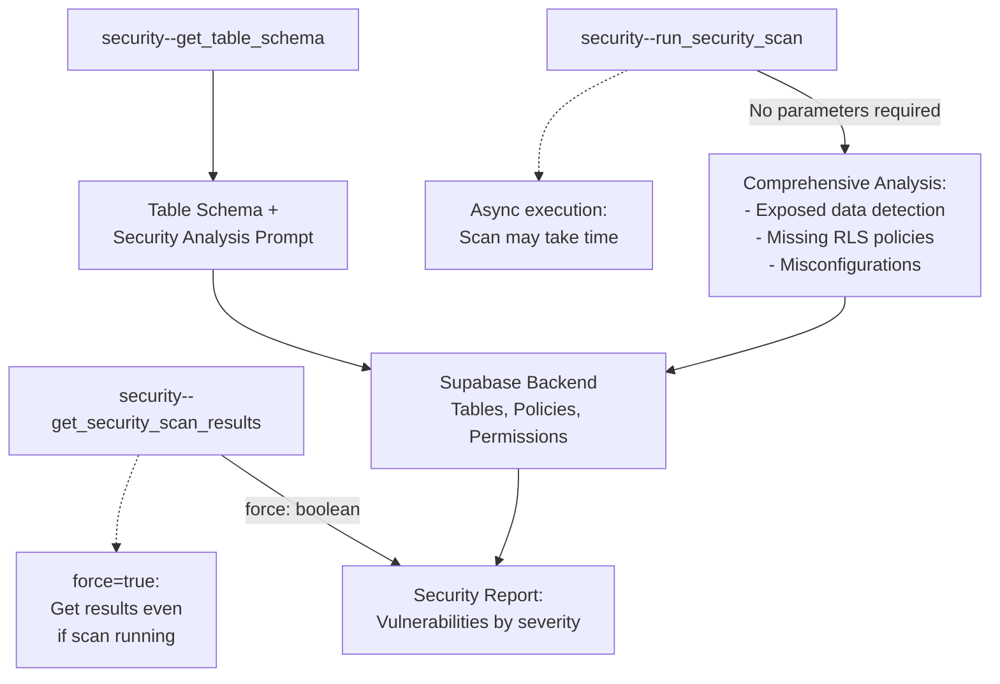
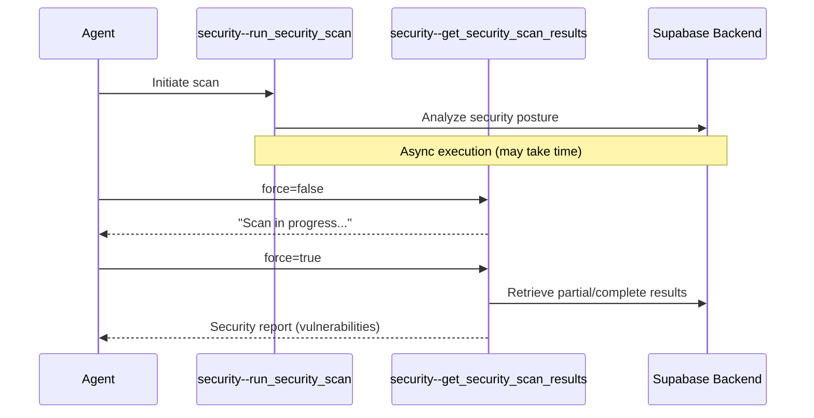
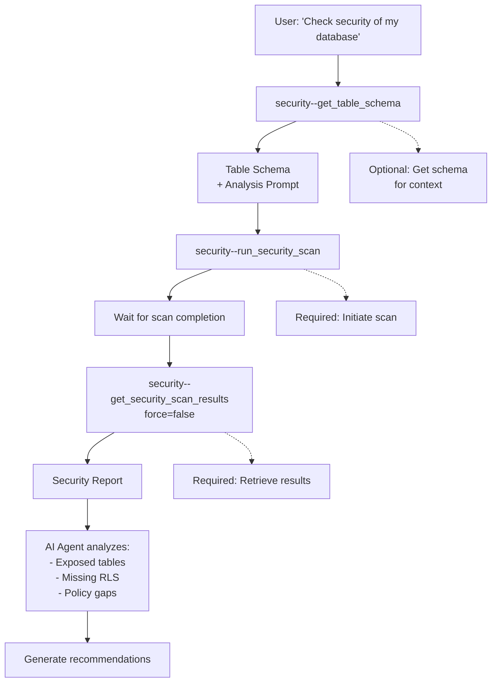
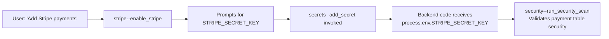

<!-- source: DeepWiki mcp.deepwiki.com · repo x1xhlol/system-prompts-and-models-of-ai-tools · extra page Secrets, Security Scanning and External Integrations · fetched 2026-10-30 -->

# Secrets, Security Scanning and External Integrations

<details>
<summary>Relevant source files</summary>

The following files were used as context for generating this wiki page:

- [Lovable/Agent Tools.json](Lovable/Agent Tools.json)

</details>


## Purpose and Scope

This document details Lovable's mechanisms for handling sensitive information, ensuring application security, and integrating with external services. It covers the `secrets--` tools for encrypted API key storage, the `security--` tools for Supabase backend analysis, and the `analytics--`, `stripe--`, `supabase--`, and `websearch--` tools for external integrations and information retrieval. The goal is to document how Lovable prevents credential exposure, validates database configurations, and facilitates interaction with third-party platforms and documentation.

For general file operations and tool ecosystem, see [Agent Prompt, Tool Naming Conventions and Categories](#4.3.1). For broader security architectures across AI assistants, see [Security Models and Safety Constraints](#10.6).

---

## System Architecture Overview

Lovable employs several distinct subsystems for secrets, security, and external integrations:

| Subsystem | Tools | Primary Purpose |
|-----------|-------|-----------------|
| **Secrets Management** | `secrets--add_secret`<br>`secrets--update_secret` | Encrypted storage of API keys and tokens as environment variables |
| **Security Scanning** | `security--run_security_scan`<br>`security--get_security_scan_results`<br>`security--get_table_schema` | Automated detection of exposed data, missing RLS policies, and misconfigurations in Supabase backends |
| **Analytics Integration** | `analytics--add_analytics_provider` | Integrate analytics providers like Google Analytics or Mixpanel |
| **Stripe Integration** | `stripe--enable_stripe` | Configure Stripe for payment processing |
| **Supabase Documentation** | `supabase--search_docs` | Search Supabase documentation |
| **Web Search** | `websearch--search` | Perform general web searches |

These subsystems work together to provide a secure and integrated development environment.

**Sources:** [Lovable/Agent Tools.json:230-433]()

---

## Secrets Management Architecture

### Tool Overview



**Diagram: Secrets Management Tool Flow**

**Sources:** [Lovable/Agent Tools.json:230-254]()

### Add Secret Tool

The `secrets--add_secret` tool is the **only authorized method** for collecting secrets from users:

| Property | Value |
|----------|-------|
| Tool Name | `secrets--add_secret` |
| Description | Add new secret (API key/token) with encryption |
| Required Parameters | `secret_name` (string) |
| Example | `STRIPE_API_KEY` |
| Security Mandate | "IMPORTANT: This is the only way to collect secrets from users, do not add it in any other way." |

**Critical Implementation Requirement:**

The tool description [Lovable/Agent Tools.json:231]() explicitly states: "Never ask the user to provide the secret value directly instead call this tool to obtain a secret." This design prevents secrets from appearing in:
- Chat logs
- System prompts
- Code comments
- Version control history

When invoked, the tool prompts the user through a secure input mechanism (details abstracted from AI agent), encrypts the value, and stores it for backend access.

**Sources:** [Lovable/Agent Tools.json:230-241]()

### Update Secret Tool

The `secrets--update_secret` tool handles credential rotation:



**Diagram: Secret Update Workflow**

The update mechanism ensures zero-downtime credential rotation by:
1. Accepting the `secret_name` parameter (e.g., `"STRIPE_API_KEY"`)
2. Prompting user for new value through secure channel
3. Replacing encrypted storage atomically
4. Updating environment variable exposure

**Sources:** [Lovable/Agent Tools.json:243-254]()

### Environment Variable Integration

All secrets added via `secrets--add_secret` are automatically exposed as environment variables in backend code. This enables standard access patterns:

```typescript
// Backend code automatically receives:
const stripeKey = process.env.STRIPE_API_KEY;
const openaiKey = process.env.OPENAI_API_KEY;
```

No explicit import or configuration required—the platform handles injection transparently.

**Sources:** [Lovable/Agent Tools.json:231]()

---

## Security Scanning Architecture

### Three-Tool Analysis System



**Diagram: Security Scanning Tool Relationships**

**Sources:** [Lovable/Agent Tools.json:407-433]()

### Run Security Scan Tool

The `security--run_security_scan` tool initiates comprehensive backend analysis:

| Property | Value |
|----------|-------|
| Tool Name | `security--run_security_scan` |
| Description | "Perform comprehensive security analysis of the Supabase backend to detect exposed data, missing RLS policies, and security misconfigurations" |
| Parameters | None required |
| Execution Model | Asynchronous |

The tool analyzes three critical security dimensions:

1. **Exposed Data Detection:** Identifies tables or columns accessible without authentication
2. **Missing RLS Policies:** Flags tables lacking Row-Level Security enforcement
3. **Security Misconfigurations:** Detects overly permissive policies or authentication bypass patterns

**Sources:** [Lovable/Agent Tools.json:407-413]()

### Get Security Scan Results Tool

The `security--get_security_scan_results` tool retrieves analysis output:

| Property | Value |
|----------|-------|
| Tool Name | `security--get_security_scan_results` |
| Required Parameters | `force` (boolean) |
| Force Flag Purpose | "Get results even if a scan is running" |

**Usage Pattern:**



**Diagram: Asynchronous Scan Retrieval Flow**

The `force` parameter enables two retrieval modes:
- **`force=false`:** Wait for scan completion, return final report
- **`force=true`:** Return immediate results even if scan incomplete (useful for streaming progress)

**Sources:** [Lovable/Agent Tools.json:415-425]()

### Get Table Schema Tool

The `security--get_table_schema` tool provides database structure context:

| Property | Value |
|----------|-------|
| Tool Name | `security--get_table_schema` |
| Description | "Get the database table schema information and security analysis prompt for the project's Supabase database" |
| Parameters | None required |
| Output | Table definitions + Security analysis guidance |

This tool serves dual purposes:
1. **Schema Inspection:** Provides column types, constraints, relationships
2. **Security Context:** Returns prompts/templates for analyzing discovered vulnerabilities

**Sources:** [Lovable/Agent Tools.json:427-433]()

---

## Security Scanning Workflow

### Complete Analysis Sequence



**Diagram: End-to-End Security Analysis Workflow**

**Sources:** [Lovable/Agent Tools.json:407-433]()

---

## Integration with Supabase Backend

All security scanning tools are **tightly coupled to Supabase**:

| Tool | Supabase Dependency |
|------|---------------------|
| `security--run_security_scan` | "...of the Supabase backend..." |
| `security--get_table_schema` | "...project's Supabase database" |

This specialization reflects Lovable's architecture: projects use Supabase as the primary backend with:
- PostgreSQL database
- Row-Level Security (RLS) policies
- Authentication via Supabase Auth
- Real-time subscriptions

The security scanner specifically validates:
1. **RLS Policy Coverage:** Every table must have policies defined
2. **Anonymous Access:** No tables should be publicly readable/writable unless explicitly intended
3. **Authentication Enforcement:** Policies should reference `auth.uid()` correctly
4. **Column-Level Security:** Sensitive columns (e.g., email, phone) should have restricted access

**Sources:** [Lovable/Agent Tools.json:408, 428]()

---

## External Integrations

Lovable provides tools to integrate with various external services and retrieve information.

### Analytics Integration

The `analytics--add_analytics_provider` tool allows integrating analytics services.

| Property | Value |
|----------|-------|
| Tool Name | `analytics--add_analytics_provider` |
| Description | "Add an analytics provider to the project (e.g., Google Analytics, Mixpanel)" |
| Required Parameters | `provider_name` (string) |
| Example | `Google Analytics` |

This tool streamlines the process of adding tracking and analytics to applications.

**Sources:** [Lovable/Agent Tools.json:256-266]()

### Stripe Integration

The `stripe--enable_stripe` tool configures Stripe for payment processing.

| Property | Value |
|----------|-------|
| Tool Name | `stripe--enable_stripe` |
| Description | "Enable Stripe for payment processing in the project" |
| Parameters | None required |

This tool likely triggers a workflow that includes prompting for Stripe API keys via `secrets--add_secret` and setting up necessary backend configurations.

**Sources:** [Lovable/Agent Tools.json:399-405]()

### Supabase Documentation Search

The `supabase--search_docs` tool allows searching the official Supabase documentation.

| Property | Value |
|----------|-------|
| Tool Name | `supabase--search_docs` |
| Description | "Search the Supabase documentation for relevant information" |
| Required Parameters | `query` (string) |
| Example | `RLS policies` |

This tool is crucial for agents to self-serve information about Supabase features and best practices.

**Sources:** [Lovable/Agent Tools.json:388-397]()

### Web Search

The `websearch--search` tool provides general web search capabilities.

| Property | Value |
|----------|-------|
| Tool Name | `websearch--search` |
| Description | "Perform a web search for a given query" |
| Required Parameters | `query` (string) |
| Example | `React hooks best practices` |

This general-purpose tool allows the agent to gather information beyond specific documentation, enabling broader problem-solving.

**Sources:** [Lovable/Agent Tools.json:435-444]()

---

## Comparison with Other Systems

### Secrets Management Across Platforms

| Platform | Secret Tool | Encryption | Environment Variable Exposure |
|----------|-------------|------------|-------------------------------|
| **Lovable** | `secrets--add_secret` | Yes (automatic) | Backend code via env vars |
| **v0** | `GetOrRequestIntegration` | Yes (platform-managed) | Automatic injection in server code |
| **Windsurf** | Not documented | N/A | Manual `.env` file management |
| **Antigravity** | Not documented | N/A | Manual configuration |

Lovable's approach is **the most restrictive**: it forbids direct secret input and mandates tool-based collection, preventing accidental credential leakage in chat history.

### Security Scanning Comparison

| Platform | Security Scanning | Backend Focus | RLS Validation |
|----------|-------------------|---------------|----------------|
| **Lovable** | `security--run_security_scan` | Supabase-specific | Yes (comprehensive) |
| **v0** | Not documented | N/A | Manual RLS setup required |
| **Same.dev** | Not documented | N/A | N/A |
| **Comet** | 9-layer security (client-side) | Browser/API calls | N/A (no backend) |

Lovable is the **only system** with automated backend security analysis capabilities, reflecting its focus on full-stack application development with integrated databases.

### External Integration Patterns

| Platform | Analytics | Payments | Documentation Search | General Web Search |
|----------|-----------|----------|----------------------|--------------------|
| **Lovable** | `analytics--add_analytics_provider` | `stripe--enable_stripe` | `supabase--search_docs` | `websearch--search` |
| **v0** | `GetOrRequestIntegration` (generic) | `GetOrRequestIntegration` (generic) | Not explicit | Not explicit |
| **Same.dev** | Not explicit | Not explicit | Not explicit | Not explicit |

Lovable provides explicit tools for common integrations and documentation, offering a more guided approach compared to generic integration tools in other platforms.

**Sources:** [Lovable/Agent Tools.json:230-444]()

---

## Best Practices and Usage Guidelines

### Secrets Management

1. **Never Ask for Direct Input:** Always invoke `secrets--add_secret` tool rather than requesting the user type the secret in chat
2. **Use Descriptive Names:** Secret names should match the expected environment variable format (e.g., `STRIPE_SECRET_KEY`, not `stripe_key`)
3. **Rotate Regularly:** Use `secrets--update_secret` for credential rotation without recreating integrations
4. **Backend-Only Exposure:** Secrets are only available in backend/server code, never exposed to client-side JavaScript

### Security Scanning

1. **Run Early:** Execute `security--run_security_scan` immediately after creating Supabase tables
2. **Interpret Results:** Use `security--get_table_schema` to understand database structure when analyzing vulnerabilities
3. **Iterative Fixes:** After addressing issues, re-run scan to validate corrections
4. **Force Flag Usage:** Use `force=true` only when needing immediate feedback during development; prefer `force=false` for complete reports

### Integration-Driven Workflow



**Diagram: Integration-Driven Secret and Security Flow**

When adding integrations (Stripe, external APIs), the workflow naturally progresses from secret collection to security validation, ensuring credentials are both securely stored and properly restricted in the database layer.

**Sources:** [Lovable/Agent Tools.json:230-241, 399-413]()

---

## Technical Implementation Notes

### Encryption and Storage

While implementation details are abstracted from the AI agent, the system guarantees:
- **At-Rest Encryption:** All secrets encrypted before storage
- **Transport Security:** Secure channels for user input
- **Access Control:** Only backend processes can decrypt and access secrets
- **Audit Logging:** Secret creation/updates logged for security review

### Scan Engine Capabilities

The `security--run_security_scan` engine performs static analysis of:
- PostgreSQL table definitions
- RLS policy SQL statements
- Supabase authentication configuration
- Public schema permissions

It does **not** perform:
- Penetration testing
- Runtime vulnerability exploitation
- Application-level logic analysis
- Client-side security validation

The focus is exclusively on Supabase backend configuration, complementing (not replacing) broader application security practices.

**Sources:** [Lovable/Agent Tools.json:408]()

---

## Related Documentation

- **[Agent Prompt, Tool Naming Conventions and Categories](#4.3.1)** - Tool Ecosystem and Naming Conventions: Overview of all `lov-*` and specialized tools
- **[Integration Ecosystem and Configuration](#4.1.6)** - v0's Integration Ecosystem: Comparison with v0's `GetOrRequestIntegration` approach
- **[Security Models and Safety Constraints](#10.6)** - Security Models and Safety Constraints: Cross-platform security architecture analysis

---

