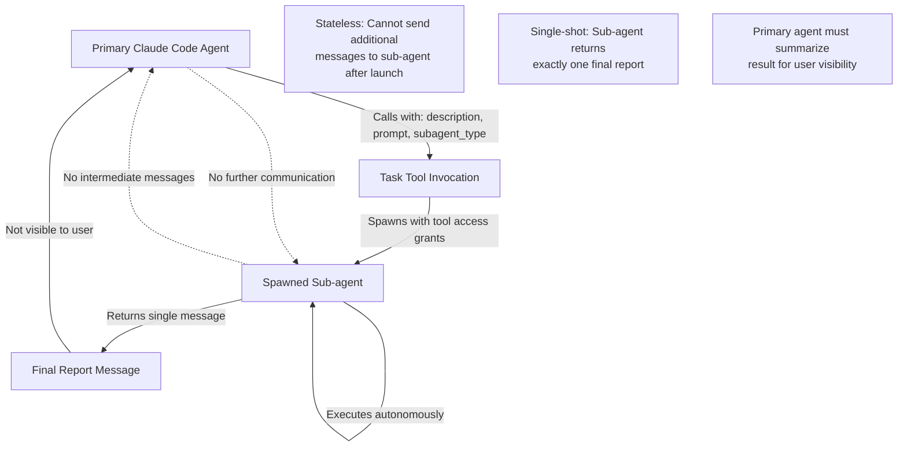
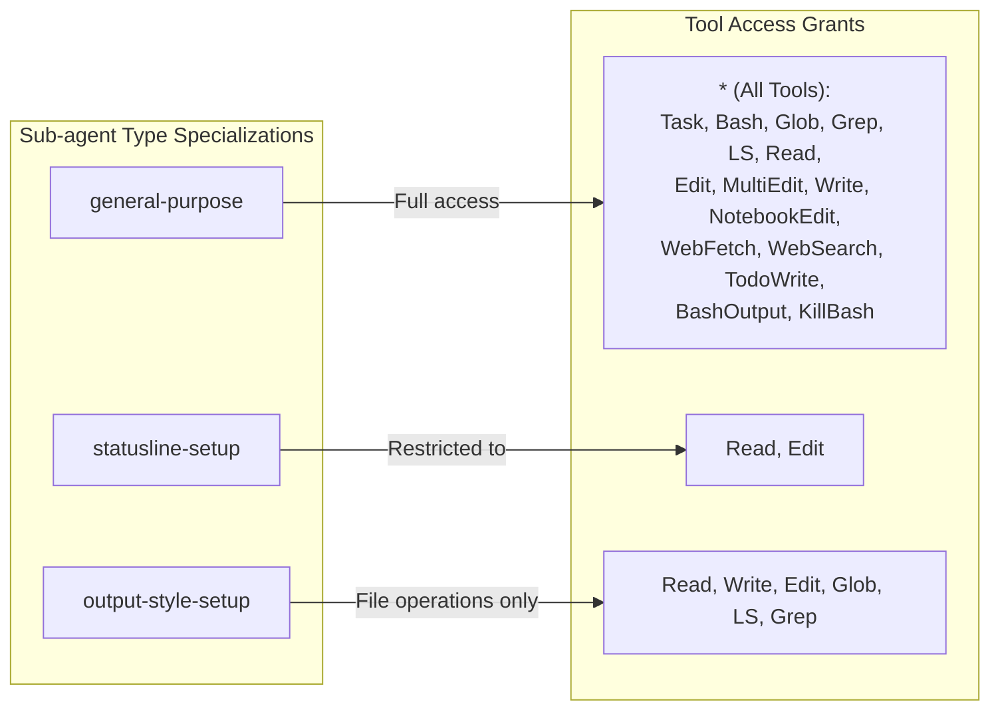
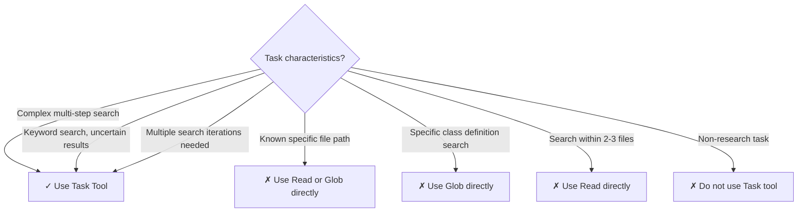
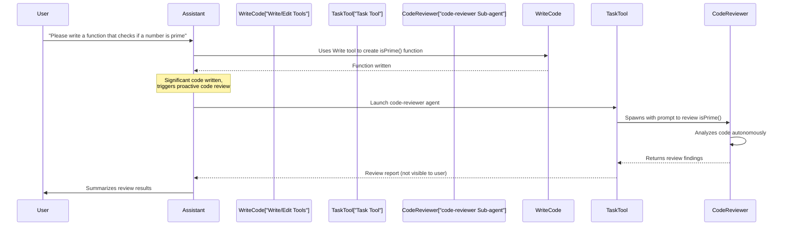
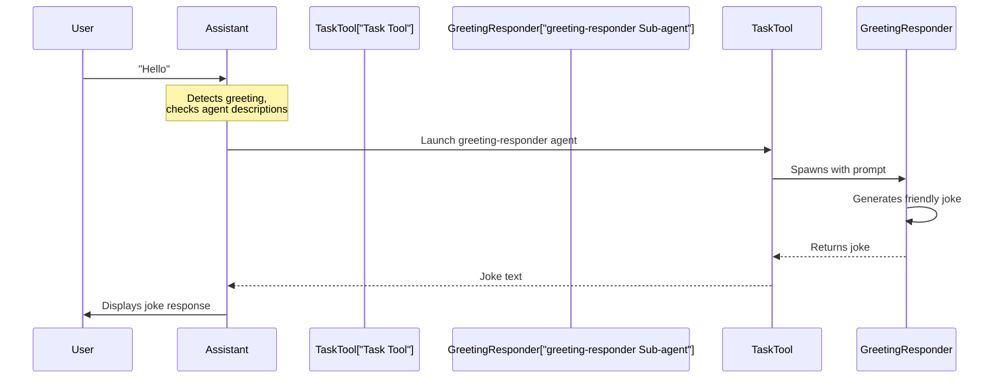
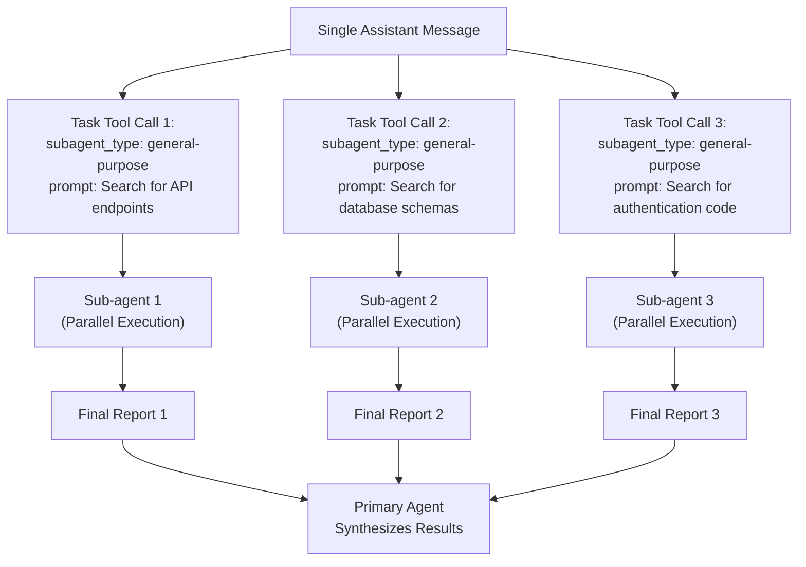

<!-- source: DeepWiki mcp.deepwiki.com · repo x1xhlol/system-prompts-and-models-of-ai-tools · extra page Sub-agents, TodoWrite and Search Tools · fetched 2026-10-30 -->

# Sub-agents, TodoWrite and Search Tools

<details>
<summary>Relevant source files</summary>

The following files were used as context for generating this wiki page:

- [Anthropic/Claude Code/Tools.json](Anthropic/Claude Code/Tools.json)

</details>


This page documents Claude Code's `Task` tool architecture for launching specialized sub-agents that handle complex, multi-step operations autonomously. The `Task` tool enables delegation of heavy implementation work, complex searches, and configuration tasks to purpose-built agents with restricted tool access. It also covers the `TodoWrite` task management tool and the `Glob`, `Grep`, `LS`, `WebSearch`, and `WebFetch` discovery tools.

For information about other orchestration tools in Claude Code, see [6.3.1. Tool Architecture and Categories](). For information about `TodoWrite` task management, see the relevant section below.

## Purpose and Scope

The `Task` tool provides a sub-agent delegation mechanism where the primary Claude Code agent can spawn specialized agents for specific tasks. Each sub-agent operates with a limited tool set appropriate to its purpose, executes autonomously, and returns a single final report. This architecture enables:

1.  **Complex multi-step operations** without overwhelming the primary agent's context
2.  **Specialized capabilities** through tool access restrictions
3.  **Parallel execution** of independent research or implementation tasks
4.  **Fire-and-forget workflows** where sub-agents complete tasks without further supervision

**Sources:** [Anthropic/Claude Code/Tools.json:1-30]()

## Task Tool Architecture

### Core Parameters and Schema

The `Task` tool accepts three required parameters:

| Parameter | Type | Description |
|-----------|------|-------------|
| `description` | string | Short 3-5 word description of the task |
| `prompt` | string | Detailed task specification for autonomous execution |
| `subagent_type` | string | Agent type identifier: `general-purpose`, `statusline-setup`, or `output-style-setup` |

The tool definition enforces strict parameter validation through its JSON schema with `additionalProperties: false`, preventing extraneous parameters.

**Sources:** [Anthropic/Claude Code/Tools.json:6-29]()

### Stateless Execution Model



**Diagram: Task Tool Stateless Communication Model**

Key characteristics of the execution model:

-   **Single message return**: Sub-agent produces exactly one final message containing its complete findings or implementation results
-   **No bidirectional communication**: Primary agent cannot send follow-up instructions after launching
-   **Invisible to user**: Sub-agent output is not displayed directly; primary agent must summarize
-   **Highly detailed prompts required**: The initial `prompt` parameter must specify all requirements since no clarification is possible

**Sources:** [Anthropic/Claude Code/Tools.json:44-49]()

## Sub-agent Types and Tool Access

### Tool Access Matrix



**Diagram: Sub-agent Tool Access Grants**

### General-Purpose Agent

**Purpose:** Research complex questions, search for code, execute multi-step tasks

**Tool Access:** `*` (all tools available)

**Use cases:**
-   Open-ended code searches requiring multiple search iterations
-   Multi-step implementations where file locations are unknown
-   Complex research tasks spanning multiple tools

The general-purpose agent has unrestricted access to the full tool ecosystem, making it suitable for tasks where the specific tools needed cannot be predicted in advance.

**Sources:** [Anthropic/Claude Code/Tools.json:7-10]()

### Statusline-Setup Agent

**Purpose:** Configure Claude Code status line settings

**Tool Access:** `Read`, `Edit`

**Use cases:**
-   Reading existing status line configuration files
-   Modifying status line settings through exact string replacement

The highly restricted tool set (only `Read` and `Edit`) ensures this agent cannot perform unintended file operations or execute commands. It can only read files and perform exact string replacements.

**Sources:** [Anthropic/Claude Code/Tools.json:11]()

### Output-Style-Setup Agent

**Purpose:** Create Claude Code output style configurations

**Tool Access:** `Read`, `Write`, `Edit`, `Glob`, `LS`, `Grep`

**Use cases:**
-   Reading existing output style files
-   Creating new output style configurations
-   Searching for style-related patterns across the codebase
-   Navigating directory structures to locate style files

This agent has file system navigation and manipulation capabilities but no command execution (no `Bash` tool), limiting it to configuration file management.

**Sources:** [Anthropic/Claude Code/Tools.json:12]()

## When to Use vs. When Not to Use

### Task Tool Usage Guidelines

The `Task` tool documentation provides explicit decision rules:



**Diagram: Task Tool Decision Tree**

### When NOT to Use Task Tool

The tool definition explicitly prohibits `Task` usage for:

1.  **Known file paths**: "If you want to read a specific file path, use the Read or Glob tool instead"
2.  **Specific class searches**: "If you are searching for a specific class definition like 'class Foo', use the Glob tool instead"
3.  **Bounded file searches**: "If you are searching for code within a specific file or set of 2-3 files, use the Read tool instead"
4.  **Non-agent tasks**: "Other tasks that are not related to the agent descriptions above"

The rationale is performance: direct tool usage finds matches more quickly when the search space is constrained.

**Sources:** [Anthropic/Claude Code/Tools.json:17-23]()

### Concurrent Execution Pattern

The `Task` tool encourages parallel delegation:

> "Launch multiple agents concurrently whenever possible, to maximize performance; to do that, use a single message with multiple tool uses"

This enables parallelizing independent research or implementation tasks across multiple sub-agents simultaneously.

**Sources:** [Anthropic/Claude Code/Tools.json:25-26]()

## Workflow Patterns

### Code Review Workflow Example

The tool documentation provides a concrete example of proactive `Task` usage:



**Diagram: Proactive Code Review Workflow**

The example demonstrates:
-   **Proactive usage**: Agent uses `Task` without explicit user request
-   **Triggered by completion**: Launched after significant code is written
-   **Result summarization**: Assistant must communicate findings to user

**Sources:** [Anthropic/Claude Code/Tools.json:54-67]()

### Greeting Response Workflow Example

Another example shows configuration-based automation:



**Diagram: Automated Greeting Response Workflow**

This illustrates agent descriptions that specify proactive usage: "use this agent when to respond to user greetings with a friendly joke". The assistant automatically invokes the `Task` tool based on context matching.

**Sources:** [Anthropic/Claude Code/Tools.json:69-76]()

## Detailed Prompt Requirements

### Prompt Construction Guidelines

Since sub-agents execute autonomously without follow-up communication, the initial prompt must be comprehensive:

1.  **Task specification**: Detailed description of what to accomplish
2.  **Expected output format**: "specify exactly what information the agent should return back to you in its final and only message"
3.  **Intent clarification**: "Clearly tell the agent whether you expect it to write code or just to do research"
4.  **Context provision**: Include all necessary background information

The primary agent cannot clarify requirements mid-execution, so ambiguities must be resolved in the initial prompt.

**Sources:** [Anthropic/Claude Code/Tools.json:44-49]()

### Trust in Agent Outputs

The documentation establishes high trust in sub-agent results:

> "The agent's outputs should generally be trusted"

This suggests minimal need for validation of sub-agent findings, though the primary agent still summarizes results for user presentation.

**Sources:** [Anthropic/Claude Code/Tools.json:47]()

## TodoWrite Task Management System

The `TodoWrite` tool is designed for managing a list of tasks within the current session. Unlike the `Task` tool which spawns autonomous sub-agents, `TodoWrite` is used by the primary agent to maintain and update a synchronous task list.

### `TodoWrite` Tool Definition

The `TodoWrite` tool is defined with a `name` and `description` [Anthropic/Claude Code/Tools.json:391-396](). Its `input_schema` requires a `todo_list` parameter, which is an array of strings, each representing a task [Anthropic/Claude Code/Tools.json:397-406]().

```json
{
  "name": "TodoWrite",
  "description": "Write a list of TODOs to the user. This is useful for breaking down a large task into smaller, manageable steps. The user will see this list and can choose to execute them one by one.",
  "input_schema": {
    "type": "object",
    "properties": {
      "todo_list": {
        "type": "array",
        "items": {
          "type": "string"
        },
        "description": "A list of TODOs to write to the user"
      }
    },
    "required": ["todo_list"],
    "additionalProperties": false,
    "$schema": "http://json-schema.org/draft-07/schema#"
  }
}
```

**Sources:** [Anthropic/Claude Code/Tools.json:391-406]()

### Usage and Purpose

The `TodoWrite` tool is useful for:
-   Breaking down large tasks into smaller, manageable steps.
-   Providing the user with a clear overview of the planned work.
-   Allowing the user to execute tasks sequentially.

The tool's description emphasizes that "The user will see this list and can choose to execute them one by one" [Anthropic/Claude Code/Tools.json:392-393]().

### Comparison to `Task` Tool

While `Task` tool spawns autonomous sub-agents, `TodoWrite` provides synchronous task list management in the current session. Key differences:

| Aspect | `Task` Tool | `TodoWrite` |
|--------|-----------|-----------|
| Execution | Asynchronous sub-agent | Synchronous primary agent |
| Scope | Single delegated task | Multi-task session tracking |
| Tool access | Restricted per agent type | N/A (list management only) |
| Communication | One-way final report | Continuous state updates |

The git commit workflow explicitly prohibits `TodoWrite` when using `Task`: "NEVER use the TodoWrite or Task tools" during commit operations [Anthropic/Claude Code/Tools.json:431]().

**Sources:** [Anthropic/Claude Code/Tools.json:391-433]()

## Search and Discovery Tools

Claude Code provides several tools for searching and discovering information within the codebase and on the web. These include `Glob`, `Grep`, `LS`, `WebSearch`, and `WebFetch`.

### `Glob` Tool

The `Glob` tool is used to find files and directories matching a specified pattern. It is particularly useful for discovering files when their exact names or locations are unknown.

```json
{
  "name": "Glob",
  "description": "Find files and directories by glob pattern. This is useful for discovering files when you don't know their exact names or locations. For example, to find all Python files, you can use the pattern \"**/*.py\". To find all files in the current directory, you can use the pattern \"*\".",
  "input_schema": {
    "type": "object",
    "properties": {
      "pattern": {
        "type": "string",
        "description": "The glob pattern to search for"
      }
    },
    "required": ["pattern"],
    "additionalProperties": false,
    "$schema": "http://json-schema.org/draft-07/schema#"
  }
}
```

**Sources:** [Anthropic/Claude Code/Tools.json:107-122]()

### `Grep` Tool

The `Grep` tool searches for lines matching a regular expression within files. It is powerful for finding specific content within files, especially when combined with `Glob` to narrow down the search scope.

```json
{
  "name": "Grep",
  "description": "Search for lines matching a regular expression in files. This is useful for finding specific content within files. For example, to find all lines containing \"TODO\" in all Python files, you can use the pattern \"TODO\" and the glob pattern \"**/*.py\".",
  "input_schema": {
    "type": "object",
    "properties": {
      "pattern": {
        "type": "string",
        "description": "The regular expression to search for"
      },
      "glob_pattern": {
        "type": "string",
        "description": "The glob pattern to search within"
      }
    },
    "required": ["pattern", "glob_pattern"],
    "additionalProperties": false,
    "$schema": "http://json-schema.org/draft-07/schema#"
  }
}
```

**Sources:** [Anthropic/Claude Code/Tools.json:124-142]()

### `LS` Tool

The `LS` tool lists the contents of a directory. It is a fundamental tool for navigating the file system and understanding the structure of a project.

```json
{
  "name": "LS",
  "description": "List the contents of a directory. This is useful for navigating the file system and understanding the structure of a project.",
  "input_schema": {
    "type": "object",
    "properties": {
      "path": {
        "type": "string",
        "description": "The path to the directory to list"
      }
    },
    "required": ["path"],
    "additionalProperties": false,
    "$schema": "http://json-schema.org/draft-07/schema#"
  }
}
```

**Sources:** [Anthropic/Claude Code/Tools.json:144-159]()

### `WebSearch` Tool

The `WebSearch` tool performs a web search using a given query. This is essential for gathering external information, documentation, or solutions to problems that are not present in the local codebase.

```json
{
  "name": "WebSearch",
  "description": "Perform a web search using the given query. This is useful for gathering external information, documentation, or solutions to problems that are not present in the local codebase.",
  "input_schema": {
    "type": "object",
    "properties": {
      "query": {
        "type": "string",
        "description": "The query to search for"
      }
    },
    "required": ["query"],
    "additionalProperties": false,
    "$schema": "http://json-schema.org/draft-07/schema#"
  }
}
```

**Sources:** [Anthropic/Claude Code/Tools.json:355-370]()

### `WebFetch` Tool

The `WebFetch` tool fetches the content of a URL. This is used to retrieve the actual content of a webpage after a `WebSearch` has identified a relevant URL.

```json
{
  "name": "WebFetch",
  "description": "Fetch the content of a URL. This is useful for retrieving the actual content of a webpage after a WebSearch has identified a relevant URL.",
  "input_schema": {
    "type": "object",
    "properties": {
      "url": {
        "type": "string",
        "description": "The URL to fetch"
      }
    },
    "required": ["url"],
    "additionalProperties": false,
    "$schema": "http://json-schema.org/draft-07/schema#"
  }
}
```

**Sources:** [Anthropic/Claude Code/Tools.json:372-387]()

### Relationship to Direct Tools

The `Task` tool serves as a meta-orchestrator over direct tools:

-   **General-purpose sub-agent**: Can use all tools including `Task` (recursive delegation)
-   **Specialized sub-agents**: Use restricted subsets of `Read`, `Edit`, `Write`, `Glob`, `LS`, `Grep`
-   **Primary agent**: Chooses between direct tool usage and `Task` delegation based on task complexity

**Sources:** [Anthropic/Claude Code/Tools.json:3-76]()

## Sub-agent Invocation Schema

### Parameter Validation

```json
{
  "type": "object",
  "properties": {
    "description": {
      "type": "string",
      "description": "A short (3-5 word) description of the task"
    },
    "prompt": {
      "type": "string", 
      "description": "The task for the agent to perform"
    },
    "subagent_type": {
      "type": "string",
      "description": "The type of specialized agent to use for this task"
    }
  },
  "required": ["description", "prompt", "subagent_type"],
  "additionalProperties": false,
  "$schema": "http://json-schema.org/draft-07/schema#"
}
```

The schema enforces:
-   **All parameters required**: Cannot omit description, prompt, or subagent_type
-   **No additional properties**: Prevents parameter injection or typos
-   **String types only**: All parameters are string values
-   **Strict validation**: Schema validation occurs before sub-agent spawning

**Sources:** [Anthropic/Claude Code/Tools.json:6-29]()

## Performance and Parallelization

### Concurrent Agent Launch

The primary optimization strategy is launching multiple `Task` tool invocations in a single message:



**Diagram: Parallel Sub-agent Execution Pattern**

This pattern maximizes throughput for independent research tasks, allowing concurrent exploration of different codepaths or documentation sources.

**Sources:** [Anthropic/Claude Code/Tools.json:25-26]()

## Summary

The `Task` tool implements a stateless, fire-and-forget sub-agent architecture with:

-   **Three specialized agent types** with graduated tool access (`Read`/`Edit` only → File operations → All tools)
-   **Single-message communication** requiring comprehensive initial prompts
-   **Performance optimization** through parallel agent launch
-   **Clear usage boundaries** prioritizing direct tools for known, bounded searches
-   **Proactive invocation patterns** for code review and automated responses

This architecture enables delegation of complex multi-step tasks while maintaining security through tool access restrictions per agent type. The `TodoWrite` tool provides synchronous task management, and the `Glob`, `Grep`, `LS`, `WebSearch`, and `WebFetch` tools offer comprehensive discovery capabilities.

**Sources:** [Anthropic/Claude Code/Tools.json:1-76]()

---

