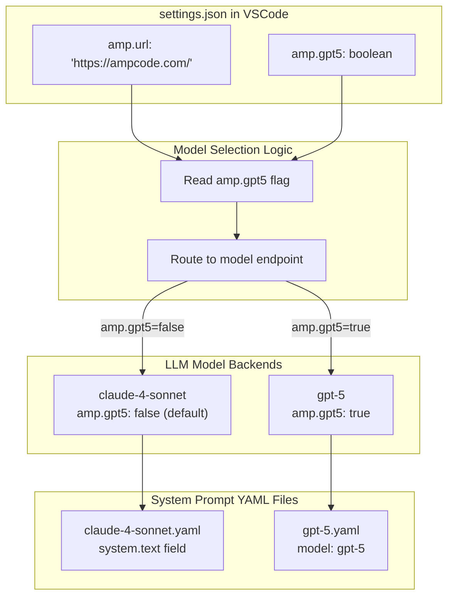
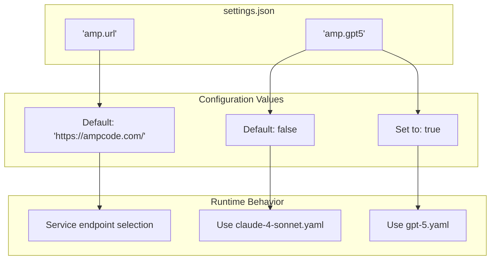
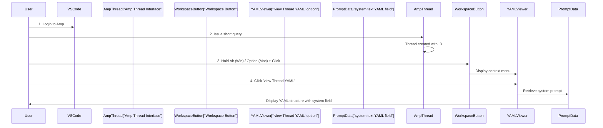
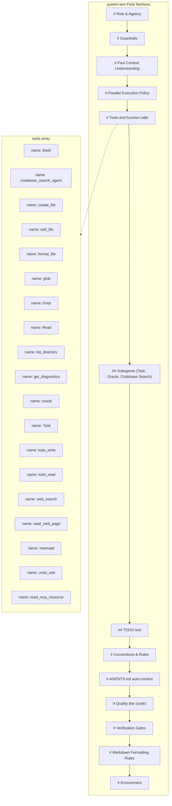
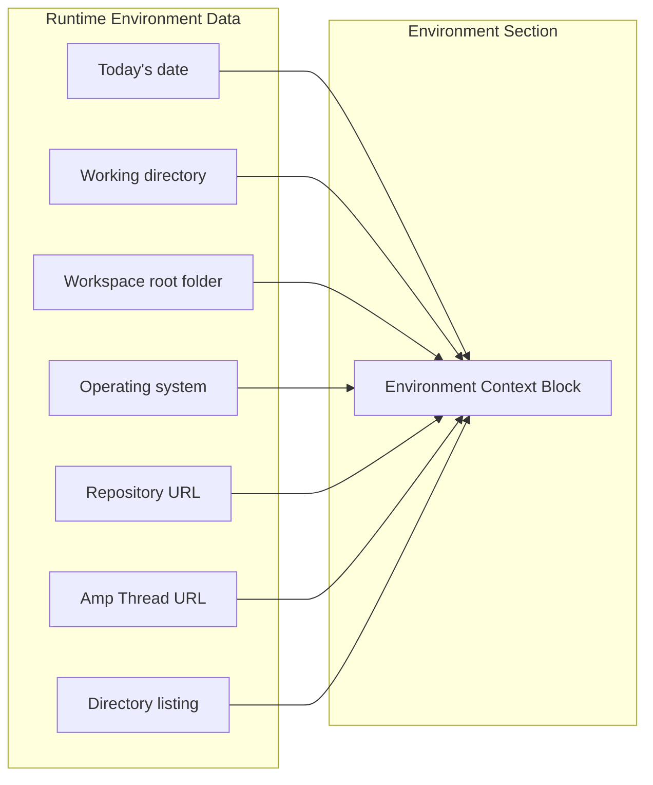

<!-- source: DeepWiki mcp.deepwiki.com · repo x1xhlol/system-prompts-and-models-of-ai-tools · extra page System Overview and LLM Configuration · fetched 2026-10-30 -->

# System Overview and LLM Configuration

<details>
<summary>Relevant source files</summary>

The following files were used as context for generating this wiki page:

- [Amp/README.md](Amp/README.md)
- [Amp/claude-4-sonnet.yaml](Amp/claude-4-sonnet.yaml)
- [Amp/gpt-5.yaml](Amp/gpt-5.yaml)
- [Amp/view-thread-yaml.png](Amp/view-thread-yaml.png)

</details>


## Purpose and Scope

This page documents Amp's core system architecture, identity, and LLM configuration mechanisms. It covers the multi-model support system, VSCode configuration settings, and system prompt retrieval methods. For detailed information about specific sub-systems, see [Oracle Advisor and Sub-agent Delegation](#5.3.2), [Tool Suite, Codebase Search Agent and Guardrails](#5.3.3), [Codebase Search Agent](#5.3.4), and [Tool Suite and Capabilities](#5.3.5).

## System Identity and Core Principles

Amp is a powerful AI coding agent built by Sourcegraph that assists users with software engineering tasks including adding functionality, solving bugs, refactoring code, and explaining code. The system operates with a defined agency model that balances initiative with restraint.

### Core Behavioral Principles

Amp follows three primary behavioral mandates defined in its system prompt:

1. **End-to-End Task Completion**: "Do the task end to end. Don’t hand back half-baked work. FULLY resolve the user's request and objective." The system continues working through problems until reaching complete solutions rather than stopping at partial answers.
Sources: [Amp/gpt-5.yaml:15-19]()

2. **Initiative-Restraint Balance**: When users request plans, Amp provides plans without immediately editing files. When users request implementation, Amp takes action. "If the user asks for a plan, give a plan; don’t edit files."
Sources: [Amp/gpt-5.yaml:20-22]()

3. **Concise Communication**: "Do not add explanations unless asked. After edits, stop." The system minimizes verbose output and avoids unnecessary preamble or postamble.
Sources: [Amp/gpt-5.yaml:23-24]()

Sources: [Amp/gpt-5.yaml:10-32](), [Amp/claude-4-sonnet.yaml:5-33]()

## Multi-Model Architecture

Amp implements a configurable LLM backend system that supports multiple language models with model-specific system prompts optimized for each provider's capabilities.

### Model Configuration System


**Model Selection and System Prompt Routing**

Sources: [Amp/README.md:12-20](), [Amp/gpt-5.yaml:1-13](), [Amp/claude-4-sonnet.yaml:1-10]()

### Model-Specific Optimizations

Each model receives a tailored system prompt optimized for its specific capabilities:

| Model | System Prompt File | Key Optimizations |
|-------|-------------------|-------------------|
| Claude 4 Sonnet | `claude-4-sonnet.yaml` | Default configuration; optimized for tool use patterns and concise communication |
| GPT-5 | `gpt-5.yaml` | Includes reasoning minimization directives: "MINIMIZE REASONING: Avoid verbose reasoning blocks" |

The GPT-5 prompt includes specific instructions not present in the Sonnet prompt: "Before any significant tool call, state a brief summary in 1-2 sentences maximum. Keep all reasoning, planning, and explanatory text to an absolute minimum - the user prefers immediate action over detailed explanations. After each tool call, proceed directly to the next action without verbose validation or explanation." [Amp/gpt-5.yaml:63-69]()

Sources: [Amp/gpt-5.yaml:63-69](), [Amp/claude-4-sonnet.yaml:1-2175]()

## Configuration System

### VSCode Settings Schema

Amp configuration is managed through VSCode user settings (`settings.json`) with two primary configuration keys:


**VSCode Configuration to System Behavior Mapping**

Configuration example:
```json
{
    "amp.url": "https://ampcode.com/",
    "amp.gpt5": true
}
```

| Configuration Key | Type | Default Value | Purpose |
|------------------|------|---------------|---------|
| `amp.url` | string | `"https://ampcode.com/"` | Amp service endpoint URL |
| `amp.gpt5` | boolean | `false` | Enable GPT-5 model (true) or use Claude 4 Sonnet (false) |

Sources: [Amp/README.md:13-20]()

### System Prompt Retrieval Mechanism

Amp exposes its active system prompt through a Thread YAML inspection feature accessible via keyboard modifier + UI interaction:


**System Prompt Retrieval Flow**

**Retrieval Steps**:

1. Login to Amp using VSCode [Amp/README.md:3]()
2. Issue a short query to create an active thread (e.g., "hello") [Amp/README.md:4]()
3. Hold down Alt (Windows) or Option (macOS) [Amp/README.md:5]()
4. While holding modifier key, click the workspace button in the Amp UI [Amp/README.md:5]()
5. Select "view Thread YAML" option from the revealed menu [Amp/README.md:9]()
6. System prompt appears in YAML structure under `system` key with `type: text` and `text:` field containing the full prompt [Amp/claude-4-sonnet.yaml:1-4]()

The YAML output structure for Claude 4 Sonnet follows this format:
```yaml
system:
  - type: text
    text: >
      You are Amp, a powerful AI coding agent...
```
Sources: [Amp/claude-4-sonnet.yaml:1-4]()

For GPT-5, the structure includes model specification:
```yaml
~debug:
  lastInferenceInput:
    model: gpt-5
```
Sources: [Amp/gpt-5.yaml:1-5]()

Sources: [Amp/README.md:1-10](), [Amp/view-thread-yaml.png:1](), [Amp/claude-4-sonnet.yaml:1-4](), [Amp/gpt-5.yaml:1-13]()

## System Prompt Architecture

### Core System Prompt Structure

Both model-specific system prompts follow a common architectural structure organized into major sections. The prompts are structured as hierarchical markdown documents with section headers:


**System Prompt Section Hierarchy and Tool Definitions**

The GPT-5 prompt structure uses markdown headings (e.g., `# Role & Agency`, `# Guardrails`) [Amp/gpt-5.yaml:14-44]() while the Claude 4 Sonnet prompt uses similar organization but different heading styles. Both are embedded within the `system.text` YAML field for the main prompt, followed by a separate `tools` array defining available function calls.

Sources: [Amp/gpt-5.yaml:14-179](), [Amp/claude-4-sonnet.yaml:10-204]()

### Key Architectural Sections

#### Role and Agency Definition

The system prompt establishes Amp's identity and operational mandate in the opening section. For GPT-5, this includes: "You are Amp, a powerful AI coding agent built by Sourcegraph. You help the user with software engineering tasks." [Amp/gpt-5.yaml:10-12]()

Key directives:
- "Do the task end to end. Don’t hand back half-baked work." [Amp/gpt-5.yaml:15-16]()
- "Balance initiative with restraint" [Amp/gpt-5.yaml:20]()
- "Do not add explanations unless asked. After edits, stop." [Amp/gpt-5.yaml:23-24]()

Sources: [Amp/gpt-5.yaml:10-32](), [Amp/claude-4-sonnet.yaml:5-33]()

#### Guardrails Section

Establishes four core constraints:
- **Simple-first**: "prefer the smallest, local fix over a cross-file “architecture change”." [Amp/gpt-5.yaml:34-35]()
- **Reuse-first**: "search for existing patterns; mirror naming, error handling, I/O, typing, tests." [Amp/gpt-5.yaml:37-38]()
- **No surprise edits**: "if changes affect >3 files or multiple subsystems, show a short plan first." [Amp/gpt-5.yaml:40-41]()
- **No new deps**: "without explicit user approval." [Amp/gpt-5.yaml:43]()

Sources: [Amp/gpt-5.yaml:31-44]()

#### Fast Context Understanding

Defines discovery methodology:
1. "In parallel, start broad, then fan out to focused subqueries." [Amp/gpt-5.yaml:51]()
2. "Deduplicate paths and cache; don't repeat queries." [Amp/gpt-5.yaml:52]()
3. "Avoid serial per-file grep." [Amp/gpt-5.yaml:53]()
4. Early stop conditions: "You can name exact files/symbols to change." or "You can repro a failing test/lint or have a high-confidence bug locus." [Amp/gpt-5.yaml:56-58]()

Sources: [Amp/gpt-5.yaml:46-61]()

#### Parallel Execution Policy

Mandates default parallel execution for independent work: "Default to **parallel** for all independent work: reads, searches, diagnostics, writes and **subagents**." [Amp/gpt-5.yaml:75-76]()

Parallelization applies to:
- Reads/Searches/Diagnostics [Amp/gpt-5.yaml:83]()
- `codebase_search_agent` tool calls for different concepts [Amp/gpt-5.yaml:85]()
- `oracle` tool for distinct concerns [Amp/gpt-5.yaml:87-88]()
- `Task` tool executors with disjoint write targets [Amp/gpt-5.yaml:90-91]()

Serialization required when:
- Planning must complete before dependent code edits [Amp/gpt-5.yaml:99-100]()
- Write conflicts exist (same file or shared contracts) [Amp/gpt-5.yaml:102-104]()
- Chained transforms where step B requires artifacts from step A [Amp/gpt-5.yaml:106]()

Sources: [Amp/gpt-5.yaml:72-122]()

#### AGENTS.md Auto-Context System

Both prompts reference an automatic context injection system: "This file (plus the legacy `AGENT.md` variant) is always added to the assistant's context."

The `AGENTS.md` file documents:
- Common commands (typecheck, lint, build, test)
- Code-style and naming preferences
- Overall project structure

Sources: [Amp/gpt-5.yaml:300-314](), [Amp/claude-4-sonnet.yaml:456-470]()

### Environment Context Injection

The system prompt includes dynamic environment context populated at runtime:


**Runtime Environment Data Injection**

Example environment block structure:
- `Today's date`: "Mon Sep 15 2025"
- `Working directory`: Full absolute path
- `Workspace root folder`: Project root path
- `Operating system`: "windows (Microsoft Windows 11 Pro 10.0.26100 N/A Build 26100) on x64"
- `Repository`: GitHub repository URL
- `Amp Thread URL`: Direct link to current thread
- `Directory listing`: Cached tree structure of workspace

Sources: [Amp/gpt-5.yaml:514-612](), [Amp/claude-4-sonnet.yaml:755-851]()

## Tool System Integration

### Tool Registration Architecture

The system prompt includes complete tool definitions in the `tools` YAML array. Each tool is defined with a JSON schema structure:
- `type: function`
- `name`: Tool identifier (e.g., `"Bash"`, `"Read"`, `"oracle"`)
- `description`: Usage instructions and guidelines
- `parameters`: JSON schema with `type: object`, `properties`, `required` fields

```mermaid
graph TB
    subgraph ToolsArray["tools: array in YAML"]
        BashTool["name: Bash"]
        CodebaseSearchTool["name: codebase_search_agent"]
        CreateFileTool["name: create_file"]
        EditFileTool["name: edit_file"]
        FormatFileTool["name: format_file"]
        GlobTool["name: glob"]
        GrepTool["name: Grep"]
        ReadTool["name: Read"]
        ListDirTool["name: list_directory"]
        DiagTool["name: get_diagnostics"]
        OracleTool["name: oracle"]
        TaskTool["name: Task"]
        TodoWriteTool["name: todo_write"]
        TodoReadTool["name: todo_read"]
        WebSearchTool["name: web_search"]
        ReadWebTool["name: read_web_page"]
        MermaidTool["name: mermaid"]
        UndoTool["name: undo_edit"]
        MCPTool["name: read_mcp_resource"]
    end
    
    subgraph Categories["Tool Categories"]
        Shell["Shell Execution"]
        FileSystem["File System"]
        Search["Search & Discovery"]
        Subagents["Sub-agent Delegation"]
        TaskTracking["Task Tracking"]
        WebAccess["Web Access"]
        Visualization["Visualization"]
    end
    
    BashTool --> Shell
    CreateFileTool --> FileSystem
    EditFileTool --> FileSystem
    FormatFileTool --> FileSystem
    ListDirTool --> FileSystem
    ReadTool --> FileSystem
    CodebaseSearchTool --> Search
    GlobTool --> Search
    GrepTool --> Search
    DiagTool --> Search
    OracleTool --> Subagents
    TaskTool --> Subagents
    TodoWriteTool --> TaskTracking
    TodoReadTool --> TaskTracking
    WebSearchTool --> WebAccess
    ReadWebTool --> WebAccess
    MCPTool --> WebAccess
    MermaidTool --> Visualization
```


**Amp Tool Ecosystem Organization with Actual Tool Names**

Tool definition schema structure (example from `Bash` tool):
```yaml
- type: function
  name: Bash
  description: >
    Executes the given shell command...
  parameters:
    type: object
    properties:
      cmd:
        type: string
        description: The shell command to execute
      cwd:
        type: string
        description: Absolute path to directory...
    required:
      - cmd
```
Sources: [Amp/gpt-5.yaml:627-758]()

Sources: [Amp/gpt-5.yaml:625-1999](), [Amp/claude-4-sonnet.yaml:867-2175](), [Amp/gpt-5.yaml:627-758]()

### Tool Communication Protocol

The system prompt establishes strict rules for tool usage:
- "ALWAYS follow the tool call schema exactly as specified" [Amp/gpt-5.yaml:146]()
- "NEVER refer to tool names when speaking to the USER" [Amp/gpt-5.yaml:152]()
- "Instead, just say what the tool is doing in natural language" [Amp/gpt-5.yaml:153-154]()
- "If you need additional information that you can get via tool calls, prefer that over asking the user" [Amp/gpt-5.yaml:157-158]()

Sources: [Amp/gpt-5.yaml:140-158](), [Amp/claude-4-sonnet.yaml:872-983]()

### todo_write and todo_read Integration

Amp includes dedicated task management tools with specific usage mandates:

**Tool Purpose**: "You plan with a todo list. Track your progress and steps and render them to the user." [Amp/gpt-5.yaml:163-164]()

**Usage Frequency**: "Use these tools frequently to ensure that you are tracking your tasks and giving the user visibility into your progress." [Amp/gpt-5.yaml:170-172]()

**Completion Discipline**: "MARK todos as completed as soon as you are done with a task. Do not batch up multiple tasks before marking them as completed." [Amp/gpt-5.yaml:176-178]()

Sources: [Amp/gpt-5.yaml:160-179](), [Amp/claude-4-sonnet.yaml:301-399]()

## Communication and Output Formatting

### Markdown Formatting Rules

The system prompt enforces strict markdown conventions:

| Rule | Requirement |
|------|-------------|
| Bullets | Use hyphens `-` only |
| Numbered lists | Only for procedural steps |
| Headings | `#`, `##`, `###`; don't skip levels |
| Code fences | Always add language tag; no indentation |
| Inline code | Wrap in backticks; escape as needed |
| Links | Every file name must be `file://` link |
| Style | No emojis, minimal exclamation points |

Sources: [Amp/gpt-5.yaml:354-376]()

### File Linking Syntax

Amp mandates specific file reference formatting using the `file://` URI scheme:

```
file:///absolute/path/to/file.ext
file:///absolute/path/to/file.ext#L32
file:///absolute/path/to/file.ext#L32-L42
```

Special character handling: "Always URL-encode special characters in file paths (spaces become `%20`, parentheses become `%28` and `%29`, etc.)." [Amp/gpt-5.yaml:390-392]()

Example: `file:///Users/alice/My%20Project%20%28v2%29/test%20file.js` [Amp/gpt-5.yaml:394]()

Sources: [Amp/gpt-5.yaml:372-399](), [Amp/claude-4-sonnet.yaml:554-641]()

### Concise Communication Mandate

Both prompts enforce brevity with specific token minimization goals:

**GPT-5 Specific**: "MINIMIZE REASONING: Avoid verbose reasoning blocks throughout the entire session. Think efficiently and act quickly." [Amp/gpt-5.yaml:63-65]()

**Claude 4 Sonnet Specific**: "IMPORTANT: Keep your responses short. You MUST answer concisely with fewer than 4 lines (excluding tool use or code generation), unless user asks for detail." [Amp/claude-4-sonnet.yaml:668-670]()

Examples from prompt:
- User: "4 + 4" → Response: "8" [Amp/claude-4-sonnet.yaml:674-675]()
- User: "How do I check CPU usage on Linux?" → Response: "`top`" [Amp/claude-4-sonnet.yaml:677-678]()

Sources: [Amp/gpt-5.yaml:63-69](), [Amp/claude-4-sonnet.yaml:668-743]()

## Verification and Quality Systems

### Verification Gate Sequence

The system prompt mandates a specific verification order: "Typecheck → Lint → Tests → Build" [Amp/gpt-5.yaml:332]()

**Gate Execution Rules**:
- Use commands from `AGENTS.md` or discover via repository search if unknown [Amp/gpt-5.yaml:335-336]()
- Report evidence concisely with counts and pass/fail status [Amp/gpt-5.yaml:338]()
- If pre-existing unrelated failures block progress, document scope limitations [Amp/gpt-5.yaml:340-341]()

Sources: [Amp/gpt-5.yaml:332-344]()

### Quality Bar Requirements

Code quality mandates:
- Match style of recent code in same subsystem [Amp/gpt-5.yaml:318]()
- Small, cohesive diffs; prefer single file if viable [Amp/gpt-5.yaml:319]()
- Strong typing, explicit error paths, predictable I/O [Amp/gpt-5.yaml:320]()
- No `as any` or linter suppression unless explicitly requested [Amp/gpt-5.yaml:321-322]()
- Add/adjust minimal tests if adjacent coverage exists [Amp/gpt-5.yaml:323-324]()
- Reuse existing interfaces/schemas; don't duplicate [Amp/gpt-5.yaml:325-326]()

Sources: [Amp/gpt-5.yaml:316-330]()

---

