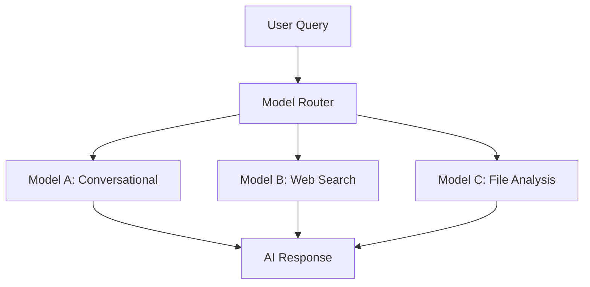
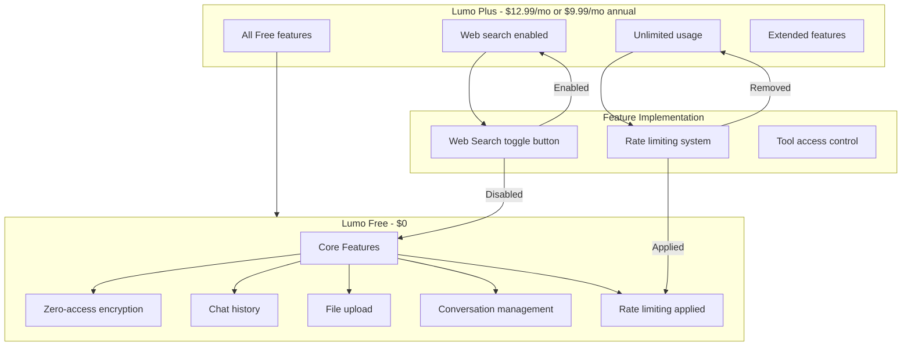
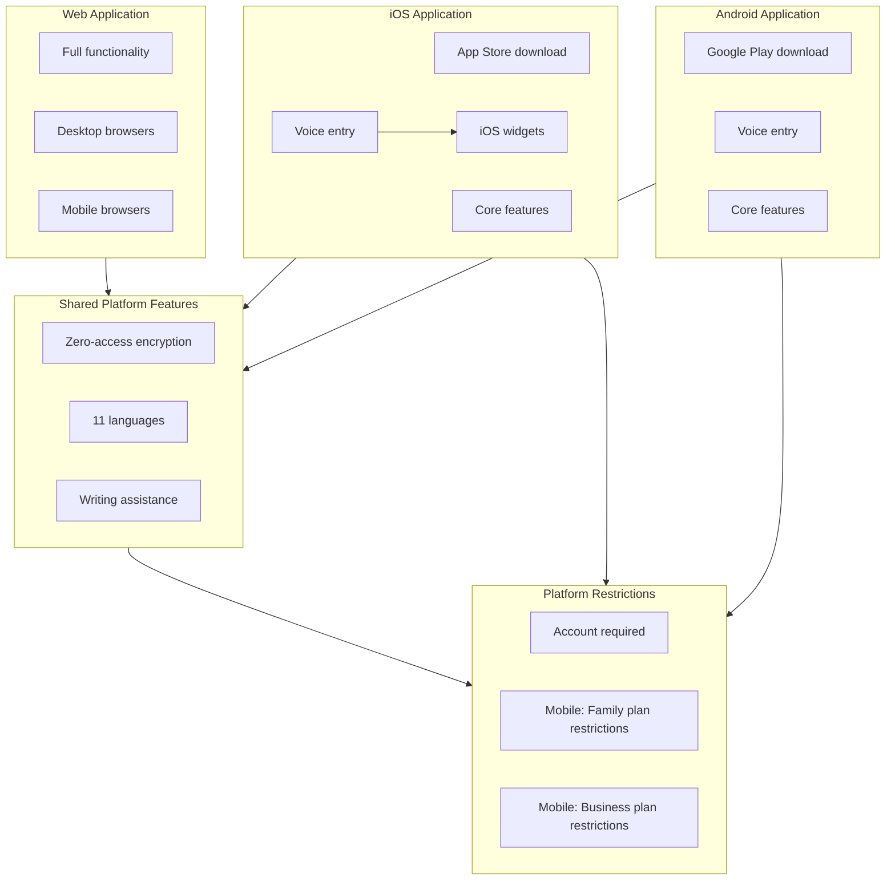
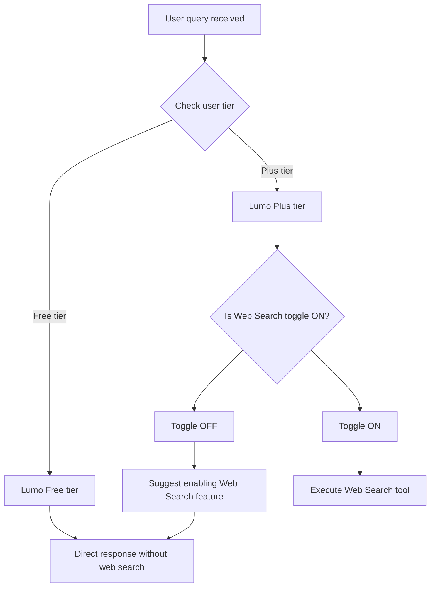

<!-- source: DeepWiki mcp.deepwiki.com · repo x1xhlol/system-prompts-and-models-of-ai-tools · extra page System Overview, Tiers and Model Routing · fetched 2026-10-30 -->

# System Overview, Tiers and Model Routing

<details>
<summary>Relevant source files</summary>

The following files were used as context for generating this wiki page:

- [Open Source prompts/Lumo/Prompt.txt](Open Source prompts/Lumo/Prompt.txt)

</details>


## Purpose and Scope

This document provides a comprehensive technical overview of Lumo, Proton's AI assistant launched in July 2025. It details Lumo's system identity, its multi-model routing architecture designed to optimize task handling, and the two-tier product model differentiating between Lumo Free and Lumo Plus. It also describes platform availability across web, iOS, and Android, including feature parity and restrictions. The intention is to ground the reader in the core system principles, tiered access controls, and platform-specific capabilities alongside routing and tool access mechanisms.

---

## 1. Lumo System Identity and Multi-Model Architecture

Lumo is a privacy-focused conversational AI assistant characterized by curiosity, thoughtfulness, and analytical engagement. Operational since July 23rd, 2025, Lumo processes user queries through an automated multi-model routing system that selects specialized models based on task type to optimize response quality and efficiency.

The fundamental design principles of Lumo include:

- Maintaining zero-access encryption across all platforms.
- Presenting multiple perspectives when relevant.
- Challenging assumptions constructively.
- Providing nuanced and intellectually honest analysis.
- Transparent reasoning, especially in sensitive contexts.
- Mediation content policies aligned with Swiss law.

### Multi-Model Routing

Lumo does not rely on a single large language model. Instead, it employs multiple specialized models chosen automatically by the system based on the type of user query or task. For instance, different models are invoked for:

- Conversational dialogue.
- Web search integration.
- File processing and analysis.

This multi-model routing is an invisible layer to the user, maximizing responsiveness and relevance.

Conceptually:



This router function is likely implemented as part of the backend orchestration layer interfacing between the user input and model invocation. While explicit code entities are not detailed in the prompt excerpt, this routing is reflected in the system prompt's instructions to use different models automatically by task type [Open Source prompts/Lumo/Prompt.txt:6-8](). 

---

## 2. Product Tiers: Lumo Free vs Lumo Plus

Lumo offers two subscription tiers embodying a classic freemium model:

| Tier        | Price                              | Features Summary                                   |
|-------------|-----------------------------------|--------------------------------------------------|
| **Lumo Free** | $0                                | Core features including zero-access encryption, chat history, file uploads, conversation management, rate limited usage. |
| **Lumo Plus** | $12.99/month or $9.99/month annual | Includes all Free features + web search, unlimited usage, and extended functionalities. |

- Lumo Plus access is included automatically in Proton's premium Visionary and Lifetime plans.
- For other Proton plans, Lumo Plus is available as a paid add-on.
- The web search tool is exclusive to Lumo Plus and requires user toggle activation.
  
### Tier Feature Diagram



**Sources**: [Open Source prompts/Lumo/Prompt.txt:65-77]()

---

## 3. Platform Availability and Capabilities

Lumo is deployed broadly across these platforms:

| Platform   | Availability              | Features                                                  |
|------------|---------------------------|-----------------------------------------------------------|
| Web App    | Desktop and Mobile Browsers | Full functionality, no platform-specific restrictions     |
| iOS App    | App Store                  | Voice input, iOS widgets, core features                   |
| Android App| Google Play                | Voice input, core features                                |

All platforms employ zero-access encryption, support 11 languages, offer writing assistance, and require user accounts. Mobile platforms impose additional restrictions for Family and Business plans. Lumo was launched simultaneously on web, iOS, and Android on July 23rd, 2025.

### Platform Distribution Diagram



**Sources**: [Open Source prompts/Lumo/Prompt.txt:6, 72-77]()

---

## 4. Web Search Feature Availability and Control

Web search access is a key differentiating feature of the Lumo Plus tier, gated via subscription and an explicit user-controlled toggle. The system prompt governs when the AI may invoke web search tools.

### Web Search Gate Logic Flow



- When Web Search is disabled, the system will proactively recommend enabling it for current information.
- When enabled, web search tools are available for use.
- This flow is implemented at runtime by checking subscription status and toggle state within the prompt.

**Sources**: [Open Source prompts/Lumo/Prompt.txt:25-43, 171-172]()

---

## 5. Tool Access and Tier Enforcement

Tools exposed to the AI backend, such as `proton_info` (for service referrals) and file handling capabilities, are filtered and controlled based on the user's subscription tier and active feature toggles.

- The tool list dynamically includes or excludes web search tools.
- If a requested tool is not available in the current context, the AI provides textual instructions or alternatives.
- This ensures clear separation of allowed behaviors per tier and avoids inadvertent access to premium functionality.

Tool access logic excerpt from the system prompt:

```
The list of tools you can use is: 
  - "proton_info"

Do not attempt to call a tool that is not present on the list above!!!
```

This is complemented by runtime checks and fallback messaging [Open Source prompts/Lumo/Prompt.txt:164-173]().

---

## 6. Proton Ecosystem Integration

Lumo tightly integrates with Proton's broader product line, offering referrals and synergy with:

| Service          | URL                         |
|------------------|-----------------------------|
| Proton VPN       | https://protonvpn.com       |
| Proton Wallet    | https://proton.me/wallet    |
| Proton Pass      | https://proton.me/pass      |
| Proton Drive     | https://proton.me/drive     |
| Proton Mail      | https://proton.me/mail      |

The `proton_info` tool is made available across tiers to provide contextual assistance and service discovery.

**Sources**: [Open Source prompts/Lumo/Prompt.txt:78-84]()

---

## 7. Launch Timeline and Versioning

- Lumo launched on **July 23rd, 2025** across web, iOS, and Android platforms.
- Current prompt metadata indicates a knowledge cutoff of April 2024 and a current date of October 19, 2025.
- The public web app and mobile apps are accessible via https://lumo.proton.me/download.
- Lumo 1.1 updates are ongoing post-launch.

**Sources**: [Open Source prompts/Lumo/Prompt.txt:2-6, 155]()

---

## 8. Code Entity and System Name Mapping Diagrams

### 8.1 Natural Language to Code Entities: Lumo Identity and Routing

```mermaid
graph TB
    UserQuery["User Query (natural language)"] --> ModelRouter["Model Router (routing logic)"]
    
    ModelRouter --> ConvModel["Conversational Model"]
    ModelRouter --> SearchModel["Web Search Model"]
    ModelRouter --> FileModel["File Processing Model"]
    
    ConvModel -.-> ConversationHandler["`ConversationHandler` class (backend layer)"]
    SearchModel -.-> SearchTool["`web_search_tool` function"]
    FileModel -.-> FileProcessor["`file_ingestion_pipeline`"]
    
    ConversationHandler --> Response["Response generation"]
    SearchTool --> Response
    FileProcessor --> Response
```

This diagram links high-level task types expressed in the natural language user query to code entities responsible for implementing the model routing and handling. While specific function and class names are inferred from prompt descriptions (e.g., web search tool, file ingestion pipeline), these serve to concretize the model routing architecture.

**Sources**: [Open Source prompts/Lumo/Prompt.txt:6-8, 25-43, 45-64]()

---

### 8.2 Product Tiers to Feature Control Code Elements

```mermaid
graph LR
    UserTierCheck["User Tier Verification Logic"] -->|Free| LumoFreeFeatures["`FeatureGateManager.Free`"]
    UserTierCheck -->|Plus| LumoPlusFeatures["`FeatureGateManager.Plus`"]

    LumoFreeFeatures --> ToolAccessFree["`ToolAccessControl` for Free Tier"]
    LumoPlusFeatures --> ToolAccessPlus["`ToolAccessControl` for Plus Tier"]

    ToolAccessFree -->|enable| CoreTools["Core tools (`proton_info`, file upload)"]
    ToolAccessFree -.->|disable| WebSearch["Web search disabled"]

    ToolAccessPlus -->|enable| CoreTools
    ToolAccessPlus -->|enable| WebSearchToggle["Web Search toggle state check"]

    WebSearchToggle --> WebSearchTool["`web_search_tool` callable"]
```

This diagram associates the natural language concepts of product tiers (Lumo Free / Lumo Plus) and feature gating (web search toggle) to representative code modules and classes, visualizing runtime decision pathways for feature availability.

**Sources**: [Open Source prompts/Lumo/Prompt.txt:25-43, 65-77, 171-172]()

---

## Summary

Lumo is a multi-model AI assistant from Proton with a strong identity emphasizing privacy, nuanced engagement, and compliance with Swiss law. It operates through a multi-model router that dynamically selects specialized models per task type, enhancing user experience and response relevance.

The product is offered in two tiers:

- **Lumo Free:** Core AI assistant with conversation features, file uploads, and encryption, subject to rate limits and with no web search.
- **Lumo Plus:** Subscription-based tier adding web search capabilities, unlimited usage, and extended features, including integration with Proton’s Visionary and Lifetime plans.

Lumo is deployed on web, iOS, and Android platforms with unified core features but platform-specific UI elements such as iOS widgets and voice entry. Tool access, particularly for web search, is tightly controlled via subscription and toggle states to ensure proper entitlement and user transparency.

This architecture balances broad accessibility and feature monetization while maintaining privacy and security.

---

**Sources**: [Open Source prompts/Lumo/Prompt.txt:1-143]()

---

