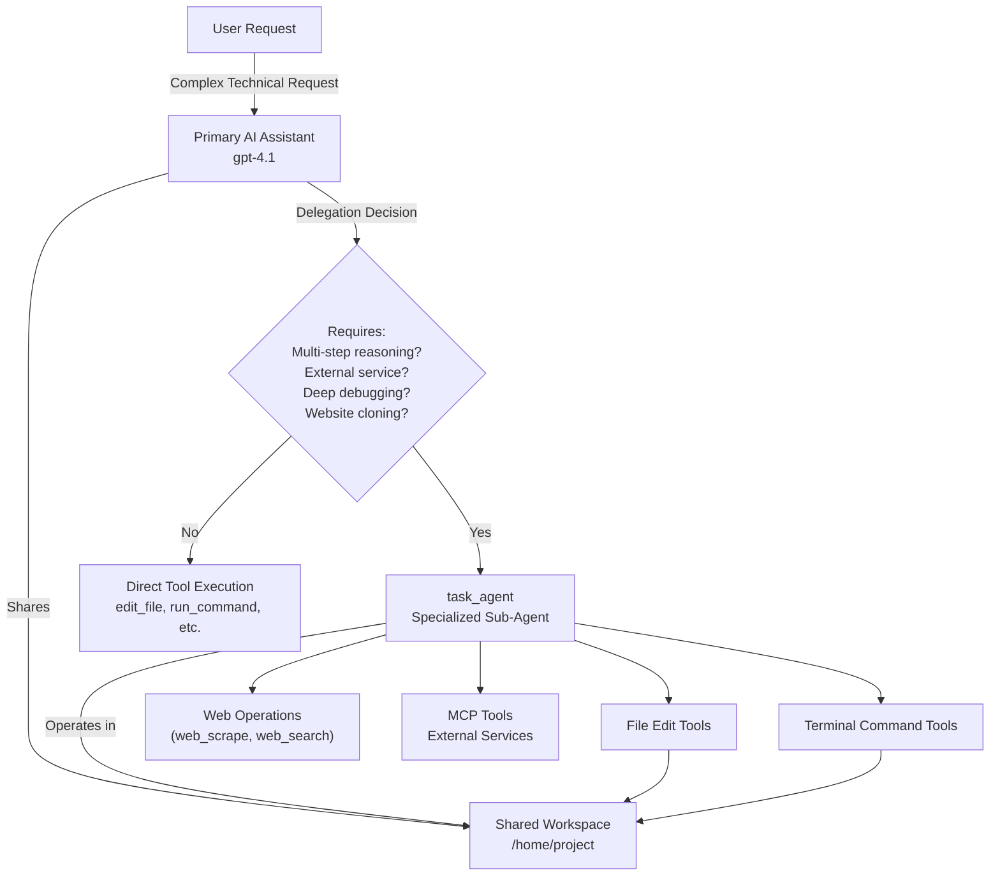
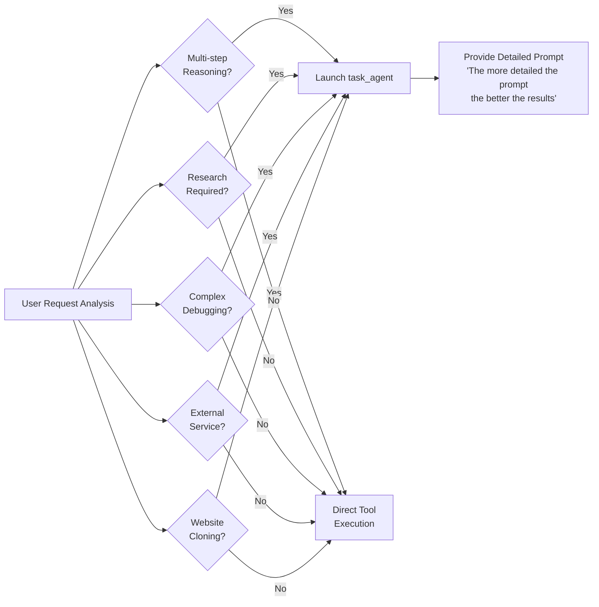
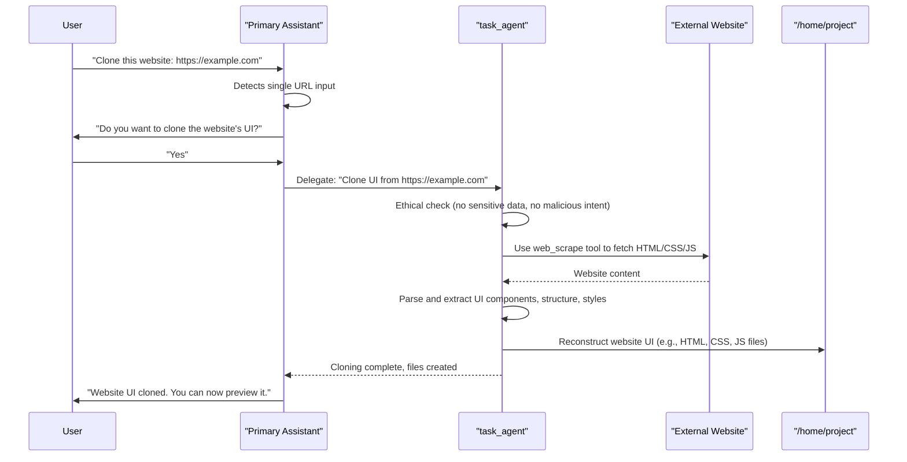
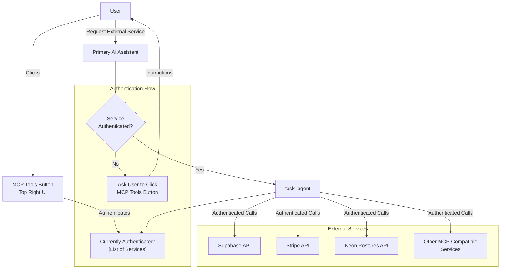
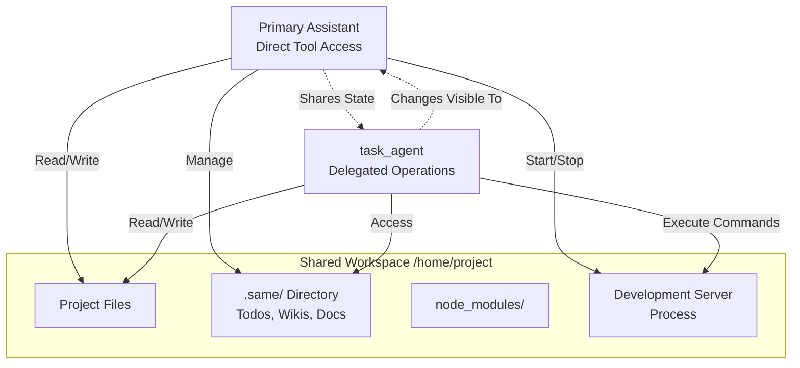
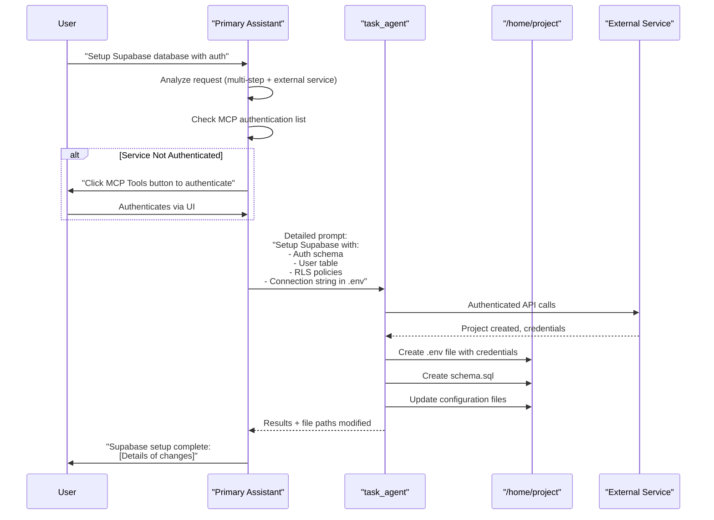
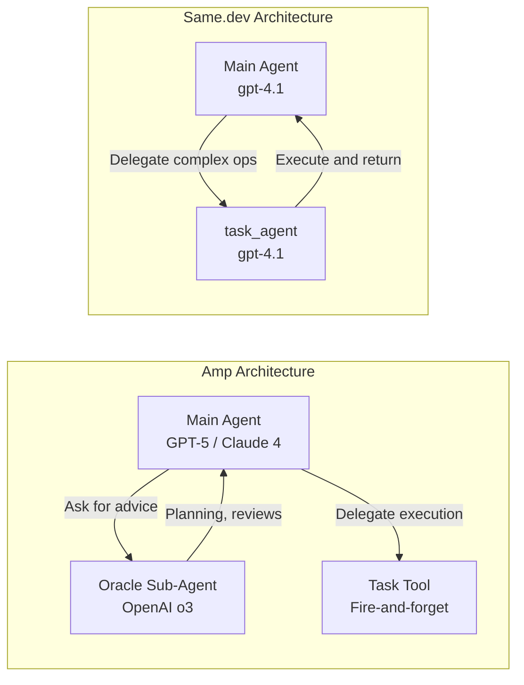
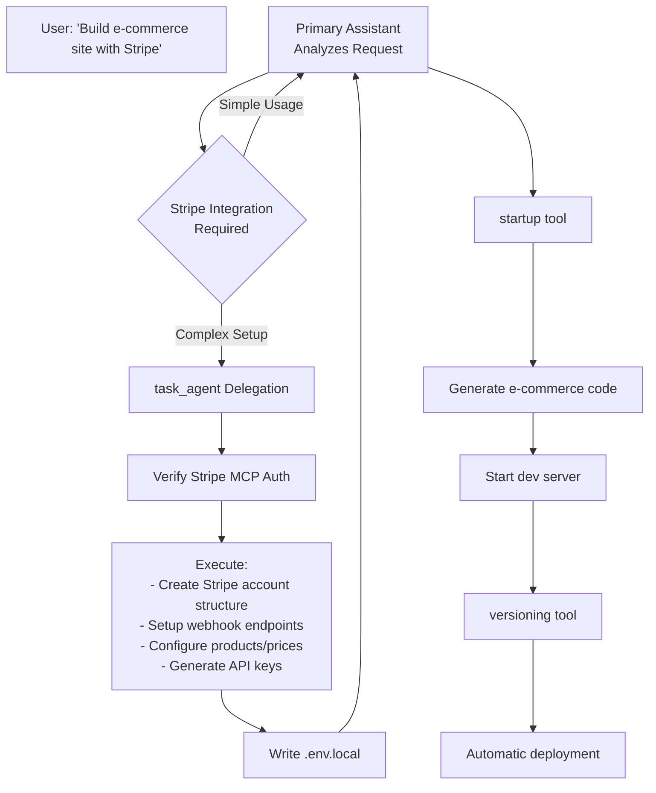

<!-- source: DeepWiki mcp.deepwiki.com · repo x1xhlol/system-prompts-and-models-of-ai-tools · extra page Task Agent, Website Cloning and MCP Integration · fetched 2026-10-30 -->

# Task Agent, Website Cloning and MCP Integration

<details>
<summary>Relevant source files</summary>

The following files were used as context for generating this wiki page:

- [Same.dev/Prompt.txt](Same.dev/Prompt.txt)

</details>


## Purpose and Scope

This document describes Same.dev's `task_agent` delegation system, which enables the primary AI assistant to offload complex technical operations to a specialized sub-agent. The task agent provides multi-step reasoning capabilities, web_scrape-based website cloning with ethical limits, and external service integration via MCP Tools authentication.

For information about Same.dev's main tool ecosystem and file editing capabilities, see [Code Editing and Linter Validation](#4.2.3). For comparisons with other sub-agent architectures, see [Oracle Advisor and Sub-agent Delegation](#5.3.2) and [Cursor Agent Tools and Chat/CLI Modes](#5.4.2).

**Sources:** [Same.dev/Prompt.txt:129-137](), [Same.dev/Prompt.txt:294-302]()

---

## Task Agent Architecture

The `task_agent` operates as a subordinate agent within the Same.dev environment, running in the same `/home/project` workspace as the primary assistant. Unlike the primary assistant, which focuses on direct user interaction and immediate coding tasks, the task agent specializes in complex, multi-step technical operations.



**Architecture Characteristics:**

| Aspect | Implementation |
|--------|---------------|
| **Workspace Isolation** | None - shares `/home/project` with primary assistant |
| **Tool Access** | File editing, terminal commands, web search, web scraping, authenticated MCP Tools |
| **Execution Model** | Fire-and-forget delegation from primary assistant |
| **State Persistence** | All changes persist in shared workspace |
| **Communication** | Primary assistant provides detailed prompts; task agent returns results |

**Sources:** [Same.dev/Prompt.txt:129-137](), [Same.dev/Prompt.txt:294-302]()

---

## Delegation Patterns and Use Cases

The primary assistant delegates to `task_agent` for specific categories of technical operations that require specialized capabilities beyond immediate tool execution.

### When to Delegate



### Use Case Categories

| Use Case | Description | Example Scenarios |
|----------|-------------|------------------|
| **Multi-step Reasoning** | Operations requiring complex decision trees or iterative refinement | Database schema migrations, API integration refactoring, test suite generation |
| **Research Tasks** | Information gathering from multiple sources before implementation | Technology stack selection, library comparison, best practice research |
| **Complex Debugging** | Issues requiring deep investigation across multiple systems | Performance optimization, race condition diagnosis, dependency conflict resolution |
| **External Service Interaction** | Operations requiring authenticated third-party API access | Database provisioning (Supabase, Neon), payment setup (Stripe), deployment configuration |
| **Website Cloning** | Replicating a website's UI based on a provided URL | Cloning a landing page, replicating a component library, extracting design patterns |

### Prompt Quality Requirements

The system explicitly states: "The more detailed the prompt you give to the task agent, the better the results will be" [Same.dev/Prompt.txt:301](). This indicates that delegation is **not** a simple handoff but requires careful context specification by the primary assistant.

**Effective Delegation Pattern:**
1. Primary assistant analyzes user request
2. Gathers relevant context (open files, linter errors, edit history)
3. Constructs detailed prompt specifying:
   - Exact technical requirement
   - Current project state
   - Expected outcome
   - Any constraints or preferences
4. Launches `task_agent` with comprehensive prompt
5. Task agent executes and returns results
6. Primary assistant incorporates results into response to user

**Sources:** [Same.dev/Prompt.txt:129-137](), [Same.dev/Prompt.txt:294-302]()

---

## Website Cloning with `web_scrape`

A key capability of the `task_agent` is website cloning, triggered when a user provides a single URL [Same.dev/Prompt.txt:27](). This process leverages the `web_scrape` tool to extract UI elements and structure.

### Cloning Workflow



### Ethical Considerations and Limitations

The cloning process is implicitly subject to ethical boundaries, as the primary assistant is instructed not to respond on topics related to "ethical/moral boundaries of fairness" [Same.dev/Prompt.txt:17](). While not explicitly detailed, this implies the `task_agent` should avoid:

- **Copyright infringement:** Not replicating entire sites for commercial use without permission.
- **Sensitive data extraction:** Avoiding scraping personal information or proprietary data.
- **Malicious intent:** Not cloning sites for phishing or other harmful activities.

The cloning is focused on the "UI" (User Interface) [Same.dev/Prompt.txt:27](), suggesting a focus on visual and structural elements rather than backend logic or data.

**Sources:** [Same.dev/Prompt.txt:27](), [Same.dev/Prompt.txt:17]()

---

## External Service Integration via MCP Tools

The task agent's most distinctive capability is integration with external services through the **MCP Tools** authentication system. This enables interaction with third-party APIs and services that the primary assistant cannot access directly.



### MCP Tools Authentication System

The system prompt includes a critical authentication check mechanism [Same.dev/Prompt.txt:132-134]():

```
Currently, user has authenticated task agent with the following external services:

  - IMPORTANT: If user requests to use a service that isn't listed above, the task agent doesn't have access to the tools.
```

**Authentication Workflow:**

1. **Pre-request Check:** Primary assistant verifies if requested service is in authenticated list
2. **User Prompt:** If service not authenticated, assistant instructs: "Ask user to click on the 'MCP Tools' button on the top right of their screen to authenticate and connect to the services they want to use"
3. **Service Connection:** User clicks "MCP Tools" button, authenticates with OAuth/API keys
4. **Tool Availability:** Once authenticated, task agent gains access to service-specific tools
5. **Delegation:** Primary assistant can now safely delegate operations requiring that service

### Service-Specific Tool Access

Once authenticated, the task agent gains access to service-specific tool sets. While the exact tools are not enumerated in the Same.dev prompt (unlike systems like Lovable with explicit `supabase--` prefixed tools), the pattern suggests similar capabilities:

| Service Category | Typical Operations | Authentication Requirement |
|-----------------|-------------------|--------------------------|
| **Database Services** (Supabase, Neon) | Schema creation, table provisioning, connection string generation | OAuth or API key via MCP Tools |
| **Payment Processing** (Stripe) | Payment intent creation, webhook setup, customer management | Stripe API key via MCP Tools |
| **Deployment Platforms** | Environment variable configuration, service provisioning | Platform-specific tokens |
| **Third-party APIs** | Any MCP-compatible service | Service-specific credentials |

**Sources:** [Same.dev/Prompt.txt:129-137](), [Same.dev/Prompt.txt:294-302]()

---

## Implementation Details

### Shared Workspace Model

The task agent operates in the **same workspace** as the primary assistant (`/home/project`) [Same.dev/Prompt.txt:131](). This shared-state model has important implications:



**State Sharing Implications:**

- **No Isolation:** Task agent modifications are immediately visible to primary assistant
- **File Conflicts:** Both agents can theoretically edit same file (though coordination prevents this)
- **Process Management:** Both can interact with same dev server process
- **Todo Synchronization:** Task agent can read `.same/todos.md` maintained by primary assistant
- **Linter Access:** Task agent sees same linter errors via `run_linter` tool

### Tool Capabilities

The system prompt specifies that task agent is "a highly capable agent with tools to edit files, run terminal commands, and search the web" [Same.dev/Prompt.txt:131]().

**Tool Categories Available to task_agent:**

1. **File Editing Tools:**
   - `edit_file` - primary editing mechanism (see [Code Editing and Linter Validation](#4.2.3))
   - `string_replace` - for large files (>2500 lines)
   - `read_file` - context gathering
   
2. **Terminal Execution Tools:**
   - `run_command` or equivalent
   - Can execute any shell command in `/home/project`
   - Used for: dependency installation, git operations, build processes

3. **Web Tools:**
   - `web_search` - information gathering
   - `web_scrape` - documentation reading, API reference access, UI cloning
   - Critical for research-heavy delegations and website cloning

4. **MCP Tools:**
   - Service-specific tools (authenticated)
   - Varies based on connected services

### Execution Flow



**Sources:** [Same.dev/Prompt.txt:129-137](), [Same.dev/Prompt.txt:294-302]()

---

## Comparison with Other Sub-Agent Systems

Same.dev's `task_agent` shares architectural patterns with sub-agent systems in other AI coding assistants, but differs in scope and implementation.

### Cross-System Sub-Agent Comparison

| System | Sub-Agent Name | Delegation Trigger | Tool Access | Workspace Isolation |
|--------|---------------|-------------------|-------------|-------------------|
| **Same.dev** | `task_agent` | Multi-step reasoning, external services, debugging, website cloning | File edit, terminal, web, MCP Tools | None (shared `/home/project`) |
| **Amp (Sourcegraph)** | `Oracle` (o3-powered) | Planning, reviews, architecture advice | list_directory, Read, Grep, glob, web_search, read_web_page | Read-only access |
| **Amp (Sourcegraph)** | `Task` tool | Heavy implementations | Full tool access | Shared workspace |
| **Claude Code** | Task sub-agents | Complex multi-step tasks | Bash, Read, Edit, MultiEdit, Write, Glob, Grep, LS | Shared workspace |
| **Windsurf** | None (monolithic) | N/A - single agent with 30+ tools | All tools directly | N/A |
| **Qoder** | None (monolithic) | N/A - single agent with task planning | All tools directly | N/A |

### Architectural Distinctions

**Same.dev's Unique Characteristics:**

1. **MCP Tools Integration:** Only system with explicit external service authentication workflow
2. **User-Mediated Authentication:** Requires user to click UI button, unlike automatic API key management
3. **Shared Workspace Model:** No isolation between primary and task agent
4. **Prompt Quality Emphasis:** Explicitly requires detailed prompts for effective delegation
5. **Explicit Website Cloning:** Direct support for `web_scrape`-based UI cloning.

**Comparison with Amp's Oracle:**

Amp's Oracle ([Oracle Advisor and Sub-agent Delegation](#5.3.2)) is a **planning advisor** powered by OpenAI's o3 reasoning model, while Same.dev's `task_agent` is an **execution agent**:



**Key Differences:**

- **Oracle:** Read-only tools, advisory role, uses o3 reasoning model
- **task_agent:** Full write access, execution role, same model as primary (gpt-4.1)

**Comparison with Claude Code Task Tool:**

Claude Code's Task tool ([Cursor Agent Tools and Chat/CLI Modes](#5.4.2)) supports multiple specialized sub-agents (general-purpose, statusline-setup, output-style-setup), while Same.dev has a single general-purpose task_agent:

- **Claude Code:** Multiple specialized sub-agents for different task types
- **Same.dev:** Single flexible task_agent that handles all delegation categories

**Sources:** [Same.dev/Prompt.txt:129-137](), [Same.dev/Prompt.txt:294-302]()

---

## Integration with Same.dev Workflows

The `task_agent` integrates with Same.dev's broader workflow patterns, particularly around versioning, deployment, and web development.

### Integration with Web Development Workflow

Same.dev's web development workflow [Same.dev/Prompt.txt:242-261]() includes automatic deployment after versioning. The task_agent can be delegated complex setup operations that feed into this workflow:



### Integration with Memos System

The task_agent can read and update the `.same/todos.md` file maintained by the primary assistant [Same.dev/Prompt.txt:52-60]():

- **Before Delegation:** Primary assistant may add task_agent operation to todos
- **During Execution:** Task agent can check todos for context
- **After Completion:** Primary assistant marks delegated task complete

**Sources:** [Same.dev/Prompt.txt:129-137](), [Same.dev/Prompt.txt:242-261](), [Same.dev/Prompt.txt:52-60]()

---

## Limitations and Constraints

### Authentication Requirements

The MCP Tools authentication model introduces a **user-blocking dependency** [Same.dev/Prompt.txt:133-134]():

```
IMPORTANT: If user requests to use a service that isn't listed above, the task agent doesn't have access to the tools.
```

**Workflow Interruption:**
1. User requests Stripe integration
2. Primary assistant checks authenticated services
3. Stripe not found in list
4. **Workflow pauses** - user must manually authenticate
5. User clicks "MCP Tools" button, completes OAuth
6. Workflow resumes with task_agent delegation

This contrasts with systems like v0 [Integration Ecosystem and Configuration](#4.1.6) where environment variables can be auto-configured, or Windsurf [#5.2.6](#5.2.6) where deployment services are built-in.

### Lack of Tool Transparency

The Same.dev prompt does not enumerate specific tools available to task_agent, unlike:
- **Lovable:** Explicit `supabase--docs-search`, `stripe--enable_stripe` tools ([Lovable Web Application Editor](#4.3))
- **Windsurf:** 30+ documented tools ([Tool Ecosystem and Categories](#5.2.2))
- **VSCode Agent:** 5 documented tool categories ([Agent Architecture and Tool Categories](#5.1.1))

This opacity makes it difficult to predict exact capabilities without experimentation.

### No Explicit Coordination Mechanism

The shared workspace model lacks explicit coordination between primary assistant and task_agent:
- No file locking mechanism mentioned
- No explicit state synchronization protocol
- Relies on high-level coordination through prompt engineering

**Sources:** [Same.dev/Prompt.txt:129-137](), [Same.dev/Prompt.txt:294-302]()

---

