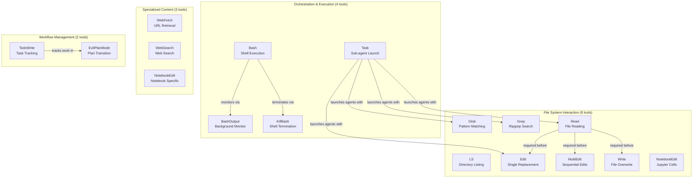
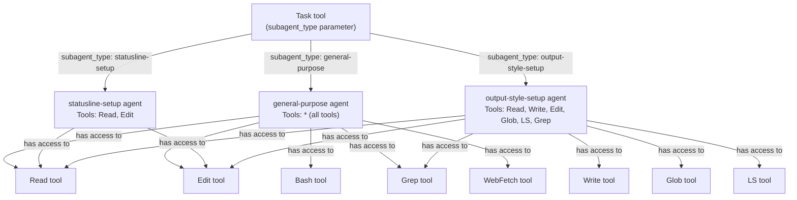
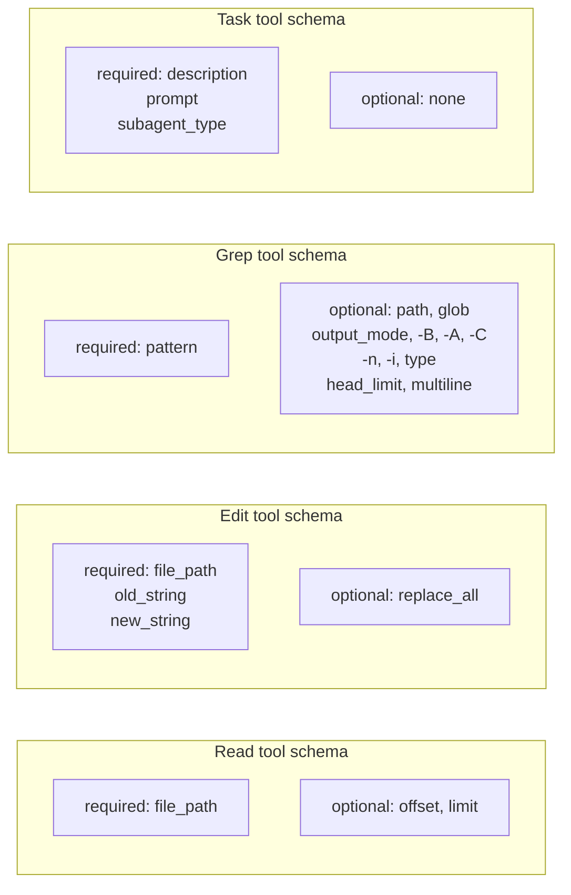
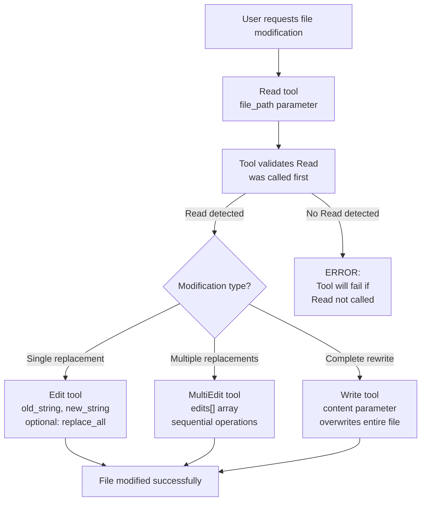
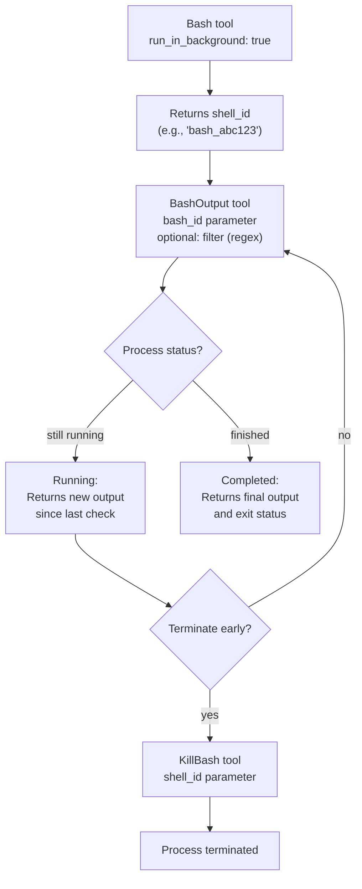
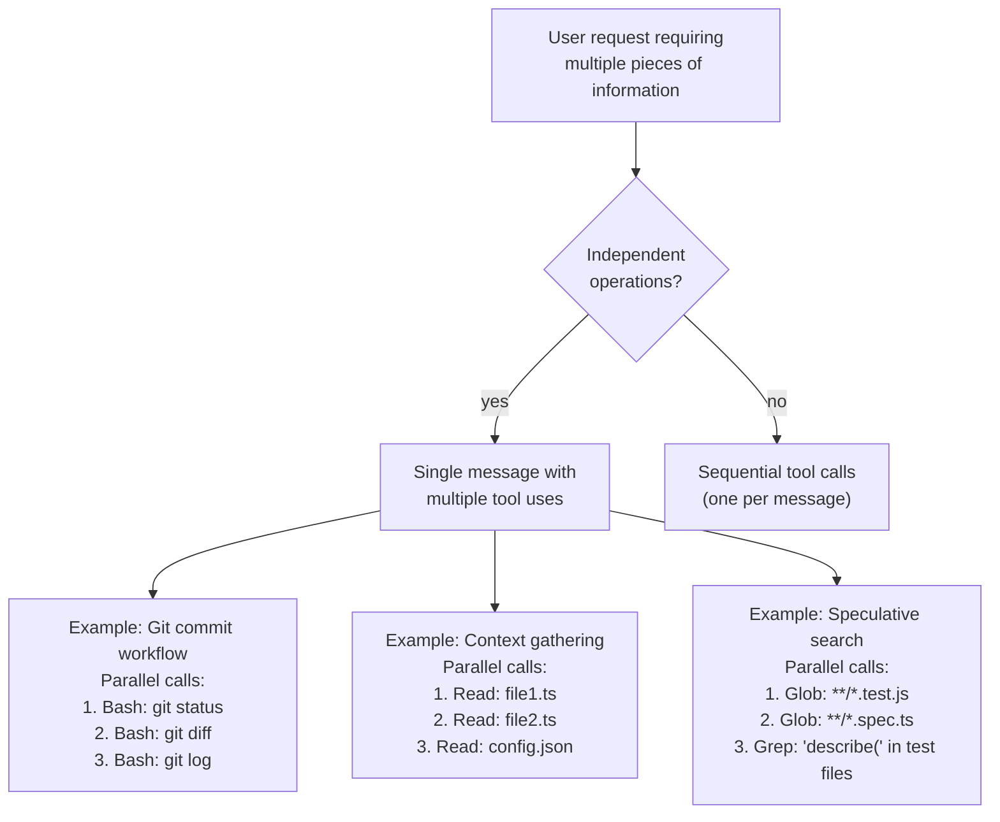
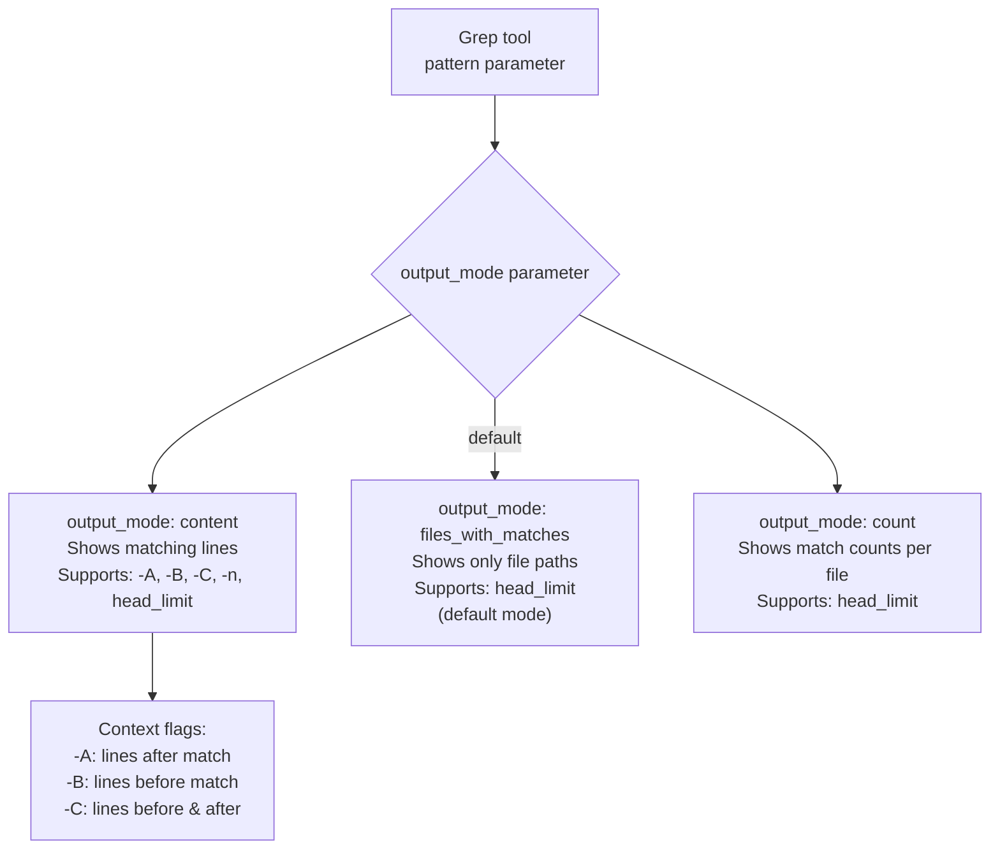
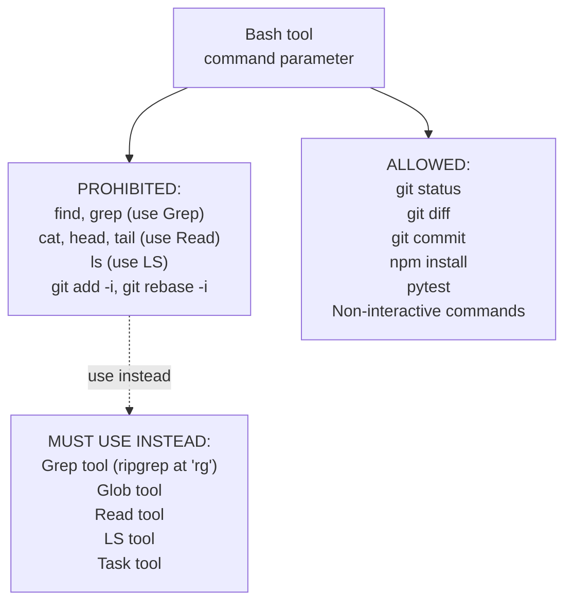

<!-- source: DeepWiki mcp.deepwiki.com · repo x1xhlol/system-prompts-and-models-of-ai-tools · extra page Tool Architecture and Categories · fetched 2026-10-30 -->

# Tool Architecture and Categories

Relevant source files

The following files were used as context for generating this wiki page:

- [Anthropic/Claude Code/Tools.json](Anthropic/Claude Code/Tools.json)

This page documents Claude Code's tool ecosystem, providing a comprehensive overview of the 16 tools available for file operations, command execution, content retrieval, and workflow management. The tools are organized into four primary categories based on their operational domain. For detailed information on specific tool workflows, see [Cursor Agent Tools and Chat/CLI Modes](#5.4.2), [File Editing Operations](#5.4.3), [Shell Command Execution](#5.4.4), [TodoWrite Task Management System](#5.4.5), and [Search and Discovery Tools](#5.4.6).

## Tool Ecosystem Overview

Claude Code provides 16 specialized tools organized into four functional categories. Each tool is defined with a JSON schema specifying its parameters, requirements, and usage constraints.

**Tool Ecosystem Architecture**

Sources: [Anthropic/Claude Code/Tools.json:1-509]()

## Tool Categories and Classification

### File System Interaction Tools

The file system category contains 8 tools for discovering, reading, and modifying files. These tools enforce a strict workflow: read operations must precede write operations to prevent unintended modifications.

| Tool | Purpose | Key Parameters | Output |
|------|---------|----------------|--------|
| `Glob` | Fast file pattern matching | `pattern`, `path` (optional) | Matching file paths sorted by modification time |
| `Grep` | Ripgrep-powered content search | `pattern`, `path`, `glob`, `output_mode` | Search results with optional context lines |
| `LS` | Directory listing | `path` (absolute), `ignore` (glob patterns) | Files and directories in path |
| `Read` | File reading with multimodal support | `file_path` (absolute), `offset`, `limit` | File contents with line numbers (cat -n format) |
| `Edit` | Single string replacement | `file_path`, `old_string`, `new_string`, `replace_all` | Modified file |
| `MultiEdit` | Sequential find-replace operations | `file_path`, `edits[]` | File with all edits applied atomically |
| `Write` | File overwriting | `file_path`, `content` | New file or overwritten existing file |
| `NotebookEdit` | Jupyter notebook cell modification | `notebook_path`, `cell_id`, `new_source`, `edit_mode` | Modified notebook cell |

Sources: [Anthropic/Claude Code/Tools.json:62-81](), [Anthropic/Claude Code/Tools.json:83-149](), [Anthropic/Claude Code/Tools.json:150-174](), [Anthropic/Claude Code/Tools.json:193-218](), [Anthropic/Claude Code/Tools.json:219-251](), [Anthropic/Claude Code/Tools.json:252-298](), [Anthropic/Claude Code/Tools.json:299-321](), [Anthropic/Claude Code/Tools.json:322-365]()

### Orchestration and Execution Tools

Four tools manage sub-agent delegation and shell command execution. The `Task` tool launches specialized agents with access to subsets of the full tool ecosystem, while the `Bash` family handles persistent shell sessions.

| Tool | Purpose | Key Parameters | Constraints |
|------|---------|----------------|-------------|
| `Task` | Launch specialized sub-agents | `description`, `prompt`, `subagent_type` | Agent types: `general-purpose`, `statusline-setup`, `output-style-setup` |
| `Bash` | Persistent shell command execution | `command`, `timeout`, `run_in_background` | Max timeout: 600000ms (10 minutes), default: 120000ms |
| `BashOutput` | Monitor background shell output | `bash_id`, `filter` (regex) | Returns only new output since last check |
| `KillBash` | Terminate background shell | `shell_id` | Immediate termination of specified shell |

Sources: [Anthropic/Claude Code/Tools.json:3-30](), [Anthropic/Claude Code/Tools.json:31-60](), [Anthropic/Claude Code/Tools.json:467-488](), [Anthropic/Claude Code/Tools.json:489-506]()

**Task Tool Sub-agent Architecture**

Sources: [Anthropic/Claude Code/Tools.json:5-19]()

### Specialized Content Tools

Three tools handle external content retrieval and specialized file formats. `NotebookEdit` is listed in both file system and specialized categories due to its dual nature as both a file editor and a domain-specific tool.

| Tool | Purpose | Key Parameters | Special Features |
|------|---------|----------------|------------------|
| `WebFetch` | URL content retrieval and analysis | `url`, `prompt` | HTML to markdown conversion, AI-powered processing, 15-minute cache |
| `WebSearch` | Web search with result formatting | `query`, `allowed_domains`, `blocked_domains` | US-only availability, domain filtering |
| `NotebookEdit` | Jupyter notebook cell editing | `notebook_path`, `cell_id`, `new_source`, `cell_type`, `edit_mode` | Edit modes: `replace`, `insert`, `delete` |

Sources: [Anthropic/Claude Code/Tools.json:366-389](), [Anthropic/Claude Code/Tools.json:434-466](), [Anthropic/Claude Code/Tools.json:322-365]()

### Workflow Management Tools

Two tools manage task planning and execution workflows. `TodoWrite` tracks multi-step tasks while `ExitPlanMode` handles the transition from planning to implementation.

| Tool | Purpose | Schema | State Management |
|------|---------|--------|------------------|
| `TodoWrite` | Structured task list management | `todos[]` with `content`, `status`, `id` | Status: `pending`, `in_progress`, `completed` |
| `ExitPlanMode` | Transition from planning to coding | `plan` (markdown string) | Prompts user approval before code execution |

Sources: [Anthropic/Claude Code/Tools.json:390-433](), [Anthropic/Claude Code/Tools.json:175-192]()

## Tool Parameter Schemas and Validation

All tools are defined with JSON Schema Draft-07 specifications enforcing strict parameter validation. Common patterns include:

**Required vs Optional Parameters**

Sources: [Anthropic/Claude Code/Tools.json:196-217](), [Anthropic/Claude Code/Tools.json:222-250](), [Anthropic/Claude Code/Tools.json:86-148](), [Anthropic/Claude Code/Tools.json:6-29]()

### Absolute Path Enforcement

Several tools enforce absolute path requirements to prevent ambiguity:

| Tool | Path Parameters | Validation Rule |
|------|----------------|-----------------|
| `Read` | `file_path` | Must be absolute path, not relative |
| `Edit` | `file_path` | Must be absolute path, not relative |
| `MultiEdit` | `file_path` | Must be absolute path, not relative |
| `Write` | `file_path` | Must be absolute path, not relative |
| `LS` | `path` | Must be absolute path, not relative |
| `NotebookEdit` | `notebook_path` | Must be absolute path, not relative |

Sources: [Anthropic/Claude Code/Tools.json:199-200](), [Anthropic/Claude Code/Tools.json:225-226](), [Anthropic/Claude Code/Tools.json:258-259](), [Anthropic/Claude Code/Tools.json:305-306](), [Anthropic/Claude Code/Tools.json:156-157](), [Anthropic/Claude Code/Tools.json:328-329]()

## Tool Interaction Patterns and Dependencies

### File Editing Workflow Requirements

Claude Code enforces a mandatory read-before-write pattern for file modifications to prevent unintended changes:

**File Modification Dependency Chain**

Sources: [Anthropic/Claude Code/Tools.json:220-221](), [Anthropic/Claude Code/Tools.json:253-254](), [Anthropic/Claude Code/Tools.json:300-301]()

### Background Shell Execution Lifecycle

The `Bash`, `BashOutput`, and `KillBash` tools form a coordinated system for managing long-running processes:

**Background Shell Management Pattern**

Sources: [Anthropic/Claude Code/Tools.json:49-52](), [Anthropic/Claude Code/Tools.json:467-488](), [Anthropic/Claude Code/Tools.json:489-506]()

### Search Tool Selection Logic

Three search tools (`Glob`, `Grep`, `Task`) are available with specific use cases to optimize performance:

| Scenario | Recommended Tool | Rationale |
|----------|-----------------|-----------|
| Known file name/pattern | `Glob` with pattern like `**/*.js` | Fast pattern matching, sorted by modification time |
| Known class definition | `Glob` with pattern like `**/Foo.{ts,js}` | Faster than agent for specific matches |
| Content search with exact text | `Grep` with pattern, optional `glob` filter | Ripgrep performance, supports regex |
| Search within 2-3 specific files | `Read` tool for each file | Direct reading faster than agent delegation |
| Open-ended search requiring multiple rounds | `Task` tool with `general-purpose` agent | Agent has access to all search tools and can iterate |

Sources: [Anthropic/Claude Code/Tools.json:13-17](), [Anthropic/Claude Code/Tools.json:62-64](), [Anthropic/Claude Code/Tools.json:84-86]()

## Tool Concurrency and Batching Capabilities

Claude Code supports calling multiple tools in a single response, enabling parallel operations for improved performance.

**Parallel Tool Execution Pattern**

Sources: [Anthropic/Claude Code/Tools.json:52-56](), [Anthropic/Claude Code/Tools.json:194-196](), [Anthropic/Claude Code/Tools.json:64]()

### Recommended Parallel Batching Scenarios

The tool definitions explicitly recommend parallel execution in these contexts:

1.  **Git operations**: When creating commits or pull requests, run `git status`, `git diff`, and `git log` in parallel [Anthropic/Claude Code/Tools.json:52-56]()

2.  **File reading**: When gathering context, speculatively read multiple potentially useful files in a single batch [Anthropic/Claude Code/Tools.json:194-196]()

3.  **Search operations**: Perform multiple searches that are potentially useful rather than one at a time [Anthropic/Claude Code/Tools.json:64]()

## Tool-Specific Constraints and Guardrails

### Read Tool Multimodal Capabilities

The `Read` tool supports multiple file formats with specialized processing:

| Format | Capability | Processing |
|--------|-----------|------------|
| Text files | Line-numbered reading | Uses `cat -n` format, 2000 lines default, optional offset/limit |
| Images (PNG, JPG, etc.) | Visual presentation | Multimodal LLM processes images visually |
| PDF files | Page-by-page extraction | Extracts both text and visual content per page |
| Jupyter notebooks (.ipynb) | Complete cell rendering | Returns all cells with outputs, combining code/text/visualizations |
| Long text files | Truncation handling | Lines over 2000 characters are truncated |

Sources: [Anthropic/Claude Code/Tools.json:194-196]()

### Grep Tool Output Modes

The `Grep` tool provides three distinct output modes optimized for different use cases:

Sources: [Anthropic/Claude Code/Tools.json:102-137]()

### Edit vs MultiEdit vs Write Decision Tree

Claude Code provides three file modification tools with distinct use cases:

| Tool | Use When | Constraints | Atomic Behavior |
|------|----------|-------------|-----------------|
| `Edit` | Single string replacement needed | `old_string` must be unique unless `replace_all: true` | Single operation |
| `MultiEdit` | Multiple sequential replacements in same file | All edits must be valid; operates on result of previous edit | All-or-nothing atomic |
| `Write` | Complete file overwrite required | Must read file first if file exists | Single operation |

Sources: [Anthropic/Claude Code/Tools.json:220-251](), [Anthropic/Claude Code/Tools.json:252-298](), [Anthropic/Claude Code/Tools.json:299-321]()

### Bash Tool Command Restrictions

The `Bash` tool explicitly prohibits certain command patterns to enforce tool usage:

**Prohibited Commands (Must Use Tools Instead)**

Sources: [Anthropic/Claude Code/Tools.json:62-67]()

### WebFetch Caching and Redirects

The `WebFetch` tool includes optimization features:

-   **Self-cleaning cache**: 15-minute cache for repeated URL access
-   **Automatic HTTPS upgrade**: HTTP URLs upgraded automatically
-   **Redirect handling**: When URL redirects to different host, tool informs and provides redirect URL in special format requiring new WebFetch request
-   **MCP tool preference**: If MCP-provided web fetch tool (prefix `mcp__`) available, prefer that tool for fewer restrictions

Sources: [Anthropic/Claude Code/Tools.json:366-389]()

### TodoWrite Task Management Rules

The `TodoWrite` tool enforces strict task state management:

**Task State Transitions**

| From State | To State | Trigger |
|-----------|----------|---------|
| `pending` | `in_progress` | Begin working on task (mark BEFORE starting) |
| `in_progress` | `completed` | Task fully accomplished (tests pass, no errors) |
| `in_progress` | `pending` | Task blocked or cannot finish |
| Any state | Removed | Task no longer relevant |

**Constraints:**
-   Only ONE task should be `in_progress` at any time
-   Tasks marked `completed` ONLY when FULLY accomplished
-   Never mark complete if: tests failing, implementation partial, unresolved errors, missing dependencies
-   Update status in real-time, don't batch completions

Sources: [Anthropic/Claude Code/Tools.json:390-433]()

---

