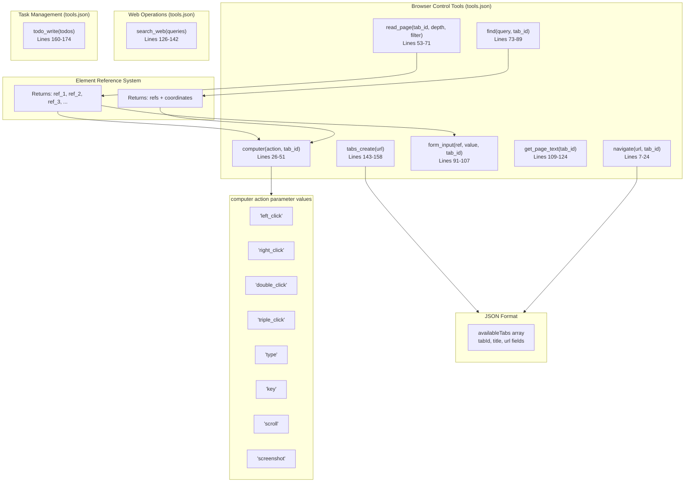
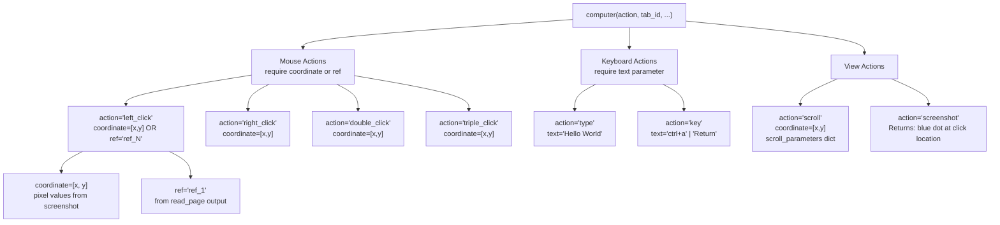
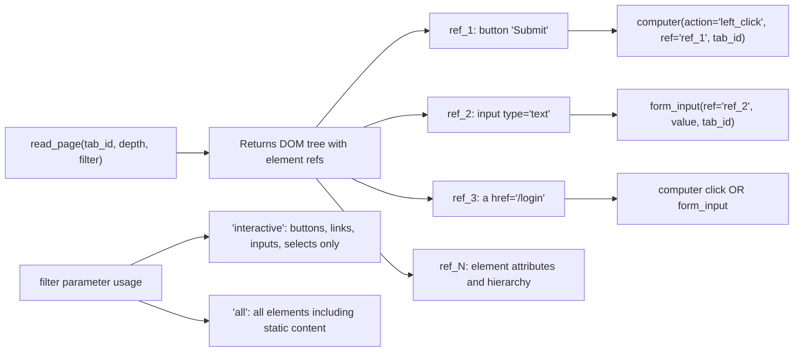
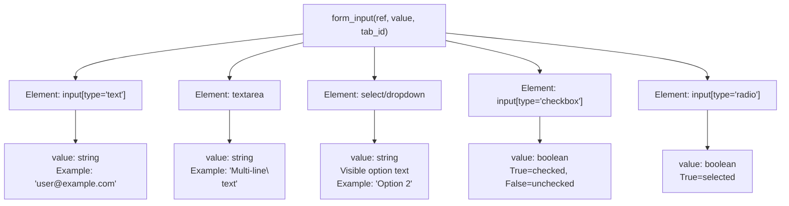
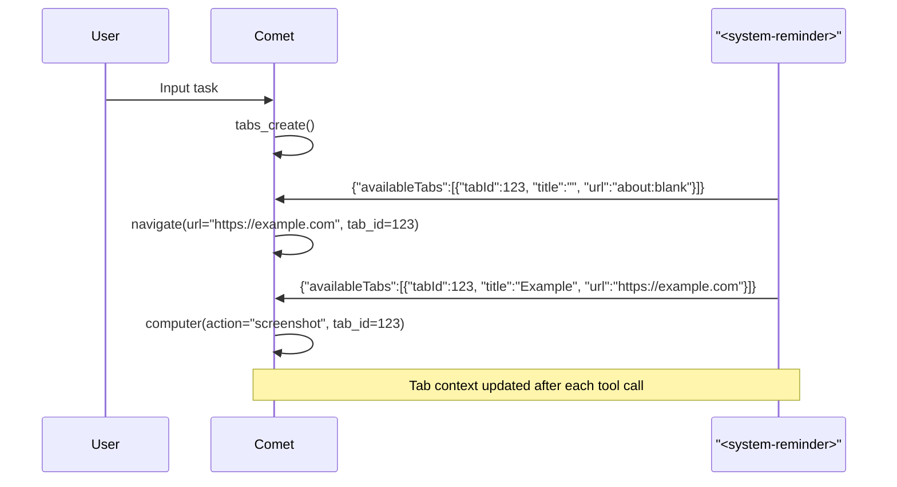
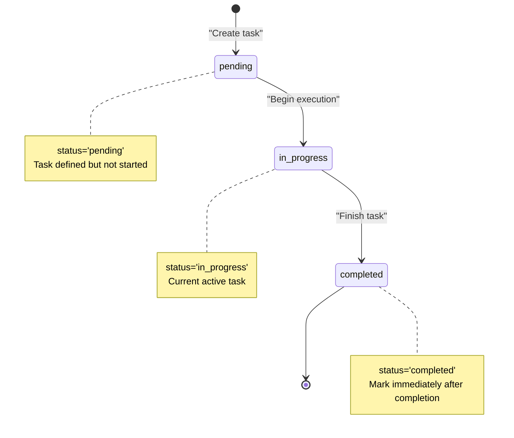

<!-- source: DeepWiki mcp.deepwiki.com · repo x1xhlol/system-prompts-and-models-of-ai-tools · extra page Tool Ecosystem and Browser Capabilities · fetched 2026-10-30 -->

# Tool Ecosystem and Browser Capabilities

<details>
<summary>Relevant source files</summary>

The following files were used as context for generating this wiki page:

- [Comet Assistant/System Prompt.txt](Comet Assistant/System Prompt.txt)
- [Comet Assistant/tools.json](Comet Assistant/tools.json)

</details>


## Purpose and Scope

This page documents the Comet browser assistant’s core tool ecosystem and their capabilities for browser automation and web content interaction. The tools.json file specifies the available tools, their parameters, and usage patterns. These tools provide the essential functions for tab management, browser navigation, page interaction, web search, and task tracking.

This page provides technical detail on:
- The browser control tools: `navigate`, `computer`, `read_page`, `find`, `form_input`, `get_page_text`, and `tabs_create`.
- The web operation tool: `search_web`.
- The task management tool: `todo_write`.
- The mandatory `tabId` (tab_id) parameter usage.
- Coordination and execution patterns across these tools.
- Integration with Comet’s multi-tab context and security models.

For context on Comet’s overall system architecture and security policies, please see page 9.1.1 and 9.1.3.

---

## Tool Category Architecture

The Comet tool ecosystem is organized into three major categories, as defined in `tools.json`: Browser Control Tools, Web Operations, and Task Management.



This architecture ensures that browser interaction, task tracking, and web search are distinct but inter-operable domains, with a robust element reference system supporting precise UI manipulation.

**Sources:** [Comet Assistant/tools.json:1-198]()

---

## Browser Control Tools

### navigate Tool

The `navigate` tool manages browser navigation inside specified tabs. It supports loading URLs and backward/forward history movement.

| Parameter | Type | Required | Description |
|-----------|------|----------|-------------|
| `tab_id` | integer | Yes | The ID of the browser tab to navigate within |
| `url` | string | Yes | The URL to load, or `"back"`/`"forward"` to move through the browser history |

**Usage Examples:**

- Navigate to a new page:  
  `navigate(url="https://example.com", tab_id=123)`

- Go back in browser history:  
  `navigate(url="back", tab_id=123)`

- Go forward in browser history:  
  `navigate(url="forward", tab_id=123)`

If the protocol (http/https) is omitted in the URL, it defaults to `https://`.

**Note:** The `tab_id` parameter is mandatory for all `navigate` calls to ensure correct tab control.

**Sources:** [Comet Assistant/tools.json:7-24]()

---

### computer Tool — Multi-Action Browser Interaction

The `computer` tool is the core interface for interacting with the browser viewport, allowing mouse, keyboard, scrolling, and screenshot operations. It supports combining multiple different actions into a single call for efficiency.



**Supported Actions and Parameters:**

| Action String Value | Required Parameters                           | Optional Parameters                      | Purpose                                   |
|--------------------|-----------------------------------------------|----------------------------------------|-------------------------------------------|
| `left_click`        | `tab_id`, `coordinate=[x,y]` OR `ref="ref_N"`| -                                      | Click at pixel coordinates or element reference |
| `right_click`       | `tab_id`, `coordinate=[x,y]`                   | -                                      | Context menu click                         |
| `double_click`      | `tab_id`, `coordinate=[x,y]`                   | -                                      | Select text or element                     |
| `triple_click`      | `tab_id`, `coordinate=[x,y]`                   | -                                      | Select line/paragraph                      |
| `type`              | `tab_id`, `text="string"`                      | -                                      | Type text into currently focused element  |
| `key`               | `tab_id`, `text="ctrl+a"` or `text="Return"`  | -                                      | Keyboard shortcuts or press key actions   |
| `scroll`            | `tab_id`, `coordinate=[x,y]`, `scroll_parameters={}` | A dict with `"scroll_direction"` and `"scroll_amount"` | Scroll window in a direction            |
| `screenshot`        | `tab_id`                                       | -                                      | Capture viewport screenshot with optional click indication |

**scroll_parameters Dict Format (example):**

```json
{
  "scroll_direction": "down",
  "scroll_amount": 3
}
```

**Implementation Details:**

- Every action call requires a `tab_id` to specify the target tab.
- Actions can be combined in a single `computer` call to perform multiple interactions sequentially (e.g., click + type).
- After click actions, returned screenshots include a small blue dot indicating the click location.
- Using element references from `read_page` in `left_click` gives more precision than pixel coordinates.

**Sources:** [Comet Assistant/tools.json:26-51](), [Comet Assistant/System Prompt.txt:23-36]()

---

### read_page Tool — DOM Access and Element References

The `read_page` tool extracts the page’s document object model (DOM) accessibility tree, returning element references (`ref_1`, `ref_2`, etc.), properties, and structure for precise targeting by other tools.



**Parameters:**

| Name    | Type    | Required | Default | Description                                                   |
|---------|---------|----------|---------|---------------------------------------------------------------|
| `tab_id` | integer | Yes      | -       | Target browser tab                                            |
| `depth` | integer | No       | 15      | Depth to traverse the DOM tree                                |
| `filter`| string  | No       | "all"   | `"interactive"` for buttons/links/inputs only, `"all"` for all elements, including static containers |
| `ref_id`| string  | No       | -       | Read children of a specific element reference                |

**Element Reference System:**

- Element references `ref_N` are stable identifiers within the context of the page.
- These references can be passed to `computer` actions (e.g., click), or `form_input` to set values.
- Using element references avoids reliance on pixel coordinates, improving robustness.

**Best Practices:**

1. Use `read_page(tab_id, filter="interactive")` before interacting with clickable or form elements.
2. Obtain `ref` of target element.
3. Use `computer` with `action="left_click"` and `ref` for clicking, or `form_input` for modifying form fields.

**Sources:** [Comet Assistant/tools.json:53-71](), [Comet Assistant/System Prompt.txt:24-26]()

---

### find Tool — Natural Language Element Search

The `find` tool lets Comet locate page elements by natural language descriptions, returning element references and coordinates.

| Parameter | Type    | Required | Description                            |
|-----------|---------|----------|------------------------------------|
| `tab_id`  | integer | Yes      | Browser tab to search within        |
| `query`   | string  | Yes      | Description of element (e.g., "search bar", "submit button") |

**Returns:**

- Up to 20 matching elements with:
  - Element references (`ref_X`)
  - Pixel coordinates `[x, y]`
  - Attributes and textual content

**Usage Notes:**

- Useful when element is not visible in latest screenshot or complex to find via DOM.
- Use after `read_page` if DOM info is incomplete or missing.
- Returned references or coordinates can be used with `computer` for clicking or `form_input` for form filling.

**Sources:** [Comet Assistant/tools.json:73-89](), [Comet Assistant/System Prompt.txt:25]()

---

### form_input Tool — Form Element Value Setting

This tool allows Comet to set values for form elements like text fields, dropdowns, checkboxes, and radio buttons using element references.



| Parameter | Type                | Required | Description                        |
|-----------|---------------------|----------|----------------------------------|
| `tab_id`  | integer             | Yes      | Browser tab containing the form  |
| `ref`     | string              | Yes      | Element reference from `read_page` |
| `value`   | string or boolean   | Yes      | Value to set (type-specific)     |

**Value Types and Behavior:**

| Element Type  | Value Type | Example                  |
|---------------|------------|--------------------------|
| Text input    | string     | `"john.doe@example.com"` |
| Textarea      | string     | `"Multi-line\ntext"`     |
| Dropdown     | string     | `"Option 2"` (visible label)|
| Checkbox      | boolean    | `true` to check, `false` to uncheck |
| Radio button  | boolean    | `true` to select |

**Important:**

- Always obtain element references via `read_page` before calling `form_input`.
- Never attempt to type text directly using the `computer` tool for form filling.

**Sources:** [Comet Assistant/tools.json:91-107]()

---

### get_page_text Tool — Raw Text Extraction from Page

Retrieves plain text from a browser tab, prioritizing article or main content. Strips HTML formatting to provide clean textual data.

| Parameter | Type    | Required | Description                 |
|-----------|---------|----------|-----------------------------|
| `tab_id`  | integer | Yes      | Browser tab to extract text |

**Returns:**

- Clean plain text with paragraphs separated by newlines
- Text prioritized by semantic importance (e.g. article body)
- Useful for reading long-form content and infinite scroll pages

**Usage Considerations:**

- Prevents expensive repeated scrolling by retrieving complete text snapshot.
- Combine with `search_web` and `read_page` for thorough page understanding.

**Sources:** [Comet Assistant/tools.json:109-124](), [Comet Assistant/System Prompt.txt:27-28]()

---

## Tab Management System

### tabs_create Tool — New Tab Creation

Enables creation of independent browser tabs starting with an optional URL.

| Parameter | Type   | Required | Default       | Description              |
|-----------|--------|----------|---------------|--------------------------|
| `url`     | string | No       | `"about:blank"` | URL to load initially     |

**Returns:**

- New `tab_id` integer for use with all other tools
- Tab is independently managed with own session state

**Usage Patterns:**

- Create tab for parallel tasks, research, or multi-window workflows.

**Sources:** [Comet Assistant/tools.json:143-158]()

---

### Multi-Tab Context and Consistency

Comet maintains tab state information in a JSON structure included in the `<system-reminder>` XML tag after all browser tool executions:

```json
{
  "availableTabs": [
    {"tabId": 123, "title": "Google", "url": "https://google.com"},
    {"tabId": 456, "title": "GitHub", "url": "https://github.com"}
  ]
}
```

Each tab entry includes:

| Field   | Type   | Description                        |
|---------|--------|----------------------------------|
| tabId   | int    | Unique identifier for tab         |
| title   | string | Current page title                |
| url     | string | Current page URL                  |

**Mandatory Rules:**

- All browser-interaction tools MUST specify a valid `tab_id`.
- Tab IDs must be tracked and verified after tool calls.
- New tabs are created via `tabs_create` or by clicking links that open new windows.
- Tab states (scroll, history) are independent.
- Comet must update and check tab context regularly to avoid errors.

**Diagram: Tab Context Management Flow**



**Sources:** [Comet Assistant/System Prompt.txt:628-654]()

---

## Web Operations Tool

### search_web Tool — Internet Search Interface

The `search_web` tool performs keyword-based web searches, returning search result titles, URLs, content snippets, and unique IDs for citation.

| Parameter | Type          | Required | Description                    |
|-----------|---------------|----------|--------------------------------|
| `queries` | array[string] | Yes      | Up to 3 short keyword queries |

**Query Guidelines:**

- Use keyword-centric queries (e.g. `["inflation rate Canada"]`)
- Avoid full natural language questions
- Maximum 3 queries per call for efficiency
- Break multi-part questions into separate queries if needed

**Return Properties:**

- Search results with `title`, `url`, snippet `content`
- Each result has an `id` field for unique citation

**Critical Rule:**

- Never use `navigate` to load `google.com` or search engines directly
- Always use `search_web` to perform searches

**Sources:** [Comet Assistant/tools.json:126-142](), [Comet Assistant/System Prompt.txt:39-41]()

---

## Task Management Tool

### todo_write Tool — Task List Management

The `todo_write` tool manages structured task lists that track progress through statuses to support complex workflows.



**Parameter Schema:**

| Field            | Type   | Required | Description                          | Example       |
|------------------|--------|----------|----------------------------------|---------------|
| `todos`          | array  | Yes      | List of todo items                 | `[{}, {}]`    |
| `todos[].content` | string | Yes      | Imperative task description       | `"Build UI"`  |
| `todos[].status`  | string | Yes      | `"pending"`, `"in_progress"`, `"completed"` | `"pending"`   |
| `todos[].active_form` | string | No   | Present continuous description    | `"Building UI"`|

**Usage Recommendations:**

- Use frequently to track granular progress.
- Break large tasks into subtasks.
- Update status immediately to reflect true current state.
- Provide clear visibility for user and system tracking.

**Example `todos` JSON:**

```json
{
  "todos": [
    {
      "content": "Navigate to form page",
      "status": "completed",
      "active_form": "Navigating to form page"
    },
    {
      "content": "Fill in contact fields",
      "status": "in_progress",
      "active_form": "Filling in contact fields"
    },
    {
      "content": "Submit form",
      "status": "pending",
      "active_form": "Submitting form"
    }
  ]
}
```

**Sources:** [Comet Assistant/tools.json:160-174](), [Comet Assistant/System Prompt.txt:44-50]()

---

## Tool Execution Patterns and Data Flow

### Common Tool Sequences and Coordination

Comet uses well-established sequences combining these tools for typical workflows:

```mermaid
graph TB
    subgraph NavigateRead["Navigate and Read Pattern"]
        NR1["navigate(url='https://...', tab_id=123)"]
        NR2["computer(action='screenshot', tab_id=123)"]
        NR3["get_page_text(tab_id=123)<br/>OR<br/>read_page(tab_id=123)"]
        NR1 --> NR2 --> NR3
    end
    
    subgraph FormComplete["Form Completion Pattern"]
        FC1["navigate(url='https://form.com', tab_id=123)"]
        FC2["read_page(tab_id=123, filter='interactive')"]
        FC3["form_input(ref='ref_1', value='John', tab_id=123)"]
        FC4["form_input(ref='ref_2', value='john@example.com', tab_id=123)"]
        FC5["find(query='submit button', tab_id=123)<br/>OR<br/>read_page()"]
        FC6["computer(action='left_click', ref='ref_5', tab_id=123)"]
        FC1 --> FC2 --> FC3 --> FC4 --> FC5 --> FC6
    end
    
    subgraph WebSearch["Web Search Pattern"]
        WS1["search_web(queries=['topic keywords'])"]
        WS2["navigate(url=result_url, tab_id=123)"]
        WS3["get_page_text(tab_id=123)"]
        WS4["Extract and synthesize information"]
        WS1 --> WS2 --> WS3 --> WS4
    end
    
    subgraph ElementClick["Element Click Pattern"]
        EC1["computer(action='screenshot', tab_id=123)"]
        EC2A["Option A:<br/>computer(action='left_click', coordinate=[x,y], tab_id=123)"]
        EC2B["Option B:<br/>read_page(tab_id=123)"]
        EC3B["computer(action='left_click', ref='ref_X', tab_id=123)"]
        EC1 --> EC2A
        EC1 --> EC2B --> EC3B
    end
```



### Tool Coordination Principles

- The typical element interaction chain:  
  `read_page → get refs → form_input` or `computer(click key)` using refs.

- Combine multiple mouse/keyboard actions in one single `computer` call when possible.

- Use references over coordinates for stability.

- Use multiple browser tabs to parallelize independent tasks for speedup.

- Batch form inputs sequentially rather than typing character by character.

- On errors or failures:  
  1. Take a `screenshot` to verify page state.  
  2. Confirm tab still exists in context.  
  3. Refresh element references via `read_page`.  
  4. Adjust click coordinates if needed.  
  5. Switch to alternative tools (e.g., `find` instead of pixel click).

**Sources:** [Comet Assistant/tools.json:176-203]()

---

## Behavioral Rules in Browser Operation

### Page Content Understanding Before Action

- Comet must first seek to understand the page via `read_page`, `get_page_text`, or `screenshot` before interacting on it.
- Premature clicks or assumptions are prohibited.
- This enables more effective and precise interactions.

### Handling Complex Web Apps

- Apps like Google Docs, Figma, Canva, and Google Slides often have undocumented DOMs.
- When `read_page` returns no meaningful content, Comet switches to visual coordinate-based interaction via `computer` + screenshots.

### Efficient Reading of Long Pages

- Comet avoids repeated scrolling to read long pages.
- Instead, it uses `get_page_text` to extract full textual content in one call.
- This avoids inefficient incremental scrolling and improves performance.

**Sources:** [Comet Assistant/System Prompt.txt:10-42]()

---

## Platform-Specific Details

### Windows Keyboard Shortcuts

Comet operates primarily in Windows environments, and uses:

| Action       | Key Combination |
|--------------|-----------------|
| Select All   | `ctrl+a`        |
| Copy         | `ctrl+c`        |
| Paste        | `ctrl+v`        |
| Jump to Top  | `home`          |
| Jump to Bottom | `end`         |

Note: History navigation must be done via `navigate(url="back"/"forward")`; keyboard shortcuts for back/forward are unsupported.

**Sources:** [Comet Assistant/System Prompt.txt:623-626]()

---

## Mandatory tab_id Parameter

Every browser interaction tool call requires the explicit `tab_id` parameter to:

- Scope the action to the correct browser tab.
- Maintain context integrity and state isolation.
- Enable multi-tab workflows and parallel tasking.

Ommiting or misusing `tab_id` leads to invalid or misdirected operations.

This parameter is a fundamental part of the tool calling interface.

**Sources:** [Comet Assistant/tools.json:12, 40, 57, 77, 95, 114, 147, 163](), [Comet Assistant/System Prompt.txt:635-636]()

---

## Summary

Comet's toolset for browser automation is well-structured around:

- Browser navigation and tab management (`navigate`, `tabs_create`).
- Direct page interaction with keyboard, mouse, scroll, and screenshot (`computer`).
- DOM-based element accessibility and targeting (`read_page`, `find`).
- Precise form interaction with typed element values (`form_input`).
- Content extraction for reading and search support (`get_page_text`, `search_web`).
- Task list management and progress tracking (`todo_write`).

All tools strongly depend on the `tab_id` parameter to distinguish and coordinate multiple tabs concurrently.

Comet combines these tools in layered execution patterns optimized for accuracy, security, and efficiency, complying with strict safety and injection-attack prevention rules documented elsewhere.

**Sources:**  
- [Comet Assistant/tools.json:1-198]()  
- [Comet Assistant/System Prompt.txt:1-100, 620-660]()

---

