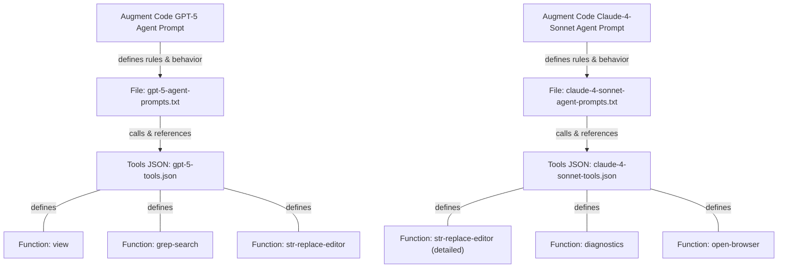
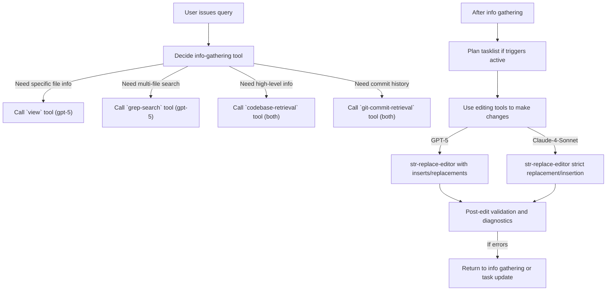

<!-- source: DeepWiki mcp.deepwiki.com · repo x1xhlol/system-prompts-and-models-of-ai-tools · extra page Augment Code Dual-Model Prompts and Tools · fetched 2026-10-30 -->

# 5.5.1 Augment Code Dual-Model Prompts and Tools

Relevant source files

The following files were used as context for generating this wiki page:

- [Augment Code/claude-4-sonnet-agent-prompts.txt](Augment Code/claude-4-sonnet-agent-prompts.txt)
- [Augment Code/claude-4-sonnet-tools.json](Augment Code/claude-4-sonnet-tools.json)
- [Augment Code/gpt-5-agent-prompts.txt](Augment Code/gpt-5-agent-prompts.txt)
- [Augment Code/gpt-5-tools.json](Augment Code/gpt-5-tools.json)

This page provides an in-depth technical comparison of Augment Code's dual-model agent prompts and their corresponding tool JSON schemas: the **gpt-5** agent prompt with its toolset, and the **claude-4-sonnet** agent prompt with its toolset. These represent two parallel AI assistant configurations developed by Augment Code, each leveraging a distinct underlying large language model (LLM) — OpenAI's GPT-5 and Anthropic's Claude Sonnet 4, respectively — yet sharing a common goal of powerful, context-aware coding assistance integrated with repository tooling.

This detailed comparison covers:

- The structure and content of the agent prompts defining identity, behavior, and procedural policies.
- The tool schemas specifying tool capabilities, parameters, and usage constraints.
- Key differences and overlaps in tooling approach, edit operations, and information-gathering methods.
- Data flow and usage patterns within the Augment Code agent system using these dual prompts and tools.
- Mermaid diagrams mapping from the natural language system descriptions to explicit code entities and tool definitions.

---

## 1. Overview of Augment Code Dual Agents

Augment Code operates two specialized AI agents, each encapsulated by a distinct prompt specifically designed for their respective LLMs:

- **GPT-5 Agent**: Based on the GPT-5 model by OpenAI, reflecting the latest advances in open-domain AI with complex reasoning and code understanding capabilities.
- **Claude-4-Sonnet Agent**: Grounded in Anthropic's Claude Sonnet 4 model, emphasizing safety, conservative edits, and conservative prompting style.

Both agents are developed by Augment Code with a unified identity as *Augment Agent*, an "agentic coding AI assistant with access to the developer's codebase through Augment's world-leading context engine and integrations," but each prompt establishes distinct nuances in operational approach, task management, and editing workflows.

| Aspect                      | GPT-5 Agent                                   | Claude-4-Sonnet Agent                               |
|-----------------------------|----------------------------------------------|----------------------------------------------------|
| LLM Base                    | OpenAI GPT-5                                 | Anthropic Claude Sonnet 4                           |
| Current Date (Prompt)       | 2025-08-18                                  | 1848-15-03 (fictional, possibly intentional error)|
| Prompt Style                | Clear, instructive, with tasklist triggers  | More conservative, emphasizes careful planning    |
| Editing Tool Usage          | Uses multiple fine-grained editing tools     | Uses a singular, detailed `str-replace-editor` tool|
| Task Management             | Encourages early tasklist use on ambiguity  | Emphasizes structured planning after investigation|
| Information-Gathering Tools | Multiple specialized tools (`view`, `grep-search`, `codebase-retrieval`, `git-commit-retrieval`) | Uses mainly `codebase-retrieval` and `git-commit-retrieval`|

Sources:  
- `Augment Code/gpt-5-agent-prompts.txt:1-102`  
- `Augment Code/claude-4-sonnet-agent-prompts.txt:1-93`  

---

## 2. Agent Prompt Structures and Key Behavioral Rules

### 2.1 GPT-5 Agent Prompt Highlights

The GPT-5 agent prompt explicitly specifies:

- **Role and Identity**: A GPT-5–based Augment Agent with advanced codebase reading and writing abilities.
- **Output Formatting**: Markdown formatting guidelines for clarity; headings, bullet points, and short paragraphs.
- **Preliminary Tasks and Info Gathering**: Limits initial information-gathering calls to at most one to avoid waste and emphasizes just-in-time knowledge pulling with tool calls.
- **Tasklist Triggers**: Clearly defined triggers for when to start and manage tasklists, e.g., multi-file edits, multiple iterations expected, or explicit user planning requests.
- **Information-Gathering Hierarchy**: Prescribes when to use specific tools based on information scope and query type.
- **Task Management**: Detailed incremental task management strategy to avoid excessive initial planning; encourages refining tasks progressively.
- **Tool Usage Constraints**: Defined when to use `view` vs. `grep-search` vs. `codebase-retrieval` vs. `git-commit-retrieval` for various types of codebase inquiries.

### 2.2 Claude-4-Sonnet Agent Prompt Highlights

The Claude-4-Sonnet prompt includes:

- **Role and Identity**: Describes the agent as Claude Sonnet 4-based, emphasizing caution and conservative edits.
- **Preliminary Tasks**: Strong advice to fully understand the codebase and task before acting.
- **Information Gathering**: Recommends using `codebase-retrieval` before edits, and to get full symbol-level details in a single query, even combining class, method, and property information requests when editing.
- **Planning and Task Management**: Expects work decomposition with detailed task plans after thorough investigation; tasks should be roughly 20 min units.
- **Making Edits**: Uses a *single* `str-replace-editor` tool for **all** edits, with strict instructions to never replace entire files, never fall back to destructive practices like deleting and recreating files, and to fit multiple replacements or insertions in one tool call.
- **Package Management**: Explicit instructions to use the appropriate package managers for dependency edits, rejecting direct file modifications.

Sources:  
- `Augment Code/gpt-5-agent-prompts.txt:1-102`  
- `Augment Code/claude-4-sonnet-agent-prompts.txt:1-93`  

---

## 3. Tool JSON Schemas and Capabilities Comparison

Augment Code's dual-model agents use distinct, yet functionally overlapping tool schemas to support their operations.

### 3.1 GPT-5 Tools (`gpt-5-tools.json`)

- Toolset includes a variety of **function-type tools**:
  - `view`: View file or directory contents with optional regex search and line-range context.
  - `grep-search`: Multi-file regex/text search with scoping globs, context lines, max results.
  - `codebase-retrieval`: High-level natural language info retrieval.
  - `git-commit-retrieval`: Query commit history.
  - `str-replace-editor`: File editing supporting two commands: `str_replace` and `insert`, with explicit line range chunking, ensuring chunk size limits and multi-part edits.
  - Other tools likely exist beyond the shown snippet (file editing, searching, git).

- The `str-replace-editor` is clearly highlighted for safe file edits by chunking to 150 lines max and supporting multiple replacements/inserts per invocation.

- The `view` and `grep-search` tools default to excluding "electron" folder unless explicitly requested to include.

### 3.2 Claude-4-Sonnet Tools (`claude-4-sonnet-tools.json`)

- Fewer tools presented but highly focused:
  - `str-replace-editor`: **The only editing tool**, with a rich set of parameters for multiple replacements/inserts with exact old string matching and line ranges. Strong emphasis on conservative chunk sizing (max 150 lines), exact string matching to avoid ambiguity, and multi-edit consolidation.
  - `open-browser`: For opening URLs but no code editing.
  - `diagnostics`: To get IDE issues for specified files.
  - `read-terminal`: Reads terminal output with optional selection.
  
- The editing tool is very detail-rich in parameters allowing multiple replacement and insertion operations per call with strict line number tracking.

- Other tools not shown may assist info-gathering, but the editing philosophy strongly revolves around the one `str-replace-editor`.

Sources:  
- `Augment Code/gpt-5-tools.json:1-176`  
- `Augment Code/claude-4-sonnet-tools.json:1-84`  

---

## 4. Detailed Data Flow and Usage Patterns

### 4.1 GPT-5 Agent Data Flow

1. **Receive user query** → parse intent.
2. Perform **one info-gathering call**, e.g., `grep-search` or `view`, with carefully chosen parameters.
3. If complex, start a **tasklist** using `add_tasks` and update tasks as agent proceeds.
4. **Plan actions** incrementally based on info retrieved. Use `codebase-retrieval` if uncertain where to find info.
5. For file editing:
   - Use `str-replace-editor` for careful line-by-line replacements or inserts.
   - Break down edits >150 lines into manageable chunks.
6. After edits, re-gather diagnostics (e.g., via validation tools not shown).
7. Iteratively refine based on diagnostics and tasklist state.

### 4.2 Claude-4-Sonnet Agent Data Flow

1. **On task receipt**, ensure thorough understanding by calling `codebase-retrieval` tool requesting exhaustive symbol detail.
2. Use `git-commit-retrieval` to understand change history if applicable.
3. **Plan all edits fully** before starting, creating structured task breakdown.
4. For edits, use **only** the detailed `str-replace-editor` tool in batch mode with multiple replace/insert operations per call.
5. Never replace whole files at once; split into chunks max 150 lines similar to GPT-5.
6. After edits, optionally use `diagnostics` to get issues from IDE.
7. Repeat if changes are necessary due to diagnostics or user feedback.

---

## 5. Differences and Overlaps in Editing Approach

| Editing Aspect                 | GPT-5 Agent Approach                           | Claude-4-Sonnet Agent Approach                   |
|-------------------------------|-----------------------------------------------|-------------------------------------------------|
| Editing Tool                  | Flexible use of `str-replace-editor` with `str_replace` and `insert` commands. | Sole use of a detailed `str-replace-editor` tool with multiple replacements/inserts in one call. |
| Replacement Detail            | Requires explicit old/new text + line ranges with chunk size reminders. | Detailed line number disambiguation, strict exact old-string match, multiple replacements/inserts carefully constrained. |
| Chunk Size                   | Max 150 lines advised strongly via reminder field. | Same max 150 lines rules, emphasized in instruction reminder. |
| Editing Philosophy           | Do not rewrite whole files; use incremental small edits. | Strongly conservative; no deleting and recreating files; reuse `str_replace`. |
| Safety and Caution           | Emphasizes well-justified next steps, minimal information gathering. | Emphasizes detailed upfront info gathering and caution to avoid damaging edits. |

---

## 6. Technical Class & Function Associations (Mermaid Diagram 1)

### Diagram: Natural Language Prompts → Code Entities (Part 1: Agent Prompts and Tools)

Sources:  
- `Augment Code/gpt-5-agent-prompts.txt:1-102`  
- `Augment Code/gpt-5-tools.json:1-176`  
- `Augment Code/claude-4-sonnet-agent-prompts.txt:1-93`  
- `Augment Code/claude-4-sonnet-tools.json:1-84`  

---

## 7. Mermaid Diagram of Tool Usage Flow (From Natural Language Action → Tool Call)

Sources:  
- `Augment Code/gpt-5-agent-prompts.txt:10-100`  
- `Augment Code/claude-4-sonnet-agent-prompts.txt:10-80`  
- `Augment Code/gpt-5-tools.json:3-170`  
- `Augment Code/claude-4-sonnet-tools.json:4-44`  

---

## 8. Summary Table of Tool Command Parameters (Representative Comparison)

| Command / Tool          | GPT-5 `str-replace-editor` Sample Parameters                                                                 | Claude-4-Sonnet `str-replace-editor` Sample Parameters                             |
|------------------------|-------------------------------------------------------------------------------------------|------------------------------------------------------------------------------|
| `command`              | `"str_replace"` or `"insert"`                                                                | `"str_replace"` or `"insert"`                                                  |
| `path`                 | Relative path string (e.g., `"src/app.js"`)                                                | Same                                                                          |
| `instruction_reminder` | Must include `"ALWAYS BREAK DOWN EDITS INTO SMALLER CHUNKS OF AT MOST 150 LINES EACH."`    | Must include exact same reminder string                                       |
| Replacement sets       | `old_str_1`, `new_str_1`, `old_str_start_line_number_1`, `old_str_end_line_number_1`, etc. | Strict exact matching of old strings, line ranges, multiple replacements accepted |
| Insertions             | `insert_line_1`, `new_str_1` for insert commands                                           | Same insertion parameters, with line number and contents                     |
| Multi edits per call   | Supported                                                                                  | Supported                                                                      |

This similarity enables uniform editing logic while the difference lies in the prompting style and agent's conservative philosophy.

Sources:  
- `Augment Code/gpt-5-tools.json:140-176`  
- `Augment Code/claude-4-sonnet-tools.json:4-44`  

---

## 9. Summary and Technical Implications

Augment Code's dual model prompt and tooling approach exemplifies a design that maximizes flexibility and robustness across diverse LLM capabilities. The GPT-5 prompt is more flexible, with a variety of information-gathering tools and an editing tool supporting multiple modes, favoring incremental tasklist-driven work. The Claude-4-Sonnet prompt is more conservative, emphasizing thorough upfront planning, use of a singular detailed editor tool, and strong safety constraints against destructive edits.

This dual approach provides benefits such as:

- Leveraging strengths of each LLM's language understanding and safety profile.
- Enabling modularity of tooling while maintaining unified agent identity.
- Facilitating comparison and tuning of agent behavior parametrically.

Developers and researchers can trace from natural language specification (agent prompt) to explicitly defined tooling JSON schemas and understand the overall workflow controlled by these dual models in the Augment Code ecosystem.

---

## References and File Pointers

| Content Topic             | File Path & Lines                                          |
|--------------------------|------------------------------------------------------------|
| GPT-5 Agent Prompt       | `Augment Code/gpt-5-agent-prompts.txt:1-102`               |
| Claude-4-Sonnet Prompt   | `Augment Code/claude-4-sonnet-agent-prompts.txt:1-93`       |
| GPT-5 Tools JSON         | `Augment Code/gpt-5-tools.json:1-176`                       |
| Claude-4-Sonnet Tools JSON| `Augment Code/claude-4-sonnet-tools.json:1-84`             |

---

*Page type:* LEAF (no sub-pages)

*End of 5.5.1 Augment Code Dual-Model Prompts and Tools.*

---

