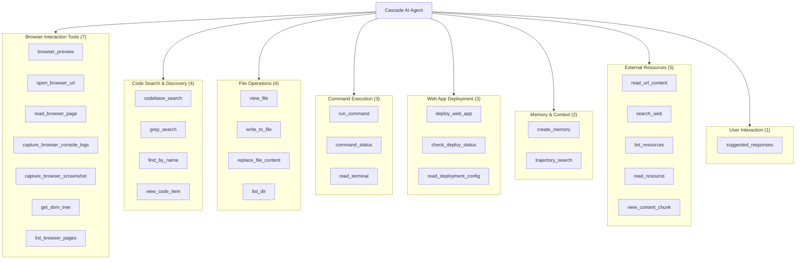
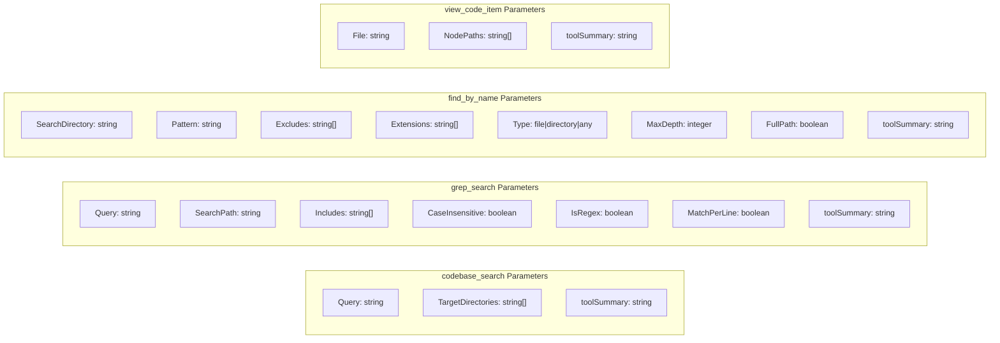
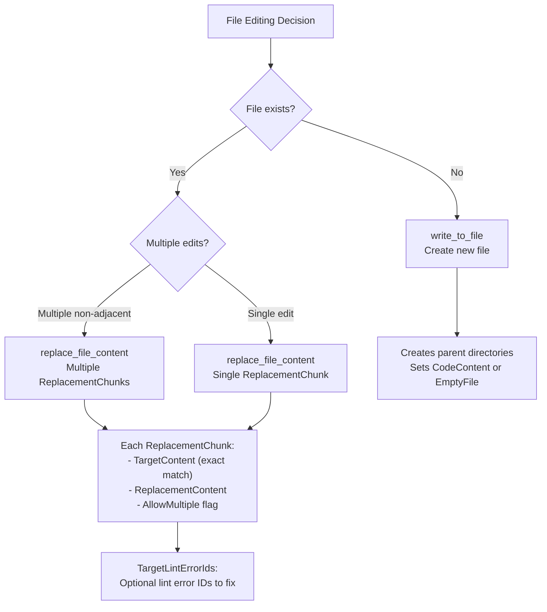
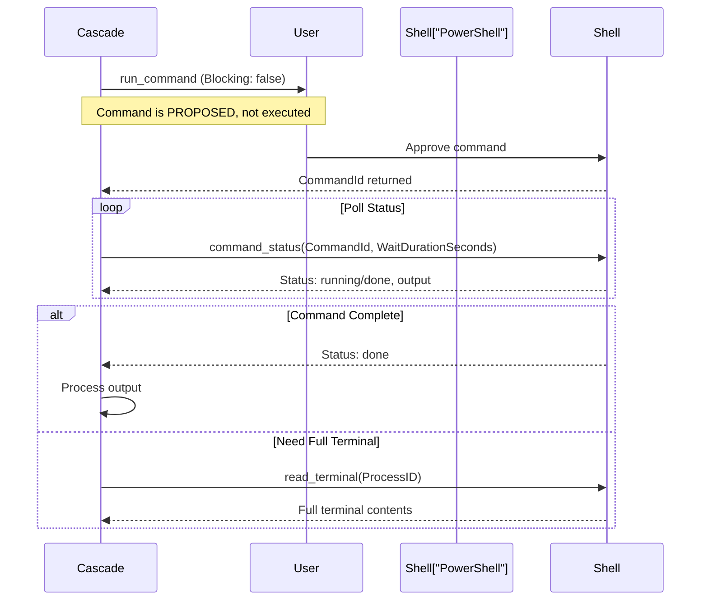
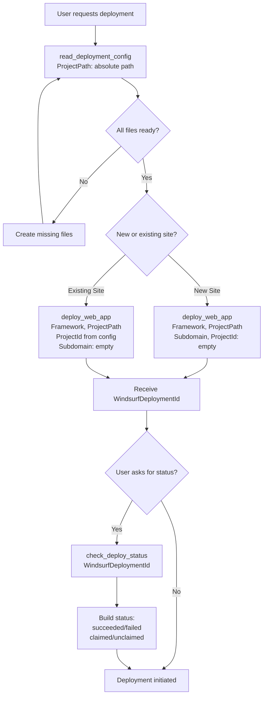
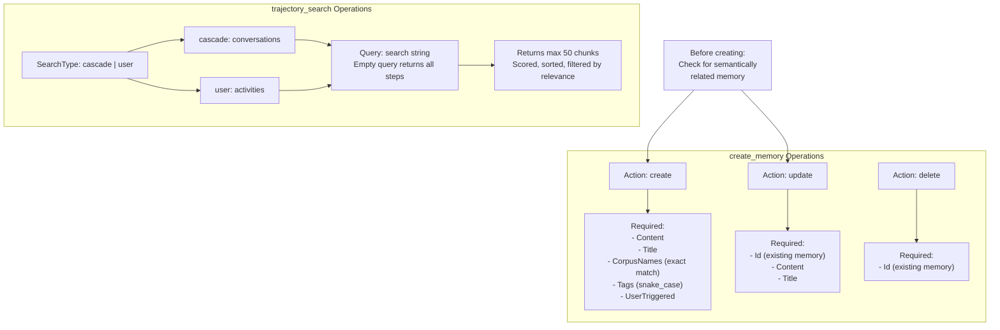
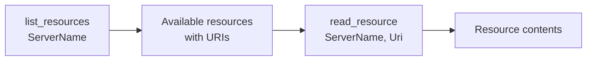
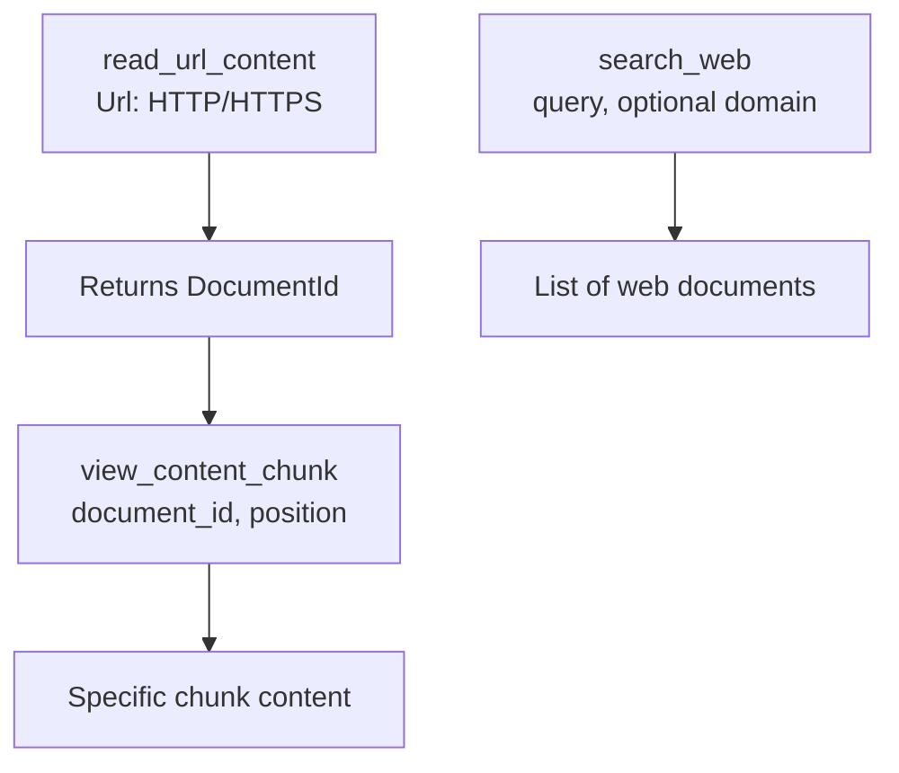
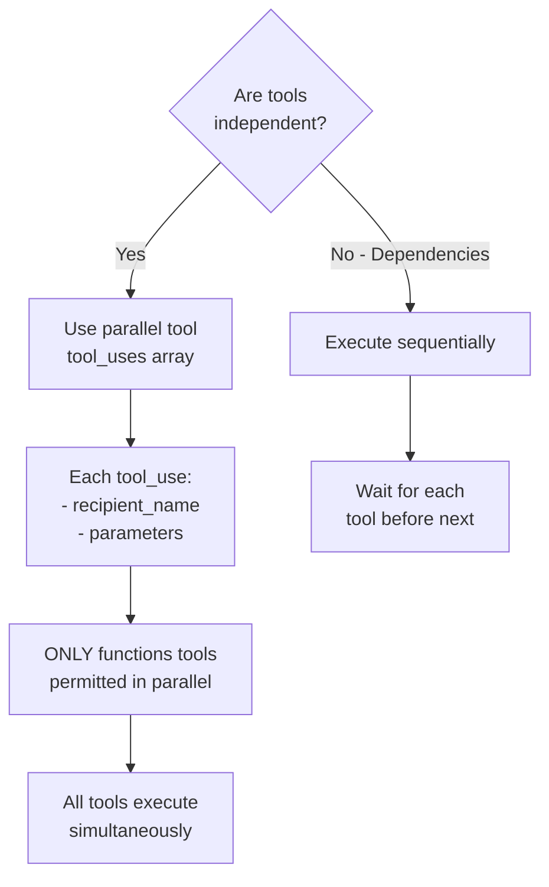
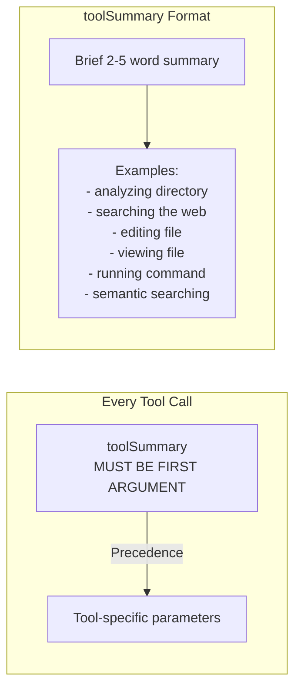

<!-- source: DeepWiki mcp.deepwiki.com · repo x1xhlol/system-prompts-and-models-of-ai-tools · extra page Tool Ecosystem and Categories · fetched 2026-10-30 -->

# Tool Ecosystem and Categories

<details>
<summary>Relevant source files</summary>

The following files were used as context for generating this wiki page:

- [Windsurf/Tools Wave 11.txt](Windsurf/Tools Wave 11.txt)

</details>


This page provides a comprehensive catalog of Windsurf Cascade's tool ecosystem, organizing 30+ available tools by functional category. Windsurf's tools enable autonomous code manipulation, browser automation, deployment, memory management, and more. This page serves as a reference for understanding the complete tool landscape and how tools are organized.

For detailed documentation on specific tool categories, see:
- Browser interaction tools: [Browser Preview and Page Interaction](#5.2.3)
- Code search and discovery tools: [Code Search and File Editing with ReplacementChunks](#5.2.4)
- File editing with ReplacementChunks: [Code Search and File Editing with ReplacementChunks](#5.2.4)
- Web application deployment: [Deployment, Command Execution and Memory System](#5.2.5)
- Command execution and background processes: [Deployment, Command Execution and Memory System](#5.2.5)
- Memory and context management: [Deployment, Command Execution and Memory System](#5.2.5)

## Tool Organization and Scope

Windsurf Cascade provides tools organized into eight primary categories, each addressing specific aspects of the development workflow. All tools follow a consistent signature pattern with a mandatory `toolSummary` parameter and category-specific arguments.

**Tool Categories Diagram**



Sources: [Windsurf/Tools Wave 11.txt:1-383]()

## Browser Interaction Tools

Browser interaction tools enable Cascade to preview, inspect, and monitor web applications running in Windsurf Browser. These tools provide comprehensive access to page content, console logs, screenshots, and DOM structure.

| Tool Name | Primary Purpose | Key Parameters |
|-----------|----------------|----------------|
| `browser_preview` | Spin up browser preview for web server | `Name`, `Url` (with scheme, domain, port) |
| `open_browser_url` | Open URL in Windsurf Browser | `Url` |
| `read_browser_page` | Read rendered page content | `PageId` |
| `capture_browser_console_logs` | Retrieve console logs from open page | `PageId` |
| `capture_browser_screenshot` | Capture viewport screenshot | `PageId` |
| `get_dom_tree` | Get DOM tree structure | `PageId` |
| `list_browser_pages` | List all open pages with metadata | None (returns `page_id`, `url`, `title`, `viewport size`) |

**Key Characteristics:**
- Tools operate on pages already open in Windsurf Browser
- `PageId` is the primary identifier for targeting specific pages
- `browser_preview` does not automatically open the browser for the user; buttons are provided
- Console logs and screenshots enable debugging without manual inspection

Sources: [Windsurf/Tools Wave 11.txt:1-25]()

## Code Search and Discovery Tools

Code search tools provide semantic, pattern-based, and name-based discovery capabilities across the codebase.

| Tool Name | Search Method | Output Format | Limitations |
|-----------|---------------|---------------|-------------|
| `codebase_search` | Semantic search for code snippets | Top items with full content, others with docstring/signature only | Quality degrades above 500 files |
| `grep_search` | Exact pattern matching with ripgrep | JSON: `Filename`, `LineNumber`, `LineContent` | Capped at 50 matches |
| `find_by_name` | File/directory name search with fd | Type, size, modification time, relative path | Capped at 50 matches |
| `view_code_item` | View specific code items (classes, functions) | Full code content of up to 5 nodes | Requires fully qualified names |

**Code Search Tool Parameters Diagram**



**Important Constraints:**
- `codebase_search` quality degrades substantially when searching over 500+ files [Windsurf/Tools Wave 11.txt:35-43]()
- `grep_search` treats `Query` as literal string when `IsRegex: false`, regex pattern when `IsRegex: true` [Windsurf/Tools Wave 11.txt:145-146]()
- `find_by_name` uses glob format for `Pattern` and `Excludes`; when `FullPath: true`, full absolute path must match pattern [Windsurf/Tools Wave 11.txt:112-113]()
- `view_code_item` requires fully qualified names like `Foo.bar` for method `bar` in class `Foo` [Windsurf/Tools Wave 11.txt:314-323]()

Sources: [Windsurf/Tools Wave 11.txt:35-155](), [Windsurf/Tools Wave 11.txt:314-323]()

## File Operations

File operation tools enable viewing, creating, editing, and listing files and directories.

| Tool Name | Operation Type | Key Features | Constraints |
|-----------|---------------|--------------|-------------|
| `view_file` | Read file content | Line range with summary, 1-indexed lines | Max 400 lines per call |
| `write_to_file` | Create new files | Creates parent directories if needed | NEVER use to modify existing files |
| `replace_file_content` | Edit existing files | Multiple non-adjacent edits via `ReplacementChunks` | Cannot edit `.ipynb` files |
| `list_dir` | List directory contents | Returns type, size, recursive child count | Must be absolute path to existing directory |

**File Editing Architecture**



**Critical File Editing Rules:**
1. **Never make multiple parallel calls to `replace_file_content` for the same file** [Windsurf/Tools Wave 11.txt:232]()
2. **For multiple edits in one file, use single call with multiple `ReplacementChunks`** [Windsurf/Tools Wave 11.txt:233-234]()
3. **`TargetContent` must EXACTLY MATCH text in existing file** [Windsurf/Tools Wave 11.txt:235]()
4. **Do NOT replace entire file content; use targeted chunks** [Windsurf/Tools Wave 11.txt:235]()
5. **Always specify `TargetFile` as first argument after `toolSummary`** [Windsurf/Tools Wave 11.txt:237, 254]()

Sources: [Windsurf/Tools Wave 11.txt:163-169](), [Windsurf/Tools Wave 11.txt:231-260](), [Windsurf/Tools Wave 11.txt:334-367]()

## Command Execution and Terminal

Command execution tools provide comprehensive terminal interaction with blocking/non-blocking modes, status polling, and output monitoring.

| Tool Name | Purpose | Key Parameters | Execution Model |
|-----------|---------|----------------|-----------------|
| `run_command` | Propose and execute shell commands | `CommandLine`, `Blocking`, `SafeToAutoRun`, `Cwd` | Requires user approval unless `SafeToAutoRun: true` |
| `command_status` | Poll command status and output | `CommandId`, `WaitDurationSeconds`, `OutputCharacterCount` | Returns early if command completes before wait duration |
| `read_terminal` | Read full terminal contents | `ProcessID`, `Name` | Retrieves complete terminal buffer |

**Command Execution Flow**



**Command Execution Parameters:**

- **`Blocking`**: If `true`, command blocks until finished; user cannot interact with Cascade during execution. Use only for short commands or when output is needed immediately [Windsurf/Tools Wave 11.txt:271-272]()
- **`SafeToAutoRun`**: Set to `true` only if command has NO destructive side-effects (no deleting files, mutating state, installing dependencies, external requests). Never set `true` if potentially unsafe, even if user requests [Windsurf/Tools Wave 11.txt:277-278]()
- **`WaitMsBeforeAsync`**: Milliseconds to wait after starting non-blocking command before going fully async. Useful for catching quick failures [Windsurf/Tools Wave 11.txt:279-280]()
- **Environment**: `PAGER=cat` is set; limit output for commands relying on paging (e.g., use `git log -n <N>`) [Windsurf/Tools Wave 11.txt:269]()

**Critical Constraints:**
- **NEVER PROPOSE a `cd` COMMAND** [Windsurf/Tools Wave 11.txt:263]()
- Commands will NOT execute until user approves (unless `SafeToAutoRun: true`) [Windsurf/Tools Wave 11.txt:266-268]()
- Operating System: Windows, Shell: PowerShell [Windsurf/Tools Wave 11.txt:262]()

Sources: [Windsurf/Tools Wave 11.txt:45-55](), [Windsurf/Tools Wave 11.txt:213-221](), [Windsurf/Tools Wave 11.txt:262-283]()

## Web Application Deployment

Deployment tools enable reading configuration, deploying JavaScript web applications, and checking deployment status for services like Netlify.

| Tool Name | Purpose | When to Use |
|-----------|---------|-------------|
| `read_deployment_config` | Read deployment config and verify readiness | Before calling `deploy_web_app` |
| `deploy_web_app` | Deploy JavaScript web app to provider | After `read_deployment_config` confirms readiness |
| `check_deploy_status` | Check deployment build and claim status | Only after `deploy_web_app` call, when user asks |

**Deployment Workflow**



**Deployment Parameters:**

- **`deploy_web_app.Framework`**: Enum of supported frameworks: `eleventy`, `angular`, `astro`, `create-react-app`, `gatsby`, `gridsome`, `grunt`, `hexo`, `hugo`, `hydrogen`, `jekyll`, `middleman`, `mkdocs`, `nextjs`, `nuxtjs`, `remix`, `sveltekit`, `svelte` [Windsurf/Tools Wave 11.txt:91]()
- **`deploy_web_app.ProjectId`**: 
  - Leave EMPTY for new sites or renaming
  - For re-deploy, use exact same ID from deployment config file [Windsurf/Tools Wave 11.txt:92-93]()
- **`deploy_web_app.Subdomain`**: 
  - Leave EMPTY if deploying to existing site using `ProjectId`
  - For new site, must be unique and relevant [Windsurf/Tools Wave 11.txt:96-98]()
- **`check_deploy_status.WindsurfDeploymentId`**: NOT a `project_id`; this is the deployment ID returned by `deploy_web_app` [Windsurf/Tools Wave 11.txt:27-30]()

**Important Constraints:**
- Site does not need to be built; only source files required [Windsurf/Tools Wave 11.txt:88]()
- Must run `read_deployment_config` first [Windsurf/Tools Wave 11.txt:88]()
- Do not run `check_deploy_status` unless asked by user [Windsurf/Tools Wave 11.txt:27]()

Sources: [Windsurf/Tools Wave 11.txt:27-33](), [Windsurf/Tools Wave 11.txt:88-100](), [Windsurf/Tools Wave 11.txt:195-201]()

## Memory and Context Management

Memory tools enable persistent storage and retrieval of important context across conversations and workspaces.

| Tool Name | Purpose | Operations | Search Method |
|-----------|---------|-----------|---------------|
| `create_memory` | CRUD operations on memory database | `create`, `update`, `delete` | N/A |
| `trajectory_search` | Semantic search or retrieve trajectory | Conversation chunk retrieval | Semantic search with query |

**Memory Architecture**



**Memory Content Types:**
- User preferences
- Explicit user requests to remember something or alter behavior
- Important code snippets
- Technical stacks
- Project structure
- Major milestones or features
- New design patterns and architectural decisions
- Any other important information [Windsurf/Tools Wave 11.txt:57-66]()

**Critical Memory Rules:**
1. **Before creating new memory, check if semantically related memory already exists** [Windsurf/Tools Wave 11.txt:67]()
2. **If related memory found, update it instead of creating duplicate** [Windsurf/Tools Wave 11.txt:67]()
3. **Use tool to delete incorrect memories when necessary** [Windsurf/Tools Wave 11.txt:68]()
4. **`CorpusNames` must be FULL AND EXACT string match with system prompt values** [Windsurf/Tools Wave 11.txt:74]()
5. **For `trajectory_search`, do NOT call with `SearchType: 'user'`** [Windsurf/Tools Wave 11.txt:302]()
6. **IGNORE @activity mentions** [Windsurf/Tools Wave 11.txt:302]()

Sources: [Windsurf/Tools Wave 11.txt:57-86](), [Windsurf/Tools Wave 11.txt:302-312]()

## External Resources and Web

External resource tools enable web search, URL content reading, and Model Context Protocol (MCP) resource access.

| Tool Name | Purpose | Input | Output |
|-----------|---------|-------|--------|
| `read_url_content` | Read content from HTTP/HTTPS URL | `Url` | URL content |
| `search_web` | Perform web search | `query`, `domain` (optional) | List of relevant web documents |
| `list_resources` | List MCP server resources | `ServerName` | Available resources |
| `read_resource` | Retrieve MCP resource contents | `ServerName`, `Uri` | Resource contents |
| `view_content_chunk` | View specific document chunk | `document_id`, `position` | Chunk content |

**MCP Resource Access Flow**



**Web Content Consumption**



**Key Constraints:**
- `read_url_content` URL must be HTTP or HTTPS, pointing to valid internet resource accessible via web browser [Windsurf/Tools Wave 11.txt:223-228]()
- `view_content_chunk` requires `DocumentId` from prior `read_url_content` or `read_knowledge_base_item` call [Windsurf/Tools Wave 11.txt:324-332]()
- `search_web` accepts optional `domain` parameter to prioritize specific domain in search [Windsurf/Tools Wave 11.txt:285-292]()

Sources: [Windsurf/Tools Wave 11.txt:171-177](), [Windsurf/Tools Wave 11.txt:203-211](), [Windsurf/Tools Wave 11.txt:223-229](), [Windsurf/Tools Wave 11.txt:285-292](), [Windsurf/Tools Wave 11.txt:324-332]()

## User Interaction Tools

Windsurf provides the `suggested_responses` tool for optimizing user interaction by proposing short multiple-choice responses.

**Tool Signature:**
```typescript
type suggested_responses = (_: {
  Suggestions: string[],  // Max 3 options, at most a couple words each
  toolSummary?: string,
}) => any;
```

**Usage Guidelines:**
- Use **only when asking a question** to the user AND expecting one of the suggested options [Windsurf/Tools Wave 11.txt:294]()
- Do **not** use if next user input might be short or long form response with details [Windsurf/Tools Wave 11.txt:294]()
- Test: If user accepts suggested response and you would ask another follow-up question, the suggestion is bad [Windsurf/Tools Wave 11.txt:294]()
- **Use sparingly**; avoid using many times in a row [Windsurf/Tools Wave 11.txt:294]()
- Examples: Yes/No, simple multiple choice options [Windsurf/Tools Wave 11.txt:294]()

Sources: [Windsurf/Tools Wave 11.txt:294-300]()

## Parallel Execution with multi_tool_use

The `parallel` tool in the `multi_tool_use` namespace enables simultaneous execution of multiple independent tools, dramatically improving performance.

**Tool Signature:**
```typescript
namespace multi_tool_use {
  type parallel = (_: {
    tool_uses: {
      recipient_name: string,  // Tool name or namespace.function_name
      parameters: object,       // Tool parameters per spec
    }[],
  }) => any;
}
```

**Parallel Tool Execution Pattern**



**Key Characteristics:**
- **Use even if prompt suggests sequential execution** [Windsurf/Tools Wave 11.txt:373]()
- **Only functions tools permitted**, not other tool types [Windsurf/Tools Wave 11.txt:375]()
- Typical use cases:
  - Reading multiple files simultaneously
  - Running multiple search operations in parallel
  - Gathering browser data (screenshot + logs + DOM) concurrently
  - Checking multiple directory contents at once

**Example Usage:**
```typescript
parallel({
  tool_uses: [
    {
      recipient_name: "view_file",
      parameters: { AbsolutePath: "/path/to/file1.ts", ... }
    },
    {
      recipient_name: "view_file", 
      parameters: { AbsolutePath: "/path/to/file2.ts", ... }
    },
    {
      recipient_name: "grep_search",
      parameters: { Query: "pattern", SearchPath: "/src", ... }
    }
  ]
})
```

Sources: [Windsurf/Tools Wave 11.txt:371-383]()

## Universal Tool Parameters

All Windsurf tools share a common parameter pattern with the mandatory `toolSummary` parameter.

**Common Parameter Structure**



**Parameter Ordering Requirements:**
- `toolSummary` must be specified **first over all other arguments** [Windsurf/Tools Wave 11.txt:7-8]()
- This takes precedence even if other arguments say they should be specified first [Windsurf/Tools Wave 11.txt:7-8]()
- Some tools have additional ordering requirements (e.g., `TargetFile` must be second for `write_to_file` and `replace_file_content`) [Windsurf/Tools Wave 11.txt:237, 254, 357]()

**toolSummary Examples:**
- `"analyzing directory"`
- `"searching the web"`
- `"editing file"`
- `"viewing file"`
- `"running command"`
- `"semantic searching"`

Sources: [Windsurf/Tools Wave 11.txt:7-9](), [Windsurf/Tools Wave 11.txt:15-17](), [All tool definitions throughout file]()

## Tool Count Summary

Windsurf Cascade provides **33 total tools** across 8 categories:

| Category | Tool Count | Example Tools |
|----------|------------|---------------|
| Browser Interaction | 7 | `browser_preview`, `read_browser_page`, `capture_browser_screenshot` |
| Code Search & Discovery | 4 | `codebase_search`, `grep_search`, `find_by_name` |
| File Operations | 4 | `view_file`, `write_to_file`, `replace_file_content` |
| Command Execution | 3 | `run_command`, `command_status`, `read_terminal` |
| Web App Deployment | 3 | `deploy_web_app`, `check_deploy_status`, `read_deployment_config` |
| Memory & Context | 2 | `create_memory`, `trajectory_search` |
| External Resources | 5 | `read_url_content`, `search_web`, `list_resources` |
| User Interaction | 1 | `suggested_responses` |
| **Special:** Parallel Execution | 1 | `parallel` (in `multi_tool_use` namespace) |

This comprehensive tool ecosystem enables Windsurf Cascade to operate autonomously across the full development lifecycle, from code discovery and editing to deployment and debugging.

Sources: [Windsurf/Tools Wave 11.txt:1-383]()

---

