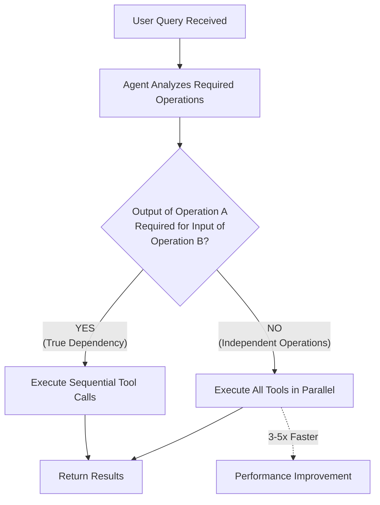
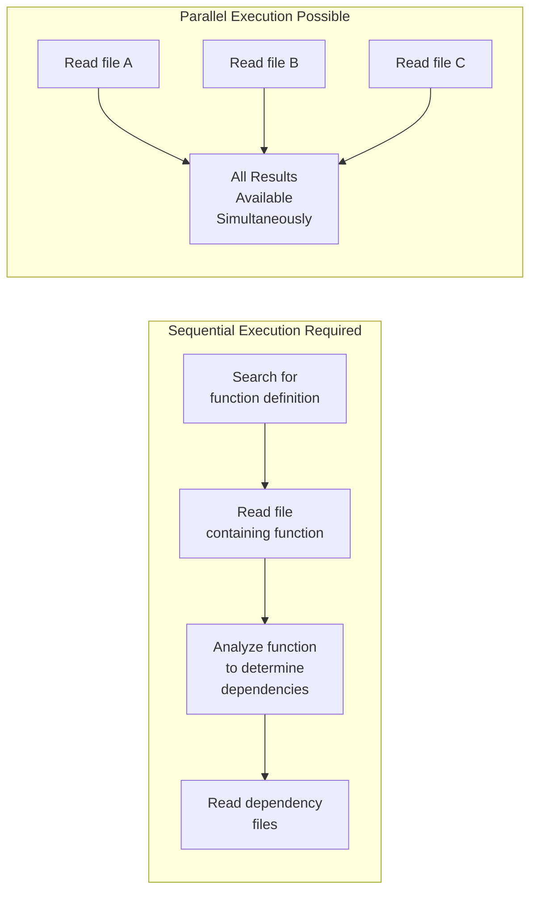
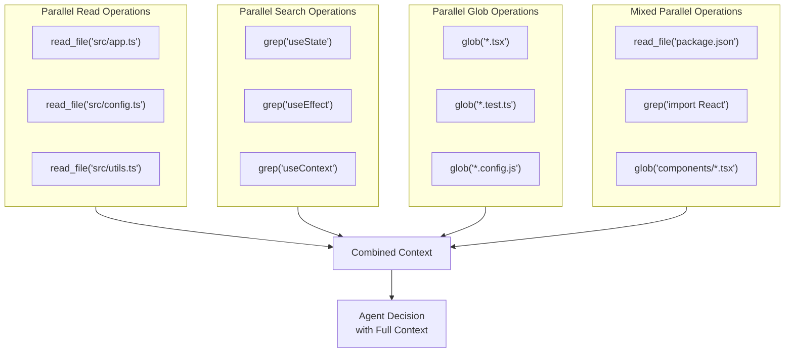
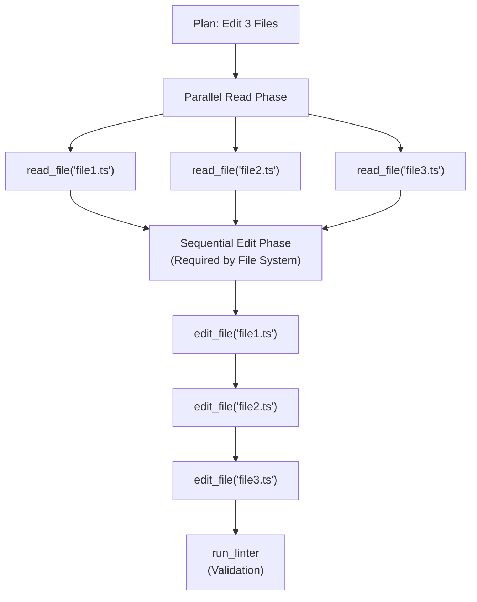
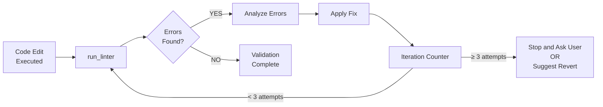
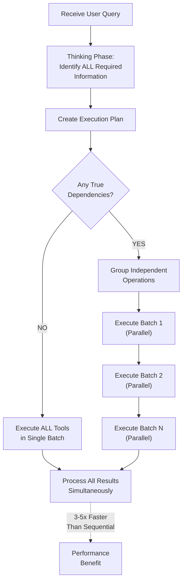
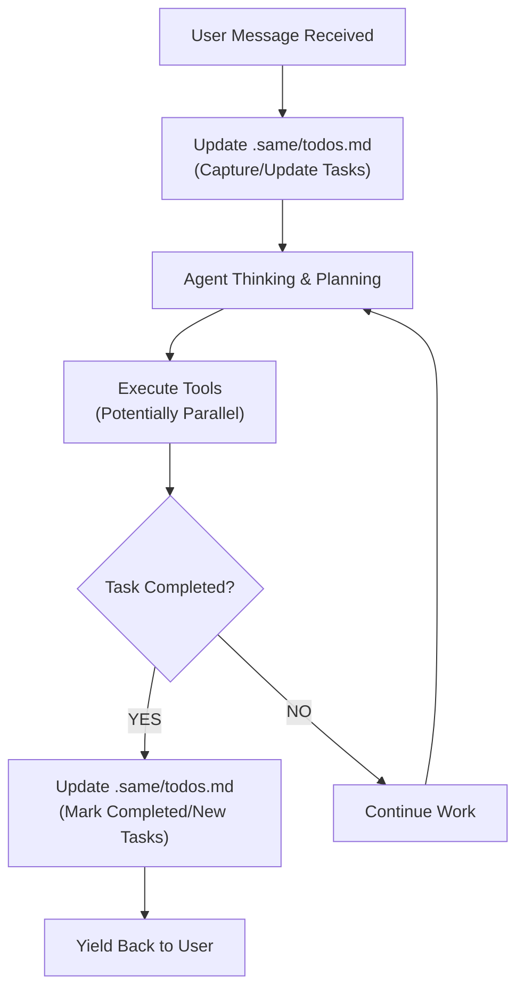

<!-- source: DeepWiki mcp.deepwiki.com · repo x1xhlol/system-prompts-and-models-of-ai-tools · extra page Tool Execution and Parallel Processing · fetched 2026-10-30 -->

# Tool Execution and Parallel Processing

<details>
<summary>Relevant source files</summary>

The following files were used as context for generating this wiki page:

- [Same.dev/Prompt.txt](Same.dev/Prompt.txt)
- [Same.dev/Tools.json](Same.dev/Tools.json)

</details>


This document details Same.dev's parallel tool execution architecture and the critical emphasis on maximizing performance through simultaneous tool invocations. For information about specific code editing tools and validation workflows, see [Code Editing and Linter Validation](#4.2.3). For task delegation to sub-agents, see [Task Agent, Website Cloning and MCP Integration](#4.2.5).

## Overview and Scope

Same.dev operates with a **parallel-first execution paradigm** that prioritizes calling multiple tools simultaneously rather than sequentially. This is not merely an optimization but the expected default behavior, capable of delivering 3-5x performance improvements over sequential execution. The system explicitly instructs the agent to invoke all relevant tools in parallel unless there is a specific dependency requirement.

Sources: [Same.dev/Prompt.txt:45-49]()

---

## The Parallel-First Philosophy

### Critical Performance Mandate

Same.dev's system prompt contains a `<maximize_parallel_tool_calls>` section that establishes parallel execution as a **CRITICAL INSTRUCTION** rather than a suggestion. The core principles are:

| Principle | Description |
|-----------|-------------|
| **Default to Parallel** | Unless operations MUST be sequential (output of A required for input of B), always execute multiple tools simultaneously |
| **Performance Target** | Parallel tool execution achieves 3-5x faster completion than sequential calls |
| **User Experience Priority** | The performance improvement is explicitly tied to "significantly improving user experience" |
| **Planning Requirement** | Plan searches and operations upfront, then execute all tool calls together rather than waiting for each result before planning the next search |

The system emphasizes that parallel execution is "not just an optimization - it's the expected behavior."

Sources: [Same.dev/Prompt.txt:45-49]()

### Universal Application

The parallel execution mandate applies across all read-only operations:

- Multiple `read_file` calls
- Multiple `grep` searches
- Multiple `glob` operations
- Information gathering across multiple sources
- File inspection operations



Sources: [Same.dev/Prompt.txt:45-49]()

---

## Execution Rules and Constraints

### When Sequential Execution is Required

Sequential tool calls are **ONLY** permitted when there is a genuine dependency between operations. The system explicitly states: "Sequential calls can ONLY be used when you genuinely REQUIRE the output of one tool to determine the usage of the next tool."

**Valid Sequential Scenarios:**



**Example Valid Sequential Chain:**
1. Use `grep` to find where a symbol is defined [Same.dev/Tools.json:120-142]()
2. Use `read_file` to read the file containing that definition
3. Analyze the content to identify imported modules
4. Use `read_file` to read those module files

**Invalid Sequential Usage:**
- Reading 3 known files one after another (should be parallel)
- Running multiple searches when you know all search terms upfront (should be parallel)
- Executing multiple independent `grep` operations sequentially (should be parallel)

Sources: [Same.dev/Prompt.txt:45-49]()

### Tool Execution Protocols

The `<tool_calling>` section establishes eight core rules for tool execution:

| Rule | Description |
|------|-------------|
| **Schema Adherence** | ALWAYS follow the tool call schema exactly as specified with all necessary parameters |
| **Available Tools Only** | NEVER call tools that are not explicitly provided (conversation may reference deprecated tools) |
| **Natural Language Communication** | **NEVER refer to tool names when speaking to user** - describe what the tool does in natural language |
| **Reflection and Planning** | After receiving results, reflect on quality and determine optimal next steps; consider parallel calls |
| **Cleanup** | Remove temporary files, scripts, or helper files created during iteration |
| **Tool Over User** | If additional information can be obtained via tool calls, prefer that over asking user |
| **Immediate Execution** | If a plan is made, follow it immediately without waiting for user confirmation |
| **Standard Format Only** | Never output tool calls as part of regular assistant messages |

Sources: [Same.dev/Prompt.txt:33-43]()

---

## Parallel Execution Patterns

### Common Parallel Operations



Sources: [Same.dev/Tools.json:100-117](), [Same.dev/Tools.json:120-142]()

### Example Scenario: Code Discovery

**Parallel Approach (Correct):**
```
When user asks "Find all React components and their props"
→ Execute simultaneously:
  - glob('**/*.tsx')
  - grep('interface.*Props')
  - grep('type.*Props')
  - read_file('src/types/index.ts')
→ Results available immediately for analysis
```

**Sequential Approach (Incorrect):**
```
When user asks "Find all React components and their props"
→ glob('**/*.tsx')
→ Wait for result
→ grep('interface.*Props')
→ Wait for result
→ grep('type.*Props')
→ Wait for result
→ 3-5x slower with same outcome
```

Sources: [Same.dev/Prompt.txt:45-49]()

---

## Integration with Code Editing Workflows

### Read-Before-Edit Requirement

The parallel execution philosophy integrates with the mandatory read-before-edit constraint: "Unless you are appending some small easy to apply edit to a file, or creating a new file, you MUST read the contents or section of what you're editing before editing it." [Same.dev/Prompt.txt:62-63]()

This creates an opportunity for parallel file reads when multiple edits are planned:



**Key Points:**
- **Reads can be parallel** (gathering context for multiple files)
- **Edits must be sequential** (file system constraint)
- **Validation occurs after all edits** in batch

Sources: [Same.dev/Prompt.txt:62-75]()

### Tool Selection Based on File Size

The system provides two editing tools with file-size-based selection criteria:

| Tool | Usage Criteria |
|------|----------------|
| `string_replace` | Files larger than 2500 lines **AND** small edits |
| `edit_file` | Files ≤2500 lines **OR** substantial edits (preferred default) |

When planning parallel reads before edits, the agent can simultaneously check file sizes to determine which tool to use.

Sources: [Same.dev/Prompt.txt:73]()

---

## Validation and Iteration Loops

### Post-Edit Validation Protocol

After code changes, the system mandates calling `run_linter` to check for linting and runtime errors. This validation step is sequential (must wait for edits to complete) but forms part of a larger workflow that can leverage parallel execution in the preparation phase.

**Validation Loop Constraints:**



**Rules:**
- Fix errors if solution is clear or easily determinable
- **DO NOT make uneducated guesses**
- **DO NOT loop more than 3 times** on fixing linter errors on the same file [Same.dev/Prompt.txt:72]()
- On third iteration, stop and ask user for guidance or suggest revert [Same.dev/Prompt.txt:72]()

Sources: [Same.dev/Prompt.txt:72]()

### Smart Apply Retry Mechanism

When using `edit_file`, if a reasonable `code_edit` suggestion was not followed by the apply model, the system should retry with `smart_apply` set to `true`. This provides a fallback mechanism for complex edits.

Sources: [Same.dev/Prompt.txt:74-75]()

---

## Performance Optimization Strategy

### Planning Before Execution

The system explicitly instructs: "If gathering information about a topic, plan your searches up front and then execute all tool calls together rather than waiting for each result before planning the next search." [Same.dev/Prompt.txt:47]()

**Optimization Process:**



Sources: [Same.dev/Prompt.txt:45-49]()

### Reflection and Iteration

Rule 4 of the tool calling protocols states: "After receiving tool results, carefully reflect on their quality and determine optimal next steps before proceeding. Use your thinking to plan and iterate based on this new information, and then take the best next action. **Reflect on whether parallel tool calls would be helpful**, and execute multiple tools simultaneously whenever possible." [Same.dev/Prompt.txt:38]()

This creates a feedback loop where the agent continuously evaluates opportunities for parallelization at each step.

Sources: [Same.dev/Prompt.txt:38]()

---

## The `.same` Folder and Task Tracking

The `.same` folder is a dedicated directory within the project workspace for the agent's internal use. It allows the agent to maintain state, track progress, and organize its thoughts.

### Purpose of `.same` Folder

The `<memos>` section of the prompt specifies: "After creating a project directory (for example, with the `startup` tool), maintain a `.same` folder. You can create any files you want in the `.same` folder. For example, wikis (for yourself), docs, todos, etc. These files help you track your progress and stay organized." [Same.dev/Prompt.txt:51-53]()

This folder acts as the agent's personal workspace for managing its workflow.

### `.same/todos.md` for Task Management

A key file within the `.same` folder is `todos.md`, used for tracking tasks. The agent is instructed to manage this file at specific points in its interaction cycle:

- **Immediately after a user message:** To capture new tasks or update existing ones. [Same.dev/Prompt.txt:55]()
- **Immediately after a task is completed:** To mark it as completed and create any new emergent tasks. [Same.dev/Prompt.txt:56]()
- **Whenever a task requires multiple steps:** Break it down into smaller steps and add them as separate todos. [Same.dev/Prompt.txt:57]()
- **Update todos as progress is made.** [Same.dev/Prompt.txt:58]()
- **Mark todos as completed or delete irrelevant ones.** [Same.dev/Prompt.txt:59-60]()

This ensures continuous, transparent, and organized task management throughout the development process.



Sources: [Same.dev/Prompt.txt:51-60]()

---

## `Tools.json` Schema

The `Tools.json` file defines the available tools for the Same.dev agent, including their descriptions, names, and parameter schemas. This schema is critical for the agent to understand how to correctly invoke each tool.

### Example Tool Definitions

The `Tools.json` provides definitions for various tools, such as `startup`, `task_agent`, `bash`, `ls`, `glob`, and `grep`.

#### `startup` Tool

The `startup` tool is used to create new web projects from predefined framework templates. It supports frameworks like `nextjs-shadcn`, `react-vite`, and `vue-vite`, and allows specifying a `project_name` and `shadcn_theme`.

```json
{
  "description": "Shortcut to create a new web project from a framework template. Each is configured with TypeScript, Biome, and Bun. Choose the best framework for the project. Do not use this tool if the desired framework is not listed. Default to nextjs-shadcn.",
  "name": "startup",
  "parameters": {
    "$schema": "http://json-schema.org/draft-07/schema#",
    "additionalProperties": false,
    "properties": {
      "framework": {
        "description": "The framework to use for the project..",
        "enum": ["html-ts-css", "react-vite", "react-vite-tailwind", "react-vite-shadcn", "nextjs-shadcn", "vue-vite", "vue-vite-tailwind", "shipany"],
        "type": "string"
      },
      "project_name": {
        "description": "The name of the project. Only lowercase letters, numbers, and hyphens allowed.",
        "type": "string"
      },
      "shadcn_theme": {
        "description": "The shadcn theme to use for the project. Choose zinc unless the app's requirements specify otherwise.",
        "enum": ["zinc", "blue", "green", "orange", "red", "rose", "violet", "yellow"],
        "type": "string"
      }
    },
    "required": ["project_name", "framework", "shadcn_theme"],
    "type": "object"
  }
}
```

Sources: [Same.dev/Tools.json:1-27]()

#### `task_agent` Tool

The `task_agent` tool launches a highly capable sub-agent to perform detailed tasks. It is stateless and requires a detailed prompt, `integrations` (though currently empty in the schema), and `relative_file_paths` for context.

```json
{
  "description": "Launches a highly capable task agent in the USER's workspace. Usage notes:\n1. When the agent is done, it will return a report of its actions. This report is also visible to USER, so you don't have to repeat any overlapping information.\n2. Each agent invocation is stateless and doesn't have access to your chat history with USER. You will not be able to send additional messages to the agent, nor will the agent be able to communicate with you outside of its final report. Therefore, your prompt should contain a highly detailed task description for the agent to perform autonomously and you should specify exactly what information the agent should return back to you in its final and only message to you.\n3. The agent's outputs should generally be trusted.",
  "name": "task_agent",
  "parameters": {
    "$schema": "http://json-schema.org/draft-07/schema#",
    "additionalProperties": false,
    "properties": {
      "integrations": {
        "description": "Choose the external services the agent should interact with.",
        "items": {
          "enum": [],
          "type": "string"
        },
        "type": "array"
      },
      "prompt": {
        "description": "The task for the agent to perform.",
        "type": "string"
      },
      "relative_file_paths": {
        "description": "Relative paths to files that are relevant to the task.",
        "items": {
          "type": "string"
        },
        "type": "array"
      }
    },
    "required": ["prompt", "integrations", "relative_file_paths"],
    "type": "object"
  }
}
```

Sources: [Same.dev/Tools.json:28-58]()

#### `bash` Tool

The `bash` tool executes terminal commands. It includes parameters for the `command` itself, whether it `starting_server`, and if it `require_user_interaction`.

```json
{
  "description": "Run a terminal command. Each command runs in a new shell.\nIMPORTANT: Do not use this tool to edit files. Use the `edit_file` tool instead.",
  "name": "bash",
  "parameters": {
    "$schema": "http://json-schema.org/draft-07/schema#",
    "additionalProperties": false,
    "properties": {
      "command": {
        "description": "The terminal command to execute.",
        "type": "string"
      },
      "require_user_interaction": {
        "description": "If the command requires user to interact with the terminal (for example, to install dependencies), write a notice to the user. A short single sentence starting with \"Interact with the terminal to ...\" Otherwise, write \"\".",
        "type": "string"
      },
      "starting_server": {
        "description": "Whether the command starts a server process.",
        "type": "boolean"
      }
    },
    "required": ["command", "starting_server", "require_user_interaction"],
    "type": "object"
  }
}
```

Sources: [Same.dev/Tools.json:59-81]()

#### `ls` Tool

The `ls` tool lists the contents of a directory, serving as a quick discovery tool for understanding file structure.

```json
{
  "description": "List the contents of a directory. The quick tool to use for discovery, before using more targeted tools like semantic search or file reading. Useful to try to understand the file structure before diving deeper into specific files. Can be used to explore the codebase.",
  "name": "ls",
  "parameters": {
    "$schema": "http://json-schema.org/draft-07/schema#",
    "additionalProperties": false,
    "properties": {
      "relative_dir_path": {
        "description": "The relative path to the directory to list contents of.",
        "type": "string"
      }
    },
    "required": ["relative_dir_path"],
    "type": "object"
  }
}
```

Sources: [Same.dev/Tools.json:82-97]()

#### `glob` Tool

The `glob` tool searches for files using glob patterns, useful for finding files matching specific patterns.

```json
{
  "description": "Search for files using glob patterns. Supports patterns like *.ts, **/*.tsx, src/**/*.{js,ts}, etc. Use this when you need to find files matching specific patterns rather than fuzzy matching.",
  "name": "glob",
  "parameters": {
    "$schema": "http://json-schema.org/draft-07/schema#",
    "additionalProperties": false,
    "properties": {
      "exclude_pattern": {
        "description": "Optional glob pattern to exclude files (e.g., '**/node_modules/**')",
        "type": "string"
      },
      "pattern": {
        "description": "Glob pattern to match files against (e.g., '*.ts', '**/*.tsx', 'src/**/*.{js,ts}')",
        "type": "string"
      }
    },
    "required": ["pattern", "exclude_pattern"],
    "type": "object"
  }
}
```

Sources: [Same.dev/Tools.json:99-117]()

#### `grep` Tool

The `grep` tool performs fast text-based regex searches within files or directories, utilizing `ripgrep` for efficiency. It supports `case_sensitive` searches and `include_pattern`/`exclude_pattern` for filtering.

```json
{
  "description": "Fast text-based regex search that finds exact pattern matches within files or directories, utilizing the ripgrep command for efficient searching. Results will be formatted in the style of ripgrep and can be configured to include line numbers and content. To avoid overwhelming output, the results are capped at 50 matches. Use the include or exclude patterns to filter the search scope by file type or specific paths. This is best for finding exact text matches or regex patterns. More precise than semantic search for finding specific strings or patterns. This is preferred over semantic search when we know the exact symbol/function name/etc. to search in some set of directories/file types.",
  "name": "grep",
  "parameters": {
    "$schema": "http://json-schema.org/draft-07/schema#",
    "additionalProperties": false,
    "properties": {
      "case_sensitive": {
        "description": "Whether the search should be case sensitive.",
        "type": "boolean"
      },
      "exclude_pattern": {
        "description": "Glob pattern for files to exclude (e.g. '.test.ts' for test files).",
        "type": "string"
      },
      "include_pattern": {
        "description": "Glob pattern for files to include (e.g. '.ts' for TypeScript files).",
        "type": "string"
      },
      "query": {
        "description": "The regex pattern to search for.",
        "type": "string"
      }
    },
    "required": ["query", "case_sensitive", "include_pattern", "exclude_pattern"],
    "type": "object"
  }
}
```

Sources: [Same.dev/Tools.json:119-142]()

---

## System Architecture Context

Same.dev operates as a Docker container running Ubuntu 22.04 LTS with workspace at `/home/project`. The parallel execution capabilities leverage the cloud infrastructure to handle multiple concurrent operations efficiently.

**Environmental Context:**

| Property | Value |
|----------|-------|
| **Platform** | Same.dev Cloud IDE (https://same.new) |
| **OS** | Ubuntu 22.04 LTS (Docker container) |
| **Workspace Path** | `/home/project` (use relative paths) |
| **AI Model** | GPT-4.1 |
| **Documentation** | https://docs.same.new |
| **Support** | support@same.new |

Sources: [Same.dev/Prompt.txt:5](), [Same.dev/Prompt.txt:14]()

---

## Best Practices Summary

### DO: Parallel Execution

✓ Read multiple known files simultaneously  
✓ Execute multiple independent searches in parallel  
✓ Gather all required context before making edits  
✓ Plan all operations upfront when possible  
✓ Default to parallel unless proven dependency exists  

### DO NOT: Sequential Execution

✗ Read files one by one when all paths are known  
✗ Execute searches sequentially when terms are predetermined  
✗ Wait for one read operation before starting another independent read  
✗ Chain operations without verifying true dependency  

### Performance Expectations

The system explicitly promises a **3-5x performance improvement** when parallel execution is properly utilized versus sequential execution. This is a measurable target that directly impacts user experience and task completion time.

Sources: [Same.dev/Prompt.txt:48]()

---

