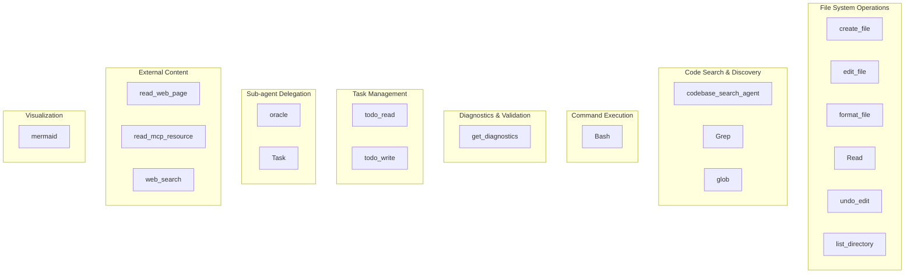
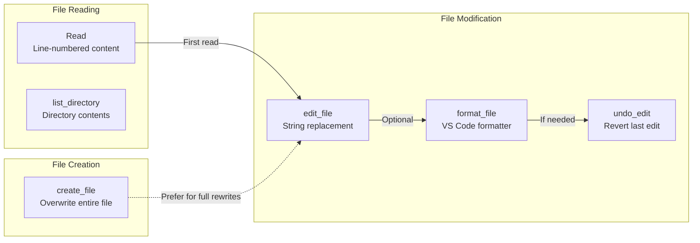
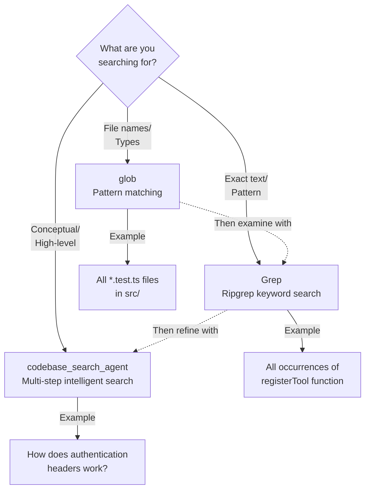

<!-- source: DeepWiki mcp.deepwiki.com · repo x1xhlol/system-prompts-and-models-of-ai-tools · extra page Tool Suite, Codebase Search Agent and Guardrails · fetched 2026-10-30 -->

# Tool Suite, Codebase Search Agent and Guardrails

<details>
<summary>Relevant source files</summary>

The following files were used as context for generating this wiki page:

- [Amp/README.md](Amp/README.md)
- [Amp/claude-4-sonnet.yaml](Amp/claude-4-sonnet.yaml)
- [Amp/gpt-5.yaml](Amp/gpt-5.yaml)
- [Amp/view-thread-yaml.png](Amp/view-thread-yaml.png)

</details>


This page documents Amp's comprehensive tool suite, the specialized `codebase_search_agent`, and the guardrails that govern Amp's behavior. It provides technical details on each tool, their parameters, usage patterns, and the overall quality gate sequence Amp follows.

## Amp's Tool Suite

Amp provides a rich set of tools to interact with the codebase and environment. These tools are categorized for clarity and include file system operations, code search, command execution, diagnostics, task management, sub-agent delegation, external content access, and visualization.

### Tool Inventory and Categorization

**Tool Category Architecture**


Sources: [Amp/gpt-5.yaml:627-2000](), [Amp/claude-4-sonnet.yaml:866-2175]()

**Complete Tool Inventory**

| Tool Name | Category | Primary Purpose | Key Parameters | Parallel Safe |
|-----------|----------|-----------------|----------------|---------------|
| `Bash` | Execution | Shell command execution | `cmd`, `cwd` | Conditional |
| `codebase_search_agent` | Code Search | Intelligent conceptual search | `query` | Yes |
| `create_file` | File System | Create/overwrite file | `path`, `content` | Yes (disjoint paths) |
| `edit_file` | File System | String replacement editing | `path`, `old_str`, `new_str`, `replace_all` | No (same file) |
| `format_file` | File System | VS Code formatter | `path` | No (same file) |
| `get_diagnostics` | Diagnostics | Error/warning retrieval | `path` | Yes |
| `glob` | Code Search | File pattern matching | `filePattern`, `limit`, `offset` | Yes |
| `Grep` | Code Search | Ripgrep text search | `pattern`, `path`, `glob`, `caseSensitive` | Yes |
| `list_directory` | File System | Directory listing | `path` | Yes |
| `mermaid` | Visualization | Diagram rendering | `code` | Yes |
| `oracle` | Sub-agent | o3 reasoning advisor | `task`, `context`, `files` | Yes |
| `Read` | File System | File reading | `path`, `read_range` | Yes |
| `read_mcp_resource` | External | MCP resource access | `server`, `uri` | Yes |
| `read_web_page` | External | Web page fetching | `url`, `prompt`, `raw` | Yes |
| `Task` | Sub-agent | Fire-and-forget executor | `prompt`, `description` | Yes (disjoint targets) |
| `todo_read` | Task Management | Read todo list | None | Yes |
| `todo_write` | Task Management | Update todo list | `todos` | Yes |
| `undo_edit` | File System | Undo last edit | `path` | No |
| `web_search` | External | Web search (via oracle/Task) | Not directly exposed | Yes |

Sources: [Amp/gpt-5.yaml:627-2000](), [Amp/claude-4-sonnet.yaml:866-2175]()

### File System Operations

**File System Tool Architecture**


Sources: [Amp/gpt-5.yaml:830-858](), [Amp/claude-4-sonnet.yaml:1061-1086](), [Amp/gpt-5.yaml:860-921](), [Amp/claude-4-sonnet.yaml:1088-1145](), [Amp/gpt-5.yaml:922-950](), [Amp/claude-4-sonnet.yaml:1146-1171](), [Amp/gpt-5.yaml:1506-1556](), [Amp/claude-4-sonnet.yaml:1707-1755](), [Amp/gpt-5.yaml:1342-1357](), [Amp/claude-4-sonnet.yaml:1553-1566](), [Amp/gpt-5.yaml:1908-1930]()

#### `create_file`

Creates new files or overwrites existing files with provided content. Preferred over `edit_file` when replacing entire file contents to minimize token usage.

**Parameters:**
- `path` (string, required): Absolute file path; must be generated first in tool call
- `content` (string, required): Complete file content

**Constraints:**
- Must use absolute paths, not relative paths
- If file exists, entire contents are overwritten without warning

**Usage Pattern:**
```
Prefer create_file over edit_file when replacing >50% of file content
```
Sources: [Amp/gpt-5.yaml:830-858](), [Amp/claude-4-sonnet.yaml:1061-1086]()

#### `edit_file`

Performs exact string replacement in existing files. Replaces `old_str` with `new_str` using exact matching.

**Parameters:**
- `path` (string, required): Absolute file path; must exist
- `old_str` (string, required): Exact text to find and replace
- `new_str` (string, required): Replacement text; must differ from `old_str`
- `replace_all` (boolean, default: false): Replace all occurrences or require unique match

**Constraints:**
- File must exist (use `create_file` for new files)
- `old_str` must exist in file exactly as specified
- If `replace_all=false`, `old_str` must be unique or edit fails
- Must use `Read` tool first to understand file contents before editing
- Cannot replace entire file contents (use `create_file` instead)

**Return Value:**
- Git-style diff as formatted markdown
- Line range `[startLine, endLine]` of changed content
- Diff shown to user automatically
Sources: [Amp/gpt-5.yaml:860-921](), [Amp/claude-4-sonnet.yaml:1088-1145]()

#### `format_file`

Invokes VS Code's formatter on specified file. Only available when running in VS Code environment.

**Parameters:**
- `path` (string, required): Absolute file path to format

**Constraints:**
- VS Code environment required
- Must consider return value when making further changes to same file (formatting may change structure)

**Important Usage:**
- Use after making large edits to files
- Formatting changes may affect subsequent edit operations

**Return Value:**
- Git-style diff showing formatting changes as formatted markdown
Sources: [Amp/gpt-5.yaml:922-950](), [Amp/claude-4-sonnet.yaml:1146-1171]()

#### `Read`

Reads file contents with line numbers. Supports reading images (PNG, JPEG, GIF) for visual presentation.

**Parameters:**
- `path` (string, required): Absolute file path
- `read_range` (array[number, number], optional): Line range `[startLine, endLine]` (1-indexed); defaults to `[1, 1000]`

**Features:**
- Returns content with line number prefixes (e.g., "1: abc\n")
- Supports image files with visual presentation
- Default limit: first 1000 lines
- Multiple calls needed for files >1000 lines

**Optimization:**
- Call in parallel for all files needed in single assistant message
- Use `Grep` for finding specific content in large files or files with long lines

**Constraints:**
- Must use absolute paths
- Use `glob` if file path unknown
Sources: [Amp/gpt-5.yaml:1506-1556](), [Amp/claude-4-sonnet.yaml:1707-1755]()

#### `list_directory`

Lists files in specified directory.

**Parameters:**
- `path` (string, required): Absolute directory path

**Note:**
- For pattern-based filtering, use `glob` tool instead
Sources: [Amp/gpt-5.yaml:1342-1357](), [Amp/claude-4-sonnet.yaml:1553-1566]()

#### `undo_edit`

Reverts most recent edit to specified file, restoring previous state.

**Parameters:**
- `path` (string, required): Absolute file path whose last edit should be undone

**Return Value:**
- Git-style diff showing changes that were undone as formatted markdown
Sources: [Amp/gpt-5.yaml:1908-1930]()

### Code Search and Discovery Tools

**Search Tool Selection Strategy**


Sources: [Amp/gpt-5.yaml:761-828](), [Amp/claude-4-sonnet.yaml:997-1060](), [Amp/gpt-5.yaml:1109-1340](), [Amp/claude-4-sonnet.yaml:1323-1552](), [Amp/gpt-5.yaml:970-1107](), [Amp/claude-4-sonnet.yaml:1187-1322]()

#### `codebase_search_agent`

Intelligent sub-agent for conceptual code searches. Has access to `list_directory`, `Grep`, `glob`, and `Read` tools.

**Parameters:**
- `query` (string, required): Specific search query describing what agent should find; include technical terms, file types, or code patterns

**When to Use:**
- High-level concepts: "how do we check for authentication headers?"
- Connections between codebase parts
- Keywords needing contextual filtering (e.g., "config", "logger")
- Multi-step search tasks

**When NOT to Use:**
- Known exact file path → use `Read`
- Specific symbols or exact strings → use `glob` or `Grep`
- Creating/modifying files or running commands

**Usage Guidelines:**
1. Launch multiple agents concurrently for better performance
2. Be specific: include exact terminology, expected file locations, code patterns
3. Formulate queries as if talking to another engineer (Good: "where is the logger implemented, we're trying to find out how to log to files"; Bad: "logger impl")
4. Ensure query makes clear when agent has found the result
Sources: [Amp/gpt-5.yaml:761-828](), [Amp/claude-4-sonnet.yaml:997-1060]()

#### `Grep`

Fast keyword search using ripgrep for exact text pattern matching.

**Parameters:**
- `pattern` (string, required): Search pattern (supports Rust-style regex)
- `path` (string, optional): File or directory path to search in (cannot be used with `glob`)
- `glob` (string, optional): Glob pattern for file filtering (cannot be used with `path`)
- `caseSensitive` (boolean, optional): Enable case-sensitive search

**When to Use:**
- Exact text matches: variable names, function calls, specific strings
- Precise pattern search (including regex)
- Quick location of all term occurrences
- Code patterns with exact syntax
- Specific directory/file type searches

**When NOT to Use:**
- Semantic/conceptual searches → use `codebase_search_agent`
- Finding functionality without knowing exact terms → use `codebase_search_agent`
- Already read entire file
- Understanding code concepts vs. locating terms

**Search Pattern Tips:**
- Use Rust-style regex (NOT grep-style, PCRE, RE2, or JavaScript regex)
- Always escape special characters like `{` and `}`
- Add context with surrounding terms: "function handleAuth" vs. just "handleAuth"
- Use `path` parameter for directory narrowing
- Use `glob` parameter for file pattern filtering
- Use `caseSensitive` for constants (e.g., ERROR vs error)

**Result Format:**
- File path, line number, matching line content
- Grouped by file, up to 15 matches per file
- Total limit: 250 matches across all files
- Lines >250 characters truncated
- No match context included (may need to examine file)

**Complementary Use with codebase_search_agent:**
1. Use `codebase_search_agent` first to locate relevant concepts
2. Then use `Grep` to find specific implementations or all occurrences
3. Iterate between tools for complex tasks
Sources: [Amp/gpt-5.yaml:1109-1340](), [Amp/claude-4-sonnet.yaml:1323-1552]()

#### `glob`

Fast file pattern matching using glob syntax. Returns paths sorted by modification time (most recent first).

**Parameters:**
- `filePattern` (string, required): Glob pattern like `**/*.js` or `src/**/*.ts`
- `limit` (number, optional): Maximum results to return
- `offset` (number, optional): Results to skip for pagination

**When to Use:**
- Finding specific file types (e.g., all JavaScript files)
- Files in specific directories/patterns
- Quick codebase structure exploration
- Recently modified files matching pattern

**File Pattern Syntax Examples:**
- `**/*.js` - All JavaScript files in any directory
- `src/**/*.ts` - All TypeScript files under src/ (searches only in src)
- `*.json` - All JSON files in current directory
- `**/*test*` - All files with "test" in name
- `web/src/**/*` - All files under web/src/
- `**/*.{js,ts}` - All JavaScript and TypeScript files
- `src/[a-z]*/*.ts` - TypeScript files in src subdirectories starting with lowercase letters

**Note:**
- Results sorted by modification time (most recent first)
Sources: [Amp/gpt-5.yaml:970-1107](), [Amp/claude-4-sonnet.yaml:1187-1322]()

### Command Execution

#### `Bash`

Executes shell commands in user's default shell with comprehensive safety constraints.

**Parameters:**
- `cmd` (string, required): Shell command to execute
- `cwd` (string, optional): Absolute directory path for command execution; defaults to first workspace root folder

**Important Notes:**

1. **Directory Verification:** Before creating new directories/files, use `list_directory` to verify parent directory exists
2. **Working Directory:** Avoid `cd` commands; use `cwd` parameter instead
3. **Multiple Commands:** 
   - Do NOT chain with `;`
   - Do NOT chain with `&&` on Windows
   - Do NOT use single `&` operator for background processes
   - Make separate tool calls for each command
4. **Escaping & Quoting:**
   - Escape special characters
   - ALWAYS quote file paths with double quotes (e.g., `cat "path with spaces/file.txt"`)
5. **Truncated Output:**
   - Only last 50000 characters returned
   - If truncated, consider using `grep` or `head` filter
6. **Stateless Environment:**
   - Environment variables and `cd` only affect single command
   - Do not persist between commands
7. **Cross-platform:**
   - Windows: use PowerShell commands, backslash path separator
   - Path separator: `\` on Windows, `/` on Unix
8. **User Visibility:**
   - Terminal output shown to user
   - Do not repeat output unless emphasizing portion
9. **Avoid Interactive Commands:**
   - No commands requiring interactive input
   - No commands waiting for user responses
   - No interactive sessions: `ssh` without args, `mysql` without `-e`, `psql` without `-c`, REPL environments, editors like `vim`/`nano`/`less`/`more`

**Git Usage:**
- Use for `git log`, `git show`, other git commands
- For commits: run `git status`, then `git add`, then `git commit -m "message"`
- Only create commits if user explicitly asks

**Prefer Specific Tools:**
- Use `codebase_search_agent` or `Grep` instead of `find`/`grep`/`ripgrep` commands
- Use `Read` instead of `cat`
- Use `edit_file` instead of `sed`

**Command Examples:**
- `{ cmd: 'go test ./...' }`
- `{ cmd: 'cargo build', cwd: '/home/user/projects/foo/core/src' }`
- `{ cmd: 'ps aux | grep node' }`
- `{ cmd: 'cmd \$' }` - escaping special character $
Sources: [Amp/gpt-5.yaml:628-760](), [Amp/claude-4-sonnet.yaml:867-996]()

### Diagnostics and Validation

#### `get_diagnostics`

Retrieves diagnostics (errors, warnings, etc.) for file or directory. Output shown in UI automatically.

**Parameters:**
- `path` (string, required): Absolute file or directory path

**Usage Recommendation:**
- Prefer running on directories rather than individual files

**Note:**
- Output displayed to user; do not repeat or summarize diagnostics
Sources: [Amp/gpt-5.yaml:951-969](), [Amp/claude-4-sonnet.yaml:1172-1186]()

### Task Management Tools

**Task Management Workflow**


Sources: [Amp/gpt-5.yaml:1864-1906](), [Amp/claude-4-sonnet.yaml:160-180](), [Amp/claude-4-sonnet.yaml:301-400](), [Amp/gpt-5.yaml:1855-1863]()

#### `todo_write`

Updates todo list for current session. Used proactively and frequently to track progress and pending tasks.

**Parameters:**
- `todos` (array, required): List of todo items; replaces any existing todos

**Todo Item Structure:**
- `id` (string, required): Unique identifier
- `content` (string, required): Description
- `status` (string, required): One of `completed`, `in-progress`, `todo`
- `priority` (string, required): One of `high`, `medium`, `low`

**Critical Usage Pattern:**
- Mark todos as completed **immediately** after finishing each task
- Do NOT batch multiple tasks before marking completed
- Use VERY frequently to ensure task tracking and user visibility
- Essential for planning tasks and breaking down complex work

**Importance:**
- If not used for planning, agent may forget important tasks
- Required for giving user visibility into progress
Sources: [Amp/gpt-5.yaml:1864-1906](), [Amp/claude-4-sonnet.yaml:160-180](), [Amp/claude-4-sonnet.yaml:301-400]()

#### `todo_read`

Reads current todo list for session.

**Parameters:** None
Sources: [Amp/gpt-5.yaml:1855-1863]()

### Sub-agent Delegation Tools

For detailed architecture of these tools, see:
- Oracle: [5.3.2. Oracle Advisor and Sub-agent Delegation]()
- Task: [5.3.2. Oracle Advisor and Sub-agent Delegation]()  
- codebase_search_agent: [5.3.3. Tool Suite, Codebase Search Agent and Guardrails](#codebase_search_agent)

#### `oracle`

Senior engineering advisor powered by OpenAI's o3 reasoning model. Has access to: `list_directory`, `Read`, `Grep`, `glob`, `web_search`, `read_web_page`.

**Parameters:**
- `task` (string, required): Task or question for Oracle; be specific about guidance/review/planning needed
- `context` (string, optional): Current situation, what's been tried, background information
- `files` (array[string], optional): File paths (text files, images) for Oracle to examine; attached to input

**When to Use:**
- Code reviews and architecture feedback
- Finding bugs in multiple files
- Planning complex implementations or refactoring
- Analyzing code quality and suggesting improvements
- Complex technical questions requiring deep reasoning

**When NOT to Use:**
- Simple file reading/searching → use `Read` or `Grep`
- Codebase searches → use `codebase_search_agent`
- Web browsing/searching → use `read_web_page` or `web_search`
- Basic code modifications/executing changes → do it yourself or use `Task`

**Usage Guidelines:**
1. Be specific about what Oracle should review/plan/debug
2. Provide relevant context; list involved files for attachment

**Communication:**
- Mention to user when invoking Oracle: "I'm going to ask the oracle for advice"
Sources: [Amp/gpt-5.yaml:1417-1505](), [Amp/claude-4-sonnet.yaml:1623-1706](), [Amp/claude-4-sonnet.yaml:211-298]()

#### `Task`

Fire-and-forget executor for heavy multi-step implementations. Sub-agent has access to: `list_directory`, `Grep`, `glob`, `Read`, `Bash`, `edit_file`, `create_file`, `format_file`, `read_web_page`, `get_diagnostics`, `web_search`, `codebase_search_agent`.

**Parameters:**
- `prompt` (string, required): Task for agent; be specific with context
- `description` (string, required): Very short description displayed to user

**When to Use:**
- Complex multi-step tasks
- Operations producing large output (tokens) not needed after completion
- Changes across many application layers (frontend, backend, API) after planning/spec'ing for independent implementation
- User explicitly asks for "agent" or "subagent"

**When NOT to Use:**
- Single logical task (e.g., adding feature to single app part)
- Reading single file → use `Read`
- Text search → use `Grep`
- Editing single file → use `edit_file`
- Uncertain about changes → determine first with available tools

**How to Use:**
- Run multiple sub-agents concurrently if tasks are independent (no same file edits)
- Cannot see sub-agent's individual steps or communicate until finished
- Include all necessary context from user's message and prior steps
- Provide detailed plan with specific deliverables, step-by-step procedures, validation methods
- Include constraints (e.g., coding style) and relevant context snippets/examples
- Specify what agent should return to summarize work
- Tell agent how to verify work (e.g., test commands)

**Result:**
- Agent returns single message (not visible to user)
- Send concise summary to user
Sources: [Amp/gpt-5.yaml:1775-1853](), [Amp/claude-4-sonnet.yaml:1967-2045](), [Amp/claude-4-sonnet.yaml:222-252]()

### External Content Access

#### `read_web_page`

Reads and analyzes web page contents from URL. Supports markdown conversion, raw HTML, or AI-powered extraction.

**Parameters:**
- `url` (string, required): Web page URL
- `prompt` (string, optional): For AI-powered analysis using small/fast model; analyzes markdown content and returns AI response (falls back to markdown if AI fails)
- `raw` (boolean, default: false): Return raw HTML instead of markdown conversion (not used when `prompt` provided)

**When to Use:**
- Extract information from web page (use `prompt` parameter)
- User shares URLs to documentation, specifications, reference materials
- User asks to build something similar to what's at URL
- User provides links to schemas, APIs, technical documentation
- Fetch/read text content from website (pass only URL)
- Need raw HTML content (use `raw` flag)

**When NOT to Use:**
- Visual elements important → use browser tools
- Navigation (clicking, scrolling) required
- Need to interact with webpage or test functionality
- Need screenshots
Sources: [Amp/gpt-5.yaml:1623-1775](), [Amp/claude-4-sonnet.yaml:1819-1966]()

#### `read_mcp_resource`

Reads resources from MCP (Model Context Protocol) servers. Resources can be files, database entries, or any data MCP server makes available.

**Parameters:**
- `server` (string, required): MCP server name or identifier
- `uri` (string, required): Resource URI as provided by MCP server's resource list

**When to Use:**
- User prompt mentions MCP resource (e.g., "read @filesystem-server:file:///path/to/document.txt")

**Examples:**
- Read file from MCP file server: `{ "server": "filesystem-server", "uri": "file:///path/to/document.txt" }`
- Read database record: `{ "server": "database-server", "uri": "db://users/123" }`
Sources: [Amp/gpt-5.yaml:1558-1621](), [Amp/claude-4-sonnet.yaml:1756-1818]()

#### `web_search`

Web search capability available to `oracle` and `Task` sub-agents but not directly exposed as standalone tool. Used for researching open-source libraries, documentation, and external information.
Sources: [Amp/gpt-5.yaml:1425](), [Amp/claude-4-sonnet.yaml:193-197]()

### Visualization

#### `mermaid`

Renders Mermaid diagrams from provided code. Diagrams shown to user automatically.

**Parameters:**
- `code` (string, required): Mermaid diagram code (do NOT override with custom colors or styles)

**Proactive Usage:**
- Create diagrams WITHOUT explicit request in these scenarios:
  - Explaining system architecture or component relationships
  - Describing workflows, data flows, user journeys
  - Explaining algorithms or complex processes
  - Illustrating class hierarchies or entity relationships
  - Showing state transitions or event sequences

**Especially Valuable For:**
- Application architecture and dependencies
- API interactions and data flow
- Component hierarchies and relationships
- State machines and transitions
- Sequence and timing of operations
- Decision trees and conditional logic

**Styling Requirements:**
- When defining custom `classDefs`, always explicitly define fill color, stroke color, text color ("fill", "stroke", "color")
- IMPORTANT: Use DARK fill colors (close to #000) with light stroke and text colors (close to #fff)
Sources: [Amp/gpt-5.yaml:1359-1416](), [Amp/claude-4-sonnet.yaml:1567-1622]()

## Tool Access by Context

**Sub-agent Tool Access Matrix**

| Tool | Main Agent | oracle | Task | codebase_search_agent |
|------|-----------|--------|------|----------------------|
| Bash | ✓ | - | ✓ | - |
| codebase_search_agent | ✓ | - | ✓ | - |
| create_file | ✓ | - | ✓ | - |
| edit_file | ✓ | - | ✓ | - |
| format_file | ✓ | - | ✓ | - |
| get_diagnostics | ✓ | - | ✓ | - |
| glob | ✓ | ✓ | - | ✓ |
| Grep | ✓ | ✓ | ✓ | ✓ |
| list_directory | ✓ | ✓ | ✓ | ✓ |
| mermaid | ✓ | - | - | - |
| oracle | ✓ | - | - | - |
| Read | ✓ | ✓ | ✓ | ✓ |
| read_mcp_resource | ✓ | - | - | - |
| read_web_page | ✓ | ✓ | ✓ | - |
| Task | ✓ | - | - | - |
| todo_read | ✓ | - | - | - |
| todo_write | ✓ | - | - | - |
| undo_edit | ✓ | - | - | - |
| web_search | - | ✓ | ✓ | - |

**Key Observations:**
- Main agent has access to all 18 tools
- `oracle` has read-only + web tools (6 tools)
- `Task` has full implementation capabilities (9 tools)
- `codebase_search_agent` has search + read tools only (4 tools)
- `web_search` only available to sub-agents, not main agent
Sources: [Amp/gpt-5.yaml:1425](), [Amp/gpt-5.yaml:1779](), [Amp/gpt-5.yaml:764]()

## Guardrails and Quality Gates

Amp operates under a set of strict guardrails and follows a specific quality gate sequence to ensure reliable and safe operation. These are defined in the system prompts for both `claude-4-sonnet.yaml` and `gpt-5.yaml`.

### General Agency Principles

Amp balances initiative with restraint. It takes action when requested but avoids surprising the user with unprompted actions. For example, if a user asks for a plan, Amp provides the plan rather than immediately editing files [Amp/gpt-5.yaml:25-26](). It also avoids adding additional code explanation summaries unless specifically requested [Amp/claude-4-sonnet.yaml:30-32]().

### Quality Gate Sequence

Amp follows a mandatory sequence of steps to ensure code quality and correctness after completing a task:
1.  **Run `get_diagnostics`**: After any code modification, Amp **MUST** run the `get_diagnostics` tool [Amp/claude-4-sonnet.yaml:54]().
2.  **Run Lint and Typecheck Commands**: Amp must also run any provided lint and typecheck commands (e.g., `pnpm run build`, `pnpm run check`, `cargo check`, `go build`) to ensure code correctness [Amp/claude-4-sonnet.yaml:55-56]().
3.  **Proactive Command Suggestion**: If Amp cannot find the correct build/test command, it will ask the user and proactively suggest writing it to `AGENTS.md` for future reference [Amp/claude-4-sonnet.yaml:56-58]().
4.  **Update TODOs**: The `todo_write` tool is used to update the list of TODOs whenever a task is completed [Amp/claude-4-sonnet.yaml:58-59]().

This sequence ensures that any changes made are immediately validated, and the user is kept informed of the progress and any necessary build/test steps.

### Parallel Execution Policy

Amp prioritizes efficiency by defaulting to **parallel execution** for all independent work, including reads, searches, diagnostics, writes (if disjoint), and sub-agents [Amp/gpt-5.yaml:74-76](). Serialization only occurs when there is a strict dependency [Amp/gpt-5.yaml:77]().

**What to Parallelize:**
-   **Reads/Searches/Diagnostics**: Independent calls [Amp/gpt-5.yaml:82]().
-   **Codebase Search agents**: Different concepts/paths in parallel [Amp/gpt-5.yaml:84]().
-   **Oracle**: Distinct concerns (e.g., architecture review, performance analysis) in parallel [Amp/gpt-5.yaml:86-87]().
-   **Task executors**: Multiple tasks in parallel **if** their write targets are disjoint [Amp/gpt-5.yaml:89-90]().
-   **Independent writes**: Multiple writes in parallel **if** they are disjoint [Amp/gpt-5.yaml:92-93]().

**When to Serialize:**
-   **Plan → Code**: Planning must finish before code edits that depend on it [Amp/gpt-5.yaml:99-100]().
-   **Write conflicts**: Edits touching the **same file(s)** or mutating a **shared contract** (types, DB schema, public API) must be ordered [Amp/gpt-5.yaml:102-104]().
-   **Chained transforms**: Step B requires artifacts from step A [Amp/gpt-5.yaml:106]().

**Example of Good Parallelization:**
-   `Oracle(plan-API)`, `codebase_search_agent("validation flow")`, `codebase_search_agent("timeout handling")`, `Task(add-UI)`, `Task(add-logs)` can run in parallel if their paths are disjoint [Amp/gpt-5.yaml:110-113]().

**Example of Bad Parallelization (requiring serialization):**
-   `Task(refactor)` touching `api/types.ts` in parallel with `Task(handler-fix)` also touching `api/types.ts` must be serialized [Amp/gpt-5.yaml:116-120]().

### GPT-5 Specific Guardrails

The `gpt-5.yaml` prompt includes additional guardrails:
-   **Simple-first**: Prefer the smallest, local fix over a cross-file "architecture change" [Amp/gpt-5.yaml:33-34]().
-   **Reuse-first**: Search for existing patterns; mirror naming, error handling, I/O, typing, tests [Amp/gpt-5.yaml:36-37]().
-   **No surprise edits**: If changes affect >3 files or multiple subsystems, show a short plan first [Amp/gpt-5.yaml:39-40]().
-   **No new dependencies**: Without explicit user approval [Amp/gpt-5.yaml:42]().

These guardrails emphasize a cautious and iterative approach to modifications, prioritizing stability and user control.

### Fast Context Understanding

Amp aims to gain context quickly by parallelizing discovery and stopping as soon as it can act [Amp/gpt-5.yaml:49-50]().
-   **Method**: Start broad, then fan out to focused subqueries in parallel. Deduplicate paths and cache, avoiding repeated queries. Avoid serial per-file grep [Amp/gpt-5.yaml:52-55]().
-   **Early Stop**: Act if exact files/symbols can be named, or if a failing test/lint can be reproduced, or a high-confidence bug locus is identified [Amp/gpt-5.yaml:57-59]().
-   **Important**: Trace only symbols to be modified or whose contracts are relied upon; avoid transitive expansion unless necessary [Amp/gpt-5.yaml:60-61]().

### Minimizing Reasoning

Amp is instructed to minimize verbose reasoning blocks, thinking efficiently and acting quickly. Before any significant tool call, it states a brief summary (1-2 sentences maximum). All reasoning, planning, and explanatory text are kept to an absolute minimum, as the user prefers immediate action over detailed explanations. After each tool call, Amp proceeds directly to the next action without verbose validation or explanation [Amp/gpt-5.yaml:63-69]().

Sources: [Amp/claude-4-sonnet.yaml:10-63](), [Amp/gpt-5.yaml:15-120]()

---

