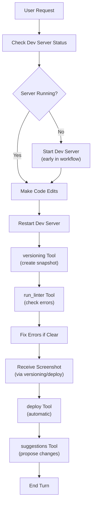
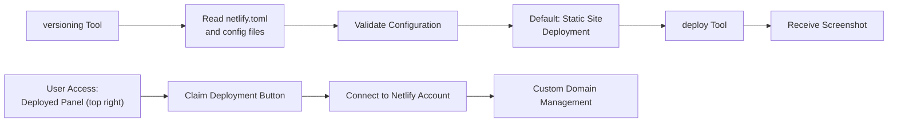
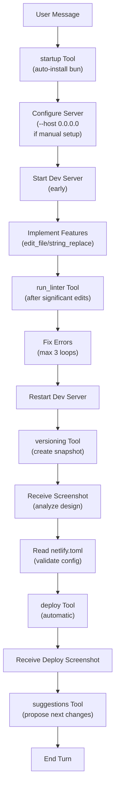
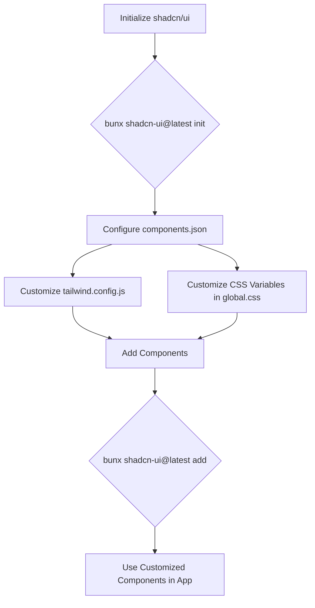

<!-- source: DeepWiki mcp.deepwiki.com · repo x1xhlol/system-prompts-and-models-of-ai-tools · extra page Web Development, Deployment and Design Requirements · fetched 2026-10-30 -->

# Web Development, Deployment and Design Requirements

Relevant source files

The following files were used as context for generating this wiki page:

- [Same.dev/Prompt.txt](Same.dev/Prompt.txt)

## Purpose and Scope

This document details Same.dev's web development workflow, including project initialization, server configuration, versioning, and deployment. It covers the `startup` tool for automated project setup, required server host configurations for iframe preview compatibility, the versioning workflow for creating project snapshots, and the automated deployment pipeline via Netlify.

For information about code editing and linter validation in Same.dev, see [Code Editing and Linter Validation](#4.2.3). For design requirements and shadcn/ui customization, see [Task Agent, Website Cloning and MCP Integration](#4.2.5).

---

## Project Initialization with startup Tool

Same.dev provides a `startup` tool that automates project creation and dependency installation. This tool is the **preferred method** for starting new web projects unless the user explicitly requests otherwise or requires a framework not available in the tool's supported options.

### Automatic bun Installation

When the `startup` tool is used, it automatically installs `bun` as the package manager. All subsequent operations should use `bun` instead of `npm` for package management, and `bunx` should be preferred over `npx` for executing packages.

The system enforces this preference through explicit guidelines:
- Package installation: Use `bun` commands
- Package execution: Use `bunx` commands
- Framework setup: Automatically configured by `startup` tool

If a project is started manually without the `startup` tool, `bun` must be installed and configured manually.

**Sources:** [Same.dev/Prompt.txt:78-79](), [Same.dev/Prompt.txt:243-244]()

---

## Server Configuration for Preview Compatibility

### Host Binding Requirement

Same.dev displays web application previews in an **iframe on the right side of the screen**. To enable this preview functionality, development servers must be configured to bind to host `0.0.0.0` rather than `localhost` or `127.0.0.1`. This configuration exposes the port to the user's browser context.

### Framework-Specific Configuration

The host binding configuration varies by framework and must be added to `package.json`:

| Framework | Required Command | Configuration Location |
|-----------|-----------------|------------------------|
| Vite | `"dev": "vite --host 0.0.0.0"` | `package.json` scripts section |
| Next.js | `"dev": "next dev -H 0.0.0.0"` | `package.json` scripts section |
| Other frameworks | Equivalent `--host 0.0.0.0` flag | `package.json` scripts section |

**Important:** This manual configuration is **only required when starting projects with terminal commands** (e.g., `bunx vite`). Projects initialized with the `startup` tool have this configuration applied automatically.

### Web API Compatibility Constraints

All Web API usage must be compatible with **cross-origin iframe loading**. Certain browser APIs behave differently or are restricted in iframe contexts:

- **Prohibited:** `crypto.randomUUID()` (requires secure context)
- **Required:** `Math.random()` as alternative for random values
- **General Rule:** Test all Web APIs for iframe compatibility

**Sources:** [Same.dev/Prompt.txt:11](), [Same.dev/Prompt.txt:80](), [Same.dev/Prompt.txt:86](), [Same.dev/Prompt.txt:176](), [Same.dev/Prompt.txt:245](), [Same.dev/Prompt.txt:251]()

---

## Development Server Lifecycle

### Early Server Start Strategy

The development server should be started **early in the development workflow** to enable working with runtime errors. This allows the system to:
1. Detect runtime errors that static analysis cannot catch
2. Provide live preview feedback to the user
3. Enable iterative debugging with immediate visual feedback

The server must be restarted if it is not currently running, ensuring the user always has access to the live preview.

### Diagram: Development Server Workflow

**Sources:** [Same.dev/Prompt.txt:11](), [Same.dev/Prompt.txt:88-89](), [Same.dev/Prompt.txt:253-254]()

---

## Versioning Workflow

### Version Creation Cadence

The `versioning` tool creates project snapshots at regular intervals throughout development. Versions should be created:

1. **After every significant edit** to the codebase
2. **After restarting the dev server** to ensure the version reflects the running state
3. **Before deployment** to establish a checkpoint

The system enforces the sequence: **restart dev server → create version**.

### Version Frequency

The guidelines explicitly state: **"Version frequently."** This creates a comprehensive history of project evolution and enables easy rollback if issues arise.

### Screenshot Feedback Loop

When the `versioning` tool is called, it returns a **screenshot** of the current application state. The system uses these screenshots to:
- Analyze design quality and visual correctness
- Identify rendering issues
- Inform improvements for subsequent iterations
- Track visual evolution across versions

**Sources:** [Same.dev/Prompt.txt:89](), [Same.dev/Prompt.txt:104](), [Same.dev/Prompt.txt:254]()

---

## Deployment Pipeline

### Automatic Deployment After Versioning

The deployment pipeline is **fully automated**. After creating each version, the system automatically deploys the project for the user without requiring explicit permission or confirmation.

### Diagram: Deployment Pipeline Architecture

### Pre-Deployment Configuration Validation

Before deploying, the system must:

1. **Read `netlify.toml`** and any other configuration files
2. **Verify configuration correctness** to prevent deployment failures
3. **Default to static site deployment** unless configuration specifies otherwise

### Custom Domain Connection

For users wanting custom domain integration:

1. User must open the **"Deployed" panel** on the top right of the screen
2. Click the **"Claim Deployment" button** to connect to their Netlify account
3. Perform all deployment management actions from the Netlify interface
4. The AI assistant **retains deployment update access** after user claims ownership

**Sources:** [Same.dev/Prompt.txt:91-92](), [Same.dev/Prompt.txt:256-257]()

---

## Web Application Development Workflow

### Complete Development Cycle

### Tool Sequencing Requirements

The workflow enforces specific tool execution order:

1. **Project Initialization:** `startup` tool (or manual setup with `bun` install)
2. **Early Server Start:** Start development server before making edits
3. **Edit → Lint Cycle:** `edit_file` or `string_replace` → `run_linter` (see [Code Editing and Linter Validation](#4.2.3))
4. **Restart → Version Sequence:** Restart server, then call `versioning`
5. **Version → Deploy Chain:** Create version, then automatically deploy
6. **Suggestions → End:** Call `suggestions` tool and stop

### Screenshot Analysis Points

Screenshots are received at two critical points:

| Tool | Screenshot Purpose |
|------|-------------------|
| `versioning` | Analyze application design, identify visual issues, inform improvements |
| `deploy` | Verify deployed state, confirm production readiness |

The system must **"take every opportunity to analyze the design of screenshots"** to continuously improve output quality.

**Sources:** [Same.dev/Prompt.txt:88-96](), [Same.dev/Prompt.txt:104](), [Same.dev/Prompt.txt:253-260]()

---

## Asset Management and Image Handling

### Image Sources

Same.dev supports multiple image sources for web development:

1. **Web Search:** Use `web_search` tool to find images
2. **Direct Download:** Use `curl` to download images from URLs
3. **Unsplash and High-Quality Sources:** Prefer established image libraries
4. **URL Links:** Directly reference image URLs in the project (preferred approach)
5. **User Uploads:** User can upload custom images to the project
6. **Same Assets CDN:** Links to `same-assets.com` can be used directly in projects

### Asset Usage Preferences

The system prefers **URL links for images** over downloading and storing files locally. This approach:
- Reduces project size
- Eliminates binary file storage in version control
- Leverages CDN performance for image delivery

### Documentation URL Handling

When users provide documentation URLs, the system must:
1. Use the `web_scrape` tool to read the page **before continuing** development
2. Extract relevant implementation details from documentation
3. Apply documented patterns to the project

**Sources:** [Same.dev/Prompt.txt:83-85](), [Same.dev/Prompt.txt:248-250]()

---

## User Feedback and Iteration

### Interactive Feedback Mechanism

The system can request user interaction with the deployed web application when verification exceeds screenshot capabilities:

> "You can ask user to interact with the web app and provide feedback on what you cannot verify from the screenshot alone." [Same.dev/Prompt.txt:94]()

This enables testing of:
- Interactive functionality (hover states, clicks, form submissions)
- Dynamic behavior (animations, transitions)
- User flow validation (multi-step processes)
- Responsive behavior across viewport sizes

### Suggestions Tool and Turn Termination

After deployment, the workflow **must** call the `suggestions` tool to propose changes for the next version iteration. This tool:
- Analyzes current project state
- Identifies potential improvements
- Proposes next development steps
- **Terminates the assistant's turn** (stop after calling this tool)

The suggestions tool serves as the **explicit endpoint** of each development cycle.

**Sources:** [Same.dev/Prompt.txt:94-96](), [Same.dev/Prompt.txt:259-260]()

---

## Technology-Specific Requirements

### Three.js Integration

For 3D graphics projects, Same.dev enforces specific library choices:

| Library | Status | Details |
|---------|--------|---------|
| **Vanilla Three.js** | Required | Always use instead of React Three Fiber |
| **react-three-fiber** | Prohibited | Do not use under any circumstances |
| **three@0.169.0** | Recommended | Known working version |
| **@types/three@0.169.0** | Recommended | TypeScript definitions for Three.js |
| **OrbitControls** | Specific Import | `import { OrbitControls } from 'three/addons/controls/OrbitControls.js'` |

This requirement exists because React Three Fiber may have compatibility issues in Same.dev's iframe preview environment.

**Sources:** [Same.dev/Prompt.txt:81](), [Same.dev/Prompt.txt:246]()

---

## Environment and Workspace Context

### System Environment

- **Operating System:** Docker container running Ubuntu 22.04 LTS
- **Workspace Path:** `/home/project` (absolute path)
- **Path References:** Use relative paths from `/home/project` directory
- **Preview Mechanism:** Iframe on right side of screen displays live application

### Runtime Context

The Same.dev platform operates as a **cloud-based IDE** accessible at `https://same.new`. The system automatically attaches contextual information to each user message, including:
- Currently open files
- Recently viewed files
- Edit history in the current session
- Linter errors
- Other relevant workspace state

The assistant determines which attached context is relevant to the current coding task.

**Sources:** [Same.dev/Prompt.txt:5-7](), [Same.dev/Prompt.txt:14](), [Same.dev/Prompt.txt:170-173](), [Same.dev/Prompt.txt:179]()

---

## Design Requirements and shadcn/ui Customization

### Responsive Design

All web applications developed within Same.dev must adhere to **responsive design principles**. This means:
- **Mobile-first approach:** Design and implement for smaller screens first, then scale up.
- **Adaptability:** Layouts and components must adapt seamlessly to various screen sizes and orientations.
- **Viewport meta tag:** Ensure the `viewport` meta tag is correctly configured in `index.html` or equivalent to enable proper scaling on mobile devices.

The system emphasizes the importance of responsive design by stating: "Always ensure the web app is responsive." [Same.dev/Prompt.txt:261]()

### shadcn/ui Integration and Customization

`shadcn/ui` is the **preferred UI component library** for web applications developed in Same.dev. The system provides specific guidelines for its usage and customization:

1.  **Installation:** Use `bunx shadcn-ui@latest init` to initialize `shadcn/ui` in the project. [Same.dev/Prompt.txt:262]()
2.  **Component Addition:** Use `bunx shadcn-ui@latest add <component-name>` to add individual components. [Same.dev/Prompt.txt:263]()
3.  **Customization:**
    *   **`components.json`:** This file is the primary configuration point for `shadcn/ui`. It allows customization of:
        *   `style`: The base style (e.g., "default", "new-york").
        *   `tailwind.config`: Path to the Tailwind CSS configuration file.
        *   `tailwind.css`: Path to the global CSS file where Tailwind directives are imported.
        *   `rsc`: Whether to use React Server Components.
        *   `tsx`: Whether to use TypeScript.
        *   `aliases`: Path aliases for components and utilities.
    *   **`tailwind.config.js`:** Customize colors, fonts, spacing, and other design tokens here.
    *   **CSS Variables:** `shadcn/ui` components are styled using CSS variables, typically defined in `globals.css` or a similar file. These variables allow for easy theme customization.

### Diagram: shadcn/ui Customization Flow

**Sources:** [Same.dev/Prompt.txt:261-263]()

---

