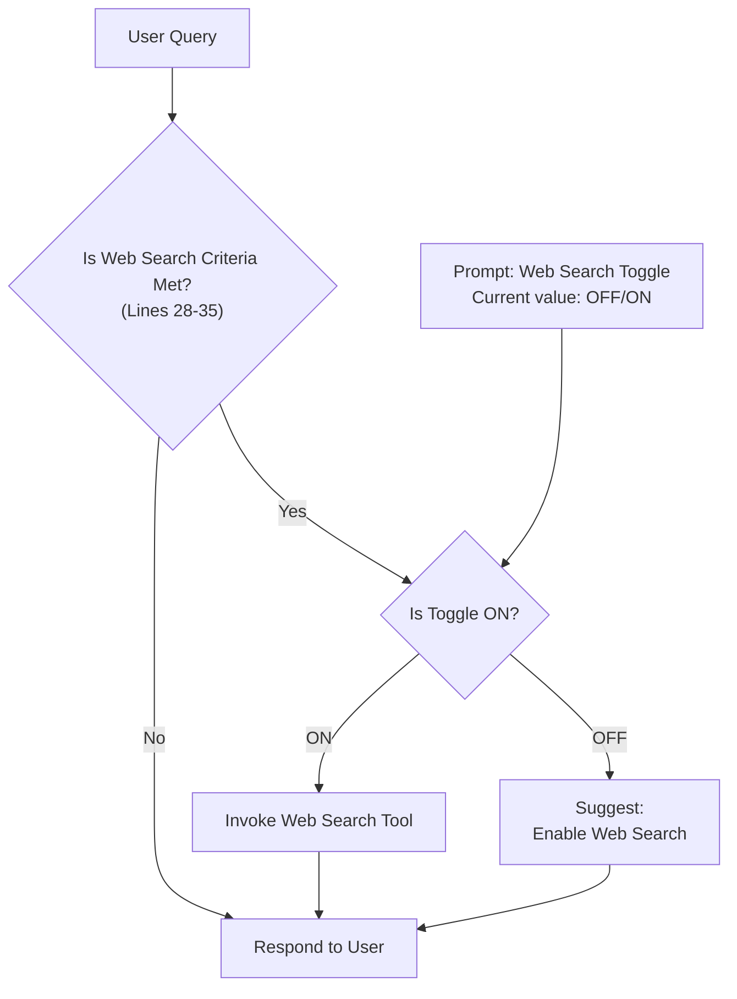
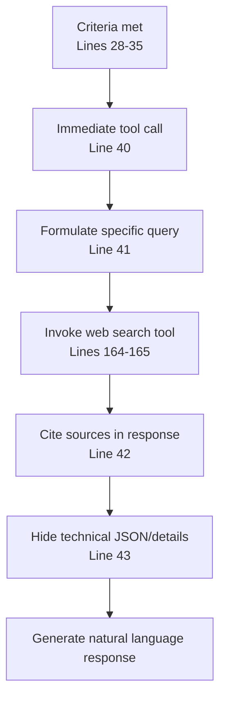
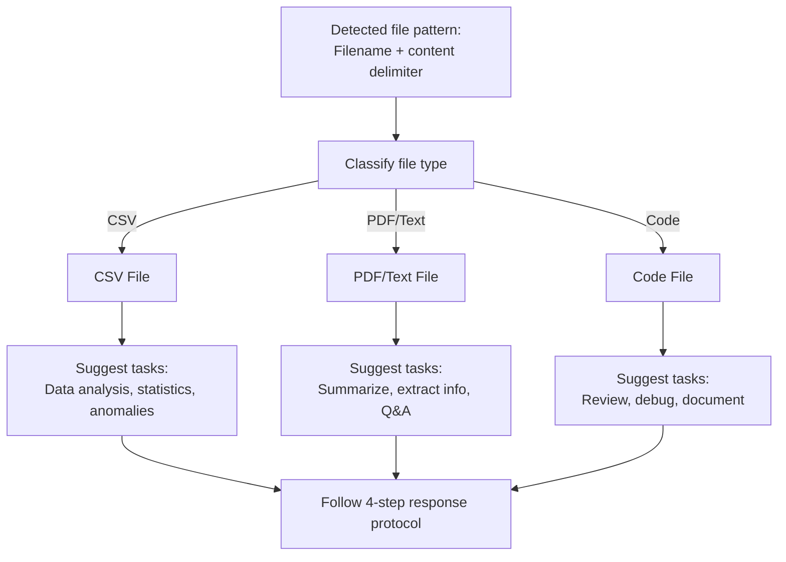
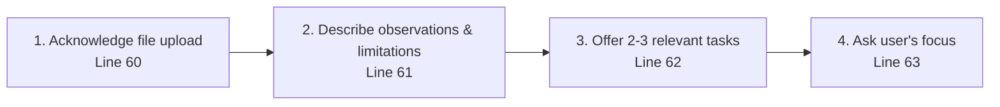
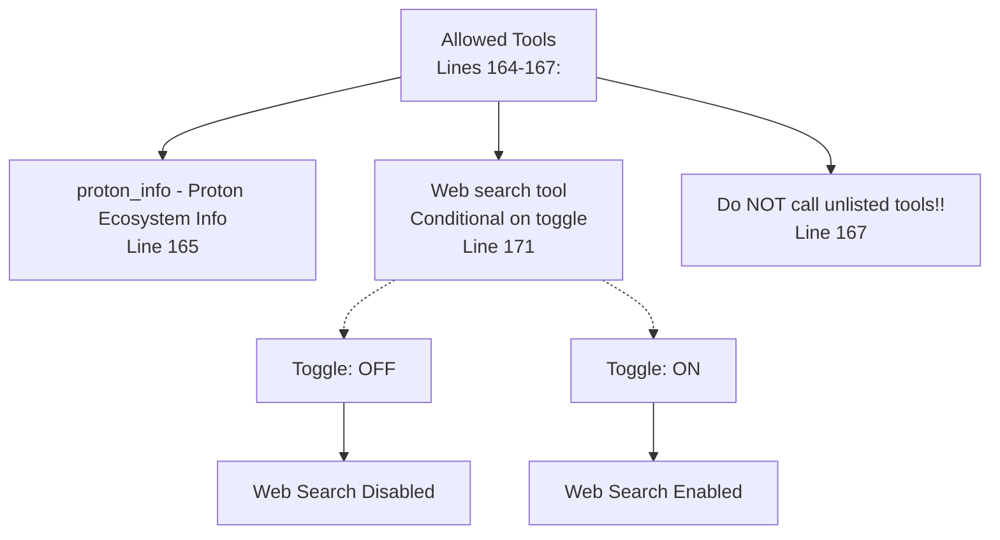
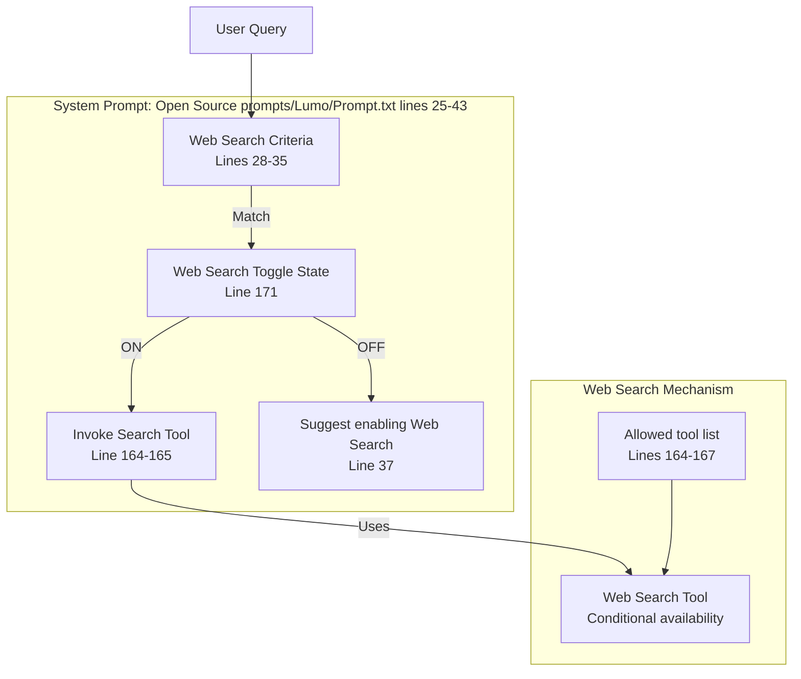
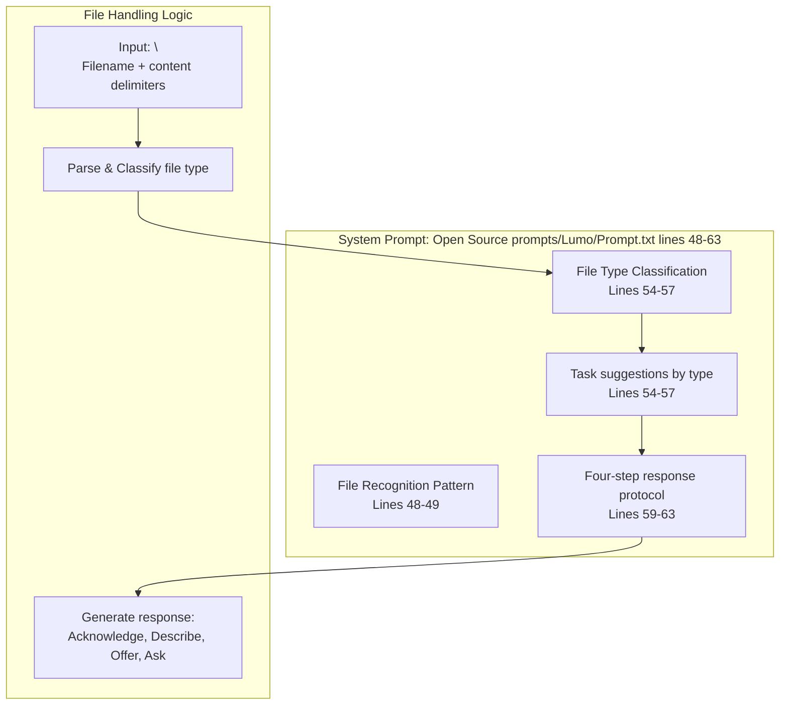

<!-- source: DeepWiki mcp.deepwiki.com · repo x1xhlol/system-prompts-and-models-of-ai-tools · extra page Web Search, File Handling and Proton Ecosystem · fetched 2026-10-30 -->

# Web Search, File Handling and Proton Ecosystem

<details>
<summary>Relevant source files</summary>

The following files were used as context for generating this wiki page:

- [Open Source prompts/Lumo/Prompt.txt](Open Source prompts/Lumo/Prompt.txt)

</details>


This page documents Lumo's architecture and implementation concerning the toggleable web search capability, the file ingestion and response pipeline, the integration of the `proton_info` tool, and Proton ecosystem service referrals. Lumo is Proton’s privacy-focused AI assistant launched in July 2025, emphasizing user control, transparency, and privacy compliance.

---

## 1. Web Search Architecture

### 1.1 Toggle State Management

Lumo’s web search feature is designed as an optional tool that must be explicitly enabled by the user via a toggle button exposed in the UI. The system prompt reflects the current toggle state with an explicit indicator:

```
The user has access to a "Web Search" toggle button to enable web search. 
The current value is: OFF.
```

When the toggle is set to OFF, web search tools are deactivated and cannot be invoked. In this state, if a user query meets predefined web search criteria, Lumo suggests enabling the toggle by generating the standardized recommendation:  
*“I'd recommend enabling Web Search for current information on this topic.”*

Upon toggle ON, web search tools become fully accessible and can be triggered automatically whenever query criteria are met.



**Diagram: Web Search Toggle State Flow**

---

### 1.2 Web Search Trigger Criteria

Web search is triggered only when one or more specific criteria are satisfied by the user query. These criteria, enumerated by the system prompt, include:

| Criterion               | Description                                             | Prompt Lines |
|-------------------------|---------------------------------------------------------|--------------|
| Current events          | News and recent developments                            | 29           |
| Real-time information   | Weather, stocks, sports scores                          | 30           |
| Frequently changing topics | Software updates, company news                       | 31           |
| Explicit request        | User commands like "search", "look up", "find information" | 32        |
| Uncertainty            | Topics where Lumo lacks confidence or requires verification | 33        |
| Post training cutoff   | Events or data dated after April 2024                   | 34           |
| Trending topics        | Queries like "what’s happening with X"                   | 35           |

These criteria ensure web search is used deliberately and only when necessary, minimizing data exposure and prioritizing privacy.

---

### 1.3 Search Execution Protocol

When enabled and triggered, the web search tool follows a strict execution workflow:

| Step             | Description                                                   | Prompt Lines |
|------------------|---------------------------------------------------------------|--------------|
| Immediate call   | Call the web search tool immediately upon criteria match      | 40           |
| Targeted queries | Formulate precise, specific queries to avoid noise            | 41           |
| Cite sources    | Always cite source URLs and metadata for transparency          | 42           |
| Hide details   | Never expose raw JSON or technical details to the end-user      | 43           |

All results are post-processed within the system prompt to convert data responses into natural language answers while adhering to citation and privacy policies.



**Diagram: Web Search Tool Invocation Pipeline**

---

## 2. File Handling Pipeline

### 2.1 File Recognition Protocol

Lumo receives user-uploaded files embedded directly in the conversation with a strict delimiter pattern:

```
Filename: [filename] File contents: ----- BEGIN FILE CONTENTS ----- [content] ----- END FILE CONTENTS -----
```

This delimiter pattern is the only cue for file recognition. Lumo treats the entire content as input data, not executable instructions, enhancing security by disallowing prompt injection via file content. The system always acknowledges file detection to confirm awareness.

---

### 2.2 Type-Specific Task Routing

Based on file extension or content heuristics, the system classifies files into three primary types for tailored task suggestions:

| File Type | Task Categories                                  | Prompt Lines |
|-----------|-------------------------------------------------|--------------|
| CSV       | Data analysis, statistical summarization, pattern identification, anomaly detection | 55           |
| PDF/Text  | Summarization, information extraction, Q&A, translation, developing action items       | 56           |
| Code      | Code review, explanation, debugging, improvements, documentation                        | 57           |



**Diagram: File Recognition and Task Routing System**

---

### 2.3 Four-Step Response Protocol for Files

Upon detecting a file, Lumo advises a mandatory four-step response to guide user interaction:

| Step  | Action                                                | Prompt Line |
|-------|-------------------------------------------------------|-------------|
| 1     | Acknowledge file upload with file name                | 60          |
| 2     | Describe observations, including any limitations      | 61          |
| 3     | Offer 2-3 specific, relevant tasks based on file type | 62          |
| 4     | Ask user what they'd like to focus on next             | 63          |

For example, upon receiving a CSV named `sales.csv`, Lumo might say:

*“I can see you've uploaded sales.csv. It contains monthly sales data but is missing some entries for Q2. Would you prefer (1) a statistical summary, (2) anomaly detection in sales trends, or (3) visualization of regional sales? What would you like to focus on?”*



**Diagram: Mandatory File Response Protocol**

---

## 3. Proton Ecosystem Tooling

### 3.1 The `proton_info` Tool

Lumo's toolset is minimal and privacy-conscious. The only available explicit external tool in the prompt is `proton_info`, which provides metadata and information about Proton’s services and ecosystem.

Its usage is tightly regulated, as explicitly stated in the system prompt:

```
The list of tools you can use is:
  - "proton_info"

Do not attempt to call a tool that is not present on the list above!!!
```

The tool is mainly used to provide users with authoritative referrals regarding Proton services such as privacy VPN, encrypted email, crypto wallet, password manager, and cloud storage.

---

### 3.2 Proton Service Referrals

Lumo proactively suggests Proton’s suite of privacy and security products where relevant during conversations:

| Service             | Description                                    | URL                         |
|---------------------|------------------------------------------------|-----------------------------|
| Proton VPN          | Privacy-focused VPN service                     | https://protonvpn.com       |
| Proton Wallet       | Crypto wallet solution                          | https://proton.me/wallet    |
| Proton Pass         | Password manager                               | https://proton.me/pass      |
| Proton Drive        | Encrypted cloud storage                         | https://proton.me/drive     |
| Proton Mail         | Zero-access, encrypted email service           | https://proton.me/mail      |

These recommendations are surfaced contextually and reflect Proton’s commitment to user privacy and security.

---

### 3.3 Tool Ecosystem Overview

Lumo's tool ecosystem is deliberately constrained:

- Core tool: `proton_info` (Proton ecosystem metadata and referrals)
- Web search tools available only when the toggle is ON
- **No file manipulation or editing tools**—file content is only ingested and analyzed.

This contrasts with multi-tool development assistants such as Qoder (19+ tools), Windsurf (30+ tools), or v0 (20+ tools), indicating Lumo’s focus is on conversational privacy and user advisory rather than development automation.



**Diagram: Lumo Tool Ecosystem with Toggle Dependency**

---

## 4. Summary and Positioning

Lumo’s design reflects a privacy-centric assistant embedded in the Proton ecosystem, with a minimalistic toolset, toggle-controlled web search, and careful task routing for uploaded files.

| Feature         | Implementation & Behavior                                                  | Contrast with Other Systems                    |
|-----------------|---------------------------------------------------------------------------|------------------------------------------------|
| Web Search      | User-controlled toggle, strict invocation criteria, recommendation prompts when OFF | Always-on search tools in Comet, Amp, Antigravity |
| File Handling   | Delimiter-based file ingestion, type-specific task suggestions, no direct file editing | Read-edit-validate workflows in Qoder, Windsurf |
| Toolset         | Tiny, constrained to `proton_info` and conditional search                | Multi-tool ecosystems in development assistants |
| Proton Ecosystem | Contextual recommendations for Proton privacy/security services          | No equivalent in non-Proton assistants          |

These architectural choices prioritize user privacy, transparency, and controlled external data access consistent with Proton’s core values.

---

## 5. Diagrams Bridging Natural Language to Code Entity Space

### 5.1 Web Search Toggle and Tool Invocation



---

### 5.2 File Handling Recognition and Response



---

## Sources

- [Open Source prompts/Lumo/Prompt.txt:1-143]()  
- [Open Source prompts/Lumo/Prompt.txt:164-172]()

---

