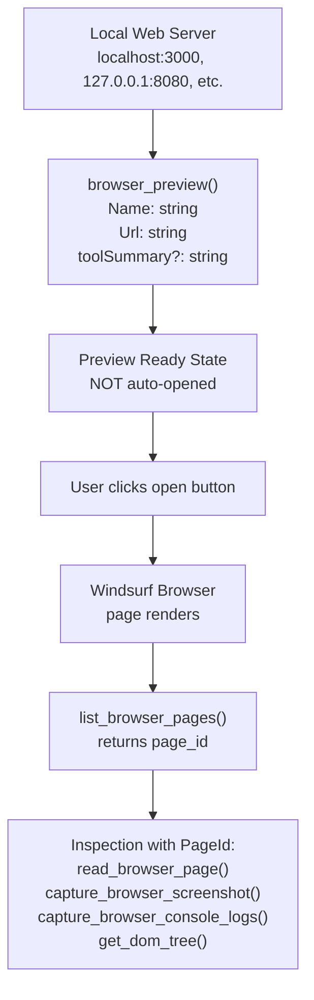
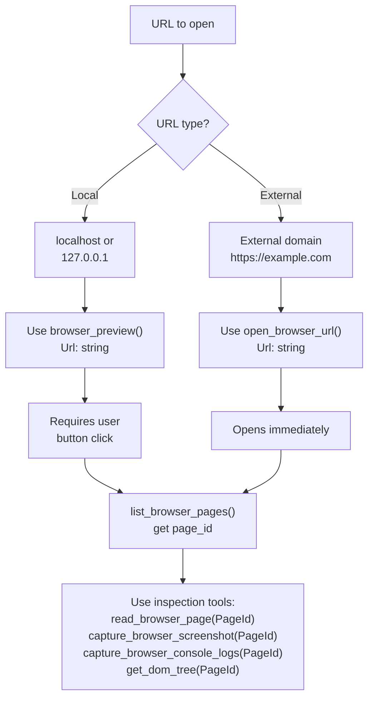
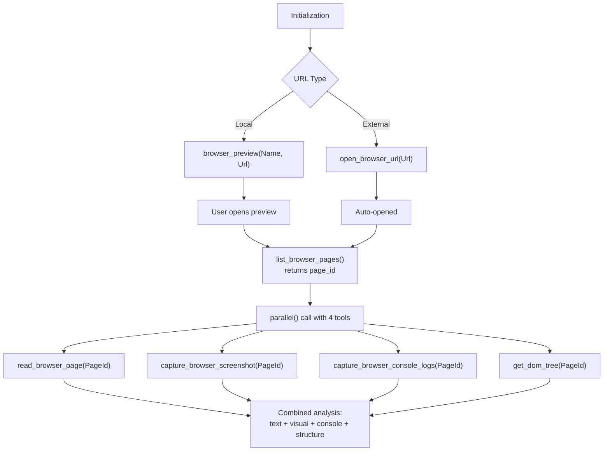
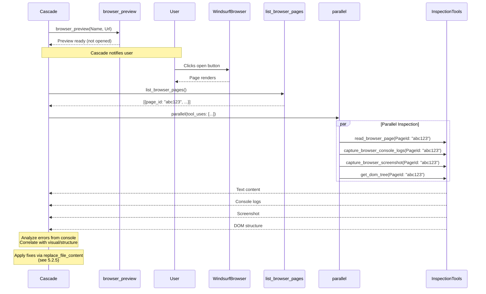

<!-- source: DeepWiki mcp.deepwiki.com · repo x1xhlol/system-prompts-and-models-of-ai-tools · extra page Browser Preview and Page Interaction · fetched 2026-10-30 -->

# Browser Preview and Page Interaction

<details>
<summary>Relevant source files</summary>

The following files were used as context for generating this wiki page:

- [Windsurf/Tools Wave 11.txt](Windsurf/Tools Wave 11.txt)

</details>


Windsurf Cascade provides browser integration tools for previewing web applications, inspecting page content, and gathering runtime information from rendered pages within the IDE environment. This enables the agent to interact with local development servers and analyze browser behavior without leaving the development context.

Related documentation: [Web Application Deployment Pipeline](#5.2.6), [Deployment, Command Execution and Memory System](#5.2.5), [Command Execution and Background Processes](#5.2.7).

## Tool Overview

Browser interaction capabilities include:

| Tool | Purpose | Key Parameter |
|------|---------|---------------|
| `browser_preview` | Initialize preview for local web server | `Url` (scheme+domain+port) |
| `open_browser_url` | Open external URL directly | `Url` |
| `list_browser_pages` | List all open pages with metadata | None |
| `read_browser_page` | Retrieve rendered page content | `PageId` |
| `capture_browser_screenshot` | Capture viewport screenshot | `PageId` |
| `capture_browser_console_logs` | Retrieve JavaScript console output | `PageId` |
| `get_dom_tree` | Extract DOM tree structure | `PageId` |

All tools support the `toolSummary` parameter (specified first) for action tracking.

Sources: [Windsurf/Tools Wave 11.txt:1-193]()

## browser_preview Tool

The `browser_preview` tool initializes browser preview capability for local web servers. This creates a preview state that requires user action to open.

**Type Definition: browser_preview Tool**



**Type Signature**

[Windsurf/Tools Wave 11.txt:2-9]() defines:

```typescript
type browser_preview = (_: {
  Name: string,
  Url: string,
  toolSummary?: string,
}) => any;
```

**Parameters**

| Parameter | Type | Format | Example |
|-----------|------|--------|---------|
| `Name` | `string` | 3-5 words, title-cased, plain text (no markdown) | `"Personal Website"` |
| `Url` | `string` | `scheme://domain:port` (no path) | `"http://localhost:3000"` |
| `toolSummary` | `string?` | 2-5 words | `"previewing local server"` |

**Critical Behavior**: Tool call does **not** automatically open browser [Windsurf/Tools Wave 11.txt:1-2](). User must click provided button to launch browser view.

Sources: [Windsurf/Tools Wave 11.txt:1-9]()

## list_browser_pages Tool

The `list_browser_pages` tool returns metadata for all open pages in Windsurf Browser, providing the `page_id` values required by inspection tools.

**Type Signature**

[Windsurf/Tools Wave 11.txt:158-161]() defines:

```typescript
type list_browser_pages = (_: {
  toolSummary?: string,
}) => any;
```

**Returned Metadata**

| Field | Type | Purpose |
|-------|------|---------|
| `page_id` | `string` | Required for `read_browser_page`, `capture_browser_screenshot`, `capture_browser_console_logs`, `get_dom_tree` |
| `url` | `string` | Current page URL |
| `title` | `string` | Page `<title>` content |
| `viewport size` | Dimensions | Viewport dimensions for screenshot context |

**Usage Pattern**

```
list_browser_pages() 
  → returns [{page_id: "abc123", url: "http://localhost:3000", ...}]
  → use page_id as PageId parameter in inspection tools
```

Sources: [Windsurf/Tools Wave 11.txt:157-161]()

## open_browser_url Tool

The `open_browser_url` tool opens external URLs directly in Windsurf Browser without requiring user approval, unlike `browser_preview` which requires user interaction.

**Tool Selection Decision Flow**



**Type Signature**

[Windsurf/Tools Wave 11.txt:180-185]() defines:

```typescript
type open_browser_url = (_: {
  Url: string,
  toolSummary?: string,
}) => any;
```

The `Url` parameter must be HTTP or HTTPS [Windsurf/Tools Wave 11.txt:224-228](). Unlike `browser_preview`, this opens immediately without user approval.

Sources: [Windsurf/Tools Wave 11.txt:179-185](), [Windsurf/Tools Wave 11.txt:223-228]()

## Page Inspection Tools

### read_browser_page

Retrieves rendered page content in text format after JavaScript execution.

**Type Signature**

[Windsurf/Tools Wave 11.txt:188-193]() defines:

```typescript
type read_browser_page = (_: {
  PageId: string,
  toolSummary?: string,
}) => any;
```

**Rendered Content Characteristics**

| Aspect | Behavior |
|--------|----------|
| JavaScript | Content generated by JavaScript included |
| DOM manipulation | Reflected in output |
| AJAX/fetch | Dynamic content present |
| vs raw HTML | Differs if JavaScript modified page |

**Use Cases**: Content verification, dynamic content extraction, element presence checks, user-facing content validation.

Sources: [Windsurf/Tools Wave 11.txt:187-193]()

### capture_browser_screenshot

Captures current viewport screenshot (visible area only, not full page).

**Type Signature**

[Windsurf/Tools Wave 11.txt:20-25]() defines:

```typescript
type capture_browser_screenshot = (_: {
  PageId: string,
  toolSummary?: string,
}) => any;
```

**Screenshot Scope**

| Captured | Not Captured |
|----------|--------------|
| Current viewport (visible area) | Content below fold |
| CSS styling, fonts, colors | Full page scroll |
| Rendered images | Hidden elements |
| Current scroll position | Off-screen content |

Viewport size from `list_browser_pages` metadata correlates screenshot dimensions with responsive breakpoints.

**Use Cases**: Layout debugging, visual design verification, responsive behavior checks, visual bug documentation.

Sources: [Windsurf/Tools Wave 11.txt:19-25]()

### capture_browser_console_logs

Retrieves JavaScript console output from browser page execution.

**Type Signature**

[Windsurf/Tools Wave 11.txt:12-17]() defines:

```typescript
type capture_browser_console_logs = (_: {
  PageId: string,
  toolSummary?: string,
}) => any;
```

**Console Output Types**

- `console.log()`, `console.error()`, `console.warn()`, `console.info()`
- Unhandled JavaScript errors
- Network request failures (if logged)

**Use Cases**: JavaScript error debugging, log output verification, runtime error detection, API request/response monitoring, resource loading checks.

Sources: [Windsurf/Tools Wave 11.txt:11-17]()

### get_dom_tree

Extracts complete DOM tree structure of an open page.

**Type Signature**

[Windsurf/Tools Wave 11.txt:127-132]() defines:

```typescript
type get_dom_tree = (_: {
  PageId: string,
  toolSummary?: string,
}) => any;
```

**DOM Tree Contents**

| Component | Details |
|-----------|---------|
| Elements | Tag names, attributes, nesting hierarchy |
| Text content | Text within elements |
| State | Post-JavaScript-execution (dynamic DOM) |

**Comparison with read_browser_page**

| Tool | Output Format |
|------|---------------|
| `read_browser_page` | Rendered text content (user-facing) |
| `get_dom_tree` | Structural HTML with tags and attributes |

**Use Cases**: Page structure analysis, element hierarchy debugging, semantic HTML verification, element finding by attributes, component composition understanding.

Sources: [Windsurf/Tools Wave 11.txt:126-132]()

## Parallel Inspection Pattern

Inspection tools can execute in parallel using the `parallel` multi-tool-use function for efficient page analysis.

**Parallel Execution Flow**



**parallel Type Signature**

[Windsurf/Tools Wave 11.txt:373-382]() defines:

```typescript
type parallel = (_: {
  tool_uses: {
    recipient_name: string,
    parameters: object,
  }[],
}) => any;
```

**Parallelizable Inspection Tools**

All four inspection tools read page state without modification, allowing simultaneous execution:

```
parallel({
  tool_uses: [
    {recipient_name: "read_browser_page", parameters: {PageId: "abc123"}},
    {recipient_name: "capture_browser_screenshot", parameters: {PageId: "abc123"}},
    {recipient_name: "capture_browser_console_logs", parameters: {PageId: "abc123"}},
    {recipient_name: "get_dom_tree", parameters: {PageId: "abc123"}}
  ]
})
```

**Sequential Dependencies**

1. `browser_preview` / `open_browser_url` → `list_browser_pages` → inspection tools (must obtain `page_id` first)
2. `browser_preview` requires user action before inspection tools can access page

Sources: [Windsurf/Tools Wave 11.txt:371-383]()

## Development Workflow Integration

**Debugging Sequence Diagram**



**Typical Inspection Sequence**

1. Verify web server running (`run_command` - see [Command Execution and Background Processes](#5.2.7))
2. Call `browser_preview` with server URL
3. Wait for user to open preview
4. Call `list_browser_pages` to obtain `page_id`
5. Execute `parallel` with all four inspection tools
6. Analyze console logs for JavaScript errors
7. Verify visual appearance via screenshot
8. Validate content via `read_browser_page`
9. Inspect structure via `get_dom_tree`
10. Apply fixes via `replace_file_content` (see [Deployment, Command Execution and Memory System](#5.2.5))

Sources: [Windsurf/Tools Wave 11.txt:1-193]()

## Tool Summary Convention

All browser interaction tools support the `toolSummary` parameter, which must be specified **first** before all other arguments [Windsurf/Tools Wave 11.txt:7-9](). This parameter should be a brief 2-5 word summary of the tool's action, such as:
- "analyzing directory"
- "searching the web"
- "editing file"
- "viewing file"
- "running command"
- "semantic searching"

For browser-specific operations, appropriate summaries include:
- "previewing local server"
- "capturing screenshot"
- "reading console logs"
- "inspecting DOM structure"
- "listing browser pages"

This convention applies universally across all Windsurf Wave 11 tools to provide consistent action tracking.

Sources: [Windsurf/Tools Wave 11.txt:7-9](), [Windsurf/Tools Wave 11.txt:15-16](), [Windsurf/Tools Wave 11.txt:23-24](), [Windsurf/Tools Wave 11.txt:130-131](), [Windsurf/Tools Wave 11.txt:159-160](), [Windsurf/Tools Wave 11.txt:183-184](), [Windsurf/Tools Wave 11.txt:191-192]()

---

