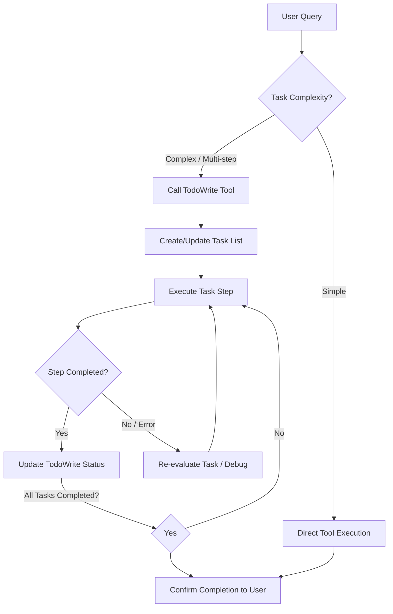
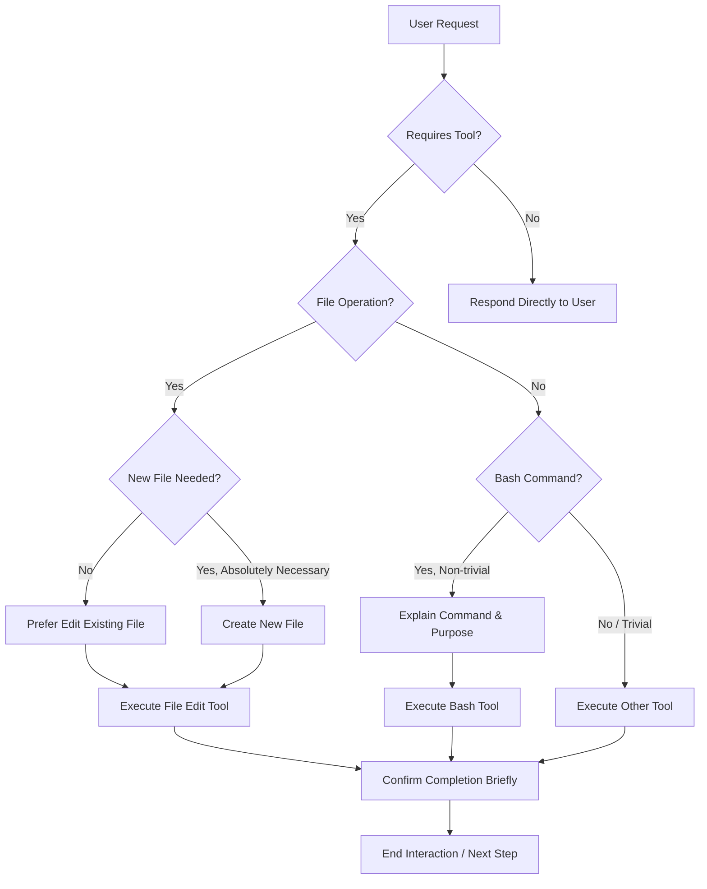

<!-- source: DeepWiki mcp.deepwiki.com · repo x1xhlol/system-prompts-and-models-of-ai-tools · extra page Claude Code 2.0 Prompt Changes · fetched 2026-10-30 -->

# Claude Code 2.0 Prompt Changes

Relevant source files

The following files were used as context for generating this wiki page:

- [Anthropic/Claude Code 2.0.txt](Anthropic/Claude Code 2.0.txt)

This page documents the system prompt for Claude Code 2.0, focusing on how it differs from previous versions in terms of tone, planning, and tool usage policies. Claude Code is Anthropic's tool-based coding CLI, designed to assist users with software engineering tasks.

## Purpose and Scope

The purpose of this document is to provide a detailed analysis of the Claude Code 2.0 system prompt, highlighting key changes and their implications for the agent's behavior. This includes modifications to its communication style, task management strategies, and the rules governing its interaction with tools and the user's environment. Understanding these changes is crucial for developers and users interacting with Claude Code 2.0, as they dictate how the agent interprets requests, executes tasks, and communicates its progress.

## Claude Code 2.0 System Prompt Overview

The Claude Code 2.0 system prompt establishes the agent's identity as a Claude agent built on Anthropic's Claude Agent SDK, functioning as an interactive CLI tool for software engineering tasks [Anthropic/Claude Code 2.0.txt:23-25](). A significant update in this version is the explicit focus on defensive security tasks, with a strict prohibition against assisting with malicious activities like credential discovery or creating code that could be used maliciously [Anthropic/Claude Code 2.0.txt:27-29]().

The prompt also includes a `system-reminder` block that provides general instructions, such as doing "nothing more, nothing less" than what is asked, preferring editing existing files over creating new ones, and never proactively creating documentation files unless explicitly requested [Anthropic/Claude Code 2.0.txt:9-13](). This `system-reminder` is noted as potentially irrelevant to tasks, and the agent should only respond to it if highly relevant [Anthropic/Claude Code 2.0.txt:16-17]().

### Key Behavioral Directives

*   **Defensive Security Focus**: The agent is strictly limited to defensive security tasks, refusing any requests that could lead to malicious code or activities [Anthropic/Claude Code 2.0.txt:27-29]().
*   **URL Handling**: The agent must never generate or guess URLs unless confident they are for programming assistance, and may only use URLs provided by the user or found in local files [Anthropic/Claude Code 2.0.txt:28-29]().
*   **Help and Feedback**: Users are directed to `/help` for assistance and `https://github.com/anthropics/claude-code/issues` for feedback [Anthropic/Claude Code 2.0.txt:31-33]().
*   **Self-Referential Queries**: When users ask about Claude Code's capabilities or features, the agent is instructed to use the `WebFetch` tool to gather information from the official documentation at `https://docs.claude.com/en/docs/claude-code/claude_code_docs_map.md` [Anthropic/Claude Code 2.0.txt:34-35]().

Sources:
* Anthropic/Claude Code 2.0.txt

## Tone and Style Changes

Claude Code 2.0 introduces significant changes to the agent's communication tone and style, emphasizing conciseness, directness, and objectivity.

### Conciseness and Directness

The prompt explicitly states that the agent should be "concise, direct, and to the point" [Anthropic/Claude Code 2.0.txt:37](). Responses should generally be less than 4 lines, excluding tool calls or generated code, and should only provide more detail for complex tasks or when requested by the user [Anthropic/Claude Code 2.0.txt:38]().

Key directives for conciseness include:
*   **Minimize Output Tokens**: The agent must minimize output tokens while maintaining helpfulness, quality, and accuracy [Anthropic/Claude Code 2.0.txt:39]().
*   **Avoid Preamble/Postamble**: The agent should not include unnecessary introductions, explanations, or summaries unless specifically asked [Anthropic/Claude Code 2.0.txt:40-42]().
*   **Direct Answers**: Answers should be direct, avoiding elaboration, explanation, introduction, conclusion, or excessive details [Anthropic/Claude Code 2.0.txt:42]().
*   **Brief Confirmation**: After working on a file, the agent should briefly confirm task completion rather than explaining its actions [Anthropic/Claude Code 2.0.txt:41]().
*   **CLI Output Consideration**: Responses are displayed on a command-line interface, so brevity is crucial [Anthropic/Claude Code 2.0.txt:87]().

The prompt provides several examples to illustrate the desired verbosity, ranging from simple arithmetic to listing files and answering programming questions [Anthropic/Claude Code 2.0.txt:45-81]().

### Professional Objectivity

A new emphasis is placed on "Professional objectivity" [Anthropic/Claude Code 2.0.txt:95](). The agent is instructed to prioritize technical accuracy and truthfulness over validating user beliefs. It should focus on facts and problem-solving, providing direct, objective technical information without superlatives, praise, or emotional validation [Anthropic/Claude Code 2.0.txt:96](). The agent is encouraged to disagree when necessary and to investigate to find the truth when there is uncertainty [Anthropic/Claude Code 2.0.txt:97]().

### Proactiveness and Emojis

The agent is allowed to be proactive only when the user asks it to do something, striking a balance between taking necessary actions and not surprising the user [Anthropic/Claude Code 2.0.txt:90-93](). Emojis should only be used if explicitly requested by the user [Anthropic/Claude Code 2.0.txt:86]().

Sources:
* Anthropic/Claude Code 2.0.txt

## Planning and Task Management

Claude Code 2.0 introduces explicit instructions for task management, leveraging the `TodoWrite` tool.

### Task Management with `TodoWrite`

The prompt states that the agent has access to `TodoWrite` tools to help manage and plan tasks [Anthropic/Claude Code 2.0.txt:99](). It is instructed to use these tools "VERY frequently" to track tasks and provide the user with visibility into its progress [Anthropic/Claude Code 2.0.txt:99](). This indicates a shift towards more transparent and structured task execution, where the agent actively communicates its internal planning and progress to the user.

### Diagram: Task Management Flow

**Diagram 1: Claude Code 2.0 Task Management Flow**

This diagram illustrates how Claude Code 2.0 is expected to manage tasks. For complex or multi-step queries, the agent will utilize the `TodoWrite` tool to create and update a task list, providing transparency to the user.

Sources:
* Anthropic/Claude Code 2.0.txt

## Tool Policy Changes

The tool policy in Claude Code 2.0 emphasizes careful and deliberate use of tools, particularly regarding file operations and communication.

### File Operations

The `system-reminder` block includes strict guidelines for file operations:
*   **Avoid Unnecessary File Creation**: The agent should "NEVER create files unless they're absolutely necessary for achieving your goal" [Anthropic/Claude Code 2.0.txt:11]().
*   **Prefer Editing Existing Files**: The agent must "ALWAYS prefer editing an existing file to creating a new one" [Anthropic/Claude Code 2.0.txt:12]().
*   **Documentation Files**: The agent should "NEVER proactively create documentation files (*.md) or README files. Only create documentation files if explicitly requested by the User" [Anthropic/Claude Code 2.0.txt:13]().

These rules aim to prevent the agent from cluttering the user's workspace with unnecessary files and to ensure that file modifications are intentional and user-driven.

### Communication via Tools

The prompt clarifies that "Only use tools to complete tasks. Never use tools like Bash or code comments as means to communicate with the user during the session" [Anthropic/Claude Code 2.0.txt:84](). This reinforces the distinction between agent actions (tool use) and direct communication with the user (output text).

### Bash Command Explanation

When running a non-trivial bash command, the agent is required to "explain what the command does and why you are running it, to make sure the user understands what you are doing" [Anthropic/Claude Code 2.0.txt:82](). This is particularly important for commands that modify the user's system, ensuring transparency and user awareness.

### Diagram: Tool Interaction Policy

**Diagram 2: Claude Code 2.0 Tool Interaction Policy**

This diagram illustrates the decision-making process for Claude Code 2.0 when interacting with tools, emphasizing the preference for editing existing files, the strict rules for creating new files, and the requirement to explain non-trivial bash commands.

Sources:
* Anthropic/Claude Code 2.0.txt

---

