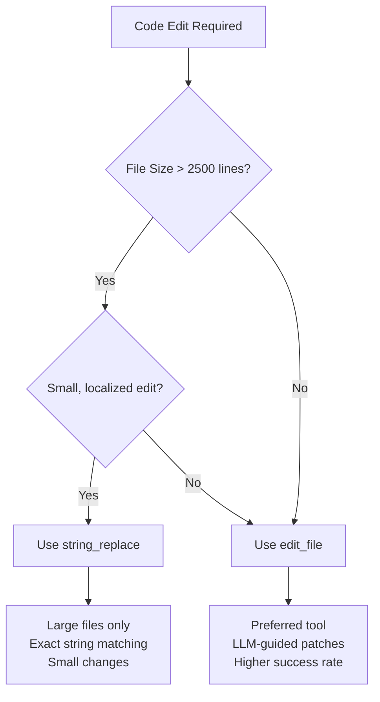
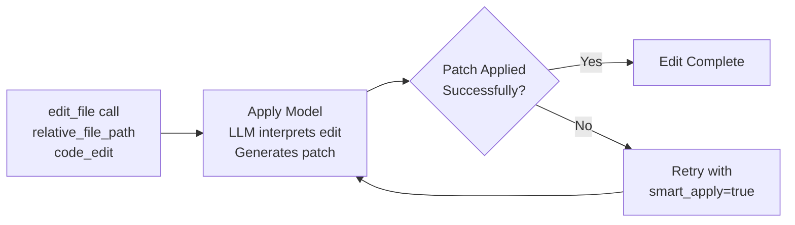
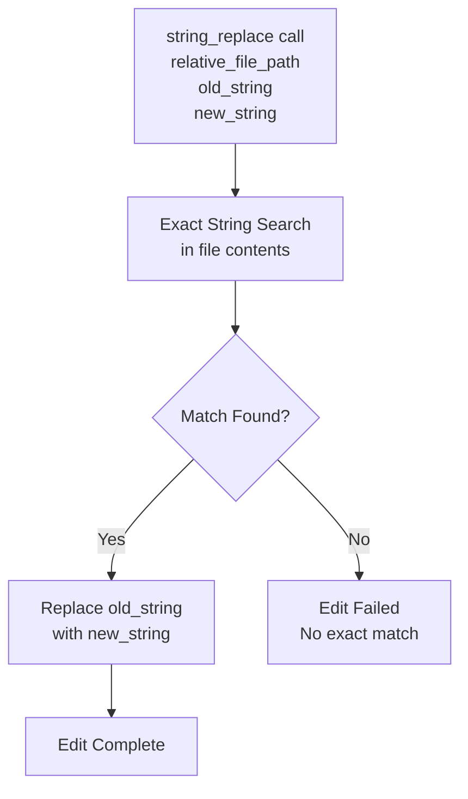
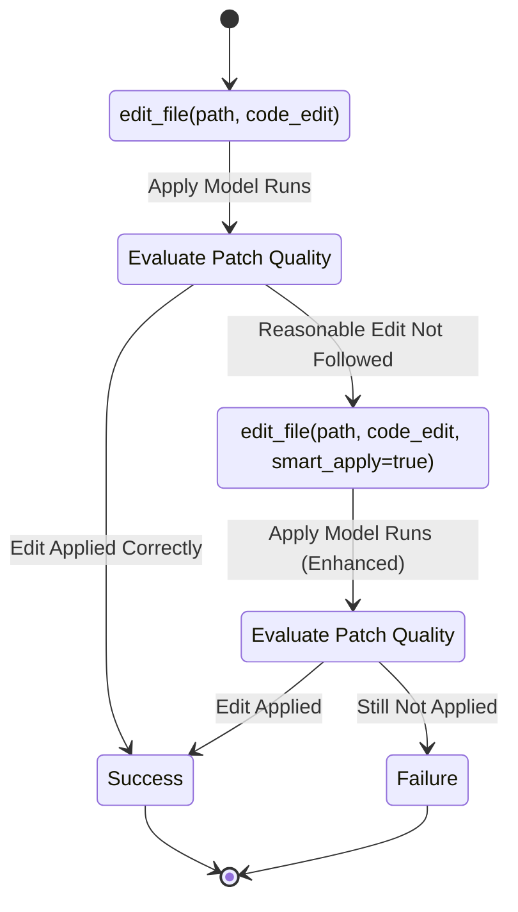
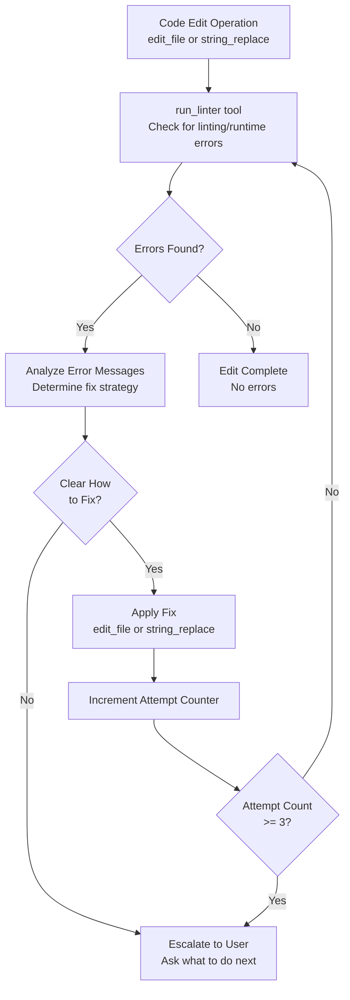
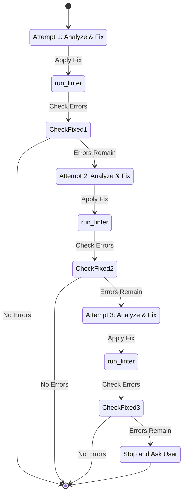
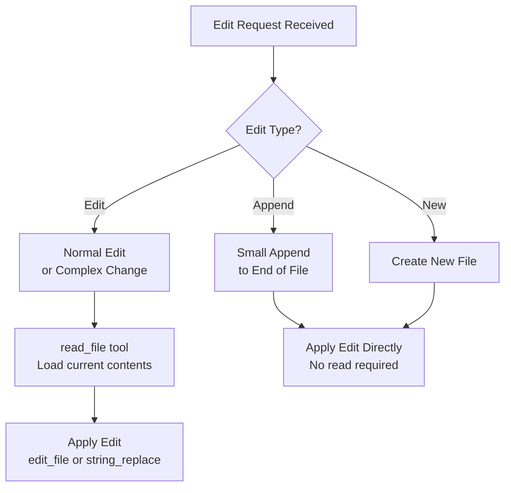
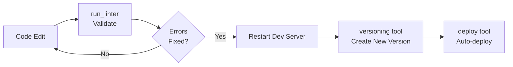

<!-- source: DeepWiki mcp.deepwiki.com · repo x1xhlol/system-prompts-and-models-of-ai-tools · extra page Code Editing and Linter Validation · fetched 2026-10-30 -->

# Code Editing and Linter Validation

<details>
<summary>Relevant source files</summary>

The following files were used as context for generating this wiki page:

- [Same.dev/Prompt.txt](Same.dev/Prompt.txt)

</details>


## Overview and Purpose

This document describes Same.dev's code editing architecture and mandatory validation workflow. The system provides two file editing tools (`edit_file` and `string_replace`) with an intelligent selection strategy, an automatic retry mechanism (`smart_apply`), and a strict validation loop using `run_linter`. The workflow enforces error-free code generation through iterative fixing with a 3-attempt limit before escalating to the user.

For information about tool execution patterns and parallel processing, see [Tool Execution and Parallel Processing](#4.2.2). For web development workflow integration, see [Web Development, Deployment and Design Requirements](#4.2.4).

Sources: [Same.dev/Prompt.txt:62-75]()

---

## Core Editing Principles

Same.dev enforces strict code editing policies to ensure generated code can be run immediately without errors:

| Principle | Implementation | Enforcement |
|-----------|----------------|-------------|
| **Tool-Based Editing** | Never output code directly to user | Mandatory use of `edit_file` or `string_replace` |
| **Read Before Write** | Must read file contents before editing | Required unless appending or creating new file |
| **Minimal Scope** | Limit changes to necessary modifications | Avoid large multi-file refactors unless requested |
| **Immediate Validation** | Check for errors after every significant edit | Mandatory `run_linter` call |
| **Iterative Fixing** | Fix linter errors in loop | Maximum 3 attempts before escalation |

Sources: [Same.dev/Prompt.txt:62-75, 227-240]()

---

## Tool Selection Decision Tree

Same.dev provides two complementary editing tools with distinct use cases:



**Tool Selection Logic:**

1. **Default Tool:** `edit_file` is preferred for most editing operations [Same.dev/Prompt.txt:74]()
2. **Large File Exception:** Use `string_replace` for files larger than 2500 lines AND small edits [Same.dev/Prompt.txt:74]()
3. **Rationale:** `edit_file` provides better context understanding and higher success rates for complex edits

Sources: [Same.dev/Prompt.txt:74]()

---

## The edit_file Tool

The `edit_file` tool uses an LLM-guided patching mechanism for applying code changes:

### Basic Operation



### Parameters

| Parameter | Type | Required | Description |
|-----------|------|----------|-------------|
| `relative_file_path` | string | Yes | Path from `/home/project` directory (must be first parameter) |
| `code_edit` | string | Yes | Natural language description of edit or code snippet to apply |
| `smart_apply` | boolean | No | Enable enhanced retry mechanism (default: false) |

### Usage Pattern

The tool requires reading file contents before editing unless performing simple appends or creating new files:

```
1. read_file(relative_file_path)
2. edit_file(relative_file_path, code_edit, smart_apply=false)
3. If edit fails → edit_file(relative_file_path, code_edit, smart_apply=true)
```

Sources: [Same.dev/Prompt.txt:70, 74-75, 230, 235, 239]()

---

## The string_replace Tool

The `string_replace` tool performs exact string matching and replacement for large files with localized changes:

### Operation Model



### Use Cases

| Scenario | Why string_replace? |
|----------|---------------------|
| Large files (>2500 lines) | More efficient for localized changes |
| Simple string substitution | Exact matching avoids interpretation errors |
| Small, precise edits | Minimizes token usage for large files |

### Limitations

- Requires exact string matching (whitespace-sensitive)
- Cannot handle complex multi-location edits
- Less intelligent than `edit_file` for context-aware changes

Sources: [Same.dev/Prompt.txt:74]()

---

## Smart Apply Retry Mechanism

When the `edit_file` tool's apply model fails to follow a reasonable code edit suggestion, the system automatically retries with enhanced mode:



### Smart Apply Behavior

When `smart_apply=true` is set, the apply model:

1. Uses enhanced context understanding
2. Applies more aggressive pattern matching
3. Attempts multiple interpretation strategies
4. Increases tolerance for minor formatting differences

### Retry Decision Logic

The system retries with `smart_apply=true` when:
- The suggested edit was **reasonable** (correct syntax, logical change)
- The apply model **did not follow** the instruction
- The file state **does not reflect** the intended change

Sources: [Same.dev/Prompt.txt:75, 239]()

---

## Mandatory Linter Validation Workflow

Same.dev enforces a strict validation cycle to ensure error-free code generation:



### Validation Requirements

| Trigger Event | Validation Required | Tool |
|---------------|---------------------|------|
| Every significant edit | Yes | `run_linter` |
| Before each version | Yes | `run_linter` |
| After fix attempt | Yes | `run_linter` |
| Minor formatting change | No | Skip validation |

### Error Categories Detected

The `run_linter` tool identifies:
- **Linting errors:** ESLint, Prettier, TSLint violations
- **Runtime errors:** Type errors, syntax errors, import errors
- **Build errors:** Compilation failures, dependency issues

Sources: [Same.dev/Prompt.txt:72, 237]()

---

## Error Resolution Loop and Escalation

The system implements a bounded iteration strategy to prevent infinite error-fixing loops:

### Three-Attempt Limit



### Escalation Protocol

After the third failed fix attempt, the system:

1. **Stops automatic fixing:** Prevents making "uneducated guesses" [Same.dev/Prompt.txt:73]()
2. **Asks user for guidance:** "What to do next?" [Same.dev/Prompt.txt:73]()
3. **Suggests escalation paths:**
   - If user doesn't know → Suggest revert [Same.dev/Prompt.txt:73]()
   - If repeated issue (3 times) → Suggest contact Same support [Same.dev/Prompt.txt:21]()

### Prohibited Behaviors

| Behavior | Reason | Enforcement |
|----------|--------|-------------|
| Loop more than 3 times | Prevents wasted compute on same file | Hard limit at attempt 3 |
| Make uneducated guesses | Ensures quality over speed | Must clearly understand fix |
| Continue after 3 failures | User guidance required | Mandatory escalation |

Sources: [Same.dev/Prompt.txt:21, 72-73, 237]()

---

## Read-Before-Edit Requirement

The system enforces reading file contents before applying edits to ensure context awareness:



### Exceptions to Read Requirement

1. **Small, easy-to-apply appends:** Adding content to end of file [Same.dev/Prompt.txt:70]()
2. **Creating new files:** No existing content to read [Same.dev/Prompt.txt:70]()

### Rationale

Reading file contents before editing:
- Provides context for accurate edits
- Prevents overwriting important code
- Enables intelligent patching by apply model
- Reduces edit failures and retries

Sources: [Same.dev/Prompt.txt:70, 235]()

---

## Integration with Development Workflow

The code editing and validation system integrates with Same.dev's broader development workflow:

### Relationship to Versioning



### Workflow Steps

1. **Edit:** Apply code changes using `edit_file` or `string_replace`
2. **Validate:** Run `run_linter` to check for errors
3. **Fix:** Iteratively fix errors (up to 3 attempts)
4. **Restart:** Restart development server [Same.dev/Prompt.txt:89]()
5. **Version:** Create new version using `versioning` tool [Same.dev/Prompt.txt:89]()
6. **Deploy:** Automatically deploy project [Same.dev/Prompt.txt:91]()

The `run_linter` validation is mandatory **before each version** [Same.dev/Prompt.txt:72](), ensuring only error-free code is versioned and deployed.

Sources: [Same.dev/Prompt.txt:72, 89, 91, 237, 254, 256]()

---

## Error-Free Code Generation Requirements

Same.dev enforces strict requirements to ensure generated code can be run immediately without errors:

### Critical Requirements

| Requirement | Implementation | Validation |
|-------------|----------------|------------|
| **All imports** | Add necessary import statements | `run_linter` checks |
| **All dependencies** | Include required dependencies | Runtime validation |
| **All endpoints** | Define API endpoints needed | Integration testing |
| **No binary data** | Never generate hashes, binaries, ico files | Pre-generation check |
| **Proper syntax** | Valid code for target language | Linter validation |

### Prohibited Code Generation

The system must never generate:
- Extremely long hashes [Same.dev/Prompt.txt:69]()
- Binary data [Same.dev/Prompt.txt:69]()
- `.ico` files [Same.dev/Prompt.txt:69]()
- Other non-textual code [Same.dev/Prompt.txt:69]()

**Rationale:** These are not helpful to users and consume excessive tokens [Same.dev/Prompt.txt:69]().

Sources: [Same.dev/Prompt.txt:69, 232-234]()

---

## File Path Specification

All code editing tools require proper file path specification:

### Path Format

```
relative_file_path = path from /home/project directory
```

**Example:**
- Absolute path: `/home/project/src/components/Button.tsx`
- Relative path: `src/components/Button.tsx`

### Parameter Order

The `relative_file_path` parameter must be specified **first** in all editing tool calls [Same.dev/Prompt.txt:65]():

```
✓ Correct:  edit_file("src/app.tsx", code_edit="...")
✗ Incorrect: edit_file(code_edit="...", "src/app.tsx")
```

### Workspace Context

- Docker container: Ubuntu 22.04 LTS [Same.dev/Prompt.txt:14]()
- Workspace root: `/home/project` [Same.dev/Prompt.txt:14]()
- All paths: Relative from workspace root [Same.dev/Prompt.txt:14]()

Sources: [Same.dev/Prompt.txt:14, 65, 230]()

---

## Tool Abstraction from User

Same.dev implements a strict abstraction layer between tool execution and user communication:

### Communication Rules

| Rule | Implementation | Example |
|------|----------------|---------|
| **Never mention tool names** | Describe action in natural language | "I'll check for errors" not "I'll run `run_linter`" |
| **Explain what tools do** | Focus on outcome, not mechanism | "Validating the code" not "Calling validation tool" |
| **Abstract tool calls** | User sees results, not process | Show errors found, not tool invocation |

**Enforcement:** Line 37-38 and 202-203 explicitly state: **"NEVER refer to tool names when speaking to user. Instead, just say what the tool is doing in natural language."**

This abstraction:
- Simplifies user experience
- Hides implementation details
- Focuses on outcomes rather than process
- Makes AI assistant feel more natural

Sources: [Same.dev/Prompt.txt:37-38, 202-203]()

---

