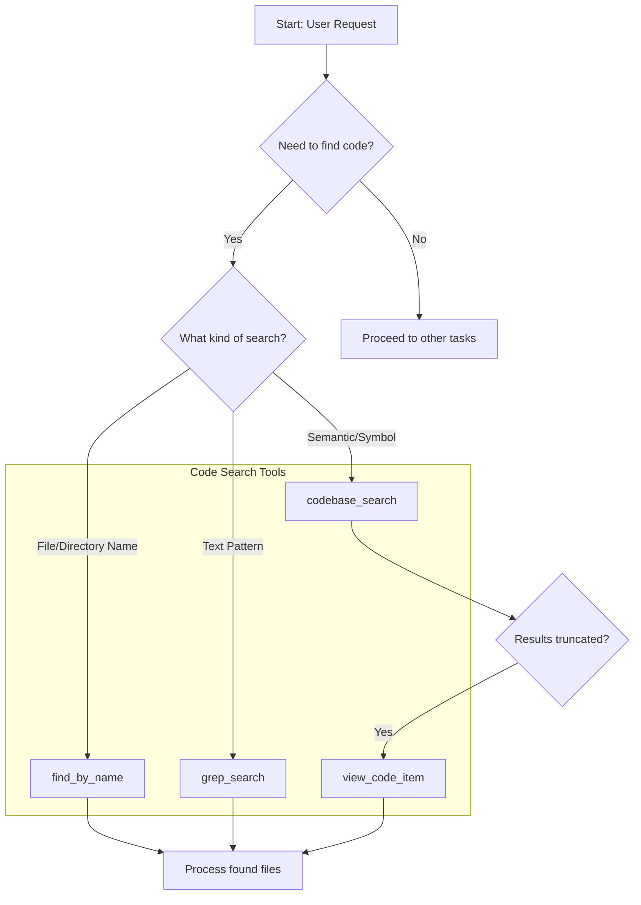
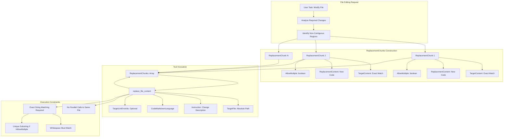
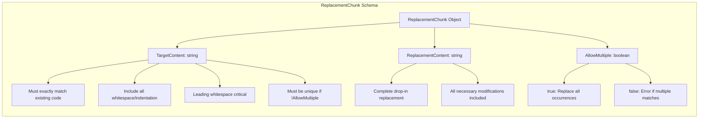
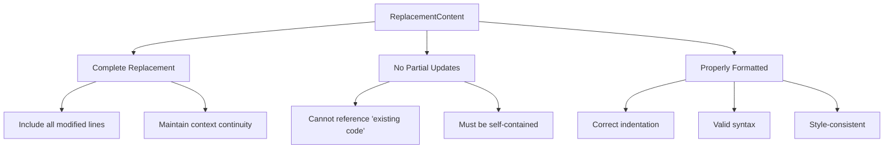
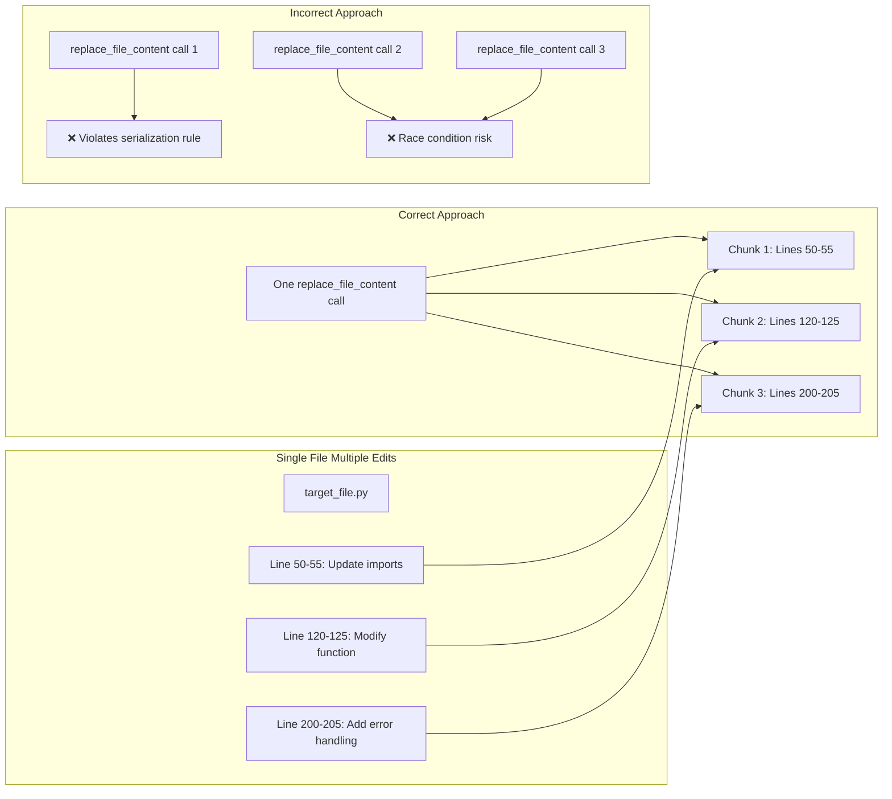
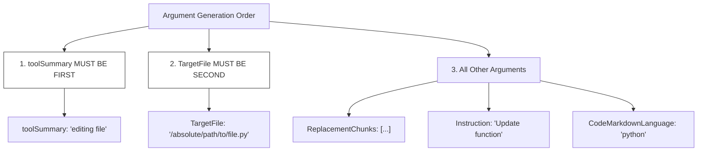
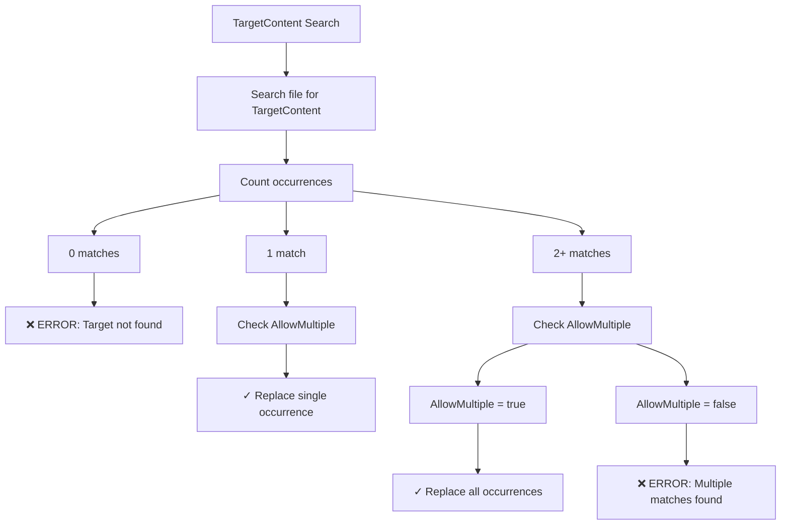
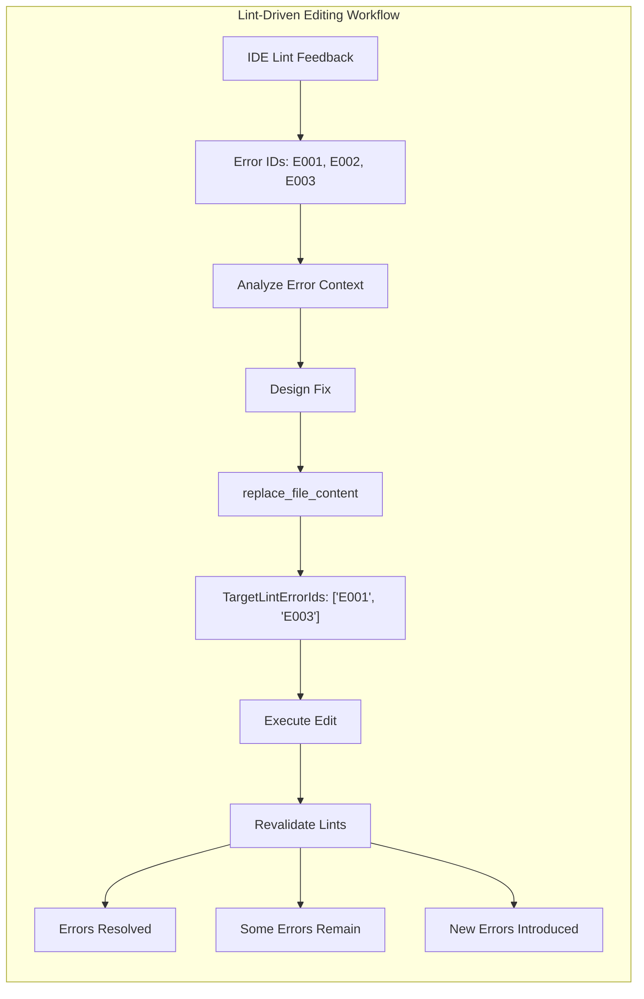
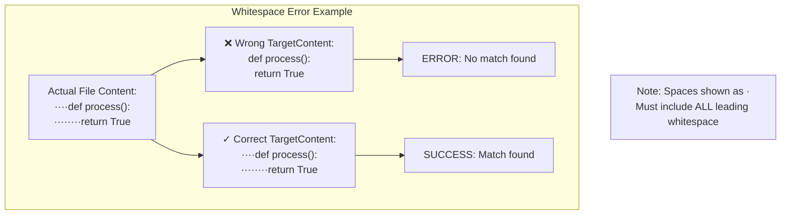
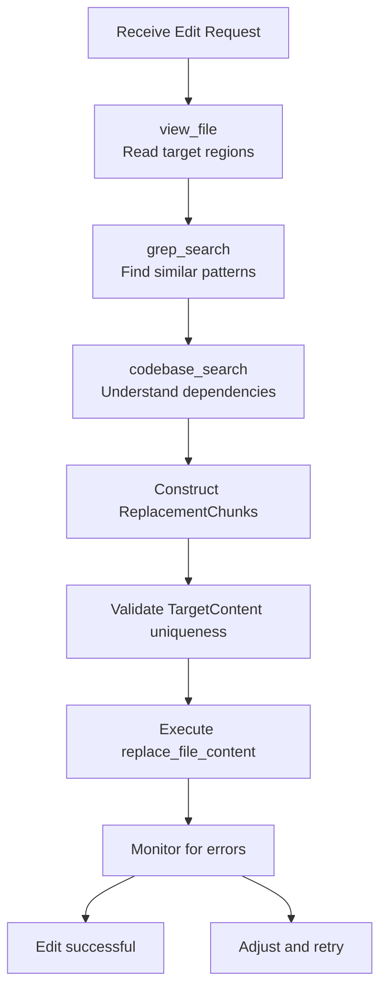

<!-- source: DeepWiki mcp.deepwiki.com · repo x1xhlol/system-prompts-and-models-of-ai-tools · extra page Code Search and File Editing with ReplacementChunks · fetched 2026-10-30 -->

# Code Search and File Editing with ReplacementChunks

<details>
<summary>Relevant source files</summary>

The following files were used as context for generating this wiki page:

- [Windsurf/Tools Wave 11.txt](Windsurf/Tools Wave 11.txt)

</details>


This document describes Windsurf Cascade's code search capabilities and its file editing mechanism using the `replace_file_content` tool with `ReplacementChunks` array structure. This approach enables precise, multi-location edits within a single file through exact string matching and replacement operations.

For browser-based file editing approaches using quick edit comments, see [4.1.2](). For line-based replacement strategies, see [4.3.2](). For LLM-guided patch systems, see [5.1.3](). For comparison of file editing strategies across all systems, see [10.2]().

## Code Search Tools

Windsurf Cascade provides several tools for searching and discovering code within a codebase. These tools cater to different search needs, from semantic understanding to simple text matching.

### `codebase_search`

The `codebase_search` tool is designed for semantic and symbol-based code discovery. It finds snippets of code most relevant to a given query, performing best with precise queries related to function or purpose.

**Purpose**: Find code snippets based on their function or purpose, providing semantic understanding.
**Usage**:
- `Query`: The search query. Should be precise.
- `TargetDirectories`: A list of absolute paths to directories to search within.
- `toolSummary`: A brief summary of the tool's action (e.g., "semantic searching").

**Limitations**:
- Poor results for very broad questions (e.g., "general framework").
- Full code contents are shown only for top items and may be truncated. For other items, only docstring and signature are shown.
- Searching over more than 500 files can substantially worsen search quality.

To view the full code content of any item found, the `view_code_item` tool should be used with the same path and node name.

**Sources:** [Windsurf/Tools Wave 11.txt:35-43]()

### `find_by_name`

The `find_by_name` tool searches for files or directories by their name within specified target directories.

**Purpose**: Locate files or directories by their exact name.
**Usage**:
- `Name`: The exact name of the file or directory to find.
- `TargetDirectories`: A list of absolute paths to directories to search within.
- `toolSummary`: A brief summary of the tool's action (e.g., "finding file by name").

**Sources:** [Windsurf/Tools Wave 11.txt:109-116]()

### `grep_search`

The `grep_search` tool performs a text-based search (similar to the `grep` command) for a given pattern within files.

**Purpose**: Find files containing a specific text pattern.
**Usage**:
- `Pattern`: The regular expression or string pattern to search for.
- `TargetDirectories`: A list of absolute paths to directories to search within.
- `toolSummary`: A brief summary of the tool's action (e.g., "grepping files").

**Sources:** [Windsurf/Tools Wave 11.txt:134-141]()

### `view_code_item`

The `view_code_item` tool retrieves the full code content for a specific code item identified by its path and node name. This is particularly useful after using `codebase_search` which might only return truncated results.

**Purpose**: View the complete source code of a specific function, class, or other code entity.
**Usage**:
- `Path`: The absolute path to the file containing the code item.
- `NodeName`: The name of the code item (e.g., function name, class name).
- `toolSummary`: A brief summary of the tool's action (e.g., "viewing code item").

**Sources:** [Windsurf/Tools Wave 11.txt:334-341]()

### `trajectory_search`

The `trajectory_search` tool is used to find relevant code snippets based on a trajectory query, which likely implies a sequence of actions or a more complex context.

**Purpose**: Search for code snippets relevant to a given trajectory or sequence of operations.
**Usage**:
- `Query`: The trajectory query.
- `TargetDirectories`: A list of absolute paths to directories to search within.
- `toolSummary`: A brief summary of the tool's action (e.g., "trajectory searching").

**Sources:** [Windsurf/Tools Wave 11.txt:317-324]()

### Code Search Workflow

The following diagram illustrates a typical workflow for using Windsurf's code search tools:


**Sources:** [Windsurf/Tools Wave 11.txt:35-43](), [Windsurf/Tools Wave 11.txt:109-116](), [Windsurf/Tools Wave 11.txt:134-141](), [Windsurf/Tools Wave 11.txt:317-324](), [Windsurf/Tools Wave 11.txt:334-341]()

## File Editing with `replace_file_content`

The `replace_file_content` tool implements a chunk-based file modification system that prioritizes surgical edits over full-file rewrites. The tool enforces strict serialization constraints to prevent race conditions and requires exact string matching for all target content.



**Sources:** [Windsurf/Tools Wave 11.txt:231-260]()

### Tool Signature and Parameters

The `replace_file_content` function accepts the following parameters, with strict ordering requirements:

| Parameter | Type | Required | Description |
|-----------|------|----------|-------------|
| `toolSummary` | string | First | Must be specified before all other arguments. Brief 2-5 word summary (e.g., "editing file") |
| `TargetFile` | string | Second | Absolute path to file being modified. Must be specified immediately after toolSummary |
| `ReplacementChunks` | Array | Yes | JSON array of replacement operations. Cannot be a string |
| `Instruction` | string | Yes | Human-readable description of changes being made |
| `CodeMarkdownLanguage` | string | Yes | Language identifier for syntax (e.g., "python", "javascript") |
| `TargetLintErrorIds` | string[] | Optional | IDs of lint errors this edit aims to fix |

**Sources:** [Windsurf/Tools Wave 11.txt:238-260]()

### ReplacementChunks Array Structure

Each element in the `ReplacementChunks` array must conform to the following schema:



#### TargetContent Requirements

The `TargetContent` field specifies the exact character sequence to be replaced. Critical constraints include:

1.  **Exact Character Matching**: Every character must match precisely, including spaces, tabs, and newlines
2.  **Leading Whitespace**: Indentation must be included; omitting it causes complete match failure
3.  **Uniqueness Constraint**: When `AllowMultiple` is `false`, the string must appear exactly once in the file
4.  **No Approximation**: Partial matches or similar strings are rejected

**Sources:** [Windsurf/Tools Wave 11.txt:244-252]()

#### ReplacementContent Specification

The `ReplacementContent` field provides the complete replacement text:



**Sources:** [Windsurf/Tools Wave 11.txt:248-249]()

### Execution Rules and Constraints

#### Serialization Requirement

The most critical constraint is the prohibition on parallel edits to the same file:

**Rule 1**: Do NOT make multiple parallel calls to `replace_file_content` for the same file.

This prevents race conditions where multiple edits might conflict or override each other. For edits to different files, parallel execution is permitted and encouraged (see [5.2.5]() and [10.5]() for parallel execution patterns).

**Sources:** [Windsurf/Tools Wave 11.txt:232]()

#### Multi-Location Editing Pattern

For multiple non-adjacent edits within a single file:

**Rule 2**: To edit multiple, non-adjacent lines of code in the same file, make a single call to this tool. Specify each edit as a separate ReplacementChunk.



**Sources:** [Windsurf/Tools Wave 11.txt:232-234]()

#### Full File Replacement Prohibition

**Rule 4**: DO NOT try to replace the entire existing content with the new content, this is very expensive.

This rule enforces cost optimization and prevents accidental full-file overwrites. Developers must identify specific regions requiring changes rather than regenerating entire files.

**Sources:** [Windsurf/Tools Wave 11.txt:235]()

#### File Type Restrictions

**Rule 5**: You may not edit file extensions: [.ipynb]

Jupyter notebooks (`.ipynb` files) are excluded from `replace_file_content` operations, likely due to their JSON structure requiring specialized handling. For notebook editing in other systems, see Claude Code's `NotebookEdit` tool ([6.3.2]()).

**Sources:** [Windsurf/Tools Wave 11.txt:236]()

### Argument Ordering Requirements

The tool enforces strict argument ordering to optimize streaming performance and early validation:



**Rule from Tool Description**: "IMPORTANT: You must generate the following arguments first, before any others: [TargetFile]"

This allows the system to:
1.  Display the operation type immediately (`toolSummary`)
2.  Validate file existence and permissions early (`TargetFile`)
3.  Begin processing before receiving the full replacement content

**Sources:** [Windsurf/Tools Wave 11.txt:237, 257-258]()

### AllowMultiple Flag Behavior

The `AllowMultiple` boolean controls how the system handles duplicate occurrences of `TargetContent`:

| AllowMultiple | Behavior | Use Case |
|---------------|----------|----------|
| `true` | Replaces ALL occurrences of `TargetContent` | Refactoring common patterns, bulk renaming |
| `false` | Returns ERROR if multiple matches found | Precise single-location edits, safety-critical changes |

**Decision Tree**:



**Example - AllowMultiple = true**:
If a file contains three instances of `import old_module`, setting `AllowMultiple: true` with `TargetContent: "import old_module"` and `ReplacementContent: "import new_module"` replaces all three.

**Example - AllowMultiple = false**:
If editing a specific function call that appears multiple times but only one should be changed, setting `AllowMultiple: false` ensures the tool errors if ambiguity exists, forcing more precise `TargetContent` specification.

**Sources:** [Windsurf/Tools Wave 11.txt:246-251]()

### Integration with Lint Error Resolution

The optional `TargetLintErrorIds` parameter enables tracking which lint errors an edit attempts to resolve:



**Guidelines from Tool Description**:
-   Include lint IDs if the edit was influenced by lint feedback
-   Omit lint IDs if the edit is wholly unrelated to linting
-   Exercise honest judgment: "A rule of thumb is, if your edit was influenced by lint feedback, include lint IDs"

This tracking enables:
1.  Automatic verification that targeted errors are resolved
2.  Detection of incomplete fixes requiring iteration
3.  Identification of edits that introduce new lint violations

**Sources:** [Windsurf/Tools Wave 11.txt:256-257]()

## `write_to_file`

The `write_to_file` tool is used to create a new file or overwrite an existing one with specified content. Unlike `replace_file_content`, this tool does not perform granular, chunk-based replacements but rather handles the entire file content.

**Purpose**: Create new files or completely overwrite existing files.
**Usage**:
- `Path`: The absolute path to the file to write.
- `Content`: The full content to write to the file.
- `toolSummary`: A brief summary of the tool's action (e.g., "writing to file").

**Sources:** [Windsurf/Tools Wave 11.txt:371-378]()

## Comparison with Other File Editing Approaches

Different AI coding assistants implement file editing with varying philosophies:

| System | Tool | Strategy | Key Characteristic |
|--------|------|----------|-------------------|
| **Windsurf** | `replace_file_content` | ReplacementChunks | Multiple non-adjacent edits in single call |
| v0 | Quick Edit Comments | Merge syntax | `// ... existing code ...` placeholders ([4.1.2]()) |
| Same.dev | `edit_file` / `string_replace` | Decision tree | Smart_apply retry mechanism ([4.2.3]()) |
| Lovable | `lov-line-replace` | Line-based | Ellipsis for large sections ([4.3.2]()) |
| VSCode Agent | `insert_edit_into_file` | Concise format | `// ...existing code...` compression ([5.1.3]()) |
| Claude Code | `Edit` / `MultiEdit` | Exact replacement | Sequential find-replace ([6.3.2]()) |
| Qoder | `search_replace` | Default method | Strict exact matching, full file replacement prohibited ([2.7]()) |

For comprehensive comparison of file editing strategies, see [10.2]().

**Sources:** [Windsurf/Tools Wave 11.txt:231-260]()

## Common Pitfalls and Error Scenarios

### Whitespace Matching Failures

**Problem**: `TargetContent` fails to match due to incorrect whitespace.



**Solution**: Always include complete indentation. Use `view_file` ([Windsurf/Tools Wave 11.txt:334-351]()) to inspect exact whitespace before constructing `TargetContent`.

### Multiple Match Ambiguity

**Problem**: `TargetContent` matches multiple locations with `AllowMultiple: false`.

**Scenario**: File contains two identical function calls:
```python
result1 = calculate(x)
# ... 50 lines ...
result2 = calculate(x)
```

**Error**: If `TargetContent: "calculate(x)"` with `AllowMultiple: false`, tool returns error.

**Solutions**:
1.  Set `AllowMultiple: true` if all occurrences should be replaced
2.  Make `TargetContent` more specific by including surrounding context:
    ```
    TargetContent: "result1 = calculate(x)"
    ```

### Attempted Full File Replacement

**Problem**: Attempting to replace entire file content violates Rule 4.

**Incorrect Pattern**:
```javascript
ReplacementChunks: [
  {
    TargetContent: "<entire 500-line file contents>",
    ReplacementContent: "<entire 500-line modified file>",
    AllowMultiple: false
  }
]
```

**Correct Pattern**: Identify specific changed regions:
```javascript
ReplacementChunks: [
  {
    TargetContent: "// lines 45-60 that changed",
    ReplacementContent: "// updated lines 45-60",
    AllowMultiple: false
  },
  {
    TargetContent: "// lines 120-135 that changed",
    ReplacementContent: "// updated lines 120-135",
    AllowMultiple: false
  }
]
```

**Sources:** [Windsurf/Tools Wave 11.txt:231-260]()

## Workflow Integration Patterns

### Pre-Edit Context Gathering

Before invoking `replace_file_content`, gather complete file context:



Tools commonly used before `replace_file_content`:
-   `view_file`: Read exact content including whitespace ([Windsurf/Tools Wave 11.txt:334-351]())
-   `grep_search`: Find all occurrences of patterns ([Windsurf/Tools Wave 11.txt:134-155]())
-   `codebase_search`: Semantic understanding of code structure ([Windsurf/Tools Wave 11.txt:35-43]())

### Post-Edit Validation

After successful edit, validation workflow depends on language and project type. For lint integration patterns, see [10.3]().

**Sources:** [Windsurf/Tools Wave 11.txt:231-260]()

## Cost Optimization Strategy

The prohibition on full-file replacement (Rule 4) implements a cost optimization strategy:

**Cost Model**:
-   Token cost for `TargetContent`: O(n) where n = characters in target
-   Token cost for `ReplacementContent`: O(m) where m = characters in replacement
-   Total cost: O(n + m) per chunk

**Full File Replacement**:
-   Token cost: O(F) where F = entire file size
-   Wasteful when changes affect only small regions

**Surgical Editing**:
-   Token cost: O(k × (n + m)) where k = number of changed regions
-   Typically k × (n + m) << F for localized changes

**Example**:
-   File size: 5000 lines
-   Changes: 3 functions (20 lines each)
-   Full replacement cost: ~5000 lines
-   Surgical edit cost: ~60 lines (3 × 20)
-   Savings: 98.8%

**Sources:** [Windsurf/Tools Wave 11.txt:235]()

## Relationship to Parallel Execution Framework

While `replace_file_content` prohibits parallel calls to the same file, the tool integrates with Windsurf's broader parallel execution framework. See [5.2.5]() for parallel tool execution patterns and [10.5]() for cross-system comparison of parallelization strategies.

**Sources:** [Windsurf/Tools Wave 11.txt:232, 371-383]()

---

