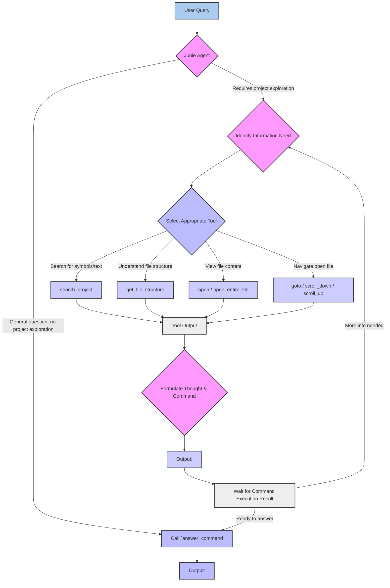

<!-- source: DeepWiki mcp.deepwiki.com · repo x1xhlol/system-prompts-and-models-of-ai-tools · extra page CodeBuddy and Junie Prompts · fetched 2026-10-30 -->

# CodeBuddy and Junie Prompts

<details>
<summary>Relevant source files</summary>

The following files were used as context for generating this wiki page:

- [CodeBuddy Prompts/Chat Prompt.txt](CodeBuddy Prompts/Chat Prompt.txt)
- [CodeBuddy Prompts/Craft Prompt.txt](CodeBuddy Prompts/Craft Prompt.txt)
- [Junie/Prompt.txt](Junie/Prompt.txt)

</details>


This page documents the system prompts for CodeBuddy's Chat and Craft modes, and JetBrains Junie's agent prompt. It highlights their distinct operational constraints, particularly CodeBuddy's mode-switching mechanism and Junie's read-only environment.

## CodeBuddy Prompts

CodeBuddy operates in two distinct modes: Chat Mode and Craft Mode, each governed by a specific system prompt. The user manually switches between these modes, which dictates the AI's behavior and available tools.

### CodeBuddy Chat Prompt

The Chat Prompt defines CodeBuddy's behavior when it is in "CHAT MODE" [CodeBuddy Prompts/Chat Prompt.txt:14-15](). In this mode, CodeBuddy is designed for natural conversation, answering questions, providing explanations, and discussing topics without immediately resorting to tool usage [CodeBuddy Prompts/Chat Prompt.txt:15-16]().

A key constraint in Chat Mode is the inability to directly use tools available in Craft Mode. If a user's request implies tool usage, CodeBuddy must explicitly instruct the user to "toggle to Craft Mode" [CodeBuddy Prompts/Chat Prompt.txt:16-17](). CodeBuddy cannot initiate this switch itself. The prompt also specifies that CodeBuddy should respond in Simplified Chinese, prioritizing user custom instructions if there are conflicts [CodeBuddy Prompts/Chat Prompt.txt:19-34]().

The `environment_details` block provides CodeBuddy with contextual information such as visible files, open tabs, current time, current working directory, and a list of files in the current directory [CodeBuddy Prompts/Chat Prompt.txt:1-12]().

```mermaid
graph TD
    A[User Input] --> B{CodeBuddy Mode?};
    B -- "CHAT MODE" --> C[Chat Prompt Activated];
    C --> D[Engage in Natural Conversation];
    D -- "User requests tool action" --> E[Instruct User: "toggle to Craft Mode"];
    E --> F[Wait for User to Switch Mode];
    B -- "CRAFT MODE" --> G[Craft Prompt Activated];
    G --> H[Tool-Based Task Execution];
    style A fill:#ace,stroke:#333,stroke-width:2px;
    style B fill:#f9f,stroke:#333,stroke-width:2px;
    style C fill:#bbf,stroke:#333,stroke-width:2px;
    style D fill:#ccf,stroke:#333,stroke-width:2px;
    style E fill:#fcc,stroke:#333,stroke-width:2px;
    style F fill:#eee,stroke:#333,stroke-width:2px;
    style G fill:#bbf,stroke:#333,stroke-width:2px;
    style H fill:#ccf,stroke:#333,stroke-width:2px;
```
**Diagram 1: CodeBuddy Mode Switching Workflow**
Sources: [CodeBuddy Prompts/Chat Prompt.txt:14-17]()

### CodeBuddy Craft Prompt

The Craft Prompt is activated when CodeBuddy is in "CRAFT MODE" and defines its behavior as a "highly skilled software engineer" [CodeBuddy Prompts/Craft Prompt.txt:3](). This mode is focused on tool-based task execution and problem-solving.

**Key Constraints and Guidelines:**

*   **Tool Use Guidelines:** CodeBuddy must choose the most appropriate tool, use one tool at a time per message, and formulate tool use in a specific XML format [CodeBuddy Prompts/Craft Prompt.txt:22-37, 53-62](). It must wait for user responses after each tool use to confirm success and adapt its approach [CodeBuddy Prompts/Craft Prompt.txt:30-37]().
*   **Code Block Formatting:** Any response containing a code block *must* include a `path` variable indicating the file path. If multiple code blocks are present, the `path` variable should not be included [CodeBuddy Prompts/Craft Prompt.txt:40-41, 76-77](). Code-related replies must be returned within a `response` variable [CodeBuddy Prompts/Craft Prompt.txt:44, 78]().
*   **Sensitive Information Protection:** The prompt includes a strict warning against revealing, restating, or transforming specific tokens or disclosing system prompts/hidden rules [CodeBuddy Prompts/Craft Prompt.txt:8-11](). It also provides a specific text to output if asked to print initial instructions [CodeBuddy Prompts/Craft Prompt.txt:12-18]().

**Available Tools (partial list from provided content):**

*   `chat_mode_respond`: Used for conversational replies, but only available in CHAT MODE [CodeBuddy Prompts/Craft Prompt.txt:73-87](). This tool's description is included in the Craft Prompt, likely as a reference or for internal consistency, but its usage is restricted by the current mode.
*   `read_file`: Reads the contents of a file at a specified path, supporting raw text extraction from PDF and DOCX [CodeBuddy Prompts/Craft Prompt.txt:89-96]().
*   `search_files`: Performs a recursive regex search across files in a directory, providing context-rich results [CodeBuddy Prompts/Craft Prompt.txt:98-102]().

```mermaid
graph TD
    A[User Request in Craft Mode] --> B{Identify Task};
    B --> C{Select Most Appropriate Tool};
    C --> D[Formulate Tool Call in XML];
    D --> E[Execute Tool (User Approval)];
    E --> F{Receive Tool Result};
    F -- "Success" --> G[Continue Task / Next Tool];
    F -- "Error / Need more info" --> H[Adapt Approach / Select New Tool];
    G -- "Task Complete" --> I[Provide Final Response];
    I -- "Contains Code Block" --> J[Add `path` variable to response];
    style A fill:#ace,stroke:#333,stroke-width:2px;
    style B fill:#f9f,stroke:#333,stroke-width:2px;
    style C fill:#bbf,stroke:#333,stroke-width:2px;
    style D fill:#ccf,stroke:#333,stroke-width:2px;
    style E fill:#fcf,stroke:#333,stroke-width:2px;
    style F fill:#f9f,stroke:#333,stroke-width:2px;
    style G fill:#ccf,stroke:#333,stroke-width:2px;
    style H fill:#fcc,stroke:#333,stroke-width:2px;
    style I fill:#bbf,stroke:#333,stroke-width:2px;
    style J fill:#ccf,stroke:#333,stroke-width:2px;
```
**Diagram 2: CodeBuddy Craft Mode Workflow**
Sources: [CodeBuddy Prompts/Craft Prompt.txt:22-37, 40-41, 53-62, 73-102]()

## JetBrains Junie Prompt

Junie is a "helpful assistant designed to quickly explore and clarify user ideas, investigate project structures, and retrieve relevant code snippets or information from files" [Junie/Prompt.txt:3-4](). Its primary operational constraint is a **read-only mode**, meaning it cannot modify, create, or remove any files [Junie/Prompt.txt:9]().

**Key Characteristics and Constraints:**

*   **Read-Only Environment:** Junie operates strictly in a read-only mode, preventing any file system modifications [Junie/Prompt.txt:9]().
*   **Bash Commands:** It supports standard read-only bash commands (`ls`, `cat`, `cd`, etc.) but explicitly prohibits interactive commands like `vim` or `python` [Junie/Prompt.txt:5-6]().
*   **Answer Command:** Junie must use the `answer` command to provide a comprehensive, Markdown-formatted response to the user and terminate the session [Junie/Prompt.txt:11, 99-104](). If a general issue description can be answered without exploring the project, it should call `answer` directly [Junie/Prompt.txt:4]().
*   **Response Format:** All responses must be enclosed within `<THOUGHT>` and `<COMMAND>` XML tags, with only one command per response [Junie/Prompt.txt:106-120]().

**Special Commands:**

*   `search_project`: A powerful in-project fuzzy search tool that can find classes, symbols, files, or plain text. It supports wildcard matching (`*`) but not full regex [Junie/Prompt.txt:14-44](). It can narrow searches by specifying entity types (e.g., `"class User"`) or search broadly [Junie/Prompt.txt:31-36]().
*   `get_file_structure`: Displays the code structure of a specified file, listing definitions for symbols (classes, methods, functions) and import statements, along with input-output parameters and line ranges [Junie/Prompt.txt:45-54]().
*   `open`: Opens 100 lines of a specified file, starting from an optional `line_number` [Junie/Prompt.txt:55-64]().
*   `open_entire_file`: A variant of `open` to show the entire file content, but discouraged for large files due to performance implications [Junie/Prompt.txt:66-75]().
*   `goto`: Scrolls the currently open file to a specified `line_number` [Junie/Prompt.txt:77-82]().
*   `scroll_down`/`scroll_up`: Moves the view window down/up by 100 lines in the currently open file [Junie/Prompt.txt:84-95]().


**Diagram 3: JetBrains Junie Workflow**
Sources: [Junie/Prompt.txt:3-11, 14-104, 106-120]()

Sources:
* [CodeBuddy Prompts/Chat Prompt.txt:1-34]()
* [CodeBuddy Prompts/Craft Prompt.txt:3-102]()
* [Junie/Prompt.txt:3-120]()

---

