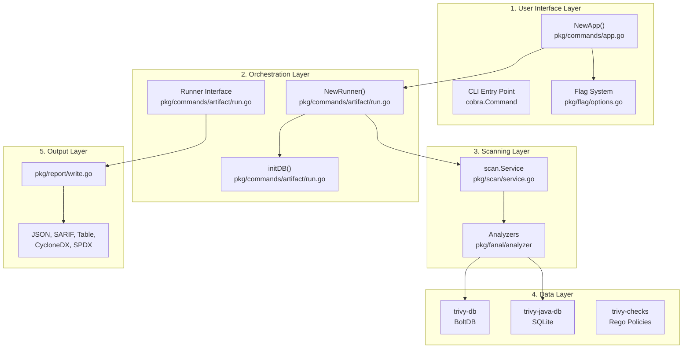
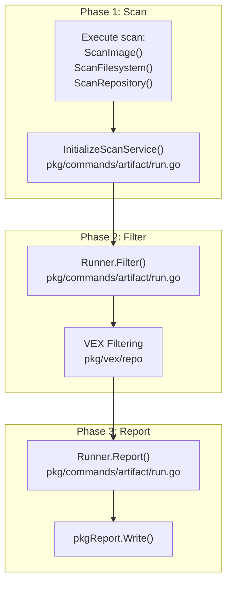

<!-- source: DeepWiki mcp.deepwiki.com · repo aquasecurity/trivy · page 1 Overview of Trivy · fetched 2026-10-30 -->

# Overview of Trivy

Relevant source files

The following files were used as context for generating this wiki page:

- [.release-please-manifest.json](.release-please-manifest.json)
- [CHANGELOG.md](CHANGELOG.md)
- [README.md](README.md)
- [docs/build/Dockerfile](docs/build/Dockerfile)
- [docs/build/requirements.txt](docs/build/requirements.txt)
- [docs/commercial/compare.md](docs/commercial/compare.md)
- [docs/commercial/contact.md](docs/commercial/contact.md)
- [docs/community/principles.md](docs/community/principles.md)
- [docs/getting-started/faq.md](docs/getting-started/faq.md)
- [docs/getting-started/installation.md](docs/getting-started/installation.md)
- [docs/imgs/excalidraw/image.excalidraw](docs/imgs/excalidraw/image.excalidraw)
- [docs/imgs/secret-demo.gif](docs/imgs/secret-demo.gif)
- [docs/imgs/trivy-k8s.png](docs/imgs/trivy-k8s.png)
- [docs/index.md](docs/index.md)
- [docs/tutorials/kubernetes/cluster-scanning.md](docs/tutorials/kubernetes/cluster-scanning.md)
- [go.mod](go.mod)
- [go.sum](go.sum)
- [integration/client_server_test.go](integration/client_server_test.go)
- [integration/docker_engine_test.go](integration/docker_engine_test.go)
- [integration/integration_test.go](integration/integration_test.go)
- [integration/registry_test.go](integration/registry_test.go)
- [integration/repo_test.go](integration/repo_test.go)
- [integration/sbom_test.go](integration/sbom_test.go)
- [integration/standalone_tar_test.go](integration/standalone_tar_test.go)
- [integration/testdata/fixtures/db/vulnerability.yaml](integration/testdata/fixtures/db/vulnerability.yaml)
- [integration/testdata/fluentd-multiple-lockfiles.json.golden](integration/testdata/fluentd-multiple-lockfiles.json.golden)
- [mkdocs.yml](mkdocs.yml)
- [pkg/commands/app.go](pkg/commands/app.go)
- [pkg/commands/app_test.go](pkg/commands/app_test.go)
- [pkg/commands/artifact/run.go](pkg/commands/artifact/run.go)
- [pkg/commands/testdata/java-db/metadata.json](pkg/commands/testdata/java-db/metadata.json)
- [pkg/commands/testdata/policy/metadata.json](pkg/commands/testdata/policy/metadata.json)
- [pkg/flag/options.go](pkg/flag/options.go)
- [release-please-config.json](release-please-config.json)

Trivy is a comprehensive, all-in-one security scanner designed to find vulnerabilities, misconfigurations, secrets, and license issues across diverse software artifacts. It is implemented in Go as a single, self-contained binary that requires no external dependencies beyond the vulnerability databases it automatically downloads.

This page provides a high-level introduction to Trivy's purpose, key features, and architecture. For more details:
- **Installation and configuration**: See [Installation and Setup](#1.1)
- **Detailed architecture and component design**: See [Core Architecture and Components](#1.2)
- **Database and resource management**: See [Database and Resource Management](#1.3)
- **CLI usage and commands**: See [CLI Reference](#2)
- **Scanning workflows by target type**: See [Target Types and Scanning Workflows](#5)

**Sources:** [README.md:14-36](), [go.mod:1-4]()

## What Trivy Does

Trivy performs security scanning across multiple dimensions, operating as a unified tool that replaces the need for separate scanners for different security concerns.

### Supported Scan Targets

Trivy can analyze the following artifact types:

| Target Type | Command | Primary Use Case |
|-------------|---------|------------------|
| Container Images | `trivy image` | Scan images from registries or tar archives |
| Filesystems | `trivy filesystem` | Scan local directories and projects |
| Rootfs | `trivy rootfs` | Scan unpacked container filesystems |
| Git Repositories | `trivy repository` | Scan source code repositories |
| Virtual Machines | `trivy vm` | Scan VM disk images (VMDK, AMI, etc.) |
| Kubernetes | `trivy kubernetes` | Scan running Kubernetes clusters |
| SBOM Files | `trivy sbom` | Scan existing SBOM files (CycloneDX, SPDX) |

### Security Scanners

Trivy includes independent scanner types that can be enabled or disabled via the `--scanners` flag:

1. **Vulnerability Scanner** (`vuln`): Detects known CVEs in OS packages and application dependencies using the `trivy-db` vulnerability database. Supports 20+ package ecosystems and operating systems.
2. **Misconfiguration Scanner** (`misconfig`): Identifies security issues in Infrastructure as Code (IaC) files including Terraform, Kubernetes manifests, Dockerfiles, CloudFormation, Helm charts, and Ansible playbooks. Uses Rego policies from the `trivy-checks` bundle.
3. **Secret Scanner** (`secret`): Finds hard-coded credentials, API keys, tokens, and other sensitive data in source code and configuration files.
4. **License Scanner** (`license`): Identifies software licenses in dependencies and classifies them (MIT, Apache, GPL, etc.) using SPDX identifiers.

**Sources:** [README.md:17-32](), [pkg/commands/app.go:88-106](), [pkg/commands/artifact/run.go:49-57]()

## High-Level Architecture

Trivy is organized into primary layers that handle different aspects of the scanning pipeline, from user interface to data access. This design enables modularity, allowing different scanner types to share common infrastructure while maintaining specialized detection logic.

### Architectural Layers

**System Architecture Overview**

**Sources:** [pkg/commands/app.go:67-117](), [pkg/commands/artifact/run.go:79-174](), [pkg/flag/options.go:36-85]()

### Key Components

The following table maps high-level components to their code locations:

| Layer | Component | File Location | Primary Responsibility |
|-------|-----------|---------------|------------------------|
| User Interface | `NewApp()` | [pkg/commands/app.go:68-117]() | Cobra command tree construction with grouped commands |
| User Interface | `Flag[T]` | [pkg/flag/options.go:36-85]() | Generic flag parsing with Viper integration |
| Orchestration | `Runner` interface | [pkg/commands/artifact/run.go:79-98]() | Defines scanning methods for each target type |
| Orchestration | `NewRunner()` | [pkg/commands/artifact/run.go:121-174]() | Initializes DB, WASM modules, and version checker |
| Data | `db.Init()` | [pkg/db/db.go]() | Manages vulnerability database initialization |
| Output | `pkgReport.Write()` | [pkg/report/write.go]() | Dispatches results to specific format writers |

For detailed architecture information including service initialization patterns and analyzer chains, see [Core Architecture and Components](#1.2).

**Sources:** [pkg/commands/app.go:68-117](), [pkg/commands/artifact/run.go:79-174](), [pkg/flag/options.go:36-85]()

## Scanning Workflow

Trivy follows a consistent three-phase workflow regardless of the target type being scanned: scan, filter, and report.

### Standard Scan Pipeline

**Main Execution Flow**

**Sources:** [pkg/commands/artifact/run.go:199-296](), [pkg/commands/artifact/run.go:79-98]()

### Target Type Dispatch

Trivy maps each CLI command to a specific `TargetKind` constant and corresponding runner method:

| CLI Command | `TargetKind` Constant | Runner Method |
|-------------|----------------------|---------------|
| `trivy image` | `TargetContainerImage` | `runner.ScanImage()` |
| `trivy fs` | `TargetFilesystem` | `runner.ScanFilesystem()` |
| `trivy rootfs` | `TargetRootfs` | `runner.ScanRootfs()` |
| `trivy repo` | `TargetRepository` | `runner.ScanRepository()` |
| `trivy sbom` | `TargetSBOM` | `runner.ScanSBOM()` |
| `trivy vm` | `TargetVM` | `runner.ScanVM()` |
| `trivy k8s` | `TargetK8s` | Kubernetes workflow |

The `TargetKind` type is defined in [pkg/commands/artifact/run.go:47-57]() and determines which analyzers are active and how the artifact is processed. For detailed workflows specific to each target type, see [Target Types and Scanning Workflows](#5).

**Sources:** [pkg/commands/artifact/run.go:47-57](), [pkg/commands/artifact/run.go:199-220]()

## Key Features

### Multiple Deployment Modes

Trivy supports two operational modes:

**Standalone Mode** (default): All scanning occurs locally. Trivy downloads and maintains its own copy of vulnerability databases and policy bundles in a local cache directory.

**Client/Server Mode**: Scanning is distributed between a client and server. The server maintains shared vulnerability databases. Mode selection is determined by the `--server` flag. When specified, Trivy connects to the remote server using the Twirp RPC protocol.

For detailed information on deployment configurations, see [Deployment Models](#8).

**Sources:** [pkg/commands/artifact/run.go:204-217](), [pkg/commands/app.go:93-94]()

### Automatic Resource Management

Trivy automatically manages several types of external resources:

1. **Vulnerability Database** (`trivy-db`): BoltDB file containing CVE data for OS packages and language ecosystems.
2. **Java Database** (`trivy-java-db`): SQLite database containing vulnerability information for Java artifacts.
3. **Policy Bundle** (`trivy-checks`): OCI artifact containing Rego policies for misconfiguration detection.

The `NewRunner()` function [pkg/commands/artifact/run.go:121-174]() triggers database initialization via `initDB()` and downloads VEX repositories if configured. For detailed database management, see [Database and Resource Management](#1.3).

**Sources:** [pkg/commands/artifact/run.go:146-153](), [pkg/commands/artifact/run.go:30]()

### Extensibility

Trivy provides several extension mechanisms:
- **WASM Modules**: Custom analyzers written in languages that compile to WebAssembly. Loaded by the `module.Manager` [pkg/commands/artifact/run.go:156-164]().
- **Plugins**: External executables that extend Trivy's capabilities. Loaded by `loadPluginCommands()` [pkg/commands/app.go:119-147]().
- **Custom Policies**: User-defined Rego policies for misconfiguration detection.

**Sources:** [pkg/commands/artifact/run.go:156-164](), [pkg/commands/app.go:119-147]()

## CLI Structure

Trivy's command-line interface is built using the Cobra framework and organized into functional groups.

| Group ID | Title | Purpose |
|----------|-------|---------|
| `groupScanning` | "Scanning Commands" | Primary scan operations (`image`, `fs`, `repo`, etc.) |
| `groupManagement` | "Management Commands" | Resource and server management (`server`, `module`, `plugin`) |
| `groupUtility` | "Utility Commands" | Helper tools (`version`, `convert`, `clean`) |

The command structure is defined in `NewApp()` [pkg/commands/app.go:68-117](). Each command is implemented as a factory function that returns a `*cobra.Command`. For comprehensive CLI documentation, see [CLI Reference](#2).

**Sources:** [pkg/commands/app.go:61-106]()

## Configuration System

Trivy uses a tiered configuration system that merges settings from CLI flags, environment variables, and configuration files.

- **Config File**: Loaded from `trivy.yaml` by default using `initConfig()` [pkg/commands/app.go:149-164]().
- **Environment Variables**: Prefixed with `TRIVY_`.
- **CLI Flags**: Defined using the generic `Flag[T]` struct [pkg/flag/options.go:36-85]().

For complete configuration documentation, see [Configuration Files and Environment Variables](#2.4).

**Sources:** [pkg/commands/app.go:149-164](), [pkg/flag/options.go:36-85]()

---

