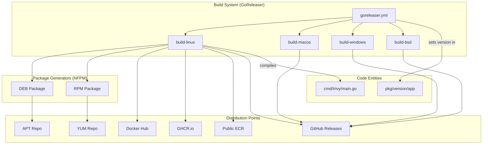
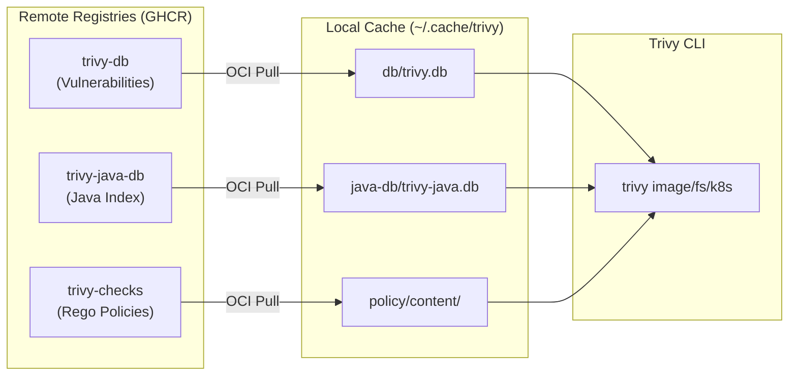

<!-- source: DeepWiki mcp.deepwiki.com · repo aquasecurity/trivy · page 1.1 Installation and Setup · fetched 2026-10-30 -->

# Installation and Setup

<details>
<summary>Relevant source files</summary>

The following files were used as context for generating this wiki page:

- [.dockerignore](.dockerignore)
- [.github/DISCUSSION_TEMPLATE/adopters.yml](.github/DISCUSSION_TEMPLATE/adopters.yml)
- [.github/DISCUSSION_TEMPLATE/bugs.yml](.github/DISCUSSION_TEMPLATE/bugs.yml)
- [.github/DISCUSSION_TEMPLATE/documentation.yml](.github/DISCUSSION_TEMPLATE/documentation.yml)
- [.github/DISCUSSION_TEMPLATE/false-detection.yml](.github/DISCUSSION_TEMPLATE/false-detection.yml)
- [.github/DISCUSSION_TEMPLATE/ideas.yml](.github/DISCUSSION_TEMPLATE/ideas.yml)
- [.github/DISCUSSION_TEMPLATE/q-a.yml](.github/DISCUSSION_TEMPLATE/q-a.yml)
- [.github/ISSUE_TEMPLATE/config.yml](.github/ISSUE_TEMPLATE/config.yml)
- [.github/pull_request_template.md](.github/pull_request_template.md)
- [CONTRIBUTING.md](CONTRIBUTING.md)
- [Dockerfile](Dockerfile)
- [Dockerfile.canary](Dockerfile.canary)
- [ci/deploy-deb.sh](ci/deploy-deb.sh)
- [ci/deploy-rpm.sh](ci/deploy-rpm.sh)
- [contrib/Trivy.gitlab-ci.yml](contrib/Trivy.gitlab-ci.yml)
- [docs/build/Dockerfile](docs/build/Dockerfile)
- [docs/build/requirements.txt](docs/build/requirements.txt)
- [docs/commercial/compare.md](docs/commercial/compare.md)
- [docs/commercial/contact.md](docs/commercial/contact.md)
- [docs/community/contribute/discussion.md](docs/community/contribute/discussion.md)
- [docs/community/contribute/issue.md](docs/community/contribute/issue.md)
- [docs/community/maintainer/help-wanted.md](docs/community/maintainer/help-wanted.md)
- [docs/community/principles.md](docs/community/principles.md)
- [docs/getting-started/faq.md](docs/getting-started/faq.md)
- [docs/getting-started/installation.md](docs/getting-started/installation.md)
- [docs/guide/configuration/filtering.md](docs/guide/configuration/filtering.md)
- [docs/guide/supply-chain/attestation/rekor.md](docs/guide/supply-chain/attestation/rekor.md)
- [docs/guide/target/container_image.md](docs/guide/target/container_image.md)
- [docs/imgs/secret-demo.gif](docs/imgs/secret-demo.gif)
- [docs/imgs/trivy-k8s.png](docs/imgs/trivy-k8s.png)
- [docs/index.md](docs/index.md)
- [docs/tutorials/kubernetes/cluster-scanning.md](docs/tutorials/kubernetes/cluster-scanning.md)
- [goreleaser-canary.yml](goreleaser-canary.yml)
- [goreleaser.yml](goreleaser.yml)

</details>


## Purpose and Scope

This page guides users through installing Trivy via various distribution methods and performing initial setup. It covers binary installation, package managers, container images, and basic configuration needed to start scanning. Trivy is designed to be platform-agnostic, supporting a wide range of operating systems and architectures.

For information about deploying Trivy in production environments, see [8.1 Standalone Mode](), [8.2 Client-Server Architecture](), or [8.3 Kubernetes Deployment with Helm](). For details on configuration files and environment variables, see [2.4 Configuration Files and Environment Variables]().

---

## Platform and Architecture Support

Trivy provides multi-platform support through a GoReleaser-based build pipeline, compiling native binaries for various operating systems and architectures. The build process ensures that binaries are statically linked and optimized for containerized environments.

### Supported Platforms

| Platform | Architectures | Build ID | Configuration Reference |
|----------|--------------|----------|-------------------------|
| Linux | amd64, arm64, 386, arm (v7), s390x, ppc64le | `build-linux` | [goreleaser.yml:5-25]() |
| macOS (Darwin) | amd64, arm64 | `build-macos` | [goreleaser.yml:43-59]() |
| Windows | amd64 | `build-windows` | [goreleaser.yml:60-76]() |
| FreeBSD | amd64 | `build-bsd` | [goreleaser.yml:26-42]() |

All official builds are compiled with `CGO_ENABLED=0` [goreleaser.yml:13]() and use `GOEXPERIMENT=jsonv2` [goreleaser.yml:14]() for high-performance JSON processing. The version information is injected into the binary at build time via `ldflags` targeting `github.com/aquasecurity/trivy/pkg/version/app.ver` [goreleaser.yml:11]().

**Sources:** [goreleaser.yml:1-76]()

---

## Distribution Architecture

The following diagram bridges the release automation logic to the resulting distribution entities.

**Release Pipeline to Artifact Mapping**


The release process is defined in `goreleaser.yml` [goreleaser.yml:1-3](). It orchestrates the creation of archives [goreleaser.yml:114-139](), Linux packages via NFPM [goreleaser.yml:83-112](), and container images [goreleaser.yml:152-252]().

**Sources:** [goreleaser.yml:1-252](), [Dockerfile:1-6]()

---

## Installation Methods

### Method 1: Official Container Images

Trivy is distributed as a minimal container image based on Alpine Linux [Dockerfile:1](). This is the recommended method for CI/CD environments.

**Available Registries:** [docs/getting-started/installation.md:12-16]()
* **Docker Hub:** `docker.io/aquasec/trivy`
* **GitHub Container Registry:** `ghcr.io/aquasecurity/trivy`
* **AWS ECR Public:** `public.ecr.aws/aquasecurity/trivy`

**Usage Example:**
```bash
docker run --rm -v /var/run/docker.sock:/var/run/docker.sock \
  -v $HOME/Library/Caches:/root/.cache/ \
  aquasec/trivy:latest image python:3.4-alpine
```
*Note: Mounting the Docker socket is required for scanning local images, and mounting a cache directory is recommended for performance [docs/getting-started/installation.md:19-22]().*

**Sources:** [Dockerfile:1-6](), [docs/getting-started/installation.md:8-29]()

### Method 2: Package Managers (Official)

#### Debian/Ubuntu (APT)
Trivy maintains an official APT repository. Packages are generated for `amd64`, `i386`, and `arm64` [ci/deploy-deb.sh:10-12]().

```bash
sudo apt-get install wget gnupg
wget -qO - https://aquasecurity.github.io/trivy-repo/deb/public.key | gpg --dearmor | sudo tee /usr/share/keyrings/trivy.gpg > /dev/null
echo "deb [signed-by=/usr/share/keyrings/trivy.gpg] https://aquasecurity.github.io/trivy-repo/deb generic main" | sudo tee -a /etc/apt/sources.list.d/trivy.list
sudo apt-get update
sudo apt-get install trivy
```
**Sources:** [docs/getting-started/installation.md:68-79](), [ci/deploy-deb.sh:1-25]()

#### RHEL/CentOS (YUM/RPM)
The RPM repository supports major RHEL versions 5 through 9 [ci/deploy-rpm.sh:43-47]().

```bash
cat << EOF | sudo tee -a /etc/yum.repos.d/trivy.repo
[trivy]
name=Trivy repository
baseurl=https://aquasecurity.github.io/trivy-repo/rpm/releases/\$basearch/
gpgcheck=1
enabled=1
gpgkey=https://aquasecurity.github.io/trivy-repo/rpm/public.key
EOF
sudo yum -y update
sudo yum -y install trivy
```
**Sources:** [docs/getting-started/installation.md:44-60](), [ci/deploy-rpm.sh:1-52]()

#### Homebrew (macOS/Linux)
The official Homebrew tap is maintained at `aquasecurity/homebrew-trivy` [goreleaser.yml:144-145]().
```bash
brew install trivy
```
**Sources:** [docs/getting-started/installation.md:88-94](), [goreleaser.yml:141-150]()

### Method 3: Installation Scripts and Binaries

For environments without package managers, Trivy provides a convenience script:
```bash
curl -sfL https://raw.githubusercontent.com/aquasecurity/trivy/main/contrib/install.sh | sudo sh -s -- -b /usr/local/bin
```
**Sources:** [docs/getting-started/installation.md:36-42]()

---

## Initial Setup and Resource Flow

Once installed, Trivy requires several external resources (databases and policies) to function. These are automatically managed during the first execution.

**Data Flow: Initialization to Scan**


### Resource Management Components

| Resource | Default Repository | Cache Subdirectory |
|----------|--------------------|--------------------|
| Vulnerability DB | `ghcr.io/aquasecurity/trivy-db` | `db/` |
| Java Database | `ghcr.io/aquasecurity/trivy-java-db` | `java-db/` |
| Policies/Checks | `ghcr.io/aquasecurity/trivy-checks` | `policy/` |

**Sources:** [docs/getting-started/installation.md:19](), [goreleaser.yml:108-109]() (Templates path)

---

## Verification

After installation, verify the setup by checking the version and running a test scan.

1. **Check Version:**
   ```bash
   trivy --version
   ```
   This verifies the binary is in the `PATH` and displays the version injected during the build [goreleaser.yml:11]().

2. **Test Scan:**
   ```bash
   trivy image alpine:latest
   ```
   This will trigger the initial download of the vulnerability database to the default cache directory [docs/getting-started/installation.md:19]().

3. **Kubernetes Environment (Optional):**
   If using Trivy in a cluster, verify connectivity:
   ```bash
   trivy k8s --report summary
   ```
   **Sources:** [docs/tutorials/kubernetes/cluster-scanning.md:14-18]()

---

## Community Installations

Trivy is also available through various community-maintained channels:
* **Arch Linux:** `pacman -S trivy` [docs/getting-started/installation.md:106]()
* **Nix/NixOS:** `nix-env --install -A nixpkgs.trivy` [docs/getting-started/installation.md:142]()
* **OpenSUSE:** `zypper install trivy` [docs/getting-started/installation.md:119]()
* **asdf/mise:** via the `asdf-trivy` plugin [docs/getting-started/installation.md:174-214]()

**Sources:** [docs/getting-started/installation.md:101-215]()

---

