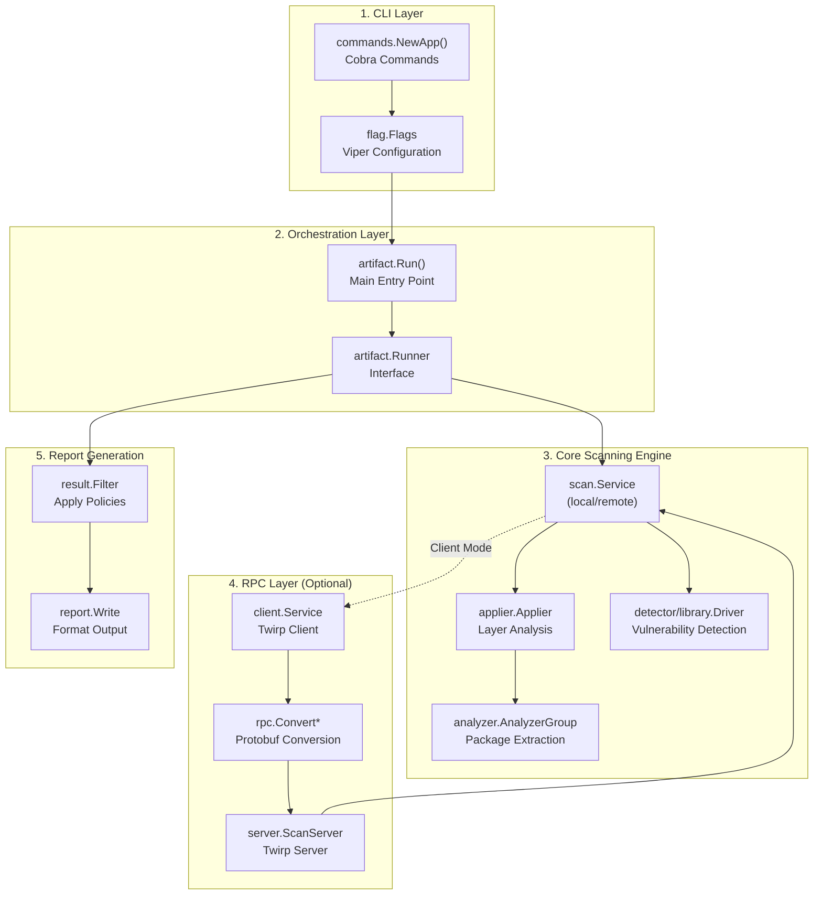
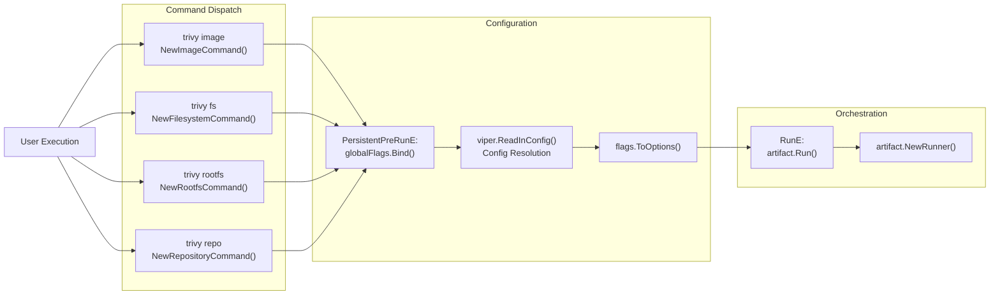
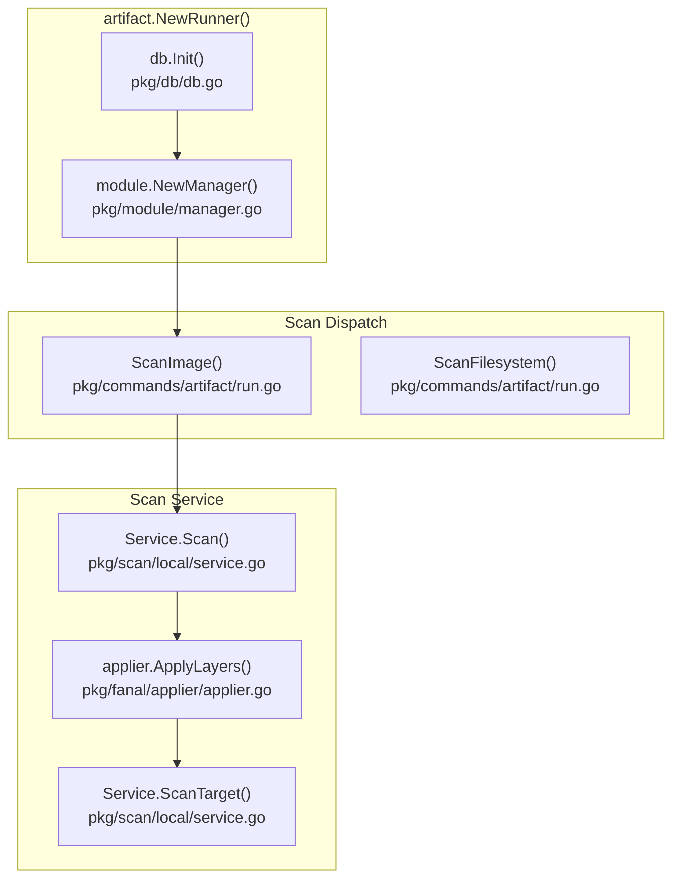
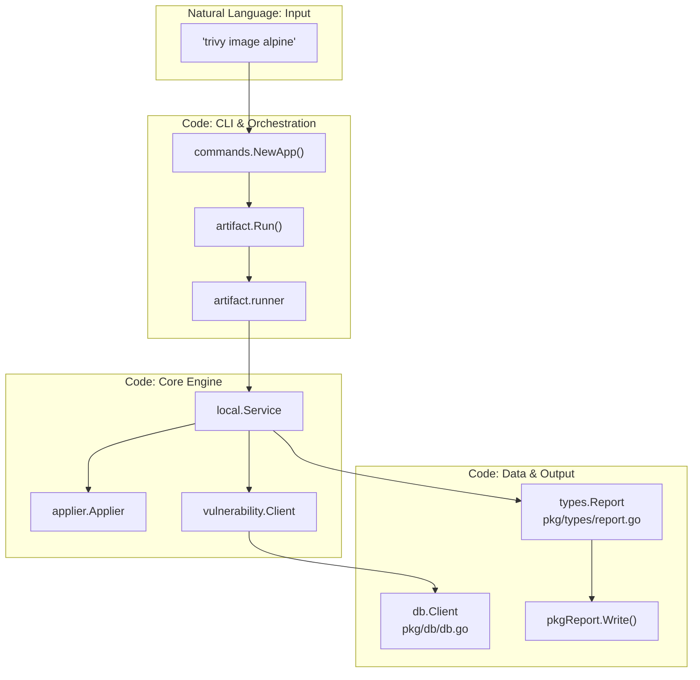

<!-- source: DeepWiki mcp.deepwiki.com · repo aquasecurity/trivy · page 1.2 Core Architecture and Components · fetched 2026-10-30 -->

# Core Architecture and Components

<details>
<summary>Relevant source files</summary>

The following files were used as context for generating this wiki page:

- [README.md](README.md)
- [cmd/trivy/main.go](cmd/trivy/main.go)
- [docs/guide/coverage/others/activestate.md](docs/guide/coverage/others/activestate.md)
- [docs/guide/coverage/others/index.md](docs/guide/coverage/others/index.md)
- [go.mod](go.mod)
- [go.sum](go.sum)
- [internal/dbtest/db.go](internal/dbtest/db.go)
- [mkdocs.yml](mkdocs.yml)
- [pkg/commands/app.go](pkg/commands/app.go)
- [pkg/commands/app_test.go](pkg/commands/app_test.go)
- [pkg/commands/artifact/run.go](pkg/commands/artifact/run.go)
- [pkg/commands/artifact/scanner.go](pkg/commands/artifact/scanner.go)
- [pkg/commands/testdata/java-db/metadata.json](pkg/commands/testdata/java-db/metadata.json)
- [pkg/commands/testdata/policy/metadata.json](pkg/commands/testdata/policy/metadata.json)
- [pkg/db/db.go](pkg/db/db.go)
- [pkg/db/db_test.go](pkg/db/db_test.go)
- [pkg/fanal/analyzer/os/release/testdata/activestate](pkg/fanal/analyzer/os/release/testdata/activestate)
- [pkg/fanal/image/image.go](pkg/fanal/image/image.go)
- [pkg/flag/options.go](pkg/flag/options.go)
- [pkg/scan/local/service.go](pkg/scan/local/service.go)
- [pkg/scan/local/service_test.go](pkg/scan/local/service_test.go)

</details>


This document explains Trivy's architectural design, covering the major subsystems and how they interact. Trivy is organized into several distinct layers: a CLI orchestration layer, a core scanning engine with analyzers and detectors, an RPC layer for client/server deployments, and a reporting system for output generation.

---

## Architectural Overview

Trivy's architecture consists of five major layers that work together to perform security scanning:

**Major System Layers**



**System Components by Layer**

| Layer | Key Components | Primary Files | Purpose |
|-------|----------------|---------------|---------|
| CLI | `commands.NewApp()`, `flag.GlobalFlagGroup` | `pkg/commands/app.go`, `pkg/flag/` | Parse commands and configuration |
| Orchestration | `artifact.Run()`, `artifact.Runner` | `pkg/commands/artifact/run.go` | Coordinate scan lifecycle |
| Scanning Engine | `scan.Service`, `applier.Applier`, `analyzer.*` | `pkg/scan/`, `pkg/fanal/` | Analyze artifacts and detect issues |
| RPC Layer | `client.Service`, `server.ScanServer` | `pkg/rpc/` | Enable distributed scanning |
| Reporting | `result.Filter`, `report.Write` | `pkg/result/`, `pkg/report/` | Filter and format results |

Sources: [pkg/commands/app.go:68-117](), [pkg/commands/artifact/run.go:79-98](), [pkg/scan/local/service.go:36-52]()

---

## CLI Layer

Trivy's command-line interface is built using Cobra for command management and Viper for configuration. The `commands.NewApp()` function constructs the command hierarchy.

### Command Structure

Each subcommand is created by a factory function that configures flags and prepares the execution context. The root command uses `PersistentPreRunE` to bind flags and initialize the logger.

**CLI Command Flow**



**Target Type Mapping**

| Command | Factory Function | Target Kind | Special Behavior |
|---------|------------------|-------------|------------------|
| `trivy image` | `NewImageCommand()` | `TargetContainerImage` | Disables lock file analyzers [pkg/commands/artifact/run.go:201-202]() |
| `trivy fs` | `NewFilesystemCommand()` | `TargetFilesystem` | Disables individual package analyzers [pkg/commands/artifact/run.go:223-225]() |
| `trivy rootfs` | `NewRootfsCommand()` | `TargetRootfs` | Scans expanded rootfs directories |
| `trivy repo` | `NewRepositoryCommand()` | `TargetRepository` | Scans remote git repositories |

Sources: [pkg/commands/app.go:68-117](), [pkg/commands/app.go:184-213](), [pkg/commands/artifact/run.go:49-57]()

### Configuration System

Trivy uses a generic flag system defined in `pkg/flag/options.go`. Configuration follows this precedence: CLI flags > environment variables > config file > defaults.

**Key Code Entities in Configuration**

| Entity | Path | Purpose |
|--------|------|---------|
| `Flag[T]` | [pkg/flag/options.go:36-85]() | Generic struct for CLI flags with Viper integration |
| `GlobalFlagGroup` | [pkg/flag/global_flag.go]() | Universal options like `--cache-dir`, `--quiet`, `--debug` |
| `initConfig()` | [pkg/commands/app.go:149-164]() | Loads YAML configuration via `viper.ReadInConfig()` |
| `ToOptions()` | [pkg/flag/options.go:206-209]() | Converts parsed flags into a unified `flag.Options` struct |

Sources: [pkg/flag/options.go:101-137](), [pkg/commands/app.go:191-203]()

---

## Orchestration Layer

The `artifact.Run()` function orchestrates the complete scan lifecycle. It initializes a `Runner` which manages the vulnerability database, VEX repositories, and WASM modules.

### Scan Lifecycle

**Runner Initialization**

The `artifact.NewRunner` function performs critical setup tasks:
1. **DB Initialization**: Calls `r.initDB()` to update the vulnerability database [pkg/commands/artifact/run.go:146-148]().
2. **VEX Download**: Calls `operation.DownloadVEXRepositories()` [pkg/commands/artifact/run.go:151-153]().
3. **WASM Modules**: Initializes the `module.Manager` to load plugins [pkg/commands/artifact/run.go:156-163]().

**Runner Execution Flow**



Sources: [pkg/commands/artifact/run.go:121-174](), [pkg/commands/artifact/run.go:199-220]()

### Runner Interface

The `Runner` interface defines the contract for all scanning operations:

```go
type Runner interface {
	ScanImage(ctx context.Context, opts flag.Options) (types.Report, error)
	ScanFilesystem(ctx context.Context, opts flag.Options) (types.Report, error)
	ScanRootfs(ctx context.Context, opts flag.Options) (types.Report, error)
	ScanRepository(ctx context.Context, opts flag.Options) (types.Report, error)
	ScanSBOM(ctx context.Context, opts flag.Options) (types.Report, error)
	ScanVM(ctx context.Context, opts flag.Options) (types.Report, error)
	Filter(ctx context.Context, opts flag.Options, report types.Report) (types.Report, error)
	Report(ctx context.Context, opts flag.Options, report types.Report) error
	Close(ctx context.Context) error
}
```

Sources: [pkg/commands/artifact/run.go:79-98]()

---

## Core Scanning Engine

The core engine handles the transition from raw artifact data (layers, files) to structured security findings.

### Local Scan Service

The `local.Service` struct implements the logic for standalone scanning. It uses an `applier.Applier` to merge artifact layers and various scanners for detection.

**Scan Execution Logic**

1. **Layer Application**: `s.applier.ApplyLayers` combines filesystem layers into a single view [pkg/scan/local/service.go:57]().
2. **OS Detection**: Identifies the operating system and handles cases where OS is missing or overridden [pkg/scan/local/service.go:58-92]().
3. **Target Scanning**: `s.ScanTarget` executes the specific scanners (vulnerability, misconfig, secret, license) [pkg/scan/local/service.go:117-164]().

### Subsystem Interaction

| Subsystem | Key Component | Purpose |
|-----------|---------------|---------|
| **Vulnerability** | `osPkgScanner`, `langPkgScanner` | Detects CVEs in OS and language packages [pkg/scan/local/service.go:175-194]() |
| **Misconfiguration** | `misconf.Scanner` | Evaluates Rego policies against config files [pkg/scan/local/service.go:199-206]() |
| **Secrets** | `secret.Scanner` | Searches for hardcoded credentials |
| **Licenses** | `licensing.Scanner` | Identifies software licenses [pkg/scan/local/service.go:142-143]() |

Sources: [pkg/scan/local/service.go:36-52](), [pkg/scan/local/service.go:166-197]()

---

## Data Flow: Artifact to Report

The following diagram illustrates the lifecycle of a scan request, bridging natural language concepts to specific code entities.

**Trivy Scan Pipeline**



Sources: [pkg/commands/app.go:68](), [pkg/commands/artifact/run.go:121](), [pkg/scan/local/service.go:55](), [pkg/db/db.go:71]()

### Database Management

The `db.Client` manages the lifecycle of the vulnerability database. It checks for updates by comparing local metadata with remote versions.

**Database Logic**
- **NeedsUpdate**: Checks if the schema version matches and if the database is stale [pkg/db/db.go:105-161]().
- **Download**: Fetches the database as an OCI artifact [pkg/db/db.go:187-196]().
- **Schema Validation**: Ensures the local `trivy.db` is compatible with the current CLI version [pkg/db/db.go:163-170]().

Sources: [pkg/db/db.go:71-102](), [pkg/db/db.go:205-222]()

---

