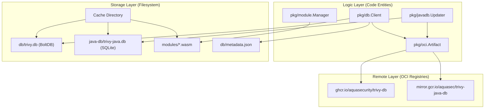
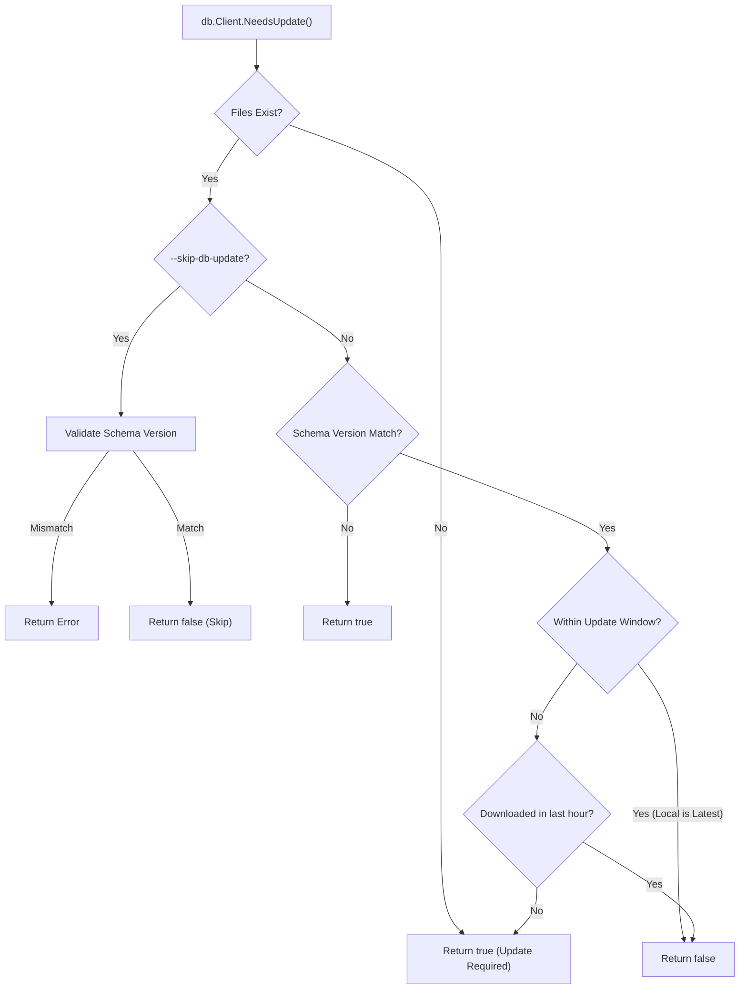
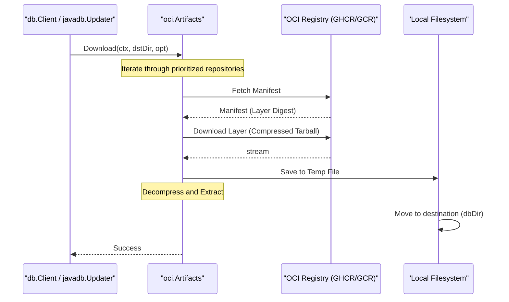

<!-- source: DeepWiki mcp.deepwiki.com · repo aquasecurity/trivy · page 1.3 Database and Resource Management · fetched 2026-10-30 -->

# Database and Resource Management

Relevant source files

The following files were used as context for generating this wiki page:

- [cmd/trivy/main.go](cmd/trivy/main.go)
- [integration/module_test.go](integration/module_test.go)
- [internal/dbtest/db.go](internal/dbtest/db.go)
- [internal/hooktest/hook.go](internal/hooktest/hook.go)
- [internal/registrytest/registrytest.go](internal/registrytest/registrytest.go)
- [pkg/attestation/attestation.go](pkg/attestation/attestation.go)
- [pkg/db/db.go](pkg/db/db.go)
- [pkg/db/db_test.go](pkg/db/db_test.go)
- [pkg/extension/hook.go](pkg/extension/hook.go)
- [pkg/extension/hook_test.go](pkg/extension/hook_test.go)
- [pkg/fanal/analyzer/language/java/jar/jar.go](pkg/fanal/analyzer/language/java/jar/jar.go)
- [pkg/fanal/analyzer/language/java/jar/jar_test.go](pkg/fanal/analyzer/language/java/jar/jar_test.go)
- [pkg/fanal/artifact/image/remote_sbom.go](pkg/fanal/artifact/image/remote_sbom.go)
- [pkg/fanal/artifact/image/remote_sbom_test.go](pkg/fanal/artifact/image/remote_sbom_test.go)
- [pkg/fanal/artifact/image/testdata/sigstore-bundle.json](pkg/fanal/artifact/image/testdata/sigstore-bundle.json)
- [pkg/flag/db_flags.go](pkg/flag/db_flags.go)
- [pkg/flag/db_flags_test.go](pkg/flag/db_flags_test.go)
- [pkg/flag/module_flags.go](pkg/flag/module_flags.go)
- [pkg/javadb/client.go](pkg/javadb/client.go)
- [pkg/module/command.go](pkg/module/command.go)
- [pkg/module/module.go](pkg/module/module.go)
- [pkg/module/module_test.go](pkg/module/module_test.go)
- [pkg/oci/artifact.go](pkg/oci/artifact.go)
- [pkg/oci/artifact_test.go](pkg/oci/artifact_test.go)

This document details Trivy's database and resource management system, which handles the lifecycle of vulnerability databases, Java databases, WASM modules, and caching mechanisms. The system manages multiple resource types: vulnerability databases containing CVE information, Java-specific vulnerability data, and WASM modules for extensibility.

For information about how databases are used during scanning operations, see page 4.1. For details about policy execution, see page 4.2. For WASM module extensibility, see page 3.3.

## Overview

Trivy's resource management is built primarily around OCI (Open Container Initiative) artifacts stored in container registries. The system automatically downloads, updates, and caches databases from remote repositories, with built-in fallback mechanisms and schema version compatibility checking.

## Resource Types

### Vulnerability Database (trivy-db)

The vulnerability database contains CVE data, package vulnerability mappings, and security advisories. It is managed by `db.Client` and stored as a BoltDB database file named `trivy.db` [pkg/db/db.go:71-77]().

**Key characteristics:**
- **Schema Versioning**: Uses `db.SchemaVersion` to ensure compatibility [pkg/db/db.go:24-27]().
- **Storage**: Located in `{cacheDir}/db/` [pkg/db/db.go:79-81]().
- **Backend**: Utilizes `bbolt` for a key-value store, typically opened in read-only mode [pkg/db/db.go:13-16](), [pkg/db/db.go:42-46]().
- **Metadata**: Tracks `DownloadedAt`, `NextUpdate`, and `Version` in `metadata.json` [pkg/db/db.go:104-121]().

**Default repositories:**
- Primary: `mirror.gcr.io/aquasec/trivy-db` [pkg/db/db.go:35-36]().
- Secondary: `ghcr.io/aquasecurity/trivy-db` [pkg/db/db.go:31-32]().

### Java Database (trivy-java-db)

The Java database provides an index for mapping Java ARchive (JAR) SHA-1 hashes to Maven coordinates (GroupId, ArtifactId, Version). It is stored in `{cacheDir}/java-db/` [pkg/javadb/client.go:142-144]().

**Key characteristics:**
- **Schema Versioning**: Managed via `javadb.SchemaVersion` [pkg/javadb/client.go:24-25]().
- **Backend**: SQLite database (requires `modernc.org/sqlite` driver) [cmd/trivy/main.go:15-16]().
- **Update Cycle**: Cached for 3 days by default, but checks for updates every 24 hours [pkg/javadb/client.go:80-82](), [pkg/javadb/client.go:94-97]().
- **Lookup Support**: Supports searching by SHA-1 hash or ArtifactID [pkg/javadb/client.go:171-184]().

Sources: [pkg/db/db.go:24-46](), [pkg/javadb/client.go:24-35](), [pkg/javadb/client.go:142-144](), [cmd/trivy/main.go:15-16]()

### Module System (WASM)

Trivy supports extensibility via WebAssembly (WASM) modules. These modules can implement custom analyzers or post-scanning hooks. They are managed by `module.Manager` [pkg/module/module.go:89-94]().

**Key characteristics:**
- **Runtime**: Powered by `wazero` for high-performance, zero-dependency WASM execution [pkg/module/module.go:15-17]().
- **Discovery**: Scans the configured module directory for `.wasm` files [pkg/module/module.go:120-126]().
- **Isolation**: Modules operate in a restricted environment with specific host functions for logging and memory management [pkg/module/module.go:29-36]().
- **Registration**: Modules register themselves as `analyzer.Analyzer` or `extension.Hook` [pkg/module/module.go:162-166]().

Sources: [pkg/module/module.go:89-111](), [pkg/module/module.go:120-153]()

## Resource Management Architecture

The following diagram bridges the high-level resource concepts to the specific code entities responsible for managing them.

**Database and Resource Management Architecture**

Sources: [pkg/db/db.go:71-102](), [pkg/javadb/client.go:39-46](), [pkg/module/module.go:89-94](), [pkg/oci/artifact.go:59-68]()

## Update Decision Logic

Trivy evaluates whether a database update is required based on file existence, schema version, and time-based thresholds.

**Key Update Thresholds:**
- **Vulnerability DB**: Skips update if the local DB was downloaded within the last hour [pkg/db/db.go:179-183]().
- **Java DB**: Skips update if the local DB was downloaded within the last 24 hours [pkg/javadb/client.go:94-97]().
- **Schema Mismatch**: If the local schema version is older than `db.SchemaVersion`, an update is forced [pkg/db/db.go:154-158](). If it is newer, the CLI requires an update [pkg/db/db.go:139-143]().

Sources: [pkg/db/db.go:105-161](), [pkg/db/db.go:172-184](), [pkg/javadb/client.go:87-99]()

## OCI Artifact Download Process

Trivy treats databases as single-layer OCI artifacts. The `pkg/oci` package provides the underlying mechanism for fetching these layers.

**Artifact Download Sequence**

**Implementation Details:**
- **Single Layer**: Trivy expects the artifact to consist of exactly one layer [pkg/oci/artifact.go:130-132]().
- **Progress Bar**: Downloads show a progress bar unless the `Quiet` option is set [pkg/oci/artifact.go:174-179]().
- **Media Types**: Validates layers against specific media types like `application/vnd.aquasec.trivy.db.layer.v1.tar+gzip` [pkg/db/db.go:26-27](), [pkg/oci/artifact.go:147-152]().

Sources: [pkg/oci/artifact.go:114-159](), [pkg/oci/artifact.go:246-258](), [pkg/db/db.go:187-196]()

## Java Database Specifics

The Java DB is essential for analyzing JAR/WAR/EAR files where `pom.properties` or `MANIFEST.MF` might be missing.

- **Initialization**: `javadb.Init` sets up the global updater with registry options and repositories [pkg/javadb/client.go:116-124]().
- **Lazy Update**: `javadb.NewClient()` triggers an update check only once per run using `sync.Once` [pkg/javadb/client.go:132-135](), [pkg/javadb/client.go:150-161]().
- **Post-Analysis**: The `javaLibraryAnalyzer` (registered as `analyzer.TypeJar`) uses the Java DB to resolve package identities during the post-analysis phase [pkg/fanal/analyzer/language/java/jar/jar.go:45-62]().

Sources: [pkg/javadb/client.go:116-161](), [pkg/fanal/analyzer/language/java/jar/jar.go:45-56]()

## Cache Management and Flags

Users control database behavior via CLI flags defined in `pkg/flag/db_flags.go`.

| Flag | Option Field | Description |
|------|--------------|-------------|
| `--skip-db-update` | `SkipDBUpdate` | Skips vulnerability DB update check [pkg/flag/db_flags.go:27-37](). |
| `--skip-java-db-update` | `SkipJavaDBUpdate` | Skips Java index DB update check [pkg/flag/db_flags.go:43-47](). |
| `--db-repository` | `DBRepositories` | List of OCI repos for vulnerability DB [pkg/flag/db_flags.go:53-58](). |
| `--java-db-repository` | `JavaDBRepositories` | List of OCI repos for Java DB [pkg/flag/db_flags.go:59-64](). |
| `--download-db-only` | `DownloadDBOnly` | Exits after downloading DB [pkg/flag/db_flags.go:22-26](). |

**Cleanup**:
The command `trivy clean` (managed by `pkg/commands/operation`) calls:
- `db.Client.Clear()` to remove the vulnerability database [pkg/db/db.go:198-203]().
- `javadb.Clear()` to remove the Java index [pkg/javadb/client.go:138-140]().

Sources: [pkg/flag/db_flags.go:14-110](), [pkg/db/db.go:198-203](), [pkg/javadb/client.go:138-140]()

---

