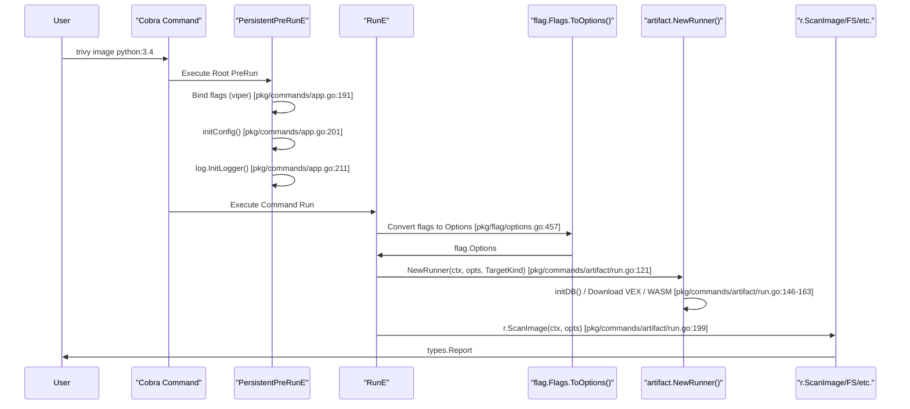
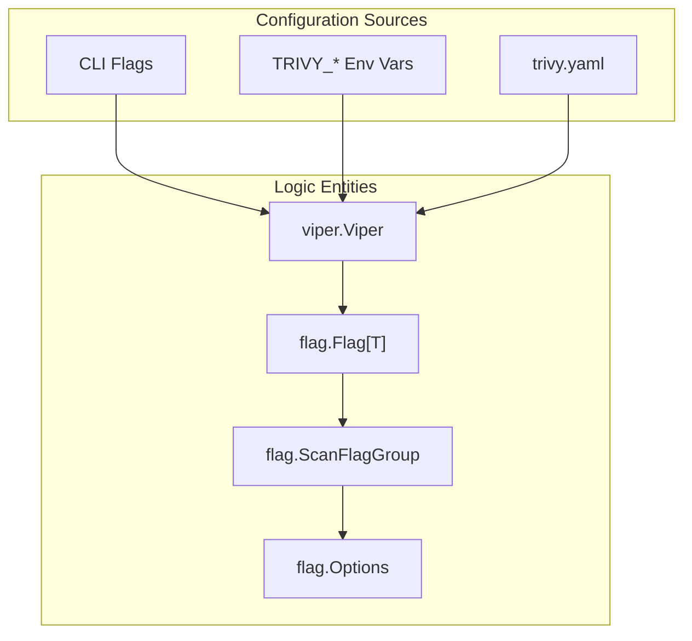

<!-- source: DeepWiki mcp.deepwiki.com · repo aquasecurity/trivy · page 2 CLI Reference · fetched 2026-10-30 -->

# CLI Reference

Relevant source files

The following files were used as context for generating this wiki page:

- [README.md](README.md)
- [go.mod](go.mod)
- [go.sum](go.sum)
- [mkdocs.yml](mkdocs.yml)
- [pkg/commands/app.go](pkg/commands/app.go)
- [pkg/commands/app_test.go](pkg/commands/app_test.go)
- [pkg/commands/artifact/run.go](pkg/commands/artifact/run.go)
- [pkg/commands/testdata/java-db/metadata.json](pkg/commands/testdata/java-db/metadata.json)
- [pkg/commands/testdata/policy/metadata.json](pkg/commands/testdata/policy/metadata.json)
- [pkg/dependency/parser/gradle/lockfile/parse.go](pkg/dependency/parser/gradle/lockfile/parse.go)
- [pkg/dependency/parser/gradle/lockfile/parse_test.go](pkg/dependency/parser/gradle/lockfile/parse_test.go)
- [pkg/dependency/parser/gradle/lockfile/testdata/happy.lockfile](pkg/dependency/parser/gradle/lockfile/testdata/happy.lockfile)
- [pkg/dependency/parser/ruby/gemspec/parse.go](pkg/dependency/parser/ruby/gemspec/parse.go)
- [pkg/fanal/analyzer/language/java/gradle/lockfile.go](pkg/fanal/analyzer/language/java/gradle/lockfile.go)
- [pkg/fanal/analyzer/language/java/gradle/lockfile_test.go](pkg/fanal/analyzer/language/java/gradle/lockfile_test.go)
- [pkg/fanal/analyzer/language/java/gradle/pom.go](pkg/fanal/analyzer/language/java/gradle/pom.go)
- [pkg/fanal/analyzer/language/java/gradle/pom_test.go](pkg/fanal/analyzer/language/java/gradle/pom_test.go)
- [pkg/fanal/analyzer/language/java/gradle/testdata/cache/caches/modules-2/files-2.1/junit/junit/4.13/5c17760663fae422643fc859fd352c68a1d91bfc/junit-4.13.pom](pkg/fanal/analyzer/language/java/gradle/testdata/cache/caches/modules-2/files-2.1/junit/junit/4.13/5c17760663fae422643fc859fd352c68a1d91bfc/junit-4.13.pom)
- [pkg/fanal/analyzer/language/java/gradle/testdata/cache/caches/modules-2/files-2.1/org.hamcrest/hamcrest-core/1.3/872e413497b906e7c9fa85ccc96046c5d1ef7ece/hamcrest-core-1.3.pom](pkg/fanal/analyzer/language/java/gradle/testdata/cache/caches/modules-2/files-2.1/org.hamcrest/hamcrest-core/1.3/872e413497b906e7c9fa85ccc96046c5d1ef7ece/hamcrest-core-1.3.pom)
- [pkg/flag/misconf_flags.go](pkg/flag/misconf_flags.go)
- [pkg/flag/options.go](pkg/flag/options.go)
- [pkg/flag/options_test.go](pkg/flag/options_test.go)
- [pkg/flag/report_flags.go](pkg/flag/report_flags.go)
- [pkg/flag/report_flags_test.go](pkg/flag/report_flags_test.go)
- [pkg/flag/scan_flags.go](pkg/flag/scan_flags.go)
- [pkg/flag/scan_flags_test.go](pkg/flag/scan_flags_test.go)
- [pkg/flag/vulnerability_flags.go](pkg/flag/vulnerability_flags.go)
- [pkg/iac/scanners/cloudformation/parser/fn_split.go](pkg/iac/scanners/cloudformation/parser/fn_split.go)
- [pkg/x/strings/strings.go](pkg/x/strings/strings.go)

This document provides a comprehensive reference for Trivy's command-line interface. It explains how Trivy's commands are organized, the overall command execution flow, and how the CLI integrates with the core scanning engine.

For detailed information on command structure and global flags, see [Command Structure and Global Flags](#2.1). For specifics on individual scan commands, see [Scan Commands and Target Options](#2.2). For misconfiguration-specific options, see [Misconfiguration Scanning Configuration](#2.3). For details on configuration files and environment variables, see [Configuration Files and Environment Variables](#2.4).

## Application Architecture

Trivy's CLI is built using the `spf13/cobra` framework and organized into logical command groups. The `NewApp()` function in [pkg/commands/app.go:68-117]() constructs the application by creating the root command and registering all subcommands.

**Command Registration in NewApp()**

```mermaid
graph TB
    NewApp["NewApp()"]
    NewApp --> rootCmd["NewRootCommand(globalFlags)"]
    NewApp --> AddGroup["rootCmd.AddGroup()"]
    
    AddGroup --> scanGroup["groupScanning"]
    AddGroup --> mgmtGroup["groupManagement"]
    AddGroup --> utilGroup["groupUtility"]
    
    NewApp --> AddCommand["rootCmd.AddCommand()"]
    
    AddCommand --> scanCmds["Scanning Commands"]
    AddCommand --> mgmtCmds["Management Commands"]
    AddCommand --> utilCmds["Utility Commands"]
    AddCommand --> pluginCmds["Plugin Commands"]
    
    scanCmds --> NewImageCommand["NewImageCommand()"]
    scanCmds --> NewFilesystemCommand["NewFilesystemCommand()"]
    scanCmds --> NewRootfsCommand["NewRootfsCommand()"]
    scanCmds --> NewRepositoryCommand["NewRepositoryCommand()"]
    scanCmds --> NewConfigCommand["NewConfigCommand()"]
    scanCmds --> NewKubernetesCommand["NewKubernetesCommand()"]
    scanCmds --> NewSBOMCommand["NewSBOMCommand()"]
    scanCmds --> NewVMCommand["NewVMCommand()"]
    
    mgmtCmds --> NewServerCommand["NewServerCommand()"]
    mgmtCmds --> NewModuleCommand["NewModuleCommand()"]
    mgmtCmds --> NewPluginCommand["NewPluginCommand()"]
    mgmtCmds --> NewRegistryCommand["NewRegistryCommand()"]
    mgmtCmds --> NewVEXCommand["NewVEXCommand()"]
    
    utilCmds --> NewConvertCommand["NewConvertCommand()"]
    utilCmds --> NewCleanCommand["NewCleanCommand()"]
    utilCmds --> NewVersionCommand["NewVersionCommand()"]
    
    pluginCmds --> loadPluginCommands["loadPluginCommands()"]
```

**Command Groups and Organization**

Commands are organized into four primary groups defined in [pkg/commands/app.go:61-65]():

| Group | ID | Purpose | Commands |
|-------|-------|---------|----------|
| Scanning | `groupScanning` | Artifact and environment scanning | `image`, `fs`, `rootfs`, `repo`, `config`, `k8s`, `sbom`, `vm` |
| Management | `groupManagement` | Database and service management | `server`, `module`, `plugin`, `registry`, `vex` |
| Utility | `groupUtility` | Helper and conversion tools | `convert`, `clean`, `version`, `completion` |
| Plugin | `groupPlugin` | External plugin commands | Loaded dynamically via `loadPluginCommands` |

Sources: [pkg/commands/app.go:61-117](), [pkg/commands/app.go:119-147]()

## Command Execution Flow

Each scanning command follows a consistent execution pattern from command invocation through result reporting. The flow uses the `artifact.Runner` interface and its implementations in [pkg/commands/artifact/run.go:79-98]() as the primary orchestrator.

**Typical Scan Command Execution Flow**

**Command Lifecycle Hooks**

Trivy commands use Cobra's lifecycle hooks defined in [pkg/commands/app.go:166-227]():

1. **PersistentPreRunE**: Executed before any command runs.
   - Binds CLI flags to `viper` configuration.
   - Initializes configuration file (default or `--config`).
   - Initializes the logger with `debug` and `quiet` settings.

2. **RunE**: Main command execution.
   - Converts flags to the unified `flag.Options` struct.
   - Customizes version output if `--version` is passed.
   - Calls the underlying scanning service via `artifact.Runner`.

Sources: [pkg/commands/app.go:184-227](), [pkg/commands/artifact/run.go:121-174]()

## Flag System Architecture

Trivy's flag system provides a type-safe, flexible mechanism for configuration. The system is built around the `Flag[T]` struct [pkg/flag/options.go:36-85]() and organized into `FlagGroups`.

**Flag Processing Architecture**

**Flag Group Implementation**

Each command constructs its flag set by combining relevant flag groups. For example, `NewImageCommand` includes `ScanFlagGroup`, `ReportFlagGroup`, `VulnerabilityFlagGroup`, and more.

The `Flag[T]` struct handles:
- **Parsing**: Resolving values from CLI, Env, or Config [pkg/flag/options.go:101-137]().
- **Validation**: Checking against `Values` list [pkg/flag/options.go:203-218]().
- **Deprecation**: Warning users about outdated flags [pkg/flag/options.go:127-129]().

Sources: [pkg/flag/options.go:36-85](), [pkg/flag/options.go:167-192]()

## Major Flag Groups

### Report Flag Group
Controls output formatting, filtering, and compliance reporting. Defined in [pkg/flag/report_flags.go:133-149]().

| Flag | Shorthand | Default | Purpose |
|------|-----------|---------|---------|
| `--format` | `-f` | `table` | Output format (json, sarif, cyclonedx, etc.) |
| `--severity` | `-s` | All | Filter by severity levels (CRITICAL, HIGH, etc.) |
| `--output` | `-o` | stdout | Write results to a file |
| `--template` | `-t` | - | Go template for custom formatting |

Sources: [pkg/flag/report_flags.go:29-129]()

### Scan Flag Group
Controls scanning behavior and performance. Defined in [pkg/flag/scan_flags.go:140-154]().

- `--scanners`: Comma-separated list of security issues to detect (`vuln`, `misconf`, `secret`, `license`).
- `--skip-dirs`: Directories or glob patterns to skip.
- `--parallel`: Number of goroutines for parallel scanning (default 5).
- `--offline-scan`: Do not issue API requests for dependency identification.

Sources: [pkg/flag/scan_flags.go:17-138]()

### Misconfiguration Flag Group
Handles IaC-specific settings for Terraform, Helm, CloudFormation, and Ansible. Defined in [pkg/flag/misconf_flags.go:147-170]().

- `--helm-values`: Override Helm `values.yaml` files.
- `--tf-vars`: Override Terraform `tfvars` files.
- `--include-non-failures`: Include successful checks in the report.
- `--checks-bundle-repository`: OCI registry URL for the checks bundle.

Sources: [pkg/flag/misconf_flags.go:22-144]()

## Configuration Resolution Priority

Trivy resolves configuration from multiple sources with a defined precedence order:

1. **CLI Flags** (Highest Priority)
2. **Environment Variables** (e.g., `TRIVY_FORMAT=json`)
3. **Configuration File** (`trivy.yaml`)
4. **Default Values** (Lowest Priority)

Environment variables are automatically mapped from flag names by converting to uppercase and replacing hyphens with underscores (e.g., `--cache-dir` becomes `TRIVY_CACHE_DIR`).

Sources: [pkg/flag/options.go:139-164](), [pkg/commands/app.go:149-164]()

---

