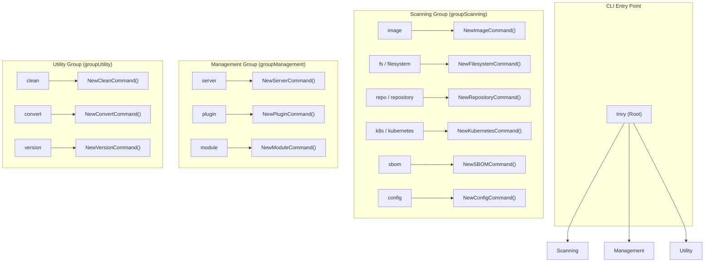
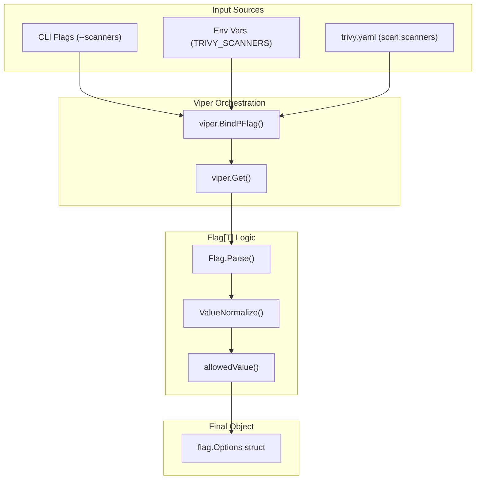

<!-- source: DeepWiki mcp.deepwiki.com · repo aquasecurity/trivy · page 2.1 Command Structure and Global Flags · fetched 2026-10-30 -->

# Command Structure and Global Flags

Relevant source files

The following files were used as context for generating this wiki page:

- [README.md](README.md)
- [go.mod](go.mod)
- [go.sum](go.sum)
- [magefiles/config_schema.go](magefiles/config_schema.go)
- [magefiles/docs.go](magefiles/docs.go)
- [mkdocs.yml](mkdocs.yml)
- [pkg/commands/app.go](pkg/commands/app.go)
- [pkg/commands/app_test.go](pkg/commands/app_test.go)
- [pkg/commands/artifact/run.go](pkg/commands/artifact/run.go)
- [pkg/commands/testdata/java-db/metadata.json](pkg/commands/testdata/java-db/metadata.json)
- [pkg/commands/testdata/policy/metadata.json](pkg/commands/testdata/policy/metadata.json)
- [pkg/dependency/parser/gradle/lockfile/parse.go](pkg/dependency/parser/gradle/lockfile/parse.go)
- [pkg/dependency/parser/gradle/lockfile/parse_test.go](pkg/dependency/parser/gradle/lockfile/parse_test.go)
- [pkg/dependency/parser/gradle/lockfile/testdata/happy.lockfile](pkg/dependency/parser/gradle/lockfile/testdata/happy.lockfile)
- [pkg/dependency/parser/ruby/gemspec/parse.go](pkg/dependency/parser/ruby/gemspec/parse.go)
- [pkg/fanal/analyzer/language/java/gradle/lockfile.go](pkg/fanal/analyzer/language/java/gradle/lockfile.go)
- [pkg/fanal/analyzer/language/java/gradle/lockfile_test.go](pkg/fanal/analyzer/language/java/gradle/lockfile_test.go)
- [pkg/fanal/analyzer/language/java/gradle/pom.go](pkg/fanal/analyzer/language/java/gradle/pom.go)
- [pkg/fanal/analyzer/language/java/gradle/pom_test.go](pkg/fanal/analyzer/language/java/gradle/pom_test.go)
- [pkg/fanal/analyzer/language/java/gradle/testdata/cache/caches/modules-2/files-2.1/junit/junit/4.13/5c17760663fae422643fc859fd352c68a1d91bfc/junit-4.13.pom](pkg/fanal/analyzer/language/java/gradle/testdata/cache/caches/modules-2/files-2.1/junit/junit/4.13/5c17760663fae422643fc859fd352c68a1d91bfc/junit-4.13.pom)
- [pkg/fanal/analyzer/language/java/gradle/testdata/cache/caches/modules-2/files-2.1/org.hamcrest/hamcrest-core/1.3/872e413497b906e7c9fa85ccc96046c5d1ef7ece/hamcrest-core-1.3.pom](pkg/fanal/analyzer/language/java/gradle/testdata/cache/caches/modules-2/files-2.1/org.hamcrest/hamcrest-core/1.3/872e413497b906e7c9fa85ccc96046c5d1ef7ece/hamcrest-core-1.3.pom)
- [pkg/flag/global_flags.go](pkg/flag/global_flags.go)
- [pkg/flag/options.go](pkg/flag/options.go)
- [pkg/flag/options_test.go](pkg/flag/options_test.go)
- [pkg/flag/report_flags.go](pkg/flag/report_flags.go)
- [pkg/flag/report_flags_test.go](pkg/flag/report_flags_test.go)
- [pkg/flag/scan_flags.go](pkg/flag/scan_flags.go)
- [pkg/flag/scan_flags_test.go](pkg/flag/scan_flags_test.go)
- [pkg/flag/vulnerability_flags.go](pkg/flag/vulnerability_flags.go)
- [pkg/iac/scanners/cloudformation/parser/fn_split.go](pkg/iac/scanners/cloudformation/parser/fn_split.go)
- [pkg/x/strings/strings.go](pkg/x/strings/strings.go)
- [schema/trivy-config.json](schema/trivy-config.json)

This page documents Trivy's command-line interface structure, including the root command, command groups, and global flags that apply across all operations. For details on individual scan commands and their specific options, see [Scan Commands and Target Options](2.2). For configuration file and environment variable handling, see [Configuration Files and Environment Variables](2.4).

## Overview

Trivy's CLI is built using the `spf13/cobra` library and follows a hierarchical command structure with a root command, multiple subcommands organized into logical groups, and a comprehensive flag system. The application supports both CLI flags and configuration files through `spf13/viper` integration.

**Sources:** [pkg/commands/app.go:66-116](), [README.md:60-99](), [go.mod:104-106]()

## Command Hierarchy

The command structure is defined in `NewApp()` which creates the root command and adds subcommands organized into groups: scanning, management, utility, and plugin commands.

### Logical Command Mapping

The following diagram bridges the CLI command space to the internal Go functions that initialize them.

| Diagram Title: CLI Command to Function Mapping |
| :--- |

**Sources:** [pkg/commands/app.go:68-106](), [pkg/commands/app.go:60-64]()

## Root Command

The root command is created by `NewRootCommand()` and serves as the entry point for all Trivy operations.

| Attribute | Value |
|-----------|-------|
| **Use** | `trivy [global flags] command [flags] target` |
| **Short** | `Unified security scanner` |
| **Long** | Scanner for vulnerabilities in container images, file systems, and Git repositories, as well as for configuration issues and hard-coded secrets |

### Root Command Lifecycle

The root command includes a `PersistentPreRunE` hook that executes before any subcommand and performs critical initialization:

1. **Version Injection**: Sets the version from `app.Version()` [pkg/commands/app.go:186]().
2. **Flag Binding**: Binds `GlobalFlagGroup` to Viper via `globalFlags.Bind(cmd)` [pkg/commands/app.go:191]().
3. **Config Initialization**: Loads the YAML config file via `initConfig()` [pkg/commands/app.go:201]().
4. **Logger Setup**: Initializes the global logger using parsed options [pkg/commands/app.go:211]().

**Sources:** [pkg/commands/app.go:165-234](), [pkg/commands/app.go:184-213]()

## Global Flags

Global flags are defined in `flag.GlobalFlagGroup` and apply to all commands. They are inherited by all subcommands because they are registered as `PersistentFlags` [pkg/flag/options.go:271-272]().

### Key Global Flags

| Flag | Config Name | Default | Description |
|------|-------------|---------|-------------|
| `--quiet, -q` | `quiet` | `false` | Suppress progress bar and log output |
| `--debug, -d` | `debug` | `false` | Enable debug mode |
| `--cache-dir` | `cache-dir` | OS-specific | Cache directory for vulnerability database |
| `--config` | `config` | `trivy.yaml` | Path to configuration file |
| `--version, -v` | `version` | `false` | Show version information |
| `--timeout` | `timeout` | `5m` | Timeout for scanning |
| `--insecure` | `insecure` | `false` | Allow insecure server connections |

**Sources:** [pkg/flag/options.go:401-438](), [pkg/commands/app.go:69-70]()

## Flag System Architecture

Trivy uses a custom type-safe flag system defined in `pkg/flag`. Each flag is an instance of the generic `Flag[T]` struct.

### Data Flow: From Input to Options

| Diagram Title: Configuration Data Flow and Normalization |
| :--- |

### Type-Safe Flag Handling
The `Flag[T]` struct (where `T` is `int`, `string`, `bool`, etc.) handles:
- **Normalization**: Converting aliases (e.g., `config` to `misconfig`) via `ValueNormalize` [pkg/flag/scan_flags.go:48-61]().
- **Validation**: Checking against `Values` slice [pkg/flag/options.go:203-218]().
- **Deprecation**: Logging warnings if a deprecated flag is used [pkg/flag/options.go:127-129]().

**Sources:** [pkg/flag/options.go:32-85](), [pkg/flag/options.go:101-137]()

## Flag Groups

Flags are organized into groups that implement the `Flagger` interface. Commands compose these groups to build their specific flag sets.

| Flag Group | Implementation | Key Responsibility |
|------------|----------------|--------------------|
| `ScanFlagGroup` | `NewScanFlagGroup()` | Handles `--scanners`, `--parallel`, `--skip-dirs` |
| `ReportFlagGroup` | `NewReportFlagGroup()` | Handles `--format`, `--output`, `--severity` |
| `DBFlagGroup` | `NewDBFlagGroup()` | Handles `--skip-db-update`, `--db-repository` |
| `CacheFlagGroup` | `NewCacheFlagGroup()` | Handles `--cache-backend`, `--redis-ca-cert` |

**Sources:** [pkg/flag/scan_flags.go:172-188](), [pkg/flag/report_flags.go:169-187](), [pkg/commands/app.go:254-270]()

## Plugin Command Integration

Trivy dynamically loads plugins and registers them as subcommands.

1. `loadPluginCommands()` calls `plugin.NewManager().LoadAll(ctx)` [pkg/commands/app.go:123]().
2. For each discovered plugin, a new `cobra.Command` is created [pkg/commands/app.go:129]().
3. These commands have `DisableFlagParsing: true` [pkg/commands/app.go:140](), allowing the plugin to handle its own flags.
4. Execution is delegated to `p.Run(ctx, plugin.Options{Args: args})` [pkg/commands/app.go:135]().

**Sources:** [pkg/commands/app.go:119-147]()

## Configuration Priority

The `Flag.Parse()` method relies on `viper.Get(f.ConfigName)` [pkg/flag/options.go:154](). Viper enforces the following precedence:
1. CLI Flags (via `BindPFlag`)
2. Environment Variables (via `BindEnv`)
3. Config File (via `ReadInConfig`)
4. Defaults (via `Flag.Default`)

**Sources:** [pkg/flag/options.go:139-164](), [pkg/commands/app.go:149-164]()

---

