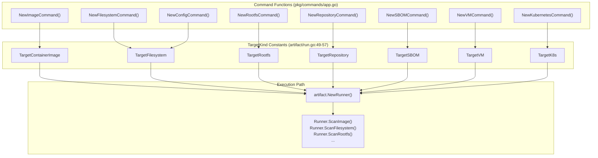
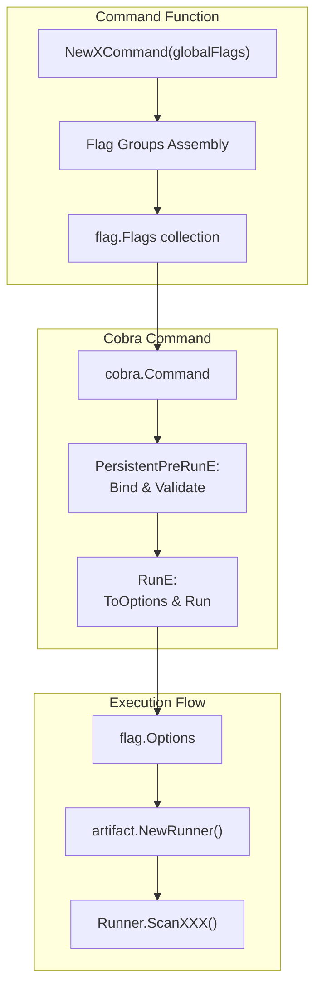
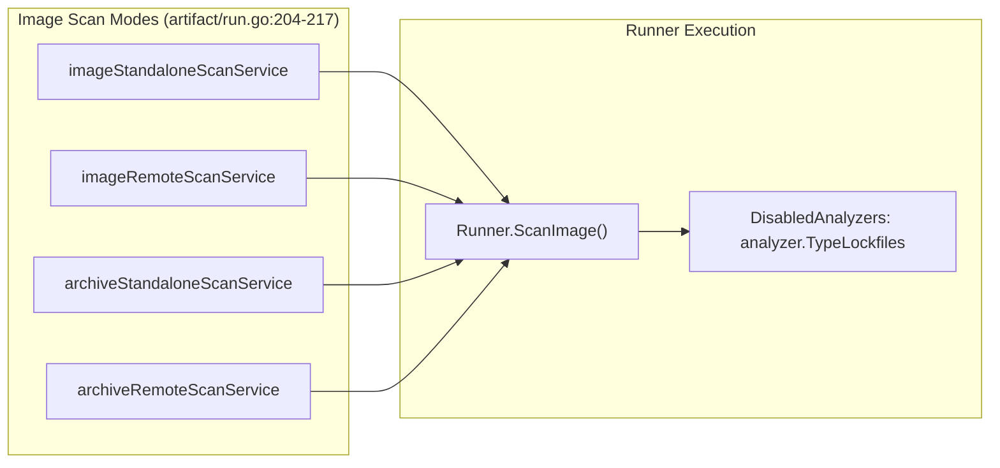

<!-- source: DeepWiki mcp.deepwiki.com · repo aquasecurity/trivy · page 2.2 Scan Commands and Target Options · fetched 2026-10-30 -->

# Scan Commands and Target Options

<details>
<summary>Relevant source files</summary>

The following files were used as context for generating this wiki page:

- [README.md](README.md)
- [docs/guide/configuration/reporting.md](docs/guide/configuration/reporting.md)
- [docs/guide/references/configuration/cli/trivy_config.md](docs/guide/references/configuration/cli/trivy_config.md)
- [docs/guide/references/configuration/cli/trivy_convert.md](docs/guide/references/configuration/cli/trivy_convert.md)
- [docs/guide/references/configuration/cli/trivy_filesystem.md](docs/guide/references/configuration/cli/trivy_filesystem.md)
- [docs/guide/references/configuration/cli/trivy_image.md](docs/guide/references/configuration/cli/trivy_image.md)
- [docs/guide/references/configuration/cli/trivy_kubernetes.md](docs/guide/references/configuration/cli/trivy_kubernetes.md)
- [docs/guide/references/configuration/cli/trivy_repository.md](docs/guide/references/configuration/cli/trivy_repository.md)
- [docs/guide/references/configuration/cli/trivy_rootfs.md](docs/guide/references/configuration/cli/trivy_rootfs.md)
- [docs/guide/references/configuration/cli/trivy_sbom.md](docs/guide/references/configuration/cli/trivy_sbom.md)
- [docs/guide/references/configuration/cli/trivy_vm.md](docs/guide/references/configuration/cli/trivy_vm.md)
- [go.mod](go.mod)
- [go.sum](go.sum)
- [mkdocs.yml](mkdocs.yml)
- [pkg/commands/app.go](pkg/commands/app.go)
- [pkg/commands/app_test.go](pkg/commands/app_test.go)
- [pkg/commands/artifact/run.go](pkg/commands/artifact/run.go)
- [pkg/commands/testdata/java-db/metadata.json](pkg/commands/testdata/java-db/metadata.json)
- [pkg/commands/testdata/policy/metadata.json](pkg/commands/testdata/policy/metadata.json)
- [pkg/dependency/parser/gradle/lockfile/parse.go](pkg/dependency/parser/gradle/lockfile/parse.go)
- [pkg/dependency/parser/gradle/lockfile/parse_test.go](pkg/dependency/parser/gradle/lockfile/parse_test.go)
- [pkg/dependency/parser/gradle/lockfile/testdata/happy.lockfile](pkg/dependency/parser/gradle/lockfile/testdata/happy.lockfile)
- [pkg/dependency/parser/ruby/gemspec/parse.go](pkg/dependency/parser/ruby/gemspec/parse.go)
- [pkg/fanal/analyzer/language/java/gradle/lockfile.go](pkg/fanal/analyzer/language/java/gradle/lockfile.go)
- [pkg/fanal/analyzer/language/java/gradle/lockfile_test.go](pkg/fanal/analyzer/language/java/gradle/lockfile_test.go)
- [pkg/fanal/analyzer/language/java/gradle/pom.go](pkg/fanal/analyzer/language/java/gradle/pom.go)
- [pkg/fanal/analyzer/language/java/gradle/pom_test.go](pkg/fanal/analyzer/language/java/gradle/pom_test.go)
- [pkg/fanal/analyzer/language/java/gradle/testdata/cache/caches/modules-2/files-2.1/junit/junit/4.13/5c17760663fae422643fc859fd352c68a1d91bfc/junit-4.13.pom](pkg/fanal/analyzer/language/java/gradle/testdata/cache/caches/modules-2/files-2.1/junit/junit/4.13/5c17760663fae422643fc859fd352c68a1d91bfc/junit-4.13.pom)
- [pkg/fanal/analyzer/language/java/gradle/testdata/cache/caches/modules-2/files-2.1/org.hamcrest/hamcrest-core/1.3/872e413497b906e7c9fa85ccc96046c5d1ef7ece/hamcrest-core-1.3.pom](pkg/fanal/analyzer/language/java/gradle/testdata/cache/caches/modules-2/files-2.1/org.hamcrest/hamcrest-core/1.3/872e413497b906e7c9fa85ccc96046c5d1ef7ece/hamcrest-core-1.3.pom)
- [pkg/flag/options.go](pkg/flag/options.go)
- [pkg/flag/options_test.go](pkg/flag/options_test.go)
- [pkg/flag/report_flags.go](pkg/flag/report_flags.go)
- [pkg/flag/report_flags_test.go](pkg/flag/report_flags_test.go)
- [pkg/flag/scan_flags.go](pkg/flag/scan_flags.go)
- [pkg/flag/scan_flags_test.go](pkg/flag/scan_flags_test.go)
- [pkg/flag/vulnerability_flags.go](pkg/flag/vulnerability_flags.go)
- [pkg/iac/scanners/cloudformation/parser/fn_split.go](pkg/iac/scanners/cloudformation/parser/fn_split.go)
- [pkg/x/strings/strings.go](pkg/x/strings/strings.go)

</details>


This page details Trivy's scan commands and their specific target options. Each scan command is designed for a specific artifact type and comes with its own set of flags and configuration options.

## Overview

Trivy provides multiple scan commands implemented as Cobra commands in [pkg/commands/app.go](). Each command is tailored for a specific artifact type and maps to a `TargetKind` constant that drives the scanning workflow through the `Runner` interface defined in [pkg/commands/artifact/run.go:79-98]().

**Command Functions and Target Mapping**



**TargetKind Constants:**
Each `TargetKind` constant determines which `Runner` method is invoked. For example, `TargetContainerImage` leads to `ScanImage` [pkg/commands/artifact/run.go:199-220]().

Sources: [pkg/commands/app.go:88-106](), [pkg/commands/artifact/run.go:49-57](), [pkg/commands/artifact/run.go:121-174](), [pkg/commands/artifact/run.go:199-220]()

## Command Structure

### Command Creation Pattern

All scan commands follow a consistent creation pattern using Cobra commands with flag groups tailored to their specific needs. The `NewApp` function in [pkg/commands/app.go:68-117]() registers these commands.



**Command Lifecycle:**
1. `NewXCommand()` creates the command with appropriate flag groups (e.g., `ScanFlagGroup`, `ReportFlagGroup`).
2. `PersistentPreRunE` in the root command binds flags and initializes the logger [pkg/commands/app.go:184-213]().
3. `RunE` converts flags to options via `flags.ToOptions(args)` [pkg/commands/app.go:214-227]().
4. `artifact.NewRunner()` initializes the scanning service, including the vulnerability database [pkg/commands/artifact/run.go:121-174]().

Sources: [pkg/commands/app.go:68-117](), [pkg/commands/app.go:184-213](), [pkg/commands/artifact/run.go:121-174]()

### Flag Groups by Command

Different commands instantiate different combinations of `FlagGroup` implementations from the `pkg/flag/` package. The configuration is often managed via `viper` [pkg/flag/options.go:101-137]().

| Command | Key Flag Groups | Common Global Flags |
|---------|-----------------|---------------------|
| `image` | `ImageFlagGroup`, `ScanFlagGroup`, `VulnerabilityFlagGroup` | `CacheDir`, `Quiet`, `Debug` |
| `fs` | `ScanFlagGroup`, `MisconfFlagGroup`, `SecretFlagGroup` | `CacheDir`, `Quiet`, `Debug` |
| `repo` | `RepoFlagGroup`, `ScanFlagGroup`, `VulnerabilityFlagGroup` | `CacheDir`, `Quiet`, `Debug` |
| `k8s` | `K8sFlagGroup`, `MisconfFlagGroup`, `ReportFlagGroup` | `CacheDir`, `Quiet`, `Debug` |

**Flag Group Structure:**
Each `FlagGroup` (e.g., `ScanFlagGroup` [pkg/flag/scan_flags.go:140-154]()) defines the flags available to that command and how they map to `Options`.

Sources: [pkg/flag/scan_flags.go:140-154](), [pkg/flag/report_flags.go:133-149](), [pkg/flag/options.go:101-137]()

## Image Command

The `trivy image` command scans container images. It disables lock file scanning by default to focus on installed OS packages [pkg/commands/artifact/run.go:201-202]().



**Image-Specific Logic:**
- If `--input` is provided, Trivy scans an image tarball instead of pulling from a registry [pkg/commands/artifact/run.go:205-210]().
- If `--server-addr` is set, Trivy operates in client mode, delegating analysis to a remote server [pkg/commands/artifact/run.go:214-217]().

Sources: [pkg/commands/artifact/run.go:199-220](), [pkg/flag/scan_flags.go:35-71]()

## Filesystem and Rootfs Commands

These commands scan local directories or extracted filesystems.

- **Filesystem (`fs`)**: Disables scanning of individual package files and SBOM files to avoid redundant findings [pkg/commands/artifact/run.go:224-225]().
- **Rootfs**: Similar to `fs`, but specifically targets unpacked filesystem trees, often disabling lock file analyzers [pkg/commands/artifact/run.go:230-235]().

Sources: [pkg/commands/artifact/run.go:222-228](), [pkg/commands/artifact/run.go:230-235]()

## Repository Command

The `trivy repo` command targets remote Git repositories.

**Repository Scan Logic**
- It disables OS-level analyzers (`analyzer.TypeOSes`) and individual package analyzers [pkg/commands/artifact/run.go:253-254]().
- It restricts package types to libraries only [pkg/commands/artifact/run.go:255]().

Sources: [pkg/commands/artifact/run.go:250-267]()

## Kubernetes Command

The `trivy k8s` command scans Kubernetes clusters. It uses a specialized `K8sFlagGroup` to handle cluster contexts and namespaces.

**Example Summary Report:**
```bash
trivy k8s --report summary cluster
```
The summary report provides a high-level overview of vulnerabilities and misconfigurations across the cluster [README.md:91-99]().

Sources: [pkg/commands/app.go:99](), [README.md:91-99]()

## Common Scanner Options

Trivy uses a unified flag system where flags like `--scanners` determine what security issues to detect.

### Scanners Flag
The `ScannersFlag` [pkg/flag/scan_flags.go:35-71]() allows users to select:
- `vulnerability` (default)
- `misconfig`
- `secret` (default)
- `license`

It includes value normalization, such as mapping `config` or `misconf` to `misconfig` [pkg/flag/scan_flags.go:48-61]().

### Vulnerability Options
The `VulnerabilityFlagGroup` [pkg/flag/vulnerability_flags.go:51-57]() manages flags like:
- `--ignore-unfixed`: Displays only fixed vulnerabilities [pkg/flag/vulnerability_flags.go:15-20]().
- `--ignore-status`: Ignores vulnerabilities based on their status (e.g., `will_not_fix`) [pkg/flag/vulnerability_flags.go:21-27]().
- `--vex`: Specifies VEX (Vulnerability Exploitability eXchange) sources [pkg/flag/vulnerability_flags.go:28-32]().

Sources: [pkg/flag/scan_flags.go:35-71](), [pkg/flag/vulnerability_flags.go:15-32]()

## Reporting and Output Options

The `ReportFlagGroup` [pkg/flag/report_flags.go:133-149]() defines how results are presented.

| Flag | Purpose | Default |
|------|---------|---------|
| `--format` | Output format (table, json, sarif, cyclonedx, spdx) | `table` |
| `--severity` | Filter by severity (UNKNOWN, LOW, MEDIUM, HIGH, CRITICAL) | All |
| `--output` | Write results to a file | Stdout |
| `--exit-code` | Exit with a non-zero code if issues are found | 0 |
| `--template` | Use a Go template for custom formatting | None |

**Template Validation:**
If `--template` is used, the file must have a `.tpl` extension [pkg/flag/report_flags.go:227-229]().

Sources: [pkg/flag/report_flags.go:29-129](), [pkg/flag/report_flags.go:220-233]()

---

